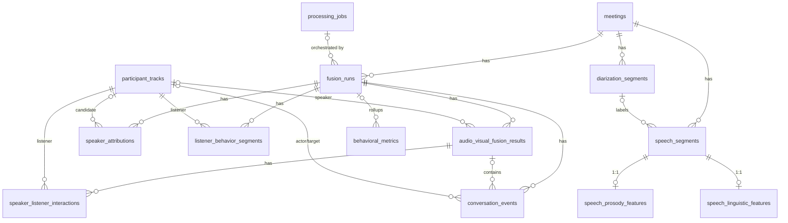

# 16 — Database Schema: Speech, Diarization, Attribution, Listener and Fusion Layer

**Project:** NTS meeting intelligence
**Target:** PostgreSQL 15 · SQLAlchemy 2.0 (async, asyncpg) · Alembic
**Companion:** `15_AUDIO_VISUAL_FUSION.md` (semantics, algorithms, API)
**Rule:** extend the existing schema; do not duplicate existing entities.

---

## 0. Scope and assumptions

I only have the project history summary, not the actual models. **Verify these before writing migrations:**

| # | Assumption | If wrong |
|---|---|---|
| A1 | PKs of `meetings`, `participant_tracks`, `processing_jobs`, `users` are `UUID` | Change FK column types |
| A2 | `Base` is a shared `DeclarativeBase`; I add a `naming_convention` if it is missing (§10.1) | Constraint names will differ; adjust drop/rename ops |
| A3 | `feature_extractions` stores per-frame/window CV rows with a timestamp and `participant_track_id` | Adjust §6.3 |
| A4 | `behavioral_metrics` holds named per-participant (and possibly per-meeting) aggregate metrics | Adjust §6.1 |
| A5 | `processing_jobs.job_type` is `VARCHAR` (or native PG enum, see §6.4) | Native enum needs `ALTER TYPE … ADD VALUE` |
| A6 | Current STT turns / speaking ratios are stored in `feature_extractions` or `behavioral_metrics` | Backfill source in §10.5 |
| A7 | PostgreSQL 15 (from the project history) | `NULLS NOT DISTINCT` (§4.4) requires 15+ |

Naming below uses `participant_tracks.id`, `meetings.id`, `processing_jobs.id`, `users.id`.

---

## 1. Review of the existing architecture and reuse map

| Existing entity | Role today | How this design uses it | Change |
|---|---|---|---|
| `meetings` | Root aggregate; owns media, jobs, tracks | Source-layer tables FK to it. It is the anchor for `fusion_runs` | none |
| `media_assets` | Video/audio/PDF assets | Audio artifact referenced by key in run config. No FK needed | none |
| `processing_jobs` | Job orchestration | Each stage links via `job_id`. New job types (§6.4) | new values only |
| `participant_tracks` | One row per person-track on camera | Target of attributions, listener rows, event actors | none |
| `feature_extractions` | Frame-level CV time series (millions of rows) | **Read-only input** to F0–F4. Not duplicated | optional `pts_ms` (§6.3) |
| `behavioral_metrics` | Aggregated metrics | Receives fusion rollups and speaker baselines (new metric names, no new table) | + nullable `fusion_run_id` |
| `nts_scores` | Final scores | Consumes rollups via `behavioral_metrics` | optional `fusion_run_id` provenance |
| `nts_visual_reports` | Cached LLM reports | Unchanged. Prompt builder may read fusion rollups | none |

**Consequence:** frame-level data stays where it is. The new tables hold only **segment-level and event-level** data, roughly 10⁴–10⁵ rows per 2-hour meeting.

---

## 2. Normalization decisions

Which of the nine requested structures become tables, and which are embedded?

| Requested | Decision | Rationale |
|---|---|---|
| `speech_segments` | **Table** | Core source entity, referenced by prosody, linguistic and turns. Word timings **embedded** as `words JSONB` (not a `words` table: ~10⁴ words/meeting, always read with their segment, never queried alone) |
| `diarization_segments` | **Table** | Raw diarizer output is separate evidence with different boundaries and provenance from ASR. Must stay independent so either can be re-run |
| `speaker_attributions` | **Table**, two scopes (`CLUSTER`/`SEGMENT`) in one table | Stores ranked candidates and manual overrides. A per-cluster mapping row instead of repeating it per segment avoids ~10³ redundant rows |
| `speech_prosody_features` | **Table**, 1:1 with `speech_segments`, shared PK | Produced by a different job (audio DSP), re-runnable independently, and wide (≈25 numeric columns) so keeping it off the hot `speech_segments` rows keeps transcript reads cheap. Frame-level contours go to **MinIO**, not the DB |
| `speech_linguistic_features` | **Table**, 1:1, shared PK | Different producer and versioning (text/NLP models). Same reasoning |
| `listener_behavior_segments` | **Table** | Many per listener, durations, evidence, coverage. Serves as the physical store for `LISTENER_GAZE`/`NOTE_TAKING`/`DISTRACTION` |
| `speaker_listener_interactions` | **Table** (turn × listener) | Queried per listener across turns (e.g., "how did P3 behave over all of P1's turns"). Embedding as JSONB on the turn would block indexing/aggregation |
| `conversation_events` | **Table** | Canonical event store. Listener *states* are **not** copied into it; they are exposed through the `v_conversation_timeline` view (no duplication) |
| `audio_visual_fusion_results` | **Table** (one row per fused turn/gap) | The timeline backbone. Includes a small cached rollup (`prosody_summary`) |

**Added table (not in the request): `fusion_runs`.** It is a small header that carries version, config, clock alignment, coverage, staleness and `is_current`. Without it every derived table would duplicate that metadata, and run replacement/versioning would need ad-hoc logic. All derived tables cascade from it.

**Deliberately not created:**

* no `words` table (embedded JSONB),
* no per-frame audio/mouth/pose tables (MinIO Parquet/NPZ artifacts + existing `feature_extractions`),
* no `speakers` table (a diarization label is an attribute; identity lives in `participant_tracks` via attribution),
* no separate `turns` table (that is `audio_visual_fusion_results`).

### 2.1 Two layers, two lifecycles

| Layer | Tables | Scope | Re-run behavior |
|---|---|---|---|
| **Source layer** (job-scoped) | `diarization_segments`, `speech_segments`, `speech_prosody_features`, `speech_linguistic_features` | `meeting_id` | Replace-by-meeting in one transaction (§9.2). On replace, current fusion run is marked `is_stale` |
| **Derived layer** (run-scoped) | `speaker_attributions`, `listener_behavior_segments`, `audio_visual_fusion_results`, `speaker_listener_interactions`, `conversation_events` | `fusion_run_id` | New `fusion_runs` row per run. Old runs are pruned by cascade |

Derived-layer tables carry **no `meeting_id`**. It is reachable through `fusion_run_id → fusion_runs.meeting_id`. This avoids a redundant column and a redundant index on the largest tables, and it removes any chance of run/meeting mismatch. `meeting_id` is indexed on all source-layer tables and on `fusion_runs`.

---

## 3. Conventions

| Topic | Convention |
|---|---|
| PKs | `UUID`, `DEFAULT gen_random_uuid()` (pgcrypto/core in PG13+). One exception: 1:1 feature tables use the parent's PK as their PK |
| Time | `BIGINT` **milliseconds** on the meeting clock (doc 15 §3). `start_ms >= 0`, `end_ms >= start_ms`. `end_ms IS NULL` = point event. No float seconds in new tables |
| Confidence | `REAL` (float4), `CHECK (x IS NULL OR x BETWEEN 0 AND 1)`. Nullable only when the value can be legitimately unknown (e.g., diarizer gives none) |
| Enumerations | `VARCHAR(n)` with a Python `enum` (SQLAlchemy `Enum(native_enum=False, create_constraint=False)`). No native PG enums and no CHECK: the taxonomy will evolve, and adding a value must not need DDL. Validated in Pydantic/SQLAlchemy |
| JSONB | For bounded, opaque, read-together payloads (`config`, `evidence_refs`, `payload`, `words`). Anything filtered or aggregated is a real column |
| Timestamps | `created_at timestamptz NOT NULL DEFAULT now()` on all. `updated_at` only where rows mutate (`fusion_runs`, `speaker_attributions`). Derived rows are immutable, replace not update |
| FK indexing | Every FK column has an index that **leads** with that column (or a partial index for sparse nullable FKs). Postgres does not create these automatically, and cascade/`SET NULL` actions would seq-scan huge tables without them |
| Cascade | Child → parent `ON DELETE CASCADE` for ownership. `SET NULL` for provenance/optional references (`job_id`, `parent_event_id`, `target_track_id`) |
| Multi-tenancy | No `organization_id` on new tables. Tenant scoping stays in the existing `get_current_org` dependency, resolved via `meeting → project → organization`. If PG-native RLS is adopted later, policies go through `EXISTS` on `fusion_runs/meetings` |

---

## 4. Table specifications

Abbreviations: **PK** primary key · **FK** foreign key · **NN** NOT NULL.

### 4.1 `fusion_runs` (new header)

| Column | Type | Null | Notes |
|---|---|---|---|
| `id` | `uuid` | NN | **PK** |
| `meeting_id` | `uuid` | NN | FK → `meetings.id` **CASCADE** |
| `job_id` | `uuid` | null | FK → `processing_jobs.id` **SET NULL**. The orchestrating job |
| `status` | `varchar(20)` | NN | `PENDING/RUNNING/COMPLETED/FAILED/SUPERSEDED` |
| `is_current` | `boolean` | NN | default `false`. Exactly one `true` per meeting |
| `is_stale` | `boolean` | NN | default `false`. Set when source layer is replaced after this run |
| `fusion_version` | `varchar(32)` | NN | algorithm/schema version |
| `input_hash` | `varchar(64)` | NN | SHA-256 of (source job ids, config, version, optional force nonce) |
| `source_job_ids` | `jsonb` | NN | `{"cv": "...", "stt": "...", "diarization": "..."}` |
| `config` | `jsonb` | NN | thresholds, `spatial_mode`, etc. |
| `clock_alignment` | `jsonb` | null | `{method, offset_ms, drift_ppm, confidence, n_anchors}` |
| `coverage` | `jsonb` | null | per modality/participant coverage and gap list (bounded) |
| `stage_done` | `jsonb` | NN | `{"prepare": "<hash>", "attribution": "<hash>", …}` for idempotent stage retries |
| `error` | `text` | null | |
| `started_at`, `completed_at` | `timestamptz` | null | |
| `created_at` / `updated_at` | `timestamptz` | NN | |

* **Unique:** `(meeting_id, input_hash)` (idempotent run creation). Partial unique `(meeting_id) WHERE is_current` (one current run).
* **Indexes:** `(meeting_id, created_at DESC)`. `(job_id) WHERE job_id IS NOT NULL`.
* **Relationships:** 1 → N to every derived table. `passive_deletes=True` on the ORM side.
* **Confidence fields:** inside `clock_alignment.confidence`. There is no run-level scalar.

### 4.2 `diarization_segments` (source)

| Column | Type | Null | Notes |
|---|---|---|---|
| `id` | `uuid` | NN | **PK** |
| `meeting_id` | `uuid` | NN | FK → `meetings.id` **CASCADE** |
| `job_id` | `uuid` | null | FK → `processing_jobs.id` **SET NULL** |
| `speaker_label` | `varchar(64)` | NN | e.g. `SPEAKER_01`. Raw diarizer label |
| `start_ms`, `end_ms` | `bigint` | NN | `end_ms >= start_ms` |
| `confidence` | `real` | null | Diarizers often give none: null means **unknown**, not 0 |
| `is_overlap` | `boolean` | NN | default `false`. Intersects another label's segment (computed at insert) |
| `source` | `varchar(64)` | NN | model name/version |
| `created_at` | `timestamptz` | NN | |

* **Unique:** `(meeting_id, speaker_label, start_ms, end_ms)` (guards duplicate inserts on retry).
* **Indexes:** `(meeting_id, start_ms)`, `(meeting_id, speaker_label, start_ms)`.
* **Referenced by:** `speech_segments.diarization_segment_id` (SET NULL), `speaker_attributions.diarization_segment_id` (CASCADE).

### 4.3 `speech_segments` (source)

| Column | Type | Null | Notes |
|---|---|---|---|
| `id` | `uuid` | NN | **PK** |
| `meeting_id` | `uuid` | NN | FK → `meetings.id` **CASCADE** |
| `job_id` | `uuid` | null | FK → `processing_jobs.id` **SET NULL** |
| `seq` | `integer` | NN | ordinal within meeting |
| `start_ms`, `end_ms` | `bigint` | NN | ASR boundaries, already split at diarization boundaries via word times |
| `text` | `text` | NN | |
| `language` | `varchar(8)` | null | |
| `asr_confidence` | `real` | null | derived from word probabilities / `exp(avg_logprob)` |
| `avg_logprob`, `no_speech_prob` | `real` | null | raw Whisper diagnostics, kept as evidence |
| `words` | `jsonb` | null | `[{"w":"So","s":10040,"e":10210,"p":0.97}, …]`, ms, bounded per segment |
| `diarization_segment_id` | `uuid` | null | FK → `diarization_segments.id` **SET NULL**. Null = speech with no diarizer label |
| `model_name` | `varchar(64)` | NN | |
| `text_tsv` | `tsvector` | null | *optional* generated column for transcript search |
| `created_at` | `timestamptz` | NN | |

* **Unique:** `(meeting_id, seq)`.
* **Indexes:** `(meeting_id, start_ms)`; `(diarization_segment_id) WHERE diarization_segment_id IS NOT NULL` (FK action support); optional GIN on `text_tsv`.
* **Relationships:** 1:1 to prosody and linguistic (`uselist=False`), N:1 to diarization segment.
* **Speaker of a segment** is not stored here. It is derived through the diarization segment and the current attribution (view §5.1), so re-attribution never rewrites transcript rows.

### 4.4 `speaker_attributions` (derived)

| Column | Type | Null | Notes |
|---|---|---|---|
| `id` | `uuid` | NN | **PK** |
| `fusion_run_id` | `uuid` | NN | FK → `fusion_runs.id` **CASCADE** |
| `scope` | `varchar(16)` | NN | `CLUSTER` or `SEGMENT` |
| `speaker_label` | `varchar(64)` | NN | diarization label |
| `diarization_segment_id` | `uuid` | null | FK → `diarization_segments.id` **CASCADE**. NN iff `scope='SEGMENT'` |
| `participant_track_id` | `uuid` | null | FK → `participant_tracks.id` **CASCADE**. Null = candidate "no visible person" |
| `rank` | `smallint` | NN | 1 = best candidate |
| `is_selected` | `boolean` | NN | the chosen row. A selected row with a null track = explicit `UNATTRIBUTED` decision |
| `method` | `varchar(24)` | NN | `AV_SYNC/FACE_ROI/ROOM_GEOMETRY/PRIOR/MANUAL` |
| `confidence` | `real` | NN | `[0,1]`. Manual = 1.0 |
| `score_components` | `jsonb` | null | `{sync_score, margin, face_conf, coverage, n_frames}` |
| `created_by_user_id` | `uuid` | null | FK → `users.id` **SET NULL**. Manual overrides only |
| `created_at`, `updated_at` | `timestamptz` | NN | |

* **Checks:** `(scope = 'SEGMENT') = (diarization_segment_id IS NOT NULL)`; confidence range; `rank >= 1`.
* **Unique:**
  * candidate uniqueness `(fusion_run_id, scope, speaker_label, diarization_segment_id, participant_track_id, method)` with **`NULLS NOT DISTINCT`** (PG15+, so nullable columns actually participate);
  * partial `(fusion_run_id, speaker_label) WHERE scope='CLUSTER' AND is_selected`, one selected cluster mapping;
  * partial `(fusion_run_id, diarization_segment_id) WHERE scope='SEGMENT' AND is_selected`.
* **Indexes:** `(fusion_run_id, speaker_label)`; `(participant_track_id, fusion_run_id) WHERE participant_track_id IS NOT NULL`; `(diarization_segment_id) WHERE diarization_segment_id IS NOT NULL`.
* **Resolution rule:** selected `SEGMENT` row (if any, even with null track) overrides the selected `CLUSTER` row.
* **Manual overrides** create a new `MANUAL` row, flip `is_selected` on the row it replaces, and trigger a partial re-run of F4→F5. They must be carried forward into every new run (copied from the previous run's `MANUAL` rows in F3, so a re-run never loses human corrections).

### 4.5 `speech_prosody_features` (source, 1:1)

| Column | Type | Null | Notes |
|---|---|---|---|
| `speech_segment_id` | `uuid` | NN | **PK** and FK → `speech_segments.id` **CASCADE** |
| `f0_mean_hz`, `f0_median_hz`, `f0_std_hz`, `f0_min_hz`, `f0_max_hz` | `real` | null | null if no voiced frames |
| `f0_range_st` | `real` | null | 5–95th percentile, semitones |
| `f0_terminal_slope_st_per_s` | `real` | null | last ~300 ms slope (question boost) |
| `voiced_ratio` | `real` | null | |
| `voiced_frames` | `integer` | null | |
| `speech_rate_wps`, `articulation_rate_wps`, `syllable_rate_sps` | `real` | null | |
| `pause_count` | `smallint` | null | |
| `pause_time_ms`, `longest_pause_ms` | `integer` | null | |
| `pause_ratio` | `real` | null | `[0,1]` |
| `energy_mean_db`, `energy_std_db`, `energy_peak_db` | `real` | null | dBFS (relative) |
| `jitter_local`, `shimmer_local`, `hnr_db` | `real` | null | unreliable on short/overlapped speech, hence nullable |
| `snr_db` | `real` | null | |
| `overlap_fraction` | `real` | null | fraction of segment overlapping other speech |
| `reliability` | `real` | NN | `[0,1]`. Combined voiced frames × SNR × (1 − overlap) |
| `contour_artifact_key` | `text` | null | MinIO key of 100 Hz F0/energy contour |
| `extractor`, `extractor_version` | `varchar(32)` | NN | |
| `job_id` | `uuid` | null | FK → `processing_jobs.id` **SET NULL** |
| `created_at` | `timestamptz` | NN | |

* **Indexes:** none beyond the PK (reads are always by segment id via join). `job_id` partial index only if needed for cleanup.
* **Checks:** ratio columns in `[0,1]`; rates `>= 0`.
* **Speaker baselines are not stored here.** They go to `behavioral_metrics` (§6.1).

### 4.6 `speech_linguistic_features` (source, 1:1)

| Column | Type | Null | Notes |
|---|---|---|---|
| `speech_segment_id` | `uuid` | NN | **PK** and FK → `speech_segments.id` **CASCADE** |
| `word_count` | `integer` | NN | |
| `is_question` | `boolean` | null | null = classifier not run / undecided |
| `question_type` | `varchar(16)` | null | `YES_NO/WH/TAG/OTHER` |
| `speech_act` | `varchar(24)` | null | `STATEMENT/QUESTION/ANSWER/AGREE/DISAGREE/DIRECTIVE/ACK/OTHER` |
| `speech_act_confidence` | `real` | null | |
| `sentiment` | `real` | null | −1..1 |
| `agreement_score`, `disagreement_score` | `real` | null | `[0,1]` cue strengths |
| `is_backchannel` | `boolean` | null | |
| `backchannel_score` | `real` | null | |
| `hedge_count`, `filler_count` | `smallint` | null | |
| `addressee_track_id` | `uuid` | null | FK → `participant_tracks.id` **SET NULL**. Name-mention resolution |
| `mentions` | `jsonb` | null | `[{"text":"Priya","span":[12,17],"track_id":"…"}]` |
| `extra` | `jsonb` | null | model-specific scores (not queried) |
| `confidence` | `real` | null | overall classifier confidence |
| `model_name`, `model_version` | `varchar(64)` | NN | |
| `job_id` | `uuid` | null | FK → `processing_jobs.id` **SET NULL** |
| `created_at` | `timestamptz` | NN | |

* **Indexes:** `(addressee_track_id) WHERE addressee_track_id IS NOT NULL`.
* **Checks:** confidence, ratio and sentiment ranges.

### 4.7 `listener_behavior_segments` (derived)

| Column | Type | Null | Notes |
|---|---|---|---|
| `id` | `uuid` | NN | **PK** |
| `fusion_run_id` | `uuid` | NN | FK → `fusion_runs.id` **CASCADE** |
| `participant_track_id` | `uuid` | NN | FK → `participant_tracks.id` **CASCADE** |
| `start_ms`, `end_ms` | `bigint` | NN | |
| `behavior_type` | `varchar(32)` | NN | `SPEAKER_ORIENTED/NOTE_TAKING/DISTRACTED/NEUTRAL/UNKNOWN` |
| `target_track_id` | `uuid` | null | FK → `participant_tracks.id` **SET NULL**. Gaze/orientation target |
| `confidence` | `real` | NN | mean label probability over the segment |
| `label_probs` | `jsonb` | null | includes `UNKNOWN` mass |
| `coverage` | `real` | NN | non-interpolated observed fraction |
| `interpolated_ratio` | `real` | NN | default 0. Share of samples interpolated (informational) |
| `mean_frame_conf` | `real` | null | |
| `features` | `jsonb` | null | window feature summary (`on_target_ratio`, `pitch_mean`, …) |
| `evidence_refs` | `jsonb` | NN | default `[]`. Bounded |
| `created_at` | `timestamptz` | NN | |

* **Indexes:** `(fusion_run_id, start_ms)`; `(participant_track_id, fusion_run_id, start_ms)`; `(fusion_run_id, behavior_type, start_ms)`; `(target_track_id) WHERE target_track_id IS NOT NULL`.
* **Checks:** time order; confidence, coverage, ratio ranges.
* Segments of one listener may not overlap for the same `behavior_type` (enforced in the state machine, verified by the integrity check §13.2; an exclusion constraint on `int8range` would need `btree_gist` and costs write time, so it isn't enforced in the DB).
* `NEUTRAL`/`UNKNOWN` are stored so that **absence of a segment never means anything**. Time not covered by any row is genuinely unprocessed.

### 4.8 `audio_visual_fusion_results` (derived, the turn/gap backbone)

| Column | Type | Null | Notes |
|---|---|---|---|
| `id` | `uuid` | NN | **PK** |
| `fusion_run_id` | `uuid` | NN | FK → `fusion_runs.id` **CASCADE** |
| `seq` | `integer` | NN | order within run |
| `kind` | `varchar(24)` | NN | `TURN/GAP/UNATTRIBUTED_SPEECH` |
| `start_ms`, `end_ms` | `bigint` | NN | |
| `speaker_track_id` | `uuid` | null | FK → `participant_tracks.id` **SET NULL** |
| `speaker_label` | `varchar(64)` | null | kept even when attributed (turn display) |
| `speech_segment_ids` | `uuid[]` | NN | default `'{}'`, ordered. No FK possible on arrays (integrity check §13.2). Transcript is joined at read time, **not copied** |
| `prosody_summary` | `jsonb` | null | duration-weighted rollup (cached, derived, see below) |
| `linguistic_summary` | `jsonb` | null | question flag, speech act, sentiment |
| `mouth_activity` | `real` | null | speaker's active-mouth fraction over valid frames |
| `face_confidence` | `real` | null | mean detection confidence, non-interpolated |
| `visual_coverage` | `real` | null | null = no video, distinct from 0 = video present but no valid frames |
| `audio_coverage` | `real` | null | |
| `attribution_confidence` | `real` | null | |
| `overall_confidence` | `real` | NN | |
| `quality_flags` | `text[]` | NN | default `'{}'` (`VIDEO_GAP`, `AMBIGUOUS_ATTRIBUTION`, …) |
| `payload` | `jsonb` | NN | `{"schema_version":1,"evidence_refs":[…], …}` |
| `created_at` | `timestamptz` | NN | |

* **Unique:** `(fusion_run_id, seq)`.
* **Indexes:** `(fusion_run_id, start_ms)`; `(speaker_track_id, fusion_run_id, start_ms) WHERE speaker_track_id IS NOT NULL`.
* **Duplication note:** `prosody_summary` is the only intentionally duplicated data (a cached rollup of `speech_prosody_features` rows). Reason: duration-weighted aggregation across N segments per turn per request is wasteful for timeline pages, and the rollup is versioned with the run so it cannot go stale relative to attribution/turn boundaries. Source rows stay authoritative.
* Columns (not JSONB) are used for values that get filtered/sorted (`overall_confidence`, `attribution_confidence`, `visual_coverage`).

### 4.9 `speaker_listener_interactions` (derived, turn × listener)

| Column | Type | Null | Notes |
|---|---|---|---|
| `id` | `uuid` | NN | **PK** |
| `fusion_result_id` | `uuid` | NN | FK → `audio_visual_fusion_results.id` **CASCADE** |
| `listener_track_id` | `uuid` | NN | FK → `participant_tracks.id` **CASCADE** |
| `top_label` | `varchar(32)` | NN | |
| `top_probability` | `real` | NN | the "82%" in the UI |
| `label_probs` | `jsonb` | NN | includes `UNKNOWN` |
| `reliability` | `real` | NN | coverage × mean frame conf |
| `coverage` | `real` | NN | |
| `interpolated_ratio` | `real` | NN | default 0 |
| `on_target_ratio` | `real` | null | |
| `mutual_gaze_ratio` | `real` | null | speaker looking at listener |
| `nod_count`, `gaze_shift_count` | `smallint` | NN | default 0 |
| `response_latency_ms` | `integer` | null | if this listener speaks next |
| `features` | `jsonb` | null | |
| `evidence_refs` | `jsonb` | NN | default `[]` |
| `created_at` | `timestamptz` | NN | |

* **Unique:** `(fusion_result_id, listener_track_id)`. This also serves as the FK-support index for `fusion_result_id`.
* **Indexes:** `(listener_track_id, fusion_result_id)`.
* **No `fusion_run_id`, no times.** Both come from the parent turn (join). This avoids duplicating two columns × 10⁵ rows. The run-level delete cascades run → results → interactions.
* Speaker is derived from the parent (`speaker_track_id`), not copied.

### 4.10 `conversation_events` (derived, canonical event store)

| Column | Type | Null | Notes |
|---|---|---|---|
| `id` | `uuid` | NN | **PK** |
| `fusion_run_id` | `uuid` | NN | FK → `fusion_runs.id` **CASCADE** |
| `fusion_result_id` | `uuid` | null | FK → `audio_visual_fusion_results.id` **SET NULL**. Containing turn |
| `event_type` | `varchar(40)` | NN | `SPEECH_START … DATA_GAP` (doc 15 §5.2) |
| `start_ms` | `bigint` | NN | |
| `end_ms` | `bigint` | null | null = point event |
| `time_uncertainty_ms` | `integer` | NN | default 0 |
| `actor_track_id` | `uuid` | null | FK → `participant_tracks.id` **SET NULL** |
| `actor_speaker_label` | `varchar(64)` | null | when unattributed |
| `target_track_id` | `uuid` | null | FK → `participant_tracks.id` **SET NULL** |
| `target_speaker_label` | `varchar(64)` | null | |
| `confidence` | `real` | NN | **event** confidence |
| `actor_confidence` | `real` | null | attribution confidence of the actor |
| `confidence_components` | `jsonb` | null | |
| `source_kind` | `varchar(16)` | NN | `SPEECH/DIARIZATION/CV/FUSION_RULE/MANUAL` |
| `parent_event_id` | `uuid` | null | self-FK **SET NULL** (RESPONSE→QUESTION) |
| `suppressed_by_event_id` | `uuid` | null | self-FK **SET NULL**. Conflict-resolution loser, kept for audit |
| `payload` | `jsonb` | NN | default `{}` |
| `evidence_refs` | `jsonb` | NN | default `[]` |
| `quality_flags` | `text[]` | NN | default `'{}'` |
| `created_at` | `timestamptz` | NN | |

* **Checks:** `end_ms IS NULL OR end_ms >= start_ms`; confidence ranges.
* **Indexes:**
  1. `(fusion_run_id, start_ms)`: timeline slice.
  2. `(fusion_run_id, event_type, start_ms)`: "all QUESTIONs".
  3. `(actor_track_id, fusion_run_id, start_ms) WHERE actor_track_id IS NOT NULL`.
  4. `(target_track_id) WHERE target_track_id IS NOT NULL`.
  5. `(fusion_result_id, start_ms) WHERE fusion_result_id IS NOT NULL`.
  6. `(parent_event_id) WHERE parent_event_id IS NOT NULL`.
  7. `(suppressed_by_event_id) WHERE suppressed_by_event_id IS NOT NULL` (tiny).
* This is the hottest table. Indexes 4, 6, 7 are partial and sparse, so cheap. If write amplification matters, indexes 4/6/7 are the first candidates to drop, replacing DB-level FKs with application integrity plus `ON DELETE` handled by run-level cascade.
* Event **class** (POINT/INTERVAL) is derived from `end_ms IS NULL`, not stored.
* Listener states (`LISTENER_GAZE`, `NOTE_TAKING`, `DISTRACTION`) are **not** written here. See view §5.2.

---

## 5. Views

### 5.1 `v_speech_segments_attributed`

Speech segments for the **current** run with the resolved speaker identity. A selected `SEGMENT` row wins even when its track is null (an explicit "unattributed" decision), which is why `CASE` is used instead of `COALESCE`.

```sql
CREATE VIEW v_speech_segments_attributed AS
SELECT
    s.id AS speech_segment_id, s.meeting_id, s.seq, s.start_ms, s.end_ms, s.text,
    s.asr_confidence, d.speaker_label, fr.id AS fusion_run_id,
    CASE WHEN sa_seg.id IS NOT NULL THEN sa_seg.participant_track_id
         ELSE sa_cl.participant_track_id END AS participant_track_id,
    CASE WHEN sa_seg.id IS NOT NULL THEN sa_seg.confidence
         ELSE sa_cl.confidence END           AS attribution_confidence
FROM speech_segments s
LEFT JOIN diarization_segments d ON d.id = s.diarization_segment_id
JOIN fusion_runs fr ON fr.meeting_id = s.meeting_id AND fr.is_current
LEFT JOIN speaker_attributions sa_seg
       ON sa_seg.fusion_run_id = fr.id AND sa_seg.scope = 'SEGMENT'
      AND sa_seg.diarization_segment_id = d.id AND sa_seg.is_selected
LEFT JOIN speaker_attributions sa_cl
       ON sa_cl.fusion_run_id = fr.id AND sa_cl.scope = 'CLUSTER'
      AND sa_cl.speaker_label = d.speaker_label AND sa_cl.is_selected;
```

### 5.2 `v_conversation_timeline` (uniform event stream)

Exposes physical `conversation_events` plus listener states as canonical events. **No data is copied.**

```sql
CREATE VIEW v_conversation_timeline AS
SELECT e.fusion_run_id,
       'evt:' || e.id::text AS item_id, 'conversation_events' AS source_table,
       e.event_type, e.start_ms, e.end_ms,
       e.actor_track_id, e.target_track_id, e.confidence
FROM conversation_events e
WHERE e.suppressed_by_event_id IS NULL
UNION ALL
SELECT l.fusion_run_id,
       'lbs:' || l.id::text, 'listener_behavior_segments',
       CASE l.behavior_type WHEN 'SPEAKER_ORIENTED' THEN 'LISTENER_GAZE'
                            WHEN 'NOTE_TAKING'      THEN 'NOTE_TAKING'
                            WHEN 'DISTRACTED'       THEN 'DISTRACTION' END,
       l.start_ms, l.end_ms,
       l.participant_track_id, l.target_track_id, l.confidence
FROM listener_behavior_segments l
WHERE l.behavior_type IN ('SPEAKER_ORIENTED','NOTE_TAKING','DISTRACTED');
```

Always query with `fusion_run_id = :run AND start_ms BETWEEN …`; Postgres pushes both predicates into each branch and uses the per-table indexes. Suppressed events are hidden by default. For "include suppressed", query the base table.

Regular (non-materialized) views: the data is run-immutable and slice-queried, so materializing would add storage and refresh work for no benefit.

---

## 6. Changes to existing tables (additive only)

### 6.1 `behavioral_metrics`

* Add `fusion_run_id uuid NULL` → `fusion_runs.id` **ON DELETE SET NULL**, with partial index `(fusion_run_id) WHERE fusion_run_id IS NOT NULL`.
* Fusion rollups are written as new `metric_name` values (no schema change), for example: `speech.f0_baseline_median_hz`, `speech.f0_baseline_mad_hz`, `speech.rate_baseline_wps`, `speech.pause_ratio_baseline`, `interaction.questions_asked`, `interaction.interruptions_made`, `interaction.interruptions_received`, `interaction.responses_latency_median_ms`, `listener.oriented_ratio_weighted`, `listener.note_taking_ratio_weighted`, `listener.nod_rate_per_min`. Coverage-weighted means also record a `coverage` value in the existing confidence/metadata columns (if it has any) or in the same metric's `details` JSON.
* **Check the existing uniqueness constraint** on `behavioral_metrics` (likely on `(meeting_id, participant_track_id, metric_name)`). If it exists, either include `fusion_run_id` in it, or delete previous fusion-produced metrics for the meeting before the rollup insert (the safe default under the replace-by-run strategy: `DELETE … WHERE meeting_id = :m AND metric_name LIKE 'speech.%' OR …`, done via a `source` column or the `fusion_run_id IS NOT NULL` marker).

### 6.2 `nts_scores`

Optional: add `fusion_run_id uuid NULL` (SET NULL) so a score can be traced to the run whose rollups fed it. No structural dependency, since scoring reads `behavioral_metrics`.

### 6.3 `feature_extractions`

No new columns are required by fusion. **If** frames are timestamped by frame index or float seconds only, add `pts_ms bigint NULL` (nullable, no default: metadata-only change, instant) and let the CV worker populate it going forward. Fusion prefers `pts_ms` and falls back to `frame_index / fps` with a `VFR_UNCERTAIN` flag on that meeting. Confirm an index of the form `(participant_track_id, <time column>)` exists, since fusion streams by track and time. If not, add it `CONCURRENTLY` (§10.3).

### 6.4 `processing_jobs`

Add job types `FUSION_PREPARE`, `SPEECH_PROSODY`, `SPEECH_LINGUISTIC`, `SPEAKER_ATTRIBUTION`, `LISTENER_ANALYSIS`, `FUSION_ASSEMBLE`. If `job_type` is a `VARCHAR`, this needs no DDL. If it is a native PG enum, use, in an autocommit block:

```python
with op.get_context().autocommit_block():
    for v in ("FUSION_PREPARE", "SPEECH_PROSODY", ...):
        op.execute(f"ALTER TYPE job_type ADD VALUE IF NOT EXISTS '{v}'")
```

`ADD VALUE` cannot run inside a transaction block on older PG, and new values cannot be used in the same transaction, so this is a separate revision (§10.2, R4).

### 6.5 Untouched

`meetings`, `media_assets`, `participant_tracks`, `users`, `nts_visual_reports`.

---

## 7. Entity relationships



### 7.1 Cascade summary

| Deleting… | Cascades to |
|---|---|
| `meetings` row | `fusion_runs` → all derived tables; `diarization_segments`; `speech_segments` → prosody, linguistic. Also `participant_tracks` (existing) → derived rows that reference tracks |
| `fusion_runs` row | all five derived tables (results → interactions; events; listener segments; attributions) |
| `speech_segments` row | prosody, linguistic (CASCADE). Turn `speech_segment_ids` arrays are not FK-enforced, so mark the run stale (§9.2) |
| `diarization_segments` row | `speaker_attributions` (SEGMENT scope) CASCADE. `speech_segments.diarization_segment_id` SET NULL |
| `participant_tracks` row | its listener segments and interaction rows CASCADE. Attribution candidate rows CASCADE. Event/turn actor and target references SET NULL |
| `processing_jobs` row | `job_id` columns SET NULL. **Data survives job deletion** |

**Recommended meeting-deletion order** (avoids relying on a very large single cascade): (1) `DELETE FROM fusion_runs WHERE meeting_id = :m` (batched by run), (2) `DELETE FROM speech_segments WHERE meeting_id = :m`, (3) `DELETE FROM diarization_segments WHERE meeting_id = :m`, (4) delete the meeting. Each step uses the indexes above.

---

## 8. SQLAlchemy 2.0 async models

```python
# app/models/speech_fusion.py
from __future__ import annotations

import enum
import uuid
from datetime import datetime
from typing import Any

from sqlalchemy import (
    BigInteger, Boolean, CheckConstraint, Computed, DateTime, Enum, ForeignKey, Index,
    Integer, SmallInteger, String, Text, UniqueConstraint, func, text,
)
from sqlalchemy.dialects.postgresql import ARRAY, JSONB, REAL, TSVECTOR, UUID
from sqlalchemy.orm import Mapped, mapped_column, relationship

from app.db.base import Base  # existing DeclarativeBase (with naming_convention, see §10.1)


# ---------- helpers ----------
def pk() -> Mapped[uuid.UUID]:
    return mapped_column(UUID(as_uuid=True), primary_key=True, default=uuid.uuid4,
                         server_default=text("gen_random_uuid()"))

def fk(target: str, ondelete: str, nullable: bool = False, **kw):
    return mapped_column(UUID(as_uuid=True), ForeignKey(target, ondelete=ondelete),
                         nullable=nullable, **kw)

def str_enum(e: type[enum.Enum], length: int = 32) -> Enum:
    # VARCHAR + Python-side validation; no native enum, no CHECK (taxonomy evolves without DDL)
    return Enum(e, native_enum=False, length=length, create_constraint=False,
                validate_strings=True, values_callable=lambda x: [m.value for m in x])

def rng(col: str) -> CheckConstraint:                # [0,1] or NULL
    return CheckConstraint(f"{col} IS NULL OR ({col} >= 0 AND {col} <= 1)", name=f"{col}_range")

def time_order() -> CheckConstraint:
    return CheckConstraint("start_ms >= 0 AND end_ms >= start_ms", name="time_order")

JSONB_OBJ = text("'{}'::jsonb")
JSONB_ARR = text("'[]'::jsonb")
TEXT_ARR = text("'{}'::text[]")

class CreatedAt:
    created_at: Mapped[datetime] = mapped_column(
        DateTime(timezone=True), server_default=func.now(), nullable=False)


# ---------- enums ----------
class FusionStatus(str, enum.Enum):
    PENDING = "PENDING"; RUNNING = "RUNNING"; COMPLETED = "COMPLETED"
    FAILED = "FAILED"; SUPERSEDED = "SUPERSEDED"

class AttributionScope(str, enum.Enum):
    CLUSTER = "CLUSTER"; SEGMENT = "SEGMENT"

class AttributionMethod(str, enum.Enum):
    AV_SYNC = "AV_SYNC"; FACE_ROI = "FACE_ROI"; ROOM_GEOMETRY = "ROOM_GEOMETRY"
    PRIOR = "PRIOR"; MANUAL = "MANUAL"

class ListenerBehavior(str, enum.Enum):
    SPEAKER_ORIENTED = "SPEAKER_ORIENTED"; NOTE_TAKING = "NOTE_TAKING"
    DISTRACTED = "DISTRACTED"; NEUTRAL = "NEUTRAL"; UNKNOWN = "UNKNOWN"

class EventType(str, enum.Enum):
    SPEECH_START = "SPEECH_START"; SPEECH_END = "SPEECH_END"; SPEAKER_CHANGE = "SPEAKER_CHANGE"
    OVERLAP_START = "OVERLAP_START"; OVERLAP_END = "OVERLAP_END"; QUESTION = "QUESTION"
    INTERRUPTION = "INTERRUPTION"; RESPONSE = "RESPONSE"; LISTENER_NOD = "LISTENER_NOD"
    LISTENER_GAZE = "LISTENER_GAZE"; NOTE_TAKING = "NOTE_TAKING"; DISTRACTION = "DISTRACTION"
    AGREEMENT = "AGREEMENT"; DISAGREEMENT = "DISAGREEMENT"; BACKCHANNEL = "BACKCHANNEL"
    LONG_PAUSE = "LONG_PAUSE"; ADDRESSEE_MENTION = "ADDRESSEE_MENTION"; DATA_GAP = "DATA_GAP"

class TurnKind(str, enum.Enum):
    TURN = "TURN"; GAP = "GAP"; UNATTRIBUTED_SPEECH = "UNATTRIBUTED_SPEECH"


# ---------- fusion_runs ----------
class FusionRun(CreatedAt, Base):
    __tablename__ = "fusion_runs"
    id: Mapped[uuid.UUID] = pk()
    meeting_id: Mapped[uuid.UUID] = fk("meetings.id", "CASCADE")
    job_id: Mapped[uuid.UUID | None] = fk("processing_jobs.id", "SET NULL", nullable=True)
    status: Mapped[FusionStatus] = mapped_column(str_enum(FusionStatus, 20),
                                                 default=FusionStatus.PENDING, nullable=False)
    is_current: Mapped[bool] = mapped_column(Boolean, nullable=False, server_default=text("false"))
    is_stale: Mapped[bool] = mapped_column(Boolean, nullable=False, server_default=text("false"))
    fusion_version: Mapped[str] = mapped_column(String(32), nullable=False)
    input_hash: Mapped[str] = mapped_column(String(64), nullable=False)
    source_job_ids: Mapped[dict[str, Any]] = mapped_column(JSONB, nullable=False, server_default=JSONB_OBJ)
    config: Mapped[dict[str, Any]] = mapped_column(JSONB, nullable=False, server_default=JSONB_OBJ)
    clock_alignment: Mapped[dict[str, Any] | None] = mapped_column(JSONB)
    coverage: Mapped[dict[str, Any] | None] = mapped_column(JSONB)
    stage_done: Mapped[dict[str, Any]] = mapped_column(JSONB, nullable=False, server_default=JSONB_OBJ)
    error: Mapped[str | None] = mapped_column(Text)
    started_at: Mapped[datetime | None] = mapped_column(DateTime(timezone=True))
    completed_at: Mapped[datetime | None] = mapped_column(DateTime(timezone=True))
    updated_at: Mapped[datetime] = mapped_column(DateTime(timezone=True), server_default=func.now(),
                                                 onupdate=func.now(), nullable=False)

    # lazy="raise": async sessions must load explicitly (selectinload / separate query)
    turns: Mapped[list["FusionResult"]] = relationship(
        back_populates="run", cascade="all, delete-orphan", passive_deletes=True, lazy="raise")
    events: Mapped[list["ConversationEvent"]] = relationship(
        back_populates="run", cascade="all, delete-orphan", passive_deletes=True, lazy="raise")

    __table_args__ = (
        UniqueConstraint("meeting_id", "input_hash", name="uq_meeting_input"),
        Index("uq_fusion_runs_one_current", "meeting_id", unique=True, postgresql_where=text("is_current")),
        Index("ix_fusion_runs_meeting_created", "meeting_id", text("created_at DESC")),
        Index("ix_fusion_runs_job", "job_id", postgresql_where=text("job_id IS NOT NULL")),
    )


# ---------- source layer ----------
class DiarizationSegment(CreatedAt, Base):
    __tablename__ = "diarization_segments"
    id: Mapped[uuid.UUID] = pk()
    meeting_id: Mapped[uuid.UUID] = fk("meetings.id", "CASCADE")
    job_id: Mapped[uuid.UUID | None] = fk("processing_jobs.id", "SET NULL", nullable=True)
    speaker_label: Mapped[str] = mapped_column(String(64), nullable=False)
    start_ms: Mapped[int] = mapped_column(BigInteger, nullable=False)
    end_ms: Mapped[int] = mapped_column(BigInteger, nullable=False)
    confidence: Mapped[float | None] = mapped_column(REAL)
    is_overlap: Mapped[bool] = mapped_column(Boolean, nullable=False, server_default=text("false"))
    source: Mapped[str] = mapped_column(String(64), nullable=False)

    __table_args__ = (
        time_order(), rng("confidence"),
        UniqueConstraint("meeting_id", "speaker_label", "start_ms", "end_ms", name="uq_natural"),
        Index("ix_diar_meeting_start", "meeting_id", "start_ms"),
        Index("ix_diar_meeting_speaker_start", "meeting_id", "speaker_label", "start_ms"),
    )


class SpeechSegment(CreatedAt, Base):
    __tablename__ = "speech_segments"
    id: Mapped[uuid.UUID] = pk()
    meeting_id: Mapped[uuid.UUID] = fk("meetings.id", "CASCADE")
    job_id: Mapped[uuid.UUID | None] = fk("processing_jobs.id", "SET NULL", nullable=True)
    seq: Mapped[int] = mapped_column(Integer, nullable=False)
    start_ms: Mapped[int] = mapped_column(BigInteger, nullable=False)
    end_ms: Mapped[int] = mapped_column(BigInteger, nullable=False)
    text: Mapped[str] = mapped_column(Text, nullable=False)
    language: Mapped[str | None] = mapped_column(String(8))
    asr_confidence: Mapped[float | None] = mapped_column(REAL)
    avg_logprob: Mapped[float | None] = mapped_column(REAL)
    no_speech_prob: Mapped[float | None] = mapped_column(REAL)
    words: Mapped[list[dict[str, Any]] | None] = mapped_column(JSONB)
    diarization_segment_id: Mapped[uuid.UUID | None] = fk(
        "diarization_segments.id", "SET NULL", nullable=True)
    model_name: Mapped[str] = mapped_column(String(64), nullable=False)
    text_tsv = mapped_column(TSVECTOR, Computed("to_tsvector('simple', text)", persisted=True))  # optional

    prosody: Mapped["SpeechProsodyFeatures | None"] = relationship(
        back_populates="segment", uselist=False, cascade="all, delete-orphan",
        passive_deletes=True, lazy="raise")
    linguistic: Mapped["SpeechLinguisticFeatures | None"] = relationship(
        back_populates="segment", uselist=False, cascade="all, delete-orphan",
        passive_deletes=True, lazy="raise")

    __table_args__ = (
        time_order(), rng("asr_confidence"), rng("no_speech_prob"),
        UniqueConstraint("meeting_id", "seq", name="uq_meeting_seq"),
        Index("ix_speech_meeting_start", "meeting_id", "start_ms"),
        Index("ix_speech_diar", "diarization_segment_id",
              postgresql_where=text("diarization_segment_id IS NOT NULL")),
        Index("ix_speech_tsv", "text_tsv", postgresql_using="gin"),   # optional
    )


class SpeechProsodyFeatures(CreatedAt, Base):
    __tablename__ = "speech_prosody_features"
    speech_segment_id: Mapped[uuid.UUID] = mapped_column(
        UUID(as_uuid=True), ForeignKey("speech_segments.id", ondelete="CASCADE"), primary_key=True)
    f0_mean_hz: Mapped[float | None] = mapped_column(REAL)
    f0_median_hz: Mapped[float | None] = mapped_column(REAL)
    f0_std_hz: Mapped[float | None] = mapped_column(REAL)
    f0_min_hz: Mapped[float | None] = mapped_column(REAL)
    f0_max_hz: Mapped[float | None] = mapped_column(REAL)
    f0_range_st: Mapped[float | None] = mapped_column(REAL)
    f0_terminal_slope_st_per_s: Mapped[float | None] = mapped_column(REAL)
    voiced_ratio: Mapped[float | None] = mapped_column(REAL)
    voiced_frames: Mapped[int | None] = mapped_column(Integer)
    speech_rate_wps: Mapped[float | None] = mapped_column(REAL)
    articulation_rate_wps: Mapped[float | None] = mapped_column(REAL)
    syllable_rate_sps: Mapped[float | None] = mapped_column(REAL)
    pause_count: Mapped[int | None] = mapped_column(SmallInteger)
    pause_time_ms: Mapped[int | None] = mapped_column(Integer)
    longest_pause_ms: Mapped[int | None] = mapped_column(Integer)
    pause_ratio: Mapped[float | None] = mapped_column(REAL)
    energy_mean_db: Mapped[float | None] = mapped_column(REAL)
    energy_std_db: Mapped[float | None] = mapped_column(REAL)
    energy_peak_db: Mapped[float | None] = mapped_column(REAL)
    jitter_local: Mapped[float | None] = mapped_column(REAL)
    shimmer_local: Mapped[float | None] = mapped_column(REAL)
    hnr_db: Mapped[float | None] = mapped_column(REAL)
    snr_db: Mapped[float | None] = mapped_column(REAL)
    overlap_fraction: Mapped[float | None] = mapped_column(REAL)
    reliability: Mapped[float] = mapped_column(REAL, nullable=False)
    contour_artifact_key: Mapped[str | None] = mapped_column(Text)
    extractor: Mapped[str] = mapped_column(String(32), nullable=False)
    extractor_version: Mapped[str] = mapped_column(String(32), nullable=False)
    job_id: Mapped[uuid.UUID | None] = fk("processing_jobs.id", "SET NULL", nullable=True)

    segment: Mapped[SpeechSegment] = relationship(back_populates="prosody", lazy="raise")
    __table_args__ = (rng("voiced_ratio"), rng("pause_ratio"), rng("overlap_fraction"),
                      rng("reliability"))


class SpeechLinguisticFeatures(CreatedAt, Base):
    __tablename__ = "speech_linguistic_features"
    speech_segment_id: Mapped[uuid.UUID] = mapped_column(
        UUID(as_uuid=True), ForeignKey("speech_segments.id", ondelete="CASCADE"), primary_key=True)
    word_count: Mapped[int] = mapped_column(Integer, nullable=False)
    is_question: Mapped[bool | None] = mapped_column(Boolean)
    question_type: Mapped[str | None] = mapped_column(String(16))
    speech_act: Mapped[str | None] = mapped_column(String(24))
    speech_act_confidence: Mapped[float | None] = mapped_column(REAL)
    sentiment: Mapped[float | None] = mapped_column(REAL)
    agreement_score: Mapped[float | None] = mapped_column(REAL)
    disagreement_score: Mapped[float | None] = mapped_column(REAL)
    is_backchannel: Mapped[bool | None] = mapped_column(Boolean)
    backchannel_score: Mapped[float | None] = mapped_column(REAL)
    hedge_count: Mapped[int | None] = mapped_column(SmallInteger)
    filler_count: Mapped[int | None] = mapped_column(SmallInteger)
    addressee_track_id: Mapped[uuid.UUID | None] = fk(
        "participant_tracks.id", "SET NULL", nullable=True)
    mentions: Mapped[list[dict[str, Any]] | None] = mapped_column(JSONB)
    extra: Mapped[dict[str, Any] | None] = mapped_column(JSONB)
    confidence: Mapped[float | None] = mapped_column(REAL)
    model_name: Mapped[str] = mapped_column(String(64), nullable=False)
    model_version: Mapped[str] = mapped_column(String(64), nullable=False)
    job_id: Mapped[uuid.UUID | None] = fk("processing_jobs.id", "SET NULL", nullable=True)

    segment: Mapped[SpeechSegment] = relationship(back_populates="linguistic", lazy="raise")
    __table_args__ = (
        rng("speech_act_confidence"), rng("agreement_score"), rng("disagreement_score"),
        rng("backchannel_score"), rng("confidence"),
        CheckConstraint("sentiment IS NULL OR (sentiment >= -1 AND sentiment <= 1)", name="sentiment_range"),
        Index("ix_ling_addressee", "addressee_track_id", postgresql_where=text("addressee_track_id IS NOT NULL")),
    )


# ---------- derived layer ----------
class SpeakerAttribution(CreatedAt, Base):
    __tablename__ = "speaker_attributions"
    id: Mapped[uuid.UUID] = pk()
    fusion_run_id: Mapped[uuid.UUID] = fk("fusion_runs.id", "CASCADE")
    scope: Mapped[AttributionScope] = mapped_column(str_enum(AttributionScope, 16), nullable=False)
    speaker_label: Mapped[str] = mapped_column(String(64), nullable=False)
    diarization_segment_id: Mapped[uuid.UUID | None] = fk(
        "diarization_segments.id", "CASCADE", nullable=True)
    participant_track_id: Mapped[uuid.UUID | None] = fk(
        "participant_tracks.id", "CASCADE", nullable=True)
    rank: Mapped[int] = mapped_column(SmallInteger, nullable=False)
    is_selected: Mapped[bool] = mapped_column(Boolean, nullable=False, server_default=text("false"))
    method: Mapped[AttributionMethod] = mapped_column(str_enum(AttributionMethod, 24), nullable=False)
    confidence: Mapped[float] = mapped_column(REAL, nullable=False)
    score_components: Mapped[dict[str, Any] | None] = mapped_column(JSONB)
    created_by_user_id: Mapped[uuid.UUID | None] = fk("users.id", "SET NULL", nullable=True)
    updated_at: Mapped[datetime] = mapped_column(DateTime(timezone=True), server_default=func.now(),
                                                 onupdate=func.now(), nullable=False)

    __table_args__ = (
        rng("confidence"),
        CheckConstraint("rank >= 1", name="rank_positive"),
        CheckConstraint("(scope = 'SEGMENT') = (diarization_segment_id IS NOT NULL)", name="scope_segment"),
        UniqueConstraint("fusion_run_id", "scope", "speaker_label", "diarization_segment_id",
                         "participant_track_id", "method", name="uq_candidate",
                         postgresql_nulls_not_distinct=True),          # PG15+
        Index("uq_attr_selected_cluster", "fusion_run_id", "speaker_label", unique=True,
              postgresql_where=text("scope = 'CLUSTER' AND is_selected")),
        Index("uq_attr_selected_segment", "fusion_run_id", "diarization_segment_id", unique=True,
              postgresql_where=text("scope = 'SEGMENT' AND is_selected")),
        Index("ix_attr_run_label", "fusion_run_id", "speaker_label"),
        Index("ix_attr_track", "participant_track_id", "fusion_run_id",
              postgresql_where=text("participant_track_id IS NOT NULL")),
        Index("ix_attr_diar", "diarization_segment_id",
              postgresql_where=text("diarization_segment_id IS NOT NULL")),
    )


class ListenerBehaviorSegment(CreatedAt, Base):
    __tablename__ = "listener_behavior_segments"
    id: Mapped[uuid.UUID] = pk()
    fusion_run_id: Mapped[uuid.UUID] = fk("fusion_runs.id", "CASCADE")
    participant_track_id: Mapped[uuid.UUID] = fk("participant_tracks.id", "CASCADE")
    start_ms: Mapped[int] = mapped_column(BigInteger, nullable=False)
    end_ms: Mapped[int] = mapped_column(BigInteger, nullable=False)
    behavior_type: Mapped[ListenerBehavior] = mapped_column(str_enum(ListenerBehavior), nullable=False)
    target_track_id: Mapped[uuid.UUID | None] = fk("participant_tracks.id", "SET NULL", nullable=True)
    confidence: Mapped[float] = mapped_column(REAL, nullable=False)
    label_probs: Mapped[dict[str, float] | None] = mapped_column(JSONB)
    coverage: Mapped[float] = mapped_column(REAL, nullable=False)
    interpolated_ratio: Mapped[float] = mapped_column(REAL, nullable=False, server_default=text("0"))
    mean_frame_conf: Mapped[float | None] = mapped_column(REAL)
    features: Mapped[dict[str, Any] | None] = mapped_column(JSONB)
    evidence_refs: Mapped[list[dict[str, Any]]] = mapped_column(JSONB, nullable=False, server_default=JSONB_ARR)

    __table_args__ = (
        time_order(), rng("confidence"), rng("coverage"), rng("interpolated_ratio"), rng("mean_frame_conf"),
        Index("ix_lbs_run_start", "fusion_run_id", "start_ms"),
        Index("ix_lbs_track_run_start", "participant_track_id", "fusion_run_id", "start_ms"),
        Index("ix_lbs_run_type_start", "fusion_run_id", "behavior_type", "start_ms"),
        Index("ix_lbs_target", "target_track_id", postgresql_where=text("target_track_id IS NOT NULL")),
    )


class FusionResult(CreatedAt, Base):
    __tablename__ = "audio_visual_fusion_results"
    id: Mapped[uuid.UUID] = pk()
    fusion_run_id: Mapped[uuid.UUID] = fk("fusion_runs.id", "CASCADE")
    seq: Mapped[int] = mapped_column(Integer, nullable=False)
    kind: Mapped[TurnKind] = mapped_column(str_enum(TurnKind, 24), nullable=False)
    start_ms: Mapped[int] = mapped_column(BigInteger, nullable=False)
    end_ms: Mapped[int] = mapped_column(BigInteger, nullable=False)
    speaker_track_id: Mapped[uuid.UUID | None] = fk("participant_tracks.id", "SET NULL", nullable=True)
    speaker_label: Mapped[str | None] = mapped_column(String(64))
    speech_segment_ids: Mapped[list[uuid.UUID]] = mapped_column(
        ARRAY(UUID(as_uuid=True)), nullable=False, server_default=text("'{}'::uuid[]"))
    prosody_summary: Mapped[dict[str, Any] | None] = mapped_column(JSONB)
    linguistic_summary: Mapped[dict[str, Any] | None] = mapped_column(JSONB)
    mouth_activity: Mapped[float | None] = mapped_column(REAL)
    face_confidence: Mapped[float | None] = mapped_column(REAL)
    visual_coverage: Mapped[float | None] = mapped_column(REAL)
    audio_coverage: Mapped[float | None] = mapped_column(REAL)
    attribution_confidence: Mapped[float | None] = mapped_column(REAL)
    overall_confidence: Mapped[float] = mapped_column(REAL, nullable=False)
    quality_flags: Mapped[list[str]] = mapped_column(ARRAY(String(32)), nullable=False, server_default=TEXT_ARR)
    payload: Mapped[dict[str, Any]] = mapped_column(JSONB, nullable=False, server_default=JSONB_OBJ)

    run: Mapped[FusionRun] = relationship(back_populates="turns", lazy="raise")
    interactions: Mapped[list["SpeakerListenerInteraction"]] = relationship(
        back_populates="turn", cascade="all, delete-orphan", passive_deletes=True, lazy="raise")

    __table_args__ = (
        time_order(), rng("mouth_activity"), rng("face_confidence"), rng("visual_coverage"),
        rng("audio_coverage"), rng("attribution_confidence"), rng("overall_confidence"),
        UniqueConstraint("fusion_run_id", "seq", name="uq_run_seq"),
        Index("ix_avfr_run_start", "fusion_run_id", "start_ms"),
        Index("ix_avfr_speaker_run_start", "speaker_track_id", "fusion_run_id", "start_ms",
              postgresql_where=text("speaker_track_id IS NOT NULL")),
    )


class SpeakerListenerInteraction(CreatedAt, Base):
    __tablename__ = "speaker_listener_interactions"
    id: Mapped[uuid.UUID] = pk()
    fusion_result_id: Mapped[uuid.UUID] = fk("audio_visual_fusion_results.id", "CASCADE")
    listener_track_id: Mapped[uuid.UUID] = fk("participant_tracks.id", "CASCADE")
    top_label: Mapped[ListenerBehavior] = mapped_column(str_enum(ListenerBehavior), nullable=False)
    top_probability: Mapped[float] = mapped_column(REAL, nullable=False)
    label_probs: Mapped[dict[str, float]] = mapped_column(JSONB, nullable=False)
    reliability: Mapped[float] = mapped_column(REAL, nullable=False)
    coverage: Mapped[float] = mapped_column(REAL, nullable=False)
    interpolated_ratio: Mapped[float] = mapped_column(REAL, nullable=False, server_default=text("0"))
    on_target_ratio: Mapped[float | None] = mapped_column(REAL)
    mutual_gaze_ratio: Mapped[float | None] = mapped_column(REAL)
    nod_count: Mapped[int] = mapped_column(SmallInteger, nullable=False, server_default=text("0"))
    gaze_shift_count: Mapped[int] = mapped_column(SmallInteger, nullable=False, server_default=text("0"))
    response_latency_ms: Mapped[int | None] = mapped_column(Integer)
    features: Mapped[dict[str, Any] | None] = mapped_column(JSONB)
    evidence_refs: Mapped[list[dict[str, Any]]] = mapped_column(JSONB, nullable=False, server_default=JSONB_ARR)

    turn: Mapped[FusionResult] = relationship(back_populates="interactions", lazy="raise")
    __table_args__ = (
        rng("top_probability"), rng("reliability"), rng("coverage"), rng("interpolated_ratio"),
        rng("on_target_ratio"), rng("mutual_gaze_ratio"),
        UniqueConstraint("fusion_result_id", "listener_track_id", name="uq_turn_listener"),
        Index("ix_sli_listener_turn", "listener_track_id", "fusion_result_id"),
    )


class ConversationEvent(CreatedAt, Base):
    __tablename__ = "conversation_events"
    id: Mapped[uuid.UUID] = pk()
    fusion_run_id: Mapped[uuid.UUID] = fk("fusion_runs.id", "CASCADE")
    fusion_result_id: Mapped[uuid.UUID | None] = fk(
        "audio_visual_fusion_results.id", "SET NULL", nullable=True)
    event_type: Mapped[EventType] = mapped_column(str_enum(EventType, 40), nullable=False)
    start_ms: Mapped[int] = mapped_column(BigInteger, nullable=False)
    end_ms: Mapped[int | None] = mapped_column(BigInteger)            # NULL = point event
    time_uncertainty_ms: Mapped[int] = mapped_column(Integer, nullable=False, server_default=text("0"))
    actor_track_id: Mapped[uuid.UUID | None] = fk("participant_tracks.id", "SET NULL", nullable=True)
    actor_speaker_label: Mapped[str | None] = mapped_column(String(64))
    target_track_id: Mapped[uuid.UUID | None] = fk("participant_tracks.id", "SET NULL", nullable=True)
    target_speaker_label: Mapped[str | None] = mapped_column(String(64))
    confidence: Mapped[float] = mapped_column(REAL, nullable=False)
    actor_confidence: Mapped[float | None] = mapped_column(REAL)
    confidence_components: Mapped[dict[str, float] | None] = mapped_column(JSONB)
    source_kind: Mapped[str] = mapped_column(String(16), nullable=False)
    parent_event_id: Mapped[uuid.UUID | None] = fk("conversation_events.id", "SET NULL", nullable=True)
    suppressed_by_event_id: Mapped[uuid.UUID | None] = fk(
        "conversation_events.id", "SET NULL", nullable=True)
    payload: Mapped[dict[str, Any]] = mapped_column(JSONB, nullable=False, server_default=JSONB_OBJ)
    evidence_refs: Mapped[list[dict[str, Any]]] = mapped_column(JSONB, nullable=False, server_default=JSONB_ARR)
    quality_flags: Mapped[list[str]] = mapped_column(ARRAY(String(32)), nullable=False, server_default=TEXT_ARR)

    run: Mapped[FusionRun] = relationship(back_populates="events", lazy="raise")

    __table_args__ = (
        CheckConstraint("start_ms >= 0 AND (end_ms IS NULL OR end_ms >= start_ms)", name="time_order"),
        rng("confidence"), rng("actor_confidence"),
        Index("ix_evt_run_start", "fusion_run_id", "start_ms"),
        Index("ix_evt_run_type_start", "fusion_run_id", "event_type", "start_ms"),
        Index("ix_evt_actor_run_start", "actor_track_id", "fusion_run_id", "start_ms",
              postgresql_where=text("actor_track_id IS NOT NULL")),
        Index("ix_evt_target", "target_track_id", postgresql_where=text("target_track_id IS NOT NULL")),
        Index("ix_evt_result_start", "fusion_result_id", "start_ms",
              postgresql_where=text("fusion_result_id IS NOT NULL")),
        Index("ix_evt_parent", "parent_event_id", postgresql_where=text("parent_event_id IS NOT NULL")),
        Index("ix_evt_suppressed_by", "suppressed_by_event_id",
              postgresql_where=text("suppressed_by_event_id IS NOT NULL")),
    )
```

### 8.1 Typical async query: timeline slice (keyset-paginated)

```python
async def timeline_page(db: AsyncSession, run_id: UUID, after: tuple[int, int] | None,
                        from_ms: int, to_ms: int, limit: int = 100):
    q = (select(FusionResult)
         .where(FusionResult.fusion_run_id == run_id,
                FusionResult.end_ms >= from_ms, FusionResult.start_ms <= to_ms)
         .order_by(FusionResult.start_ms, FusionResult.seq).limit(limit))
    if after:                                            # cursor = (start_ms, seq)
        q = q.where(tuple_(FusionResult.start_ms, FusionResult.seq) > tuple_(*after))
    turns = (await db.scalars(q)).all()

    ids = [t.id for t in turns]
    listeners = (await db.scalars(select(SpeakerListenerInteraction)
                 .where(SpeakerListenerInteraction.fusion_result_id.in_(ids)))).all() if ids else []
    seg_ids = list({s for t in turns for s in t.speech_segment_ids})
    segs = (await db.scalars(select(SpeechSegment).where(SpeechSegment.id.in_(seg_ids)))).all() if seg_ids else []
    # events for the same window come from v_conversation_timeline or conversation_events
    ...
```

Plan expectation: `ix_avfr_run_start` range scan, one PK-lookup batch for segments, one index scan on `uq_turn_listener` for interactions. Three queries per page, no N+1 (`lazy="raise"` enforces this).

---

## 9. Write path and idempotency

### 9.1 Derived layer: new run, then swap

```python
async def start_run(db, meeting_id, cfg, source_jobs, force=False) -> FusionRun:
    h = input_hash(source_jobs, cfg, FUSION_VERSION, nonce=uuid4().hex if force else "")
    existing = await db.scalar(select(FusionRun).where(
        FusionRun.meeting_id == meeting_id, FusionRun.input_hash == h))
    if existing:                          # idempotent enqueue / retry
        return existing
    run = FusionRun(meeting_id=meeting_id, fusion_version=FUSION_VERSION, input_hash=h,
                    source_job_ids=source_jobs, config=cfg, status=FusionStatus.RUNNING)
    db.add(run); await db.commit()
    return run

async def publish_run(db, run):           # F5 final step: single short transaction
    async with db.begin():
        await db.execute(update(FusionRun).where(FusionRun.meeting_id == run.meeting_id,
                                                 FusionRun.is_current).values(is_current=False,
                                                                              status=FusionStatus.SUPERSEDED))
        await db.execute(update(FusionRun).where(FusionRun.id == run.id)
                         .values(is_current=True, is_stale=False, status=FusionStatus.COMPLETED,
                                 completed_at=func.now()))
```

The old run stays fully queryable until the swap, so users never see a half-written timeline, and a failed run never affects `is_current`. Unfinished runs (`status != COMPLETED`) are invisible to the API.

### 9.2 Source layer: replace-by-meeting

```python
async def replace_stt_output(db, meeting_id, diar_rows, speech_rows, job_id):
    async with db.begin():
        await db.execute(delete(SpeechSegment).where(SpeechSegment.meeting_id == meeting_id))
        await db.execute(delete(DiarizationSegment).where(DiarizationSegment.meeting_id == meeting_id))
        await bulk_insert(db, DiarizationSegment, diar_rows)
        await bulk_insert(db, SpeechSegment, speech_rows)      # diarization_segment_id resolved in-memory
        await db.execute(update(FusionRun).where(FusionRun.meeting_id == meeting_id,
                                                 FusionRun.is_current).values(is_stale=True))
```

Prosody/linguistic rows disappear by cascade and are regenerated by F1/F2. Manual speaker mappings survive because F3 copies the previous run's `MANUAL` attributions by `speaker_label`. If labels changed (diarizer re-run), unmatched manual mappings are surfaced in the UI as "needs review", never silently dropped or applied.

### 9.3 Bulk insert

```python
async def bulk_insert(db: AsyncSession, model, rows: list[dict], chunk: int = 5000):
    for i in range(0, len(rows), chunk):
        await db.execute(insert(model), rows[i:i + chunk])      # SA 2.0 insertmanyvalues batching
```

For very large inserts (> ~200k rows, e.g. re-imports), use asyncpg `copy_records_to_table` through `await (await db.connection()).get_raw_connection()`. Fusion's normal volume (10⁴–10⁵ rows) does not need it.

### 9.4 Streaming reads of existing frame data

`feature_extractions` is read with keyset pagination (`WHERE track_id = :t AND ts > :last ORDER BY ts LIMIT 20000`) or a server-side cursor (`conn.stream(...)`) in the ARQ worker. Never `.all()` a whole meeting.

---

## 10. Alembic migration strategy

### 10.1 Prerequisites

1. **Naming convention** on `Base.metadata`, so autogenerate and hand-written ops agree on constraint names, and downgrades can drop by name:

```python
NAMING = {"ix": "ix_%(column_0_label)s", "uq": "uq_%(table_name)s_%(constraint_name)s",
          "ck": "ck_%(table_name)s_%(constraint_name)s",
          "fk": "fk_%(table_name)s_%(column_0_name)s_%(referred_table_name)s",
          "pk": "pk_%(table_name)s"}
Base.metadata.naming_convention = NAMING
```

   If the project already has constraints with default names, **do not** rename existing ones. Apply the convention only to new objects (pass explicit names in ops) and keep autogenerate's `compare_type` on but `include_object` filtering to skip legacy constraints.
2. **Async `env.py`**: the standard SQLAlchemy async template (`connection.run_sync(do_run_migrations)`). Set `compare_type=True`, `compare_server_default=True`, and an `include_object` hook that ignores the two views.
3. Import the new models module in `env.py` so `target_metadata` sees it.

### 10.2 Revision plan (all additive, one concern per revision)

| Rev | Content | Locking/risk |
|---|---|---|
| **R1** `fusion_runs_and_source_tables` | `fusion_runs`, `diarization_segments`, `speech_segments` (+ indexes, checks, optional `text_tsv` GIN) | New empty tables; no risk |
| **R2** `speech_feature_tables` | `speech_prosody_features`, `speech_linguistic_features` | New tables; none |
| **R3** `derived_layer_tables` | `speaker_attributions`, `listener_behavior_segments`, `audio_visual_fusion_results`, `speaker_listener_interactions`, `conversation_events` | New tables; none |
| **R4** `job_types` | `processing_jobs` enum values if native enum (autocommit block) | Trivial; separate because of enum-in-transaction rules |
| **R5** `existing_table_columns` | `behavioral_metrics.fusion_run_id`, optional `nts_scores.fusion_run_id`, optional `feature_extractions.pts_ms` (all nullable, no default → metadata-only) | Brief `ACCESS EXCLUSIVE` lock; set `lock_timeout` |
| **R6** `existing_table_indexes` | `CREATE INDEX CONCURRENTLY` on big existing tables (partial index on `behavioral_metrics.fusion_run_id`; any missing `(participant_track_id, time)` on `feature_extractions`) | Non-blocking; must be outside a transaction |
| **R7** `views` | `v_speech_segments_attributed`, `v_conversation_timeline` (`op.execute`) | None |

Backfill is **not** an Alembic revision (§10.5). Order of deployment: migrate → deploy code that writes → backfill → enable reads.

### 10.3 Example revision (R3 excerpt + R6 pattern)

```python
"""derived layer tables"""
from alembic import op
import sqlalchemy as sa
from sqlalchemy.dialects import postgresql as pg

revision, down_revision = "16_003", "16_002"

def upgrade() -> None:
    op.execute("SET LOCAL lock_timeout = '5s'")
    op.create_table(
        "conversation_events",
        sa.Column("id", pg.UUID(as_uuid=True), server_default=sa.text("gen_random_uuid()"), nullable=False),
        sa.Column("fusion_run_id", pg.UUID(as_uuid=True), nullable=False),
        sa.Column("fusion_result_id", pg.UUID(as_uuid=True), nullable=True),
        sa.Column("event_type", sa.String(40), nullable=False),
        sa.Column("start_ms", sa.BigInteger, nullable=False),
        sa.Column("end_ms", sa.BigInteger, nullable=True),
        # … remaining columns exactly as §4.10 …
        sa.Column("created_at", sa.DateTime(timezone=True), server_default=sa.func.now(), nullable=False),
        sa.PrimaryKeyConstraint("id", name="pk_conversation_events"),
        sa.ForeignKeyConstraint(["fusion_run_id"], ["fusion_runs.id"], ondelete="CASCADE",
                                name="fk_conversation_events_fusion_run_id_fusion_runs"),
        sa.CheckConstraint("start_ms >= 0 AND (end_ms IS NULL OR end_ms >= start_ms)",
                           name="ck_conversation_events_time_order"),
    )
    op.create_index("ix_evt_run_start", "conversation_events", ["fusion_run_id", "start_ms"])
    op.create_index("ix_evt_run_type_start", "conversation_events",
                    ["fusion_run_id", "event_type", "start_ms"])
    op.create_index("ix_evt_actor_run_start", "conversation_events",
                    ["actor_track_id", "fusion_run_id", "start_ms"],
                    postgresql_where=sa.text("actor_track_id IS NOT NULL"))
    # … other tables …

def downgrade() -> None:
    op.drop_table("conversation_events")   # reverse dependency order across the revision
```

R6 pattern (big existing table, no write blocking):

```python
def upgrade() -> None:
    with op.get_context().autocommit_block():                  # CONCURRENTLY can't run in a txn
        op.create_index("ix_behavioral_metrics_fusion_run", "behavioral_metrics", ["fusion_run_id"],
                        postgresql_where=sa.text("fusion_run_id IS NOT NULL"),
                        postgresql_concurrently=True, if_not_exists=True)

def downgrade() -> None:
    with op.get_context().autocommit_block():
        op.drop_index("ix_behavioral_metrics_fusion_run", table_name="behavioral_metrics",
                      postgresql_concurrently=True, if_exists=True)
```

Add the FK on the new `behavioral_metrics.fusion_run_id` in R5 with `NOT VALID` then `VALIDATE CONSTRAINT` in R6 to avoid a long scan under lock:

```python
op.execute("ALTER TABLE behavioral_metrics ADD CONSTRAINT fk_bm_fusion_run FOREIGN KEY (fusion_run_id) "
           "REFERENCES fusion_runs(id) ON DELETE SET NULL NOT VALID")
# R6: op.execute("ALTER TABLE behavioral_metrics VALIDATE CONSTRAINT fk_bm_fusion_run")
```

### 10.4 Rules

* Additive only (new tables, nullable columns). Nothing is renamed or dropped, so code and schema can deploy independently.
* Every revision has a working `downgrade()` (drop in reverse dependency order). Downgrade from R5 onward only removes new columns; data in the new tables is derived and regenerable, so **downgrade loses no source-of-truth data**.
* Review autogenerate output by hand. Autogenerate does not detect views, partial-index predicates changes reliably, `NULLS NOT DISTINCT`, or generated columns. Those are written explicitly.
* CI: `alembic upgrade head` on an empty DB, `alembic downgrade base`, `alembic upgrade head` again, then `alembic check` (no drift between models and DB).
* `SET LOCAL lock_timeout` on any revision touching existing tables.
* Test on a restored production-size snapshot before R5/R6.

### 10.5 Backfill (script, not a revision)

`scripts/backfill_speech.py` reads whatever the current STT phase stored (A6: speaking turns / segments in `feature_extractions` or `behavioral_metrics`) and populates `diarization_segments` and `speech_segments` for existing meetings, per meeting, in batches, idempotently (skip meetings that already have rows):

* Convert float seconds → integer ms (round half-even).
* Rows lacking word timestamps: `words = NULL`. No timing is invented, and downstream turn assembly falls back to segment boundaries with a `SEGMENT_TIMING_ONLY` flag.
* Meetings whose STT output can't be recovered are re-queued through the existing STT job. Then F0–F5 run.
* Log per-meeting counts; verify `COUNT(*)` parity with the source before enabling reads.

---

## 11. Index summary and query patterns

| Requirement | Index | Serves |
|---|---|---|
| `meeting_id` | `fusion_runs(meeting_id, created_at DESC)`; `diarization_segments(meeting_id, start_ms)`; `speech_segments(meeting_id, start_ms)`; unique `(meeting_id, seq)` | list runs, load a meeting's raw speech, ordered scan |
| `participant_track_id` | `listener_behavior_segments(participant_track_id, fusion_run_id, start_ms)`; `conversation_events(actor_track_id, fusion_run_id, start_ms)` (partial); `speaker_attributions(participant_track_id, fusion_run_id)` (partial); `speaker_listener_interactions(listener_track_id, fusion_result_id)`; `audio_visual_fusion_results(speaker_track_id, fusion_run_id, start_ms)` (partial) | "everything about participant X", and FK-action support on track deletes |
| timestamp | every table leads a `(…, start_ms)` index with its scope key (`meeting_id` or `fusion_run_id`) | time-range slices with keyset pagination |
| speaker | `diarization_segments(meeting_id, speaker_label, start_ms)`; `speaker_attributions(fusion_run_id, speaker_label)`; turn/actor indexes above | per-speaker scans and label → track resolution |
| speech segments | `(meeting_id, start_ms)`; `(diarization_segment_id)` partial; optional GIN `text_tsv` | ordered reading, segment ↔ diarization joins, transcript search |
| event type | `conversation_events(fusion_run_id, event_type, start_ms)`; `listener_behavior_segments(fusion_run_id, behavior_type, start_ms)` | "all QUESTIONs / NOTE_TAKING in this run" |

Why `(scope_key, start_ms)` is enough for time-range queries: a meeting is short (≤ a few hours) and the scope key confines the scan to one run's rows (10³–10⁴ per table). An interval-overlap query becomes `start_ms <= :to AND end_ms >= :from`, with the index bounding `start_ms` and a cheap filter on `end_ms`. A GiST `int8range` index would only pay off for point-in-interval queries across very long meetings and costs write time, so it isn't created.

Never do: `WHERE meeting_id = … ORDER BY …` on derived tables (no such column), unscoped scans by `event_type` across runs, or `IN (huge list)` on segment ids (use a join or `= ANY(:ids)` with ≤ a few thousand ids).

---

## 12. Design for scale

### 12.1 Volume model (per 2-hour, 8-participant meeting)

| Table | Rows (typ.) | Notes |
|---|---|---|
| `diarization_segments` | 1–3 k | |
| `speech_segments` | 1–2 k | ~9 k words in `words` JSONB |
| `speech_prosody_features`, `…_linguistic_features` | 1–2 k each | |
| `speaker_attributions` | 50–300 | cluster candidates + few segment overrides |
| `listener_behavior_segments` | 3–10 k | hysteresis limits fragmentation |
| `audio_visual_fusion_results` | 1–2 k | |
| `speaker_listener_interactions` | 7–14 k | turns × listeners |
| `conversation_events` | 5–30 k | |
| **Total new** | **~20–60 k** | vs **~10⁶** frame rows already in `feature_extractions` |

At 10⁴ meetings with two retained runs each: ~10⁹ rows total only in the extreme case, dominated by `conversation_events` and `interactions`. Hence the mitigations below.

### 12.2 Mitigations

1. **Keep frame-level data out.** Pitch contours, normalized signals and mouth traces live in MinIO (Parquet/NPZ), referenced by key. This is the largest single scaling decision.
2. **Bounded JSONB.** `evidence_refs` ≤ 50 refs per row (overflow → artifact key in `payload`). `words` per segment only. No unbounded arrays in hot rows. `speech_segment_ids` is per-turn (small).
3. **Retention.** Keep the current run plus the previous one. A nightly ARQ task deletes older non-current runs in batches (`DELETE FROM fusion_runs WHERE id IN (… LIMIT 20)`), and the cascade uses the `fusion_run_id`-led indexes. Derived data is regenerable, so deletion is safe.
4. **Partitioning (deferred, with a trigger).** When `conversation_events` or `speaker_listener_interactions` exceeds roughly 100–200 M rows or single-table vacuum/index maintenance becomes painful, convert to **`HASH` partitioning on `fusion_run_id`** (16–64 partitions; composite PK `(fusion_run_id, id)`). Because derived tables are regenerable, the migration is **create partitioned table → recompute runs**, not a live data copy. Source-layer tables stay unpartitioned: they are small.
5. **Autovacuum/storage.** Derived tables are insert-heavy and then immutable: set `autovacuum_vacuum_insert_scale_factor = 0.05`, `fillfactor = 100`, and avoid updates. Use `TOAST` defaults for JSONB. Check `pg_stat_user_tables` bloat monthly.
6. **BRIN is not used.** Leading scope columns make btree ranges selective, and BRIN would only help on physically time-ordered data across many meetings.
7. **Connection use.** Fusion workers use a dedicated small async pool and the `arq:fusion` queue, so bulk writes don't starve API requests.
8. **Read paths.** Timeline pages come from one table + two batched lookups. `EXPLAIN (ANALYZE, BUFFERS)` targets: page of 100 turns < 20 ms on a warm cache.

---

## 13. Integrity, security and operations

### 13.1 Security

* All API access goes through `get_current_org` → meeting ownership check → `fusion_run_id` resolution. Derived tables are **never** queried by a client-supplied run id without checking `fusion_runs.meeting_id` against the authorised meeting.
* Manual attribution writes record `created_by_user_id` (audit).
* Raw text (`speech_segments.text`, `words`) is personal data. Include these tables in the same retention/erasure procedure as media assets (meeting deletion order §7.1).

### 13.2 Integrity checks (nightly, or after a run)

Constraints the DB cannot express cheaply are verified with queries. Any row returned is an alert.

```sql
-- track belongs to the same meeting as the run (all derived tables; shown for events)
SELECT e.id FROM conversation_events e
JOIN fusion_runs r ON r.id = e.fusion_run_id
JOIN participant_tracks t ON t.id = e.actor_track_id
WHERE t.meeting_id <> r.meeting_id;

-- turn references a speech segment from another meeting / that no longer exists
SELECT f.id FROM audio_visual_fusion_results f
JOIN fusion_runs r ON r.id = f.fusion_run_id
CROSS JOIN LATERAL unnest(f.speech_segment_ids) AS sid
LEFT JOIN speech_segments s ON s.id = sid AND s.meeting_id = r.meeting_id
WHERE s.id IS NULL;

-- overlapping same-type listener segments
SELECT a.id FROM listener_behavior_segments a
JOIN listener_behavior_segments b
  ON a.fusion_run_id = b.fusion_run_id AND a.participant_track_id = b.participant_track_id
 AND a.behavior_type = b.behavior_type AND a.id < b.id
 AND a.start_ms < b.end_ms AND b.start_ms < a.end_ms;

-- more than one current run per meeting is impossible (partial unique index) but stale check:
SELECT id FROM fusion_runs WHERE is_current AND is_stale;   -- informational
```

### 13.3 "Never invent observations" at the schema level

* Nullable measured columns: null means **not measured**, not zero (`visual_coverage`, `mouth_activity`, prosody metrics, `diarization_segments.confidence`).
* `coverage` and `interpolated_ratio` are NOT NULL on listener rows so reliability is always recorded.
* `evidence_refs` on derived rows and immutable source rows, so every derived claim points at raw data.
* Suppressed events are retained (`suppressed_by_event_id`), never deleted.
* `NEUTRAL`/`UNKNOWN` rows exist. Absence of a row = unprocessed, not "nothing happened".

---

## 14. Testing checklist

1. Migration round trip (`upgrade → downgrade → upgrade → alembic check`) on empty and production-sized snapshots.
2. Constraint tests: time order, confidence ranges, scope/segment check, `NULLS NOT DISTINCT` uniqueness, one selected attribution per cluster, one current run per meeting.
3. Cascade tests: delete run, delete meeting (with ordering of §7.1), delete a participant track, delete a job (data survives).
4. Query-plan tests (`EXPLAIN`) asserting index use for: timeline slice, events by type, per-track listener segments, attribution resolution view.
5. Idempotency tests: repeating `start_ms`-identical inserts, retrying `fusion_assemble` with the same `input_hash`, replacing STT output mid-run (run gets `is_stale`).
6. Load test: synthesize 1,000 meetings × 30 k derived rows, then check timeline latency, run-prune time, and vacuum behavior.
7. View tests: segment-level `UNATTRIBUTED` override beats cluster mapping (the `CASE` in §5.1).

---

## 15. Open items to confirm against the real codebase

1. Actual PK types and existing constraint names (A1, A2).
2. Where STT turns are stored today and their time units (A6). This defines the backfill.
3. Existing uniqueness on `behavioral_metrics` (§6.1).
4. Whether `job_type` is a native enum (§6.4).
5. Whether `feature_extractions` already has a suitable `(participant_track_id, time)` index and per-frame `pts_ms` (§6.3).
6. Whether `speech_segments.text_tsv` search is wanted in v1. If not, drop the column and GIN index, since they add write cost.
