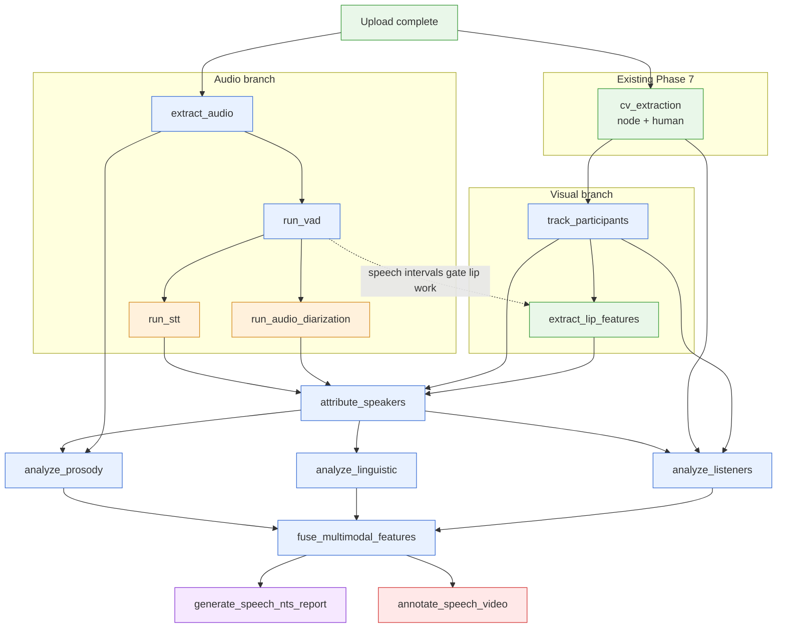
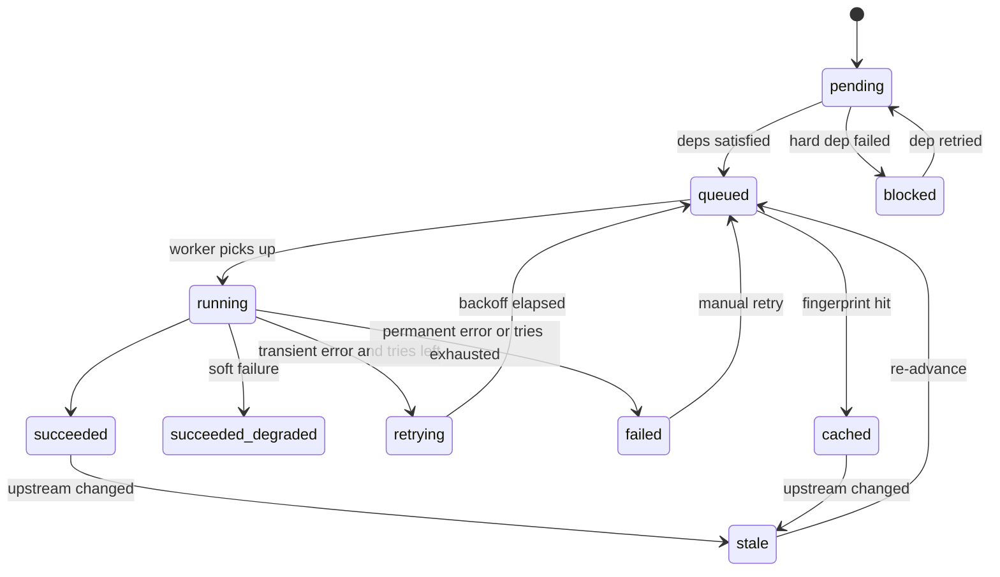
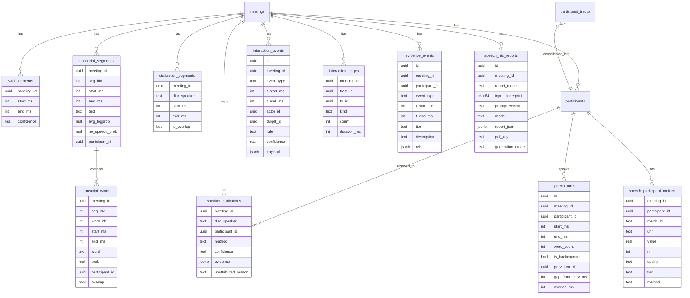

# 17 — Speech Pipeline Architecture

**Project:** NTS (Non-Technical Skills) Meeting Analysis
**Phase:** 17 — Speech, Diarization, Audio-Visual Attribution, Listener Analysis
**Status:** Design / ready for implementation
**Companion doc:** `18_SPEECH_NTS_REPORTING.md`

---

## 0. Scope and Assumptions

This document defines the processing pipeline that turns an uploaded meeting video into speech, turn-taking, prosody, linguistic and listener features, fuses them with the existing visual features, and hands them to the reporting and annotated-video stages.

**Assumptions (verify against the repo before coding).** Only the Phase 1–11 history was available when this was written.

| Assumption | Impact if wrong |
|---|---|
| Existing CV job type is `cv_extraction` and writes head pose, gaze bearing, body keypoints, hands, and emotions to `feature_extractions` keyed by `participant_tracks` | Rename dependencies in `pipeline_dag.py` |
| `job_service.py` exposes idempotent `enqueue(meeting_id, job_type)` and success-triggered cascade | Section 4 extends it. If the cascade is hard-coded, refactor to the DAG registry first |
| Phase 8/9 already has an audio step and faster-whisper transcription with basic diarization | Phase 17 supersedes it behind a feature flag. Old tables stay untouched |
| Human's face mesh landmarks are **not** persisted by Phase 7 | Lip extraction needs its own Node pass (Section 5, job 6) |
| MinIO has one main bucket | New objects use a prefix, not a new bucket |
| Model weights cannot be fetched from HuggingFace at runtime (Phase 10 DNS failures) | All model weights are vendored (Section 8.3) |

---

## 1. Review of the Existing Architecture

### 1.1 What we reuse unchanged

| Existing component | Reused for |
|---|---|
| FastAPI + async SQLAlchemy + Alembic | New tables, new endpoints |
| Redis + ARQ | All new jobs, with extra named queues |
| `job_service.py` (idempotent enqueue, cascade) | Extended into a DAG-aware scheduler (Section 4) |
| `useJobPolling` and `JobStatusBadge` | Stage-graph progress UI |
| MinIO with presigned GET/PUT | All artifacts and the annotated video |
| Node.js `human_cv_script.js` spawned by an ARQ worker | Lip/mouth extraction (new mode) |
| `cv_extraction_worker` output (`participant_tracks`, `feature_extractions`) | Visual tracking, listener analysis |
| `faster-whisper` | STT with word timestamps |
| `video_annotation_worker.py` (OpenCV, zero re-inference) | Extended with speech overlays |
| Groq/Qwen client, prompt loader, UPSERT cache, `reportlab` PDF builder | Extended in doc 18 |

### 1.2 Gaps this phase closes

1. **No voice activity detection.** Whisper currently sees silence and noise, which risks hallucinated text.
2. **Diarization is not tied to visual identity.** Speaker labels such as `SPEAKER_01` are not mapped to `participant_tracks`.
3. **Cascade is linear.** "One job triggers the next" cannot express fan-out and fan-in, and the audio and visual branches are independent.
4. **No lip/mouth signal.** The strongest cue linking a voice to a face is missing.
5. **No prosody, linguistic, or turn-taking features.**
6. **No listener analysis.** The current visual features are not related to who is speaking.
7. **Report inputs are visual-only.**

---

## 2. Design Principles

1. **No new services.** Every job is an ARQ function in the existing backend package. New "workers" are additional processes of the same image with different queue names and concurrency, not microservices.
2. **DAG, not chain.** Dependencies are declared once in code. A job runs when all its hard dependencies have succeeded.
3. **Content-addressed idempotency.** A job's identity is `(meeting_id, job_type, input_fingerprint)`. Same inputs and code version means skip. Changed inputs mean recompute and invalidate downstream.
4. **Manifest-last commit.** Artifacts are written to MinIO first. A `manifest.json` is written last and is the commit marker. Then one DB transaction records results.
5. **Graceful degradation.** Visual-dependent stages may fail without failing the pipeline. The pipeline continues audio-only and records the reduced capability so reports say so.
6. **Store the small, stream the big.** Aggregates and events go in PostgreSQL. High-rate time series go to Parquet in MinIO.
7. **Every number is traceable.** Each metric carries method, sample size, and quality. This feeds the evidence rules in doc 18.
8. **One timebase.** All timestamps are integer milliseconds from the start of the video container's presentation timeline (`t_ms`). Audio and video offsets are measured once in `extract_audio` and stored.

---

## 3. Pipeline Design

### 3.1 Requested linear flow versus the optimized DAG

The requested order is logically correct as a data-flow narrative but suboptimal as an execution order, because several stages are independent:

* STT, diarization, visual tracking, and lip extraction do not depend on each other.
* Prosody, linguistic analysis, and listener analysis all depend only on attributed speech.
* The annotated video does not depend on the LLM report.

### 3.2 Job DAG



Colors show the preferred worker class. `gpu` jobs run on CPU if no GPU worker exists.

### 3.3 Mapping to the requested stages

| Requested stage | Job(s) | Note |
|---|---|---|
| Audio extraction | `extract_audio` | |
| VAD | `run_vad` | |
| STT | `run_stt` | Runs on VAD-derived chunks |
| Audio diarization | `run_audio_diarization` | Parallel with STT |
| Visual participant tracking | `cv_extraction` (existing) + `track_participants` | The second job consolidates track IDs |
| Mouth/lip activity | `extract_lip_features` | Gated by VAD intervals |
| Audio-visual attribution | `attribute_speakers` | Also merges STT words into attributed turns |
| Speech prosody | `analyze_prosody` | Split from `analyze_speech` |
| Linguistic analysis | `analyze_linguistic` | Split from `analyze_speech` |
| Listener analysis | `analyze_listeners` | |
| Multimodal fusion | `fuse_multimodal_features` | The only writer of final metric tables |
| LLM NTS report | `generate_speech_nts_report` | Parallel with annotation |
| Annotated video | `annotate_speech_video` | Parallel with report |

`analyze_speech` is split in two because prosody (signal processing) and linguistics (text rules) have different resource profiles and failure modes, and they can run concurrently. `analyze_speech` remains the UI label for the pair.

### 3.4 Critical path

```
extract_audio → run_vad → run_stt → attribute_speakers → analyze_prosody
   → fuse_multimodal_features → generate_speech_nts_report
```

The visual branch (`cv_extraction → track_participants → extract_lip_features`) is usually the longest and defines the real critical path when `cv_extraction` has not already run. When `cv_extraction` is cached from earlier phases, STT is the critical path.

**Optimization: VAD-gated lip extraction.** Meetings are typically 40–70% speech, so restricting lip extraction to VAD speech intervals (padded by 300 ms) cuts the Node pass roughly in half. This is why `extract_lip_features` depends on `run_vad`.

### 3.5 Hard versus soft dependencies

| Job | Hard deps (must succeed) | Soft deps (may be degraded) |
|---|---|---|
| `attribute_speakers` | `run_stt`, `run_audio_diarization` | `track_participants`, `extract_lip_features` |
| `analyze_listeners` | `attribute_speakers`, `cv_extraction` | `track_participants` |
| `analyze_prosody` | `attribute_speakers`, `extract_audio` | none |
| `fuse_multimodal_features` | `analyze_prosody`, `analyze_linguistic` | `analyze_listeners` |
| `annotate_speech_video` | `fuse_multimodal_features` | none |
| `generate_speech_nts_report` | `fuse_multimodal_features` | none |

Degraded modes and their reported capabilities:

| Failure | Pipeline behavior | `capabilities` flags in report input |
|---|---|---|
| `extract_lip_features` fails | Attribution falls back to audio-only mapping with turn-order and speaking-ratio priors and lower confidence | `lip_attribution: false`, `attribution_method: "audio_only"` |
| `track_participants` fails | Attribution runs on raw `participant_tracks` and marks fragmentation risk | `track_consolidation: false` |
| `analyze_listeners` fails | Fusion proceeds without listener metrics. The report omits the Listener Behavior section with a stated reason | `listener: false` |
| `run_audio_diarization` fails | Hard failure. Without speaker segmentation the feature set is not meaningful | pipeline `failed` |

---

## 4. Orchestration Extensions

### 4.1 Static DAG registry

`backend/app/pipeline/pipeline_dag.py` is the single source of truth:

```python
@dataclass(frozen=True)
class JobSpec:
    job_type: str
    queue: str                      # "io" | "cpu" | "gpu" | "cv" | "llm" | "render"
    hard_deps: tuple[str, ...]
    soft_deps: tuple[str, ...] = ()
    max_tries: int = 3
    timeout_s: int = 3600
    version: str = "1"              # bump when algorithm changes

SPEECH_DAG: dict[str, JobSpec] = {...}
```

### 4.2 DAG-aware advance (fan-in safe)

Each job, on completion (success, `succeeded_degraded`, or `cached`), calls `job_service.advance(meeting_id, job_type)` inside the same transaction that records its result.

```mermaid
sequenceDiagram
    participant W as ARQ worker
    participant DB as PostgreSQL
    participant JS as job_service.advance
    participant R as Redis / ARQ

    W->>DB: BEGIN
    W->>DB: write results and set job status
    W->>JS: advance(meeting_id, job_type)
    JS->>DB: pg_advisory_xact_lock(hash(meeting_id))
    JS->>DB: load job rows for meeting
    JS->>JS: find jobs whose hard_deps all done and status is pending
    JS->>DB: insert or update rows as queued, with input_fingerprint
    W->>DB: COMMIT
    JS->>R: enqueue each ready job with _job_id
    Note over JS,R: enqueue happens after commit; a sweeper covers a crash in between
```

Key properties:

* **Advisory lock per meeting** serializes concurrent completions (for example prosody and linguistic finishing simultaneously), so `fuse_multimodal_features` is enqueued exactly once.
* **Enqueue after commit.** If the process dies between commit and enqueue, the `queued` DB row exists without an ARQ job. `reap_stale_jobs` (4.6) re-enqueues it.
* **ARQ `_job_id`** is `"{meeting_id}:{job_type}:{fingerprint[:16]}"`, a second dedupe layer at the queue level.

### 4.3 `processing_jobs` additions (Alembic migration `0xx_speech_pipeline`)

| Column | Type | Purpose |
|---|---|---|
| `pipeline` | text | `"speech_v1"` (distinguishes from earlier pipelines) |
| `input_fingerprint` | char(64) | sha256 of job inputs (4.4) |
| `attempt` | int | Current try number |
| `queue` | text | Routing record |
| `heartbeat_at` | timestamptz | Liveness for the sweeper |
| `error_class` | text | `transient` \| `permanent` \| `degraded` |
| `error_code` | text | Stable code such as `NO_AUDIO_STREAM` |
| `error_detail` | text | Truncated message |
| `output_manifest_key` | text | MinIO key of the manifest |
| `progress` | real | 0..1 for the UI |

Add a partial unique index: `UNIQUE (meeting_id, job_type) WHERE status IN ('queued','running')`. It is the DB-level idempotency guard.

### 4.4 Input fingerprint and caching

```
fingerprint = sha256(
    job_type + job_version + config_hash(job_type)
    + sorted(upstream_fingerprints)      # for pipeline jobs
    + source_media_etag                  # for extract_audio / cv-dependent jobs
)
```

* `config_hash` covers only the config keys that job reads (for example STT model size for `run_stt`), so editing the prosody config does not invalidate STT.
* Before running, a worker checks whether a `succeeded` row with the same fingerprint exists **and** its manifest object exists in MinIO (HEAD). If so, the job is marked `cached` and advances immediately.
* When an upstream fingerprint changes, downstream rows become `stale` and are re-enqueued on next advance. Old artifacts remain (fingerprint-keyed) until garbage collection.

### 4.5 Job status state machine



### 4.6 Retry taxonomy

| Class | Examples | Behavior |
|---|---|---|
| Transient | MinIO 5xx/timeouts, Redis disconnect, Postgres serialization failure, Groq 429/5xx/timeouts, worker killed (OOM, deploy) | `raise Retry(defer=backoff)`. Backoff is 30s, 2m, 10m with jitter, `max_tries` per spec |
| Permanent | No audio stream, unreadable container, zero-length audio, schema validation failure of an upstream artifact, invalid config | Fail immediately, no retry. `error_code` is set |
| Degraded | Lip extraction crash, listener analysis insufficient data | Complete as `succeeded_degraded` with a degradation record in the manifest |
| Resource | CUDA OOM | One automatic retry on the CPU queue (`fallback_queue`), then fail |

**Stale-job sweeper.** ARQ cron `reap_stale_jobs` runs every 2 minutes. It handles:

* `running` with `heartbeat_at` older than 3× heartbeat interval. The worker is presumed dead, so the job is requeued if tries remain, else failed.
* `queued` with no live ARQ job (crash between commit and enqueue). The job is re-enqueued.

Workers update `heartbeat_at` and `progress` every 15 seconds from a background task.

### 4.7 Queues and worker processes

Same image, different `arq` commands (`WorkerSettings.queue_name`, `max_jobs`):

| Queue | Jobs | `max_jobs` | Notes |
|---|---|---|---|
| `io` | `extract_audio`, `track_participants`, `fuse_multimodal_features`, orchestration cron | 4 | Light |
| `cpu` | `run_vad`, `analyze_prosody`, `analyze_linguistic`, `analyze_listeners`, `attribute_speakers` | 2 | |
| `gpu` | `run_stt`, `run_audio_diarization` | 1 per GPU (0 = falls back to `cpu` queue consumption) | Both are models, so serialize per GPU |
| `cv` | `cv_extraction` (existing), `extract_lip_features` | 1 | Node + TF.js is memory heavy |
| `llm` | `generate_speech_nts_report` | 2 | Network-bound, rate-limited |
| `render` | `annotate_speech_video` | 1 | OpenCV/ffmpeg |

Compose adds services that reuse the backend image, for example `worker-gpu`, `worker-cv`, `worker-render`. No new codebases.

---

## 5. Job Specifications

Conventions used below:

* **Key prefix** `P = meetings/{meeting_id}/speech/v{pipeline_version}/`.
* **Txn** means what is written to PostgreSQL in the final transaction.
* Resource figures are **planning estimates for a 60-minute, 4–8 participant meeting**. Benchmark in the Phase 17.0 spike before capacity planning.
* Every job follows the common skeleton in 5.14.

---

### 5.1 `extract_audio`

| | |
|---|---|
| **Queue / needs** | `io`. CPU 1–2 cores, RAM < 500 MB, no GPU |
| **Depends on** | Upload complete (`media_assets` video) |
| **Input** | Source video from MinIO |
| **Processing** | `ffprobe` records stream durations and `start_time` of audio and video streams. Then `ffmpeg -vn -ac 1 -ar 16000 -c:a pcm_s16le`. Records `av_offset_ms = audio.start_time − video.start_time` and whether the video has variable frame rate |
| **Output (MinIO)** | `P/audio/mixed_16k_mono.wav`, `P/audio/probe.json`, `P/audio/manifest.json` |
| **Output (DB)** | `media_assets` row of kind `audio_16k`. `meetings.audio_offset_ms`, `meetings.duration_ms` |
| **Retry** | Transient: 3 tries. Permanent: `NO_AUDIO_STREAM`, `CORRUPT_CONTAINER` |
| **Idempotency** | Fingerprint is source ETag plus ffmpeg args. Output key is deterministic, so overwrite is safe |
| **Caching** | Hit if manifest exists. Reused by every later audio job |
| **Failure recovery** | Partial WAV is never referenced because the manifest is written last |
| **Txn** | One: `media_assets` insert, meeting columns update, job status |
| **Parallelism** | Runs concurrently with `cv_extraction` |
| **Time** | ~1–2 min |

Multichannel note: if the container has multiple audio tracks (for example per-participant recordings), `probe.json` records them, and diarization can be skipped in a later variant. v1 mixes down.

---

### 5.2 `run_vad`

| | |
|---|---|
| **Queue / needs** | `cpu`. 1 core, RAM ~300 MB |
| **Depends on** | `extract_audio` |
| **Input** | `P/audio/mixed_16k_mono.wav` |
| **Processing** | Silero VAD (weights vendored) with config: `threshold=0.5`, `min_speech_ms=250`, `min_silence_ms=300`, `speech_pad_ms=100`. Emits raw segments and merged **STT chunks** (adjacent segments merged up to 30 s, split at the longest internal silence) |
| **Output (MinIO)** | `P/vad/segments.json`, `P/vad/stt_chunks.json` |
| **Output (DB)** | `vad_segments(meeting_id, start_ms, end_ms, confidence)` (hundreds to a few thousand rows) |
| **Retry** | Transient 3. Permanent: `EMPTY_AUDIO`. A meeting with < 5 s of speech fails as `NO_SPEECH_DETECTED` and blocks the pipeline with a clear UI message |
| **Idempotency** | Fingerprint from audio manifest and VAD config. DB write is replace-by-meeting inside one txn |
| **Caching** | Manifest hit skips |
| **Failure recovery** | Stateless, so rerun |
| **Txn** | `DELETE vad_segments WHERE meeting_id` then bulk insert, plus job status |
| **Parallelism** | Fans out to STT, diarization, and lip extraction |
| **Time** | ~1 min |

---

### 5.3 `run_stt`

| | |
|---|---|
| **Queue / needs** | `gpu` (preferred) or `cpu`. GPU: 4–6 GB VRAM for large-v3 fp16. CPU: 4–8 threads, RAM 3–4 GB (large-v3 int8) or ~1.5 GB (small) |
| **Depends on** | `run_vad` |
| **Input** | WAV plus `stt_chunks.json` |
| **Processing** | `faster-whisper` with `word_timestamps=True`, `condition_on_previous_text=False` (limits hallucination loops), `vad_filter=False` (VAD is already done), `beam_size=5`, language auto-detect once from the first speech chunks then pinned. Chunk timestamps are offset to global `t_ms`. Drops segments with `no_speech_prob > 0.6` and `avg_logprob < -1.0` and flags them `low_confidence` rather than deleting them silently |
| **Output (MinIO)** | `P/stt/transcript.json` (segments and words), `P/stt/words.parquet`, `P/stt/manifest.json` |
| **Output (DB)** | `transcript_segments`, `transcript_words` (no participant yet) |
| **Retry** | Transient 3. CUDA OOM falls back to the CPU queue once with the same model, then to a smaller model only if config allows and it is recorded in the manifest |
| **Idempotency** | Fingerprint includes model name, compute type, beam size, and VAD chunk fingerprint |
| **Caching** | Per-chunk cache: `P/stt/chunks/{chunk_hash}.json`. A rerun after a crash resumes from finished chunks |
| **Failure recovery** | Chunk-level checkpointing gives resume, and progress is reported as chunks done / total |
| **Txn** | Delete-and-insert transcript rows for the meeting, plus job status |
| **Parallelism** | Parallel with diarization, lip, and tracking. Within the job, sequential on one model instance |
| **Time** | GPU ~3–6 min. CPU: small ≈ 0.3–0.6× realtime, large-v3 int8 ≈ 1–2× realtime |

Per-chunk checkpointing matters because an hour of CPU transcription is expensive to redo.

---

### 5.4 `run_audio_diarization`

| | |
|---|---|
| **Queue / needs** | `gpu` (preferred) or `cpu`. GPU 2–3 GB. CPU: 4+ threads, RAM 3–5 GB peak on one-hour audio |
| **Depends on** | `run_vad` (used to restrict embedding extraction to speech) |
| **Input** | WAV and VAD segments |
| **Processing** | Overlap-aware diarization (pyannote 3.x pipeline from vendored weights, or SpeechBrain ECAPA embeddings plus clustering as the fallback). Optional `num_speakers` hint from `meetings.expected_participants`. Output: labeled segments, `overlap` intervals, and per-speaker centroid embeddings |
| **Output (MinIO)** | `P/diarization/segments.json`, `P/diarization/overlaps.json`, `P/diarization/embeddings.npz`, RTTM file |
| **Output (DB)** | `diarization_segments(meeting_id, diar_speaker, start_ms, end_ms, is_overlap)` |
| **Retry** | Transient 3. `INSUFFICIENT_SPEECH` is permanent. Speaker count above 12 raises a warning flag, not a failure |
| **Idempotency** | Fingerprint includes model version and `num_speakers` hint |
| **Caching** | Manifest hit skips |
| **Failure recovery** | Whole-file operation, so rerun. Not checkpointable |
| **Txn** | Delete-and-insert plus job status |
| **Parallelism** | Parallel with STT. **They must not share one small GPU without a memory check.** If VRAM is below 8 GB, the queue config serializes them |
| **Time** | GPU ~2–5 min. CPU ~10–25 min |

Diarization label instability is expected. Labels are arbitrary, and speakers with similar voices may merge or split. This is exactly why attribution is done per window, not once globally (5.7).

---

### 5.5 `track_participants`

| | |
|---|---|
| **Queue / needs** | `io`. 1–2 cores, RAM ~1 GB. Reads Parquet or DB rows for face and body tracks |
| **Depends on** | `cv_extraction` (existing) |
| **Input** | `participant_tracks` and per-frame face box and body keypoints from `feature_extractions` |
| **Processing** | Consolidates fragmented tracks: merge tracks that are temporally disjoint and spatially consistent (box IoU or centroid distance, plus body size). Optionally uses face-embedding similarity if Human emitted descriptors. Applies a minimum track duration. Produces stable `participant_id` (`P1..Pn`) with a per-frame box index and a **layout classification**: `gallery_tiles` (static grid-like boxes), `room_camera` (moving people, shared scene), or `unknown`. Layout drives how gaze targets are interpreted in `analyze_listeners` |
| **Output (MinIO)** | `P/tracking/tracks.parquet` (t_ms, participant_id, face box, body box, quality), `P/tracking/summary.json` |
| **Output (DB)** | `participants` (or extend `participant_tracks` with `participant_id`, `merged_from[]`). `meetings.layout_type` |
| **Retry** | Transient 3. Zero tracks is `NO_PARTICIPANTS_DETECTED`, so the job completes as `succeeded_degraded` and audio-only attribution proceeds |
| **Idempotency** | Fingerprint from `cv_extraction` fingerprint and tracking config |
| **Caching** | Manifest hit skips |
| **Failure recovery** | Deterministic, rerun |
| **Txn** | Upsert participants, update `participant_tracks.participant_id`, job status |
| **Parallelism** | Runs while audio jobs run |
| **Time** | ~1–3 min |

Human-review hook: the UI can let a user rename or merge participants. A manual edit changes the tracking fingerprint and invalidates everything downstream through the normal stale mechanism.

---

### 5.6 `extract_lip_features`

| | |
|---|---|
| **Queue / needs** | `cv`. Node.js TF.js. CPU 4 cores, RAM 2–4 GB per Node process, GPU not required |
| **Depends on** | `track_participants`, `run_vad` |
| **Input** | Source video, `tracks.parquet` (face boxes), VAD speech intervals (padded ±300 ms) |
| **Processing** | Extend `human_cv_script.js` with `--mode lip`. Reads only speech-active frame ranges and only face-box crops. Uses the face mesh to compute mouth aspect ratio (MAR), lip aperture (inner lip distance normalized by inter-ocular distance), and per-frame face quality (yaw, pitch, occlusion proxy, face size in pixels). Frames with |yaw| > 45° or tiny faces are flagged `unreliable`. Python then computes windowed features at 10 Hz: aperture variance, aperture velocity energy, and fraction of frames unreliable |
| **Output (MinIO)** | `P/lip/lip_frames.parquet`, `P/lip/lip_activity_10hz.parquet`, `P/lip/manifest.json` |
| **Output (DB)** | `lip_summary(meeting_id, participant_id, usable_ratio, mean_quality)` (small) |
| **Retry** | Transient 2. Node crash: retry once, then complete as `succeeded_degraded` |
| **Idempotency** | Fingerprint from tracking fingerprint, VAD fingerprint, and lip config |
| **Caching** | **Shard-level.** The job is split into time shards (for example 5-minute ranges over speech intervals). Each shard result is cached at `P/lip/shards/{shard_hash}.parquet`, so a crash resumes |
| **Failure recovery** | A missing shard is recomputed. Persistent shard failure marks only that range `unreliable` |
| **Txn** | Summary rows plus job status |
| **Parallelism** | Shards run on 2–4 Node processes on the `cv` queue where RAM allows |
| **Time** | ~8–20 min with VAD gating |

Why this is a separate pass instead of reusing Phase 7 output: face mesh at video frame rate for every frame was likely not persisted, and re-running only the mouth region on speech frames is cheaper than re-running the full Human pipeline.

---

### 5.7 `attribute_speakers`

| | |
|---|---|
| **Queue / needs** | `cpu`. 2 cores, RAM 1–2 GB |
| **Depends on (hard)** | `run_stt`, `run_audio_diarization` |
| **Depends on (soft)** | `track_participants`, `extract_lip_features` |
| **Input** | Diarization segments, STT words, tracks, lip activity series |
| **Processing** | (1) Build a 10 Hz speech-activity indicator per diarization speaker. (2) For each (diarization speaker, visual participant) compute lip-audio agreement over a lag window of ±400 ms to absorb A/V offset. Use only frames marked reliable. (3) Solve a global assignment (Hungarian) on a normalized agreement matrix, with the option of leaving a speaker `unattributed`. (4) Run **windowed refinement** over 10 s windows to detect diarization label switches and correct them where the local agreement margin is strong. (5) Produce a confidence per mapping: margin between best and second-best, fraction of evidence frames, and consistency across windows. (6) Assign STT words to speakers by maximum temporal overlap with diarization. Words in overlap regions get `overlap=true`. (7) Build **turns** (Section 5.7.1) |
| **Output (MinIO)** | `P/attribution/speaker_map.json`, `P/attribution/window_attribution.parquet`, `P/attribution/attributed_words.parquet`, `P/attribution/turns.json` |
| **Output (DB)** | `speaker_attributions`, `transcript_words.participant_id`, `transcript_segments.participant_id`, `speech_turns` |
| **Retry** | Transient 3. No permanent failure specific to this job. A missing soft dependency yields `succeeded_degraded` |
| **Idempotency** | Fingerprint from all four upstream fingerprints and attribution config |
| **Caching** | Manifest hit skips |
| **Failure recovery** | Deterministic and cheap, so rerun |
| **Txn** | **One transaction** updates words, segments, attributions, and turns together, so downstream never sees half-attributed data |
| **Parallelism** | Fan-in point, so sequential. Internally vectorized |
| **Time** | ~1–2 min |

Each `speaker_attributions` row stores `method` (`av_lip`, `audio_only`), `confidence`, and `evidence` JSON (agreement score, frames used, runner-up score). Unattributed speech is kept as `participant_id = NULL` with an `unattributed_reason` and is reported as a coverage statistic. It is never dropped silently.

#### 5.7.1 Turn construction

* A **turn** is contiguous speech by one participant where internal gaps are shorter than `turn_gap_merge_s` (default 1.0 s).
* A **backchannel** is a short utterance (≤ 1.5 s and ≤ 3 words, matching a language-specific list or non-lexical tokens) occurring while another participant holds the turn. It is stored as a turn with `is_backchannel=true` and excluded from turn counts by default (counted separately).
* Each turn records `prev_turn_id`, `prev_participant_id`, `gap_from_prev_ms` (negative means overlap), `overlap_ms`.
* Interruption and overlap classification is computed later in fusion from these fields using explicit rules (doc 18, Section 4).

---

### 5.8 `analyze_prosody`

| | |
|---|---|
| **Queue / needs** | `cpu`. 1 core per participant (multiprocessing), RAM ~1 GB |
| **Depends on** | `attribute_speakers`, `extract_audio` |
| **Input** | WAV and attributed turns |
| **Processing** | For each participant, on non-overlapped, voiced speech only: F0 by Praat via `parselmouth` (or `librosa.pyin` fallback) with a **per-speaker F0 floor/ceiling** estimated in a first pass to avoid octave errors. Intensity (dB, uncalibrated so values are relative within the recording), voiced ratio, F0 percentiles (p5, p50, p95), range in Hz and semitones, F0 variability (SD in semitones), jitter and shimmer are **excluded from v1** because they are unreliable on compressed meeting audio. Speaking rate is computed in linguistic analysis to keep word data in one place. Overlapped regions are excluded to avoid mixed-voice pitch |
| **Output (MinIO)** | `P/prosody/f0_series_10hz.parquet`, `P/prosody/summary.json` |
| **Output (DB)** | Written by fusion (this job writes only the summary artifact) |
| **Retry** | Transient 3. Speaker with < 20 s voiced speech gets `prosody: unavailable` (not a failure) |
| **Idempotency** | Fingerprint from attribution fingerprint and prosody config |
| **Caching** | Per-participant cache `P/prosody/participants/{pid}_{hash}.json` |
| **Failure recovery** | Per-participant isolation. One participant failing does not lose others |
| **Txn** | Job status only |
| **Parallelism** | Parallel with linguistic and listener analysis. Per-participant multiprocessing inside |
| **Time** | ~3–6 min |

Every prosody metric is emitted with `n_voiced_frames` and a `quality` derived from voiced duration and audio SNR. Audio codec and microphone effects are recorded as flags (doc 18).

---

### 5.9 `analyze_linguistic`

| | |
|---|---|
| **Queue / needs** | `cpu`. 1 core, RAM < 500 MB |
| **Depends on** | `attribute_speakers` |
| **Input** | Attributed words and turns |
| **Processing** | Deterministic, rule-based v1: word counts, speaking rate (words per minute over turn time excluding pauses > 0.5 s = articulation rate), pause statistics, filler rate (language-specific lexicon), question detection (question mark plus interrogative/auxiliary-inversion rules, quality flagged `medium`), backchannel counts, hedging-term rate from a lexicon, mean utterance length, lexical diversity (type-token ratio over fixed-size windows, so it is length-comparable), addressed-participant mentions (name matches). Language rule packs are pluggable. **Unsupported languages emit `unavailable`. The LLM is never used to fill missing linguistic metrics** |
| **Output (MinIO)** | `P/linguistic/features.json`, `P/linguistic/events.json` (question events, mention events with timestamps) |
| **Output (DB)** | Written by fusion |
| **Retry** | Transient 3, no permanent failures |
| **Idempotency** | Fingerprint from attribution fingerprint, language, rule-pack version |
| **Caching** | Manifest hit skips |
| **Failure recovery** | Rerun |
| **Txn** | Job status only |
| **Parallelism** | Parallel with prosody and listeners |
| **Time** | < 1 min |

---

### 5.10 `analyze_listeners`

| | |
|---|---|
| **Queue / needs** | `cpu`. 2 cores, RAM 1–2 GB |
| **Depends on (hard)** | `attribute_speakers`, `cv_extraction` |
| **Depends on (soft)** | `track_participants` |
| **Input** | Attributed turns (who is speaking when), per-frame gaze, head pose, body keypoints, hands, facial affect |
| **Processing** | For every participant, for every interval in which **another** participant holds the floor, compute listener measures against the active speaker. Definitions are in doc 18 Section 4. In summary: speaker-directed orientation (method depends on `layout_type`: geometric bearing to the speaker's position for `room_camera`, camera/screen-oriented proxy for `gallery_tiles`), gaze-away, head nods (pitch oscillation detection), head-down plus hand-motion pattern (possible note-taking, labeled INFERRED), posture-shift counts, facial expression classifier output distributions. Emits per-interval events for the evidence timeline. Frames without a reliable face are `not_assessable`, counted in coverage, and **excluded from the denominator** |
| **Output (MinIO)** | `P/listener/listener_series.parquet`, `P/listener/events.json`, `P/listener/summary.json` |
| **Output (DB)** | Written by fusion |
| **Retry** | Transient 3. Insufficient visual data yields `succeeded_degraded` with `listener: unavailable` |
| **Idempotency** | Fingerprint from attribution, CV, tracking fingerprints, listener config |
| **Caching** | Manifest hit skips |
| **Failure recovery** | Rerun |
| **Txn** | Job status only |
| **Parallelism** | Parallel with prosody and linguistic |
| **Time** | ~2–4 min |

---

### 5.11 `fuse_multimodal_features`

| | |
|---|---|
| **Queue / needs** | `io`. 1–2 cores, RAM ~1 GB |
| **Depends on** | `analyze_prosody`, `analyze_linguistic`, `analyze_listeners` (soft) |
| **Input** | Summary and event artifacts from the three analysis jobs, `turns.json`, tracking summary, existing Phase 10 visual aggregates |
| **Processing** | (1) Compute turn-taking metrics and classify interactions (interruptions, overlaps, response latencies) from turns using documented rules. (2) Assemble the **metric envelope** for every metric (id, value, unit, n, denominator, quality, tier, method). (3) Build the speaker-listener interaction matrix and edges. (4) Select evidence events (ranking rules in doc 18). (5) Run consistency checks: for example the sum of speaking-time shares must be within 0.5 points of 100 including unattributed, and no negative durations. (6) Write the **report input JSON** (`speech_nts_input.json`) that the LLM stage consumes |
| **Output (MinIO)** | `P/fusion/fused_summary.json`, `P/fusion/interaction_events.json`, `P/report/speech_nts_input.json` |
| **Output (DB)** | `speech_participant_metrics`, `interaction_events`, `interaction_edges`, `evidence_events`, `meeting_speech_summary` |
| **Retry** | Transient 3. Failed consistency check is permanent (`FUSION_INCONSISTENT`) and lists the failed check |
| **Idempotency** | Fingerprint from all analysis fingerprints and fusion config |
| **Caching** | Manifest hit skips |
| **Failure recovery** | Fully derived from artifacts, so rerun anytime |
| **Txn** | **One transaction**: delete-and-insert for all fusion tables, plus job status. This is the only writer of final metric tables |
| **Parallelism** | Fan-in point. Fans out to report and annotation |
| **Time** | ~1 min |

---

### 5.12 `generate_speech_nts_report`

| | |
|---|---|
| **Queue / needs** | `llm`. 1 core, RAM ~500 MB, network to Groq |
| **Depends on** | `fuse_multimodal_features` |
| **Input** | `speech_nts_input.json`, existing Phase 10 visual report (optional, for the combined mode) |
| **Processing** | Details in doc 18: per-participant LLM calls, JSON output validation, hallucination linting, repair loop, deterministic fallback renderer, PDF via `reportlab` |
| **Output (MinIO)** | `P/report/report.json`, `P/report/report.pdf`, `P/report/llm_trace.json` (prompts and raw responses, retained for audit) |
| **Output (DB)** | `speech_nts_reports` (UPSERT on `(meeting_id, report_mode, input_fingerprint)`) |
| **Retry** | Transient (429, 5xx, timeouts): 4 tries with backoff. Validation failure: up to 2 in-job repair attempts, then fall back to the deterministic renderer, marking the report `generation_mode=deterministic_fallback`. The job still succeeds |
| **Idempotency** | Fingerprint includes prompt version, model name, and input JSON hash. Same fingerprint returns the cached report |
| **Caching** | UPSERT cache table (existing pattern). Force regenerate is an explicit API flag |
| **Failure recovery** | Per-participant results are cached, so a crash on participant 5 of 6 resumes at 5 |
| **Txn** | UPSERT report row and job status |
| **Parallelism** | Participants can be processed with limited concurrency (default 2) to respect Groq rate limits. Parallel with annotation |
| **Time** | ~1–3 min |

---

### 5.13 `annotate_speech_video`

| | |
|---|---|
| **Queue / needs** | `render`. 2–4 cores, RAM 1–2 GB, no GPU. Disk for temp frames |
| **Depends on** | `fuse_multimodal_features` |
| **Input** | Source video, tracks, turns, attributions, interaction events, listener events, existing CV features (reuses Phase 11 drawing code) |
| **Processing** | Extends `video_annotation_worker.py` with a `speech` overlay set: active-speaker highlight per participant box, speaker label and attribution confidence, live turn counter and speaking share, subtitle strip (attributed words), overlap or interruption flashes, listener markers (nod, gaze-away, possible note-taking) with the legend making clear these are detector outputs. Two-pass encode: OpenCV frames to a piped ffmpeg process (H.264, `yuv420p`, `+faststart`), audio remuxed from the original. **Zero model inference** |
| **Output (MinIO)** | `P/video/annotated_speech.mp4`, `P/video/manifest.json` |
| **Output (DB)** | `media_assets` row (`annotated_speech_video`) |
| **Retry** | Transient 2. Long-running, so failure after 80% is expensive |
| **Idempotency** | Fingerprint from fusion fingerprint and overlay config |
| **Caching** | Manifest hit skips. Overlay options that only change styling are part of the config hash |
| **Failure recovery** | Segment rendering: the video is rendered in 2-minute segments to `P/video/segments/{n}.mp4`, then concatenated with ffmpeg concat demuxer. A crash resumes at the missing segment |
| **Txn** | `media_assets` insert and job status |
| **Parallelism** | Parallel with the report. Segments may be rendered by 2 processes if RAM allows |
| **Time** | ~10–20 min |

---

### 5.14 Common job skeleton

```python
async def run_job(ctx, meeting_id: UUID, job_type: str, fingerprint: str):
    async with job_context(ctx, meeting_id, job_type, fingerprint) as job:
        # 1. Cache check: succeeded row with same fingerprint AND manifest HEAD ok
        if await job.cache_hit():
            return await job.finish(status="cached")     # advance() runs inside

        # 2. Mark running, start heartbeat task
        await job.mark_running()

        # 3. Load inputs by manifest (never by "latest"), verify upstream fingerprints
        inputs = await job.load_inputs()

        # 4. Compute (CPU-bound work in a process pool or thread, not on the event loop)
        artifacts, records = await job.compute(inputs)

        # 5. Upload artifacts to MinIO under fingerprint-keyed paths
        await job.upload(artifacts)
        # 6. Upload manifest.json LAST (commit marker)
        manifest = await job.write_manifest(artifacts)

        # 7. Single DB transaction: replace-by-meeting writes + job status + advance()
        async with job.transaction() as tx:
            await tx.replace_records(records)
            await tx.set_status("succeeded")   # or succeeded_degraded
            await job_service.advance(tx, meeting_id, job_type)
    # 8. Post-commit: enqueue the jobs that advance() marked ready
```

Errors are classified by a central `classify_error(exc) → transient | permanent | degraded`, so individual jobs raise typed exceptions (`TransientError`, `PermanentError`, `DegradedResult`) rather than choosing retry logic ad hoc.

---

## 6. Data Model

### 6.1 New tables



### 6.2 Storage rule of thumb

| Data | Where | Reason |
|---|---|---|
| Per-frame or 10 Hz series (lip, F0, listener) | Parquet in MinIO | Tens to hundreds of thousands of rows per participant |
| Words, turns, segments | PostgreSQL | ~10k rows per hour, queried by the UI and annotation |
| Metrics (long/narrow `metric_id` rows) | PostgreSQL | Maps directly to the LLM metric envelope. New metrics need no migration |
| Events (interruptions, nods, questions) | PostgreSQL | Evidence timeline and UI |

### 6.3 Transaction pattern

Replace-by-meeting inside a single transaction, at `READ COMMITTED`:

```sql
DELETE FROM speech_turns WHERE meeting_id = :m;
-- bulk INSERT (chunks of 5-10k or asyncpg COPY)
UPDATE processing_jobs SET status='succeeded', ... WHERE id = :job;
-- advance() in the same txn
COMMIT;
```

Readers see the old data or the new data, never a mixture. Large deletes are cheap because rows are per-meeting and indexed on `meeting_id`. Every new table has `(meeting_id, ...)` as the leading index column.

---

## 7. MinIO Object Layout

```
{bucket}/meetings/{meeting_id}/
├── source/video.mp4                       (existing)
├── report/ ... (Phase 10 outputs)         (existing)
└── speech/v1/
    ├── audio/        mixed_16k_mono.wav  probe.json  manifest.json
    ├── vad/          segments.json  stt_chunks.json  manifest.json
    ├── stt/          transcript.json  words.parquet  chunks/{hash}.json  manifest.json
    ├── diarization/  segments.json  overlaps.json  embeddings.npz  diarization.rttm  manifest.json
    ├── tracking/     tracks.parquet  summary.json  manifest.json
    ├── lip/          lip_frames.parquet  lip_activity_10hz.parquet  shards/{hash}.parquet  manifest.json
    ├── attribution/  speaker_map.json  window_attribution.parquet  attributed_words.parquet  turns.json  manifest.json
    ├── prosody/      f0_series_10hz.parquet  summary.json  participants/{pid}_{hash}.json  manifest.json
    ├── linguistic/   features.json  events.json  manifest.json
    ├── listener/     listener_series.parquet  events.json  summary.json  manifest.json
    ├── fusion/       fused_summary.json  interaction_events.json  manifest.json
    ├── report/       speech_nts_input.json  report.json  report.pdf  llm_trace.json  participants/{pid}_{hash}.json  manifest.json
    └── video/        annotated_speech.mp4  segments/{n}.mp4  manifest.json
```

* `manifest.json` per stage lists artifacts with sha256, size, and the job fingerprint. It is written **last**.
* A downstream job loads its inputs **only through upstream manifests**. This makes "half-written artifact" impossible to consume.
* Retention: intermediate artifacts are retained 30 days after the last read, the final report and annotated video are retained per project policy. A GC cron deletes artifacts whose fingerprint is no longer referenced by any `succeeded` job row.
* Presigned GET URLs (existing pattern) serve the PDF and video to the frontend. Nothing under `speech/` is public.
* Audio and transcripts are sensitive personal data. Bucket policy, encryption at rest, and per-org prefix access follow the existing Phase 3 org-scoping rules.

---

## 8. Resources, Parallelism, and Deployment

### 8.1 Resource summary (planning estimates, 60-min meeting)

| Job | Queue | CPU | RAM | GPU | Est. time |
|---|---|---|---|---|---|
| extract_audio | io | 1–2 | < 0.5 GB | – | 1–2 min |
| run_vad | cpu | 1 | 0.3 GB | – | ~1 min |
| run_stt | gpu / cpu | 4–8 threads (CPU mode) | 1.5–4 GB (CPU), 4–6 GB VRAM (GPU) | optional | GPU 3–6 min; CPU 20–120 min by model |
| run_audio_diarization | gpu / cpu | 4+ threads | 3–5 GB (CPU), 2–3 GB VRAM | optional | GPU 2–5 min; CPU 10–25 min |
| track_participants | io | 1–2 | ~1 GB | – | 1–3 min |
| extract_lip_features | cv | 4 | 2–4 GB per Node proc | – | 8–20 min |
| attribute_speakers | cpu | 2 | 1–2 GB | – | 1–2 min |
| analyze_prosody | cpu | 1 per participant | ~1 GB | – | 3–6 min |
| analyze_linguistic | cpu | 1 | < 0.5 GB | – | < 1 min |
| analyze_listeners | cpu | 2 | 1–2 GB | – | 2–4 min |
| fuse_multimodal_features | io | 1–2 | ~1 GB | – | ~1 min |
| generate_speech_nts_report | llm | 1 | 0.5 GB | – | 1–3 min |
| annotate_speech_video | render | 2–4 | 1–2 GB | – | 10–20 min |

Minimum viable host (CPU-only): 8 cores, 16 GB RAM, running queues with the `max_jobs` limits in 4.7. Recommended: one 8–16 GB GPU for the `gpu` queue.

### 8.2 Parallelization opportunities

| Level | Parallel set |
|---|---|
| Pipeline | `{run_stt, run_audio_diarization, extract_lip_features (after tracking)}` after VAD, and `{track_participants}` alongside the audio branch |
| Pipeline | `{analyze_prosody, analyze_linguistic, analyze_listeners}` after attribution |
| Pipeline | `{generate_speech_nts_report, annotate_speech_video}` after fusion |
| Within a job | Lip shards across Node processes. Prosody across participants. Report across participants (limited by API rate). Annotation across segments (RAM permitting) |
| Across meetings | ARQ queues process different meetings concurrently, bounded by `max_jobs` |

Do **not** parallelize inside STT on CPU (thread contention makes it slower). Use `cpu_threads` on one model instance.

### 8.3 Offline model vendoring

Phase 10 hit HuggingFace DNS failures, so this phase treats all model weights as build-time artifacts:

* Store weights (Silero VAD, diarization models, faster-whisper models) in a MinIO `models/` prefix or bake them into the image.
* Set `HF_HUB_OFFLINE=1` and `TRANSFORMERS_OFFLINE=1`. Load from explicit local paths in config.
* A startup check (`/healthz/models`) verifies each configured model path exists, and the worker refuses to start otherwise.
* Model versions and checksums are recorded in every manifest, and they are part of each job's `config_hash`.
* Gated model licenses (for example pyannote) must be accepted once by an operator on a networked machine when the weights are downloaded.

### 8.4 Compose additions (illustrative)

```yaml
worker-gpu:
  image: nts-backend
  command: arq app.workers.gpu.WorkerSettings
  deploy: { resources: { reservations: { devices: [{ capabilities: [gpu] }] } } }
worker-cpu:
  image: nts-backend
  command: arq app.workers.cpu.WorkerSettings
worker-cv:
  image: nts-backend            # already contains node + human script
  command: arq app.workers.cv.WorkerSettings
worker-render:
  image: nts-backend
  command: arq app.workers.render.WorkerSettings
worker-llm:
  image: nts-backend
  command: arq app.workers.llm.WorkerSettings
```

These are process groups of the existing image. No new repositories, APIs, or network hops.

---

## 9. Failure Recovery Scenarios

| Scenario | Behavior |
|---|---|
| Worker killed mid-STT | Heartbeat lapses, sweeper requeues, chunk cache resumes at the first missing chunk |
| Crash after MinIO upload but before DB commit | No manifest-committed state in DB. Rerun finds the manifest, verifies artifact hashes, skips recompute, and only performs the DB transaction |
| Crash between DB commit and enqueue | Rows are `queued` with no ARQ job. Sweeper re-enqueues |
| Two upstream jobs finish simultaneously | Advisory lock in `advance()` makes the fan-in enqueue exactly once |
| Duplicate enqueue from API double-click | Partial unique index plus ARQ `_job_id` reject it |
| Lip extraction fails permanently | `succeeded_degraded`. Attribution is audio-only, and the report states the reduced method |
| Diarization mislabels or merges two speakers | Low attribution confidence and windowed inconsistency produce `attribution_flags`. Speech metrics for the affected participants are marked `quality: low`. The report includes the flag |
| Groq outage | Transient retries, then the job fails as retryable. The rest of the pipeline (annotation) is unaffected. Deterministic fallback report available on request |
| User corrects participant names or merges tracks | Tracking fingerprint changes and downstream jobs go `stale` and rerun. STT and diarization stay cached |
| Model or config upgrade | `job_version` or `config_hash` changes, only that job and its descendants recompute |
| Poison meeting (always crashes a worker) | `max_tries` exhausted, then `failed` with a stable `error_code`, and dependents `blocked`. The UI shows which stage failed |

Manual recovery API: `POST /meetings/{id}/speech-pipeline/retry?from={job_type}&force=false`. It marks the job and all descendants `stale` (or `pending` if `force`) and calls `advance()`.

---

## 10. File and Folder Structure

```
backend/app/
├── pipeline/
│   ├── __init__.py
│   ├── pipeline_dag.py            # JobSpec registry (SPEECH_DAG), queue routing
│   ├── fingerprint.py             # fingerprint + config_hash helpers
│   ├── job_context.py             # run_job skeleton, heartbeat, manifest IO
│   ├── errors.py                  # TransientError / PermanentError / DegradedResult, classify_error
│   └── sweeper.py                 # reap_stale_jobs cron
├── services/
│   ├── job_service.py             # EXTENDED: advance(), DAG-aware enqueue, retry-from
│   └── storage_service.py         # EXTENDED: manifest helpers, fingerprint-keyed paths, HEAD checks
├── workers/
│   ├── settings_io.py  settings_cpu.py  settings_gpu.py
│   ├── settings_cv.py  settings_llm.py  settings_render.py   # ARQ WorkerSettings per queue
│   ├── cv_extraction_worker.py            # existing
│   └── speech/
│       ├── extract_audio.py
│       ├── run_vad.py
│       ├── run_stt.py
│       ├── run_audio_diarization.py
│       ├── track_participants.py
│       ├── extract_lip_features.py        # spawns node in --mode lip
│       ├── attribute_speakers.py
│       ├── analyze_prosody.py
│       ├── analyze_linguistic.py
│       ├── analyze_listeners.py
│       ├── fuse_multimodal_features.py
│       ├── generate_speech_nts_report.py
│       └── annotate_speech_video.py       # thin wrapper over video_annotation_worker
├── speech/                                  # pure-Python domain logic (no I/O, unit-testable)
│   ├── audio/        ffprobe.py  resample.py
│   ├── vad/          silero.py  chunking.py
│   ├── stt/          whisper_runner.py  chunk_cache.py  filters.py
│   ├── diarization/  runner.py  overlap.py
│   ├── tracking/     consolidate.py  layout.py
│   ├── lip/          features.py  windows.py  shards.py
│   ├── attribution/  agreement.py  assignment.py  refine.py  word_align.py  turns.py
│   ├── prosody/      f0.py  intensity.py  summary.py
│   ├── linguistic/   lexicons/  rules.py  questions.py  rate.py
│   ├── listeners/    orientation.py  nods.py  notetaking.py  events.py
│   ├── fusion/       turn_taking.py  interactions.py  metrics_envelope.py  evidence_select.py  checks.py
│   └── config.py                            # pydantic config models + hashing
├── models/                                  # SQLAlchemy models
│   └── speech.py                            # tables in Section 6
├── schemas/
│   └── speech.py                            # Pydantic API + artifact schemas
├── api/
│   └── speech_pipeline.py                   # start / status / retry / artifacts endpoints
├── reporting/                               # see doc 18
└── annotation/
    └── speech_overlays.py                   # drawing routines used by the render worker

backend/alembic/versions/0xx_speech_pipeline.py
backend/config/speech_pipeline.yaml
backend/tests/speech/  (unit per module, integration per job, golden meetings)
external/human/human_cv_script.js            # add --mode lip
frontend/src/features/speechPipeline/
    StageGraph.tsx  useSpeechPipelineStatus.ts  SpeechTimeline.tsx  SpeakerMapReview.tsx
docs/17_SPEECH_PIPELINE_ARCHITECTURE.md
docs/18_SPEECH_NTS_REPORTING.md
```

### 10.1 Module responsibilities

| Module | Responsibility | Rule |
|---|---|---|
| `workers/speech/*.py` | Orchestrate one job: load inputs, call domain code, write artifacts, transaction | **No algorithms here** |
| `speech/**` | Pure domain logic operating on arrays and dataclasses | **No DB, MinIO, or ARQ imports** |
| `pipeline/job_context.py` | Skeleton, heartbeat, manifest, cache check | Only place that talks to both MinIO and job tables |
| `pipeline/pipeline_dag.py` | Dependency and queue definitions | Only place that lists dependencies |
| `services/job_service.py` | Enqueue, advance, retry-from, invalidation | Only writer of job status transitions |
| `speech/fusion/*` | Metric envelope construction | Only producer of final metric values, so every reported number has one code path |
| `speech/config.py` | Typed config plus per-job config hashing | Changing a field must change only the affected job hash |

---

## 11. API and Frontend

New endpoints (under the existing auth and org dependencies):

| Method | Path | Purpose |
|---|---|---|
| POST | `/meetings/{id}/speech-pipeline/start` | Enqueue root jobs (`extract_audio`, plus `cv_extraction` if not cached) |
| GET | `/meetings/{id}/speech-pipeline/status` | Stage graph: status, progress, degraded flags, error codes |
| POST | `/meetings/{id}/speech-pipeline/retry` | `from`, `force` parameters |
| GET | `/meetings/{id}/speech/transcript` | Attributed transcript (paged) |
| GET | `/meetings/{id}/speech/metrics` | Metric envelopes per participant |
| GET | `/meetings/{id}/speech/speaker-map` | Attribution with confidences |
| PUT | `/meetings/{id}/speech/speaker-map` | Manual correction, which invalidates downstream |
| GET | `/meetings/{id}/speech/report` | Report JSON, and presigned PDF URL |
| GET | `/meetings/{id}/speech/annotated-video` | Presigned GET URL |

Frontend: extend `useJobPolling` to poll the stage graph endpoint. `StageGraph.tsx` renders the DAG with per-node `JobStatusBadge` (including the `degraded` and `cached` states). `SpeakerMapReview.tsx` shows each diarization speaker, the assigned participant, confidence, and lets a reviewer correct it. This is the one human-in-the-loop control, and it matters because attribution is the foundation for every per-person number.

---

## 12. Observability, Testing, Rollout

**Observability.** Structured logs with `meeting_id`, `job_type`, `fingerprint`, `attempt`. Per-stage duration histograms. Counters for cache hits, retries by class, degraded completions. Alert on jobs `running` beyond 2× expected duration.

**Testing.**

* Unit tests for every module in `speech/**` using synthetic data (for example known-frequency sine waves for F0, scripted turn sequences for interruption rules).
* Golden meetings: 3–5 short annotated recordings (2, 4 and 6 speakers, gallery and room layouts) with manually verified turns and speaker maps. Track diarization error rate, attribution accuracy, and turn-metric deltas per release.
* Idempotency tests: run every job twice and assert identical fingerprints, identical DB rows, and zero duplicate ARQ jobs. Kill-and-resume tests for STT, lip, and annotate.
* Fan-in race test: complete prosody, linguistic, and listener jobs concurrently 100 times and assert exactly one fusion enqueue.

**Rollout.**

1. Phase 17.0 spike: benchmark STT and diarization models on target hardware, and validate lip-audio agreement on the golden set. Go/no-go for lip attribution accuracy.
2. Migrations, DAG registry, `advance()` refactor, with the existing pipeline behavior unchanged behind `speech_pipeline_v2=false`.
3. Audio branch (jobs 1–4), then visual branch (5–6), then attribution.
4. Analysis and fusion.
5. Reporting (doc 18) and annotation.
6. Enable per organization via feature flag. Keep Phase 8/9 tables and endpoints until parity is verified.

**Risks and open questions.**

| Risk | Mitigation |
|---|---|
| Lip-audio agreement is weak in gallery views with small or low-quality faces | Quality gating, audio-only fallback, manual speaker-map review |
| Diarization errors on similar voices or overlapping speech | Windowed refinement, quality flags, exclude overlap from prosody |
| Whisper hallucination on noisy segments | VAD chunking, no-speech and logprob filters, `condition_on_previous_text=False` |
| Compressed conference audio distorts pitch and intensity | Flags plus conservative quality labels. Relative use only, never cross-speaker comparison of absolute intensity |
| Long meetings (> 2 h) | Chunk and shard caching already bounds redo cost. Set timeouts per spec, and consider splitting annotation |
| Multilingual meetings | Linguistic rule packs are per language. Unsupported means `unavailable`, never guessed |
| Open: are per-participant audio tracks available for some meetings? | Would replace diarization and simplify attribution. Decide during the spike |
| Open: does Phase 7 persist face descriptors usable for track merging? | Determines the strength of `track_participants` |
