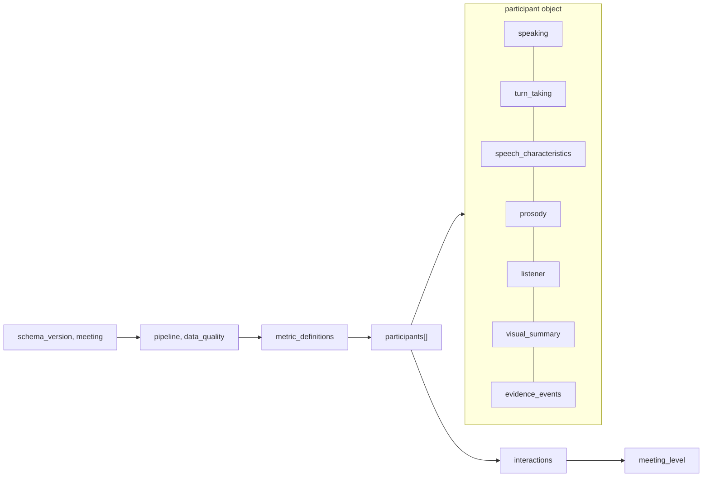
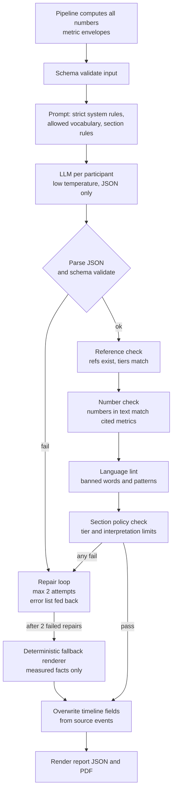
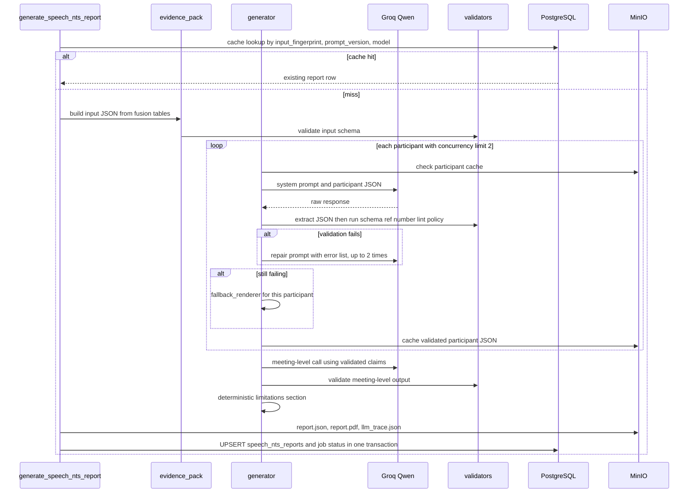

# 18 — Speech NTS Reporting

**Project:** NTS (Non-Technical Skills) Meeting Analysis
**Phase:** 18 — Evidence-driven speech and interaction reporting
**Depends on:** `17_SPEECH_PIPELINE_ARCHITECTURE.md` (job `fuse_multimodal_features` produces this document's input; job `generate_speech_nts_report` consumes it)
**Status:** Design / ready for implementation

---

## 1. Purpose and Principles

The Phase 10 report turns visual behavioral summaries into a structured NTS PDF. Phase 18 extends that architecture with speech, diarization, prosody, linguistic features, turn-taking, interruptions, listener behavior, and speaker-listener interaction.

The main risk in this phase is not missing data but **over-interpretation**. A report that says "P2 has low confidence because of a low pitch" is unsupported and potentially harmful. The design therefore rests on six principles:

1. **Numbers come from code, never from the LLM.** All metrics are computed deterministically in the pipeline (doc 17). The LLM only selects, orders, and phrases them.
2. **Every claim carries a tier and references.** Each sentence in the report is tagged `OBSERVED`, `MEASURED`, `INFERRED`, or `LLM_INTERPRETATION`, and cites metric or event IDs that exist in the input.
3. **The report describes behavior, not traits or internal states.** It states what was detected and how much. It does not state what someone felt, intended, or is like.
4. **Uncertainty is first-class.** Quality, coverage, and sample size travel with every metric. Low-quality metrics are reported as such or suppressed.
5. **Validation is automated.** Output that cites nonexistent evidence, alters a number, or uses banned inferential language is rejected and repaired, and after repeated failure falls back to a deterministic template.
6. **Extend, don't replace.** The existing Groq/Qwen pipeline, cache, UPSERT layer, and PDF builder are reused (Section 9).

---

## 2. Evidence Tiers

Every statement in the pipeline, the LLM input, and the report belongs to exactly one tier.

| Tier | Definition | Produced by | Example | May the LLM create it? |
|---|---|---|---|---|
| **OBSERVED** | A directly detected, timestamped event | Detectors and rules in the pipeline | "A head-nod pattern was detected at 08:14–08:16." "P2 began speaking at 12:03 while P4 was speaking." | No. It only restates events from input |
| **MEASURED** | An aggregate computed from observations by a documented formula | `fuse_multimodal_features` | "P2 speaking share: 18.4% of attributed speech time." "Median response latency: 1.8 s (n = 15)." | No. It only restates values from input |
| **INFERRED** | A label produced by a **deterministic heuristic rule** over measured signals, which can be wrong | Rule modules with named rule IDs | "Head-down with hand motion for 24% of listening time (rule `NOTE_PATTERN_v1`), consistent with possible note-taking." | No. The rule engine produces it, and the LLM may only restate it with hedged wording |
| **LLM_INTERPRETATION** | The LLM's synthesis: grouping, contrasts, prioritization of what to observe further | The LLM | "Turn-taking was distributed unevenly, with P2 and P4 accounting for most floor time." | Yes, but limited (see below) |

### 2.1 What LLM_INTERPRETATION may and may not do

**May:** compare participants using provided numbers, describe distributions, note co-occurrence of provided metrics, suggest *what to observe further*, summarize patterns already visible in the evidence.

**May not:** introduce any number not in the input, attribute internal states (confidence, nervousness, engagement, interest, boredom, stress, dominance, anxiety, motivation), infer personality or competence, use demographic assumptions, draw causal claims ("because"), or make recommendations about individuals' suitability, performance ratings, or employment.

`LLM_INTERPRETATION` sentences must cite at least one metric or event, use hedged language (`suggests`, `is consistent with`, `may indicate`), and appear only in allowed sections (Section 7 table). They render in the PDF with a distinct label and style.

---

## 3. Feature Catalog

All features are computed in the pipeline (doc 17). "Denominator" is stated explicitly for every ratio because most misleading statistics arise from ambiguous denominators.

### 3.1 Speaking and turn-taking

| Metric ID suffix | Definition | Unit | Denominator | Tier |
|---|---|---|---|---|
| `speaking.time_s` | Sum of attributed non-backchannel speech duration | s | – | MEASURED |
| `speaking.time_share_pct` | `time_s / total attributed speech time` | % | Total attributed speech time of all participants | MEASURED |
| `speaking.equal_share_ratio` | `time_share / (100/N)` where N is the participant count | ratio | – | MEASURED |
| `speaking.turn_count` | Turns (excluding backchannels) | count | – | MEASURED |
| `speaking.mean_turn_s`, `median_turn_s`, `longest_turn_s`, `p90_turn_s` | Turn duration stats | s | turns | MEASURED |
| `turn_taking.turns_per_10min` | `turn_count / analyzed_minutes × 10` | rate | – | MEASURED |
| `turn_taking.turns_initiated_after_silence` | Turns starting after ≥ 1.0 s of no speech by anyone | count | – | MEASURED |
| `turn_taking.turns_following_other_speaker` | Turns whose previous turn was by another participant | count | – | MEASURED |
| `turn_taking.response_latency_median_s` | Median gap from previous other-speaker turn end to own turn start, over turns with gap ≥ 0 | s | `n` turns with gap ≥ 0 | MEASURED |
| `turn_taking.response_latency_p90_s` | 90th percentile of the same | s | same | MEASURED |
| `turn_taking.overlap_starts` | Turn onsets during another participant's speech (non-backchannel) | count | – | OBSERVED events, MEASURED count |
| `turn_taking.interruptions_made` | Overlap onsets meeting the interruption rule (Section 4.1) | count | – | MEASURED (rule-defined) |
| `turn_taking.interruptions_received` | Same, seen from the interrupted speaker | count | – | MEASURED (rule-defined) |
| `turn_taking.backchannels_made` | Short acknowledgements during others' turns | count | – | MEASURED |
| `turn_taking.backchannels_received` | Same, received | count | – | MEASURED |

### 3.2 Speech characteristics (linguistic)

| Metric | Definition | Unit | Quality note |
|---|---|---|---|
| `speech.words_total` | Words attributed | count | Depends on STT accuracy |
| `speech.speaking_rate_wpm` | Words per minute over speaking time | wpm | Includes pauses within turns |
| `speech.articulation_rate_wpm` | Words per minute excluding pauses > 0.5 s | wpm | |
| `speech.pause_ratio` | Pause time within turns / turn time | ratio | |
| `speech.filler_rate_per_min` | Lexicon-matched fillers per minute of speech | rate | Language-dependent. Whisper may omit fillers |
| `speech.hedge_rate_per_100w` | Hedging-lexicon matches per 100 words | rate | Lexical only |
| `speech.mean_utterance_words` | Words per turn | count | |
| `speech.lexical_diversity_ttr50` | Mean type-token ratio over 50-word windows | ratio | Length-normalized |
| `speech.questions_asked` | Questions detected | count | Quality `medium` (rules) |
| `speech.mentions_of_others` | Name mentions of other participants | count | Only if names are known |

### 3.3 Prosody

Computed on voiced, non-overlapped speech only.

| Metric | Definition | Unit | Quality note |
|---|---|---|---|
| `prosody.f0_median_hz` | Median fundamental frequency | Hz | Reported with `n_voiced_frames` |
| `prosody.f0_p5_hz`, `f0_p95_hz` | 5th and 95th percentile | Hz | |
| `prosody.f0_range_semitones` | `12·log2(p95/p5)` | st | Preferred over Hz for spread |
| `prosody.f0_sd_semitones` | SD of F0 in semitones | st | |
| `prosody.intensity_median_db` | Median relative intensity | dB (relative) | **Uncalibrated.** Depends on the microphone and gain, so it is never compared across participants |
| `prosody.intensity_range_db` | p95 − p5 of intensity | dB | Within-speaker only |
| `prosody.voiced_ratio` | Voiced frames / speech frames | ratio | |

### 3.4 Listener behavior

Computed for each participant over intervals when **another** participant holds the floor ("listening intervals"). Frames with no reliable face are `not_assessable`, reported as coverage, and excluded from the denominators.

| Metric | Definition | Unit | Tier |
|---|---|---|---|
| `listener.assessable_pct` | Assessable listening time / total listening time | % | MEASURED |
| `listener.speaker_oriented_pct` | Assessable time with orientation toward the active speaker (method-dependent, Section 4.4) | % | MEASURED |
| `listener.gaze_away_pct` | Assessable time oriented away from both the speaker target and the screen/camera region | % | MEASURED |
| `listener.head_down_pct` | Assessable time with head pitch below threshold | % | MEASURED |
| `listener.possible_note_taking_pct` | Time matching rule `NOTE_PATTERN_v1` / assessable listening time | % | INFERRED |
| `listener.head_nods` | Nod events (pitch oscillation rule) | count | OBSERVED events, MEASURED count |
| `listener.posture_shifts` | Torso keypoint displacement events | count | OBSERVED events |
| `listener.expression_classifier_distribution` | Distribution of facial-expression classifier outputs during listening | % per class | MEASURED (classifier output), see caution below |

Categories are **not mutually exclusive** (for example head-down and gaze-away overlap, and note-taking is a subset of head-down). The schema states this so the report does not add them up.

**Facial-expression caution.** Classifier outputs (for example "neutral", "happy") are reported only as *classifier output distributions*, never as emotions or feelings, and they are excluded from `LLM_INTERPRETATION` in v1 unless quality is `high`.

### 3.5 Speaker-listener interactions

| Metric | Definition | Tier |
|---|---|---|
| `interactions.response_matrix[i][j]` | Number of turns by `j` immediately following a turn by `i` | MEASURED |
| `interactions.floor_transfer_share[i][j]` | `matrix[i][j] / sum_j matrix[i][j]` | MEASURED |
| `interactions.interruption_pairs[i→j]` | Interruptions by `i` of `j` | MEASURED |
| `interactions.orientation_to_speaker[listener][speaker]_pct` | Listener's speaker-oriented % while that speaker held the floor | MEASURED |
| `interactions.nods_to_speaker[listener][speaker]` | Nods by listener during speaker's turns | MEASURED |
| `interactions.questions_directed[i→j]` | Questions by `i` followed within 3 s by a turn from `j` (a **temporal adjacency**, not confirmed addressee) | MEASURED |

`questions_directed` is named as adjacency, and the report says "followed by a turn from P3", never "asked P3", unless a name mention exists in the question.

---

## 4. Exact Rules for Rule-Defined Metrics

These definitions are versioned (`rule_id`, `rule_version`) and included in `metric_definitions` of the LLM input, so both the model and human reviewers see the same definition.

### 4.1 Interruption rule (`INTERRUPT_v1`)

Speaker B's non-backchannel turn onset at time `t` is an interruption of speaker A when all hold:

1. A is speaking at `t` (A's turn began ≥ 1.0 s before `t`).
2. B's speech continues for ≥ 1.0 s after `t`.
3. A's turn ends within 2.0 s after `t`, **or** overlap lasts ≥ 1.5 s.

Otherwise the event is recorded as an `overlap_start` (not counted as an interruption). Simultaneous starts (both begin within 0.3 s after silence) are `simultaneous_start`. This rule detects **overlap-onset patterns**. It does not determine intent, appropriateness, or whether A had finished their point. The report language reflects this: "began speaking during P4's turn (overlap-onset rule)", not "rudely interrupted".

### 4.2 Response latency (`LATENCY_v1`)

For each turn whose previous turn was by a different participant and gap ≥ 0: latency = `turn.start − prev.end`. Turns with negative gaps (overlap) are excluded from latency statistics and counted in `overlap_starts`. `n` is always reported. Latency statistics with `n < 5` are `quality: low`.

### 4.3 Note-taking pattern (`NOTE_PATTERN_v1`, INFERRED)

Over a listening interval, a frame is flagged when head pitch is below −20° (config) sustained for ≥ 2 s **and** wrist keypoint motion energy in the lower frame region exceeds a threshold. The label is `possible_note_taking`. Reported wording is always "head-down and hand-motion pattern consistent with possible note-taking". Head-down alone is reported as `head_down_pct` and is never called note-taking. Phone use, reading, and typing produce similar signals, and the definition says so.

### 4.4 Speaker-oriented orientation (`ORIENT_v1`)

The interpretation depends on `layout_type` (doc 17, `track_participants`):

| Layout | Method | Report wording |
|---|---|---|
| `room_camera` | Angular difference between the listener's gaze/head bearing and the geometric bearing to the active speaker's position in the frame, within a tolerance | "oriented toward the active speaker" |
| `gallery_tiles` | Gaze toward the screen/camera region, since the listener cannot look at another person's tile relative to the camera in a way the camera can resolve. Speaker-specific targeting is **not** measurable | "screen-oriented" and never "looking at the speaker" |
| `unknown` | Screen-oriented proxy, quality capped at `low` | "screen-oriented (layout unknown)" |

The `analysis_context.capabilities.gaze_target` field carries `"speaker_specific"`, `"screen_proxy"`, or `"unavailable"`. The prompt (Section 6) requires the report to use the matching vocabulary.

### 4.5 Nod (`NOD_v1`)

Head pitch oscillation ≥ 2 cycles at 1–4 Hz with amplitude ≥ 5°, while another participant is speaking and the face is reliably tracked. Counted as `head_nods`. No affective meaning is attached.

### 4.6 Evidence event selection (`EVENT_SELECT_v1`)

The LLM input contains at most `K = 25` events per participant (config), chosen deterministically:

1. All interruptions made or received.
2. Longest turn, and the turns with the longest and shortest response latency.
3. The 3 longest sustained speaker-oriented and gaze-away intervals (≥ 10 s).
4. The 3 longest possible-note-taking intervals.
5. Question events (up to 5, evenly spread over time).
6. Fill up to K by even temporal spacing with events that have the highest detector confidence.

Events are sorted by time and given stable IDs (`E-0042`). Selection is fully deterministic, and it is not an LLM decision.

---

## 5. LLM Input JSON Schema

The pipeline (`fuse_multimodal_features`) writes `speech_nts_input.json` conforming to this schema. The report job validates it **before** any LLM call.

### 5.1 Structure overview



### 5.2 The metric envelope

Every metric is an object, not a bare number, so quality, denominator, and sample size are always visible to the model:

```json
{
  "id": "P2.speaking.time_share_pct",
  "value": 18.4,
  "unit": "%",
  "tier": "MEASURED",
  "n": 17,
  "denominator": "total attributed speech time (767.0 s)",
  "quality": "high",
  "method": "time_share_v1"
}
```

* `id` is `"{participant_id}.{group}.{name}"`, unique in the document, and it is what claims cite.
* `value` is a number or `null`. `null` means unavailable, and `quality` must then be `unavailable`.
* `n` is the number of underlying units (turns, frames, words, events).
* `quality` is one of `high | medium | low | unavailable`, derived by code from `n`, coverage, and attribution confidence (Section 5.5).

### 5.3 JSON Schema (draft 2020-12)

```json
{
  "$schema": "https://json-schema.org/draft/2020-12/schema",
  "$id": "https://nts.local/schemas/speech_nts_input/1.0",
  "title": "SpeechNtsInput",
  "type": "object",
  "additionalProperties": false,
  "required": ["schema_version", "meeting", "pipeline", "data_quality",
               "metric_definitions", "participants", "interactions", "meeting_level"],

  "$defs": {
    "tier": { "enum": ["OBSERVED", "MEASURED", "INFERRED"] },
    "quality": { "enum": ["high", "medium", "low", "unavailable"] },

    "metric": {
      "type": "object",
      "additionalProperties": false,
      "required": ["id", "value", "unit", "tier", "n", "quality"],
      "properties": {
        "id": { "type": "string", "pattern": "^[A-Za-z0-9_]+\\.[a-z_]+\\.[a-z0-9_]+$" },
        "value": { "type": ["number", "null"] },
        "unit": { "type": "string" },
        "tier": { "$ref": "#/$defs/tier" },
        "n": { "type": ["integer", "null"], "minimum": 0 },
        "denominator": { "type": ["string", "null"] },
        "quality": { "$ref": "#/$defs/quality" },
        "method": { "type": "string" }
      },
      "allOf": [
        { "if": { "properties": { "value": { "const": null } }, "required": ["value"] },
          "then": { "properties": { "quality": { "const": "unavailable" } } } }
      ]
    },

    "metric_group": {
      "type": "object",
      "additionalProperties": { "$ref": "#/$defs/metric" }
    },

    "event": {
      "type": "object",
      "additionalProperties": false,
      "required": ["event_id", "event_type", "t_start_s", "t_end_s", "tier", "rule"],
      "properties": {
        "event_id": { "type": "string", "pattern": "^E-[0-9]{4}$" },
        "event_type": { "enum": [
          "turn", "longest_turn", "interruption_made", "interruption_received",
          "overlap_start", "question", "backchannel", "speaker_oriented_interval",
          "gaze_away_interval", "head_nod", "possible_note_taking_interval",
          "response_latency_extreme", "posture_shift" ] },
        "t_start_s": { "type": "number", "minimum": 0 },
        "t_end_s": { "type": "number", "minimum": 0 },
        "tier": { "$ref": "#/$defs/tier" },
        "rule": { "type": "string" },
        "counterpart_id": { "type": ["string", "null"] },
        "confidence": { "type": ["number", "null"], "minimum": 0, "maximum": 1 },
        "detail": { "type": ["string", "null"], "maxLength": 200 },
        "transcript_excerpt": { "type": ["string", "null"], "maxLength": 160 }
      }
    },

    "matrix": {
      "type": "object",
      "required": ["row_ids", "col_ids", "values", "unit", "tier"],
      "properties": {
        "id": { "type": "string" },
        "row_ids": { "type": "array", "items": { "type": "string" } },
        "col_ids": { "type": "array", "items": { "type": "string" } },
        "values": { "type": "array", "items": { "type": "array", "items": { "type": ["number", "null"] } } },
        "unit": { "type": "string" },
        "tier": { "$ref": "#/$defs/tier" },
        "quality": { "$ref": "#/$defs/quality" }
      }
    }
  },

  "properties": {
    "schema_version": { "const": "speech_nts_input/1.0" },

    "meeting": {
      "type": "object",
      "additionalProperties": false,
      "required": ["meeting_id", "duration_s", "analyzed_interval_s", "participant_count",
                   "language", "layout_type", "total_attributed_speech_s"],
      "properties": {
        "meeting_id": { "type": "string" },
        "title": { "type": ["string", "null"] },
        "duration_s": { "type": "number" },
        "analyzed_interval_s": {
          "type": "object",
          "required": ["start", "end"],
          "properties": { "start": { "type": "number" }, "end": { "type": "number" } }
        },
        "participant_count": { "type": "integer", "minimum": 1 },
        "language": { "type": "string" },
        "layout_type": { "enum": ["gallery_tiles", "room_camera", "unknown"] },
        "total_attributed_speech_s": { "type": "number" },
        "unattributed_speech_s": { "type": "number" }
      }
    },

    "pipeline": {
      "type": "object",
      "required": ["pipeline_version", "config_hash", "generated_at", "models"],
      "properties": {
        "pipeline_version": { "type": "string" },
        "config_hash": { "type": "string" },
        "generated_at": { "type": "string", "format": "date-time" },
        "models": {
          "type": "object",
          "properties": {
            "stt": { "type": "string" }, "vad": { "type": "string" },
            "diarization": { "type": "string" }, "cv": { "type": "string" }
          }
        }
      }
    },

    "data_quality": {
      "type": "object",
      "additionalProperties": false,
      "required": ["capabilities", "attribution", "flags"],
      "properties": {
        "capabilities": {
          "type": "object",
          "required": ["speech", "prosody", "lip_attribution", "listener", "gaze_target"],
          "properties": {
            "speech": { "type": "boolean" },
            "prosody": { "type": "boolean" },
            "lip_attribution": { "type": "boolean" },
            "listener": { "type": "boolean" },
            "gaze_target": { "enum": ["speaker_specific", "screen_proxy", "unavailable"] }
          }
        },
        "attribution": {
          "type": "object",
          "required": ["method", "attributed_speech_pct", "mean_confidence"],
          "properties": {
            "method": { "enum": ["av_lip", "audio_only"] },
            "attributed_speech_pct": { "type": "number" },
            "mean_confidence": { "type": "number" }
          }
        },
        "audio": {
          "type": "object",
          "properties": {
            "overlap_speech_pct": { "type": "number" },
            "stt_mean_logprob": { "type": "number" },
            "estimated_snr_db": { "type": ["number", "null"] }
          }
        },
        "flags": {
          "type": "array",
          "items": {
            "type": "object",
            "required": ["code", "severity", "message"],
            "properties": {
              "code": { "type": "string" },
              "severity": { "enum": ["info", "warning", "critical"] },
              "message": { "type": "string" },
              "affects": { "type": "array", "items": { "type": "string" } }
            }
          }
        }
      }
    },

    "metric_definitions": {
      "type": "object",
      "description": "Keyed by 'group.name'. Rendered into the prompt so the model sees the same definition as reviewers.",
      "additionalProperties": {
        "type": "object",
        "required": ["definition", "unit", "denominator", "allowed_wording", "prohibited_inference"],
        "properties": {
          "definition": { "type": "string" },
          "unit": { "type": "string" },
          "denominator": { "type": "string" },
          "rule_id": { "type": "string" },
          "allowed_wording": { "type": "array", "items": { "type": "string" } },
          "prohibited_inference": { "type": "array", "items": { "type": "string" } }
        }
      }
    },

    "participants": {
      "type": "array",
      "minItems": 1,
      "items": {
        "type": "object",
        "additionalProperties": false,
        "required": ["participant_id", "display_label", "attribution_confidence",
                     "speaking", "turn_taking", "speech_characteristics", "prosody",
                     "listener", "evidence_events"],
        "properties": {
          "participant_id": { "type": "string", "pattern": "^P[0-9]+$" },
          "display_label": { "type": "string" },
          "attribution_confidence": { "$ref": "#/$defs/metric" },
          "speaking": { "$ref": "#/$defs/metric_group" },
          "turn_taking": { "$ref": "#/$defs/metric_group" },
          "speech_characteristics": { "$ref": "#/$defs/metric_group" },
          "prosody": { "$ref": "#/$defs/metric_group" },
          "listener": { "$ref": "#/$defs/metric_group" },
          "visual_summary": { "$ref": "#/$defs/metric_group" },
          "evidence_events": {
            "type": "array",
            "maxItems": 40,
            "items": { "$ref": "#/$defs/event" }
          },
          "participant_flags": { "type": "array", "items": { "type": "string" } }
        }
      }
    },

    "interactions": {
      "type": "object",
      "additionalProperties": false,
      "required": ["response_matrix", "interruption_matrix"],
      "properties": {
        "response_matrix": { "$ref": "#/$defs/matrix" },
        "floor_transfer_share": { "$ref": "#/$defs/matrix" },
        "interruption_matrix": { "$ref": "#/$defs/matrix" },
        "orientation_to_speaker_pct": { "$ref": "#/$defs/matrix" },
        "nods_to_speaker": { "$ref": "#/$defs/matrix" },
        "question_followed_by_turn": { "$ref": "#/$defs/matrix" }
      }
    },

    "meeting_level": {
      "type": "object",
      "properties": {
        "speech_density_pct": { "$ref": "#/$defs/metric" },
        "overlap_time_s": { "$ref": "#/$defs/metric" },
        "total_turns": { "$ref": "#/$defs/metric" },
        "total_interruptions": { "$ref": "#/$defs/metric" },
        "turn_share_gini": { "$ref": "#/$defs/metric" },
        "silence_longest_s": { "$ref": "#/$defs/metric" }
      }
    }
  }
}
```

The required metric IDs per group (the pipeline must always emit them, using `value: null, quality: "unavailable"` if not computable):

| Group | Required IDs |
|---|---|
| `speaking` | `time_s, time_share_pct, equal_share_ratio, turn_count, mean_turn_s, median_turn_s, longest_turn_s, p90_turn_s` |
| `turn_taking` | `turns_per_10min, turns_initiated_after_silence, turns_following_other_speaker, response_latency_median_s, response_latency_p90_s, overlap_starts, interruptions_made, interruptions_received, backchannels_made, backchannels_received` |
| `speech_characteristics` | `words_total, speaking_rate_wpm, articulation_rate_wpm, pause_ratio, filler_rate_per_min, hedge_rate_per_100w, mean_utterance_words, lexical_diversity_ttr50, questions_asked, mentions_of_others` |
| `prosody` | `f0_median_hz, f0_p5_hz, f0_p95_hz, f0_range_semitones, f0_sd_semitones, intensity_median_db, intensity_range_db, voiced_ratio` |
| `listener` | `assessable_pct, speaker_oriented_pct, gaze_away_pct, head_down_pct, possible_note_taking_pct, head_nods, posture_shifts` |

Extra tight rules enforced by a schema post-validator in code: `id` prefix must match the enclosing participant, `event_id` must be unique across the document, `t_end_s ≥ t_start_s`, and shares should sum to 100 ± 0.5 including `unattributed`.

### 5.4 Sample input JSON

The values are **synthetic**. Participant P2 matches the running example: 17 turns, mean turn 8.3 s, 18.4% of speaking time (total attributed speech 767 s). Some metrics and participants are elided with `...` for readability. The real file contains all required IDs.

```json
{
  "schema_version": "speech_nts_input/1.0",
  "meeting": {
    "meeting_id": "3f6c0b1e-9d5a-4f1e-8a77-0c2d4b9e1a10",
    "title": "Weekly operations review",
    "duration_s": 900.0,
    "analyzed_interval_s": { "start": 0.0, "end": 900.0 },
    "participant_count": 4,
    "language": "en",
    "layout_type": "gallery_tiles",
    "total_attributed_speech_s": 767.0,
    "unattributed_speech_s": 21.4
  },
  "pipeline": {
    "pipeline_version": "speech_v1",
    "config_hash": "9c1d7e4f",
    "generated_at": "2026-09-29T10:12:44Z",
    "models": { "stt": "faster-whisper large-v3 int8", "vad": "silero-vad 5.1",
                "diarization": "pyannote-3.1 (vendored)", "cv": "human 3.x" }
  },
  "data_quality": {
    "capabilities": { "speech": true, "prosody": true, "lip_attribution": true,
                      "listener": true, "gaze_target": "screen_proxy" },
    "attribution": { "method": "av_lip", "attributed_speech_pct": 97.3, "mean_confidence": 0.86 },
    "audio": { "overlap_speech_pct": 4.1, "stt_mean_logprob": -0.31, "estimated_snr_db": 24.0 },
    "flags": [
      { "code": "GALLERY_LAYOUT_GAZE_LIMIT", "severity": "info",
        "message": "Gallery layout: gaze orientation is measured toward the screen/camera region, not toward specific speakers." },
      { "code": "P3_LOW_ATTRIBUTION", "severity": "warning",
        "message": "P3 speaker mapping confidence 0.58; several P3 turns may be attributed to P4.",
        "affects": ["P3", "P4"] }
    ]
  },
  "metric_definitions": {
    "listener.speaker_oriented_pct": {
      "definition": "Share of assessable listening time during which the participant's gaze/head orientation was toward the screen/camera region (gallery layout proxy).",
      "unit": "%",
      "denominator": "assessable listening time",
      "rule_id": "ORIENT_v1",
      "allowed_wording": ["maintained screen-oriented gaze during X% of assessable listening time"],
      "prohibited_inference": ["attention", "engagement", "interest", "respect"]
    },
    "turn_taking.interruptions_made": {
      "definition": "Turn onsets during another participant's turn meeting the overlap-onset rule.",
      "unit": "count",
      "denominator": "n/a",
      "rule_id": "INTERRUPT_v1",
      "allowed_wording": ["began speaking during another participant's turn on X occasions (overlap-onset rule)"],
      "prohibited_inference": ["rudeness", "dominance", "disrespect", "intent"]
    }
  },
  "participants": [
    {
      "participant_id": "P2",
      "display_label": "Participant 2",
      "attribution_confidence": { "id": "P2.attribution.confidence", "value": 0.91, "unit": "0-1", "tier": "MEASURED", "n": 412, "quality": "high", "method": "av_lip_agreement" },
      "speaking": {
        "time_s":            { "id": "P2.speaking.time_s", "value": 141.1, "unit": "s", "tier": "MEASURED", "n": 17, "quality": "high" },
        "time_share_pct":    { "id": "P2.speaking.time_share_pct", "value": 18.4, "unit": "%", "tier": "MEASURED", "n": 17, "denominator": "total attributed speech time (767.0 s)", "quality": "high" },
        "equal_share_ratio": { "id": "P2.speaking.equal_share_ratio", "value": 0.74, "unit": "ratio", "tier": "MEASURED", "n": 4, "denominator": "equal share = 25.0%", "quality": "high" },
        "turn_count":        { "id": "P2.speaking.turn_count", "value": 17, "unit": "count", "tier": "MEASURED", "n": 17, "quality": "high" },
        "mean_turn_s":       { "id": "P2.speaking.mean_turn_s", "value": 8.3, "unit": "s", "tier": "MEASURED", "n": 17, "quality": "high" },
        "median_turn_s":     { "id": "P2.speaking.median_turn_s", "value": 6.1, "unit": "s", "tier": "MEASURED", "n": 17, "quality": "high" },
        "longest_turn_s":    { "id": "P2.speaking.longest_turn_s", "value": 27.9, "unit": "s", "tier": "MEASURED", "n": 17, "quality": "high" },
        "p90_turn_s":        { "id": "P2.speaking.p90_turn_s", "value": 16.4, "unit": "s", "tier": "MEASURED", "n": 17, "quality": "high" }
      },
      "turn_taking": {
        "turns_per_10min":               { "id": "P2.turn_taking.turns_per_10min", "value": 11.3, "unit": "rate", "tier": "MEASURED", "n": 17, "denominator": "15.0 analyzed minutes", "quality": "high" },
        "turns_initiated_after_silence": { "id": "P2.turn_taking.turns_initiated_after_silence", "value": 6, "unit": "count", "tier": "MEASURED", "n": 17, "quality": "high" },
        "turns_following_other_speaker": { "id": "P2.turn_taking.turns_following_other_speaker", "value": 15, "unit": "count", "tier": "MEASURED", "n": 17, "quality": "high" },
        "response_latency_median_s":     { "id": "P2.turn_taking.response_latency_median_s", "value": 1.8, "unit": "s", "tier": "MEASURED", "n": 13, "denominator": "turns following another speaker with gap >= 0", "quality": "medium", "method": "LATENCY_v1" },
        "response_latency_p90_s":        { "id": "P2.turn_taking.response_latency_p90_s", "value": 4.2, "unit": "s", "tier": "MEASURED", "n": 13, "quality": "medium", "method": "LATENCY_v1" },
        "overlap_starts":                { "id": "P2.turn_taking.overlap_starts", "value": 3, "unit": "count", "tier": "MEASURED", "n": 3, "quality": "high" },
        "interruptions_made":            { "id": "P2.turn_taking.interruptions_made", "value": 2, "unit": "count", "tier": "MEASURED", "n": 2, "quality": "high", "method": "INTERRUPT_v1" },
        "interruptions_received":        { "id": "P2.turn_taking.interruptions_received", "value": 1, "unit": "count", "tier": "MEASURED", "n": 1, "quality": "high", "method": "INTERRUPT_v1" },
        "backchannels_made":             { "id": "P2.turn_taking.backchannels_made", "value": 9, "unit": "count", "tier": "MEASURED", "n": 9, "quality": "medium" },
        "backchannels_received":         { "id": "P2.turn_taking.backchannels_received", "value": 4, "unit": "count", "tier": "MEASURED", "n": 4, "quality": "medium" }
      },
      "speech_characteristics": {
        "words_total":            { "id": "P2.speech.words_total", "value": 351, "unit": "count", "tier": "MEASURED", "n": 351, "quality": "high" },
        "speaking_rate_wpm":      { "id": "P2.speech.speaking_rate_wpm", "value": 149, "unit": "wpm", "tier": "MEASURED", "n": 351, "denominator": "speaking time", "quality": "high" },
        "articulation_rate_wpm":  { "id": "P2.speech.articulation_rate_wpm", "value": 171, "unit": "wpm", "tier": "MEASURED", "n": 351, "quality": "high" },
        "pause_ratio":            { "id": "P2.speech.pause_ratio", "value": 0.13, "unit": "ratio", "tier": "MEASURED", "n": 17, "quality": "high" },
        "filler_rate_per_min":    { "id": "P2.speech.filler_rate_per_min", "value": 1.1, "unit": "rate", "tier": "MEASURED", "n": 4, "quality": "low", "method": "filler_lexicon_en_v1" },
        "questions_asked":        { "id": "P2.speech.questions_asked", "value": 12, "unit": "count", "tier": "MEASURED", "n": 12, "quality": "medium", "method": "question_rules_en_v1" },
        "...": {}
      },
      "prosody": {
        "f0_median_hz":         { "id": "P2.prosody.f0_median_hz", "value": 118.0, "unit": "Hz", "tier": "MEASURED", "n": 8410, "denominator": "voiced non-overlapped 10 ms frames", "quality": "high" },
        "f0_p5_hz":             { "id": "P2.prosody.f0_p5_hz", "value": 92.0, "unit": "Hz", "tier": "MEASURED", "n": 8410, "quality": "high" },
        "f0_p95_hz":            { "id": "P2.prosody.f0_p95_hz", "value": 171.0, "unit": "Hz", "tier": "MEASURED", "n": 8410, "quality": "high" },
        "f0_range_semitones":   { "id": "P2.prosody.f0_range_semitones", "value": 10.7, "unit": "st", "tier": "MEASURED", "n": 8410, "quality": "high" },
        "intensity_median_db":  { "id": "P2.prosody.intensity_median_db", "value": 61.2, "unit": "dB (relative)", "tier": "MEASURED", "n": 8410, "quality": "medium" },
        "...": {}
      },
      "listener": {
        "assessable_pct":            { "id": "P2.listener.assessable_pct", "value": 88.0, "unit": "%", "tier": "MEASURED", "n": 3610, "denominator": "total listening time (758.0 s)", "quality": "high" },
        "speaker_oriented_pct":      { "id": "P2.listener.speaker_oriented_pct", "value": 74.0, "unit": "%", "tier": "MEASURED", "n": 3178, "denominator": "assessable listening time", "quality": "medium", "method": "ORIENT_v1:screen_proxy" },
        "gaze_away_pct":             { "id": "P2.listener.gaze_away_pct", "value": 19.0, "unit": "%", "tier": "MEASURED", "n": 3178, "denominator": "assessable listening time", "quality": "medium", "method": "ORIENT_v1:screen_proxy" },
        "head_down_pct":             { "id": "P2.listener.head_down_pct", "value": 27.0, "unit": "%", "tier": "MEASURED", "n": 3178, "quality": "medium" },
        "possible_note_taking_pct":  { "id": "P2.listener.possible_note_taking_pct", "value": 24.0, "unit": "%", "tier": "INFERRED", "n": 3178, "denominator": "assessable listening time", "quality": "low", "method": "NOTE_PATTERN_v1" },
        "head_nods":                 { "id": "P2.listener.head_nods", "value": 11, "unit": "count", "tier": "MEASURED", "n": 11, "quality": "medium", "method": "NOD_v1" },
        "...": {}
      },
      "evidence_events": [
        { "event_id": "E-0007", "event_type": "question", "t_start_s": 63.2, "t_end_s": 66.0, "tier": "OBSERVED", "rule": "question_rules_en_v1", "confidence": 0.8, "transcript_excerpt": "Can we confirm the handover time?" },
        { "event_id": "E-0011", "event_type": "interruption_made", "t_start_s": 148.4, "t_end_s": 153.0, "tier": "OBSERVED", "rule": "INTERRUPT_v1", "counterpart_id": "P4", "confidence": 0.9 },
        { "event_id": "E-0015", "event_type": "longest_turn", "t_start_s": 301.0, "t_end_s": 328.9, "tier": "OBSERVED", "rule": "turn_v1" },
        { "event_id": "E-0019", "event_type": "possible_note_taking_interval", "t_start_s": 402.0, "t_end_s": 431.5, "tier": "OBSERVED", "rule": "NOTE_PATTERN_v1", "detail": "head-down with hand motion, listening to P1", "counterpart_id": "P1", "confidence": 0.6 },
        { "event_id": "E-0021", "event_type": "head_nod", "t_start_s": 512.3, "t_end_s": 513.6, "tier": "OBSERVED", "rule": "NOD_v1", "counterpart_id": "P3", "confidence": 0.7 }
      ],
      "participant_flags": []
    },
    { "participant_id": "P1", "display_label": "Participant 1", "...": "same structure" }
  ],
  "interactions": {
    "response_matrix": {
      "id": "interactions.response_matrix",
      "row_ids": ["P1", "P2", "P3", "P4"], "col_ids": ["P1", "P2", "P3", "P4"],
      "values": [[0, 9, 6, 8], [7, 0, 3, 5], [5, 2, 0, 9], [9, 4, 7, 0]],
      "unit": "count (row speaker followed by column speaker)", "tier": "MEASURED", "quality": "medium"
    },
    "interruption_matrix": {
      "id": "interactions.interruption_matrix",
      "row_ids": ["P1", "P2", "P3", "P4"], "col_ids": ["P1", "P2", "P3", "P4"],
      "values": [[0, 0, 1, 0], [0, 0, 0, 2], [0, 1, 0, 0], [1, 0, 0, 0]],
      "unit": "count (row interrupted column)", "tier": "MEASURED", "quality": "high"
    }
  },
  "meeting_level": {
    "speech_density_pct": { "id": "M.meeting.speech_density_pct", "value": 85.2, "unit": "%", "tier": "MEASURED", "n": null, "quality": "high" },
    "total_interruptions": { "id": "M.meeting.total_interruptions", "value": 4, "unit": "count", "tier": "MEASURED", "n": 4, "quality": "high" }
  }
}
```

(In the real input the `"..."` placeholders above do not exist. They exist here only to shorten the sample.)

### 5.5 Quality assignment rules (computed by code, not the LLM)

| Condition | Effect |
|---|---|
| `n` below the metric's minimum (turn stats: 5 turns. Latency: 5. Prosody: 20 s voiced. Listener: 60 s assessable) | `quality: low`, or `unavailable` below half the minimum |
| Attribution confidence for the participant < 0.6 | All speaker-specific metrics capped at `low`. `participant_flags += "LOW_ATTRIBUTION"` |
| `listener.assessable_pct` < 50 | Listener metrics capped at `low` |
| Audio SNR < 10 dB | Prosody capped at `low`, linguistic capped at `medium` |
| Layout `gallery_tiles` or `unknown` | `speaker_oriented_pct` method `screen_proxy`, capped at `medium` |
| STT mean log-prob < −0.8 | Linguistic metrics capped at `low` |

The report renders `low` metrics with an explicit "low-quality measurement" marker and forbids using `low`-quality metrics as the sole basis of any `LLM_INTERPRETATION` sentence.

---

## 6. LLM Prompt Design

### 6.1 Call structure

Two stages, both using the existing Groq client:

1. **Per-participant call** (one per participant): receives the meeting header, `data_quality`, `metric_definitions`, that participant's block, the aggregate other-participant summary (interaction matrices), and returns that participant's report JSON. Smaller contexts reduce cross-participant contamination and truncation risk.
2. **Meeting-level call**: receives only already validated per-participant claims plus `meeting_level` and `interactions`, and returns the meeting summary, group patterns, and `limitations`. It cannot see raw metrics that were not cited, and it can only cite IDs from the input.

### 6.2 System prompt (versioned `speech_nts_system/1.0`)

```
You are an analyst writing an evidence-based observational report about
communication behavior in a recorded meeting. You describe what was detected
and measured. You do not diagnose, rate personality, or infer internal states.

INPUT
You will receive a JSON document. It contains metrics (each with an id, value,
unit, tier, n, quality, denominator), events (each with an event_id), and
metric_definitions. This JSON is the ONLY source of facts.

OUTPUT
Return ONE JSON object conforming to the provided output schema. No markdown,
no text before or after the JSON, no code fences, no reasoning text.

EVERY CLAIM is an object: {"text": ..., "tier": ..., "refs": [...]}.
- "tier" is one of OBSERVED, MEASURED, INFERRED, LLM_INTERPRETATION.
- "refs" lists metric ids and/or event ids that support the claim. Every ref
  MUST exist in the input exactly as written. A claim with no refs is invalid.
- OBSERVED claims restate an event (cite its event_id) and use past tense.
- MEASURED claims restate metric values. Numbers in "text" MUST be copied exactly
  from the cited metric (same value, same unit; you may round to the
  input's precision but never change it). Include n or the denominator when the
  input provides it.
- INFERRED claims may only restate a metric or event whose input tier is INFERRED.
  Use the hedge phrases "consistent with" or "possible", and name the rule
  in the input (rule id) when stating it.
- LLM_INTERPRETATION claims compare or summarize cited evidence. They must use
  hedged verbs (suggests, is consistent with, may reflect the pattern of),
  must cite at least two refs, and may appear only in the sections allowed by the
  schema. They may not introduce numbers absent from the input.

HARD RULES
1. Never state or imply an emotion, feeling, intention, motive, personality trait,
   skill level, competence, or state of mind. Prohibited words include (not limited to):
   confident, nervous, anxious, stressed, engaged, disengaged, bored, interested,
   uninterested, attentive, distracted, dominant, submissive, aggressive, rude,
   passive, assertive, shy, enthusiastic, hesitant, defensive, uncomfortable, respectful.
2. Never explain a measurement by a psychological cause. Forbidden patterns include:
   "because", "due to", "which shows/indicates/proves/means", "reflecting his/her/their".
3. Never interpret a single metric as a trait (for example pitch, speaking rate,
   gaze, or pause use). Describe the measurement and its context only.
4. Use only the vocabulary the input allows for gaze: if
   data_quality.capabilities.gaze_target is "screen_proxy", write "screen-oriented"
   and never "looked at the speaker". If "unavailable", make no gaze claims.
5. Report quality honestly. If a metric has quality "low", say "low-quality
   measurement". If "unavailable", say the measure is unavailable. Never fill gaps.
6. Do not compare absolute pitch or intensity values between participants.
   Within-participant description only.
7. Do not use demographic information, and do not guess gender, age, culture,
   accent, or native language.
8. Do not make recommendations about hiring, promotion, performance rating,
   or suitability. "Areas for further observation" must be phrased as questions
   about what additional recordings could clarify, not as advice to the person.
9. If participant_flags or data_quality.flags affect a participant (for example
   LOW_ATTRIBUTION), add a claim stating the limitation in the relevant section.
10. Use the participant's display_label only. Never invent names.
11. Do not quote transcript text beyond the provided transcript_excerpt fields.
12. If evidence for a section is insufficient, set "insufficient_evidence": true
    for that section and give one claim explaining what was unavailable.

STYLE
Neutral, concise, third person, past tense for events, present tense for measures.
No adjectives of judgment (good, poor, strong, weak, excellent, lacking).
Prefer "the analyzed interval" over "the meeting" when reporting percentages.
```

### 6.3 User prompt template

```
TASK: Write the participant report for {participant_id}.
SECTIONS: speaking_profile, participation, turn_taking, speech_characteristics,
prosody, communication_patterns, listener_behavior, interaction_with_others,
observable_strengths, areas_for_further_observation, evidence_timeline.

SECTION SOURCE RULES:
{section_rules_table}     # generated from Section 7 table

OUTPUT SCHEMA:
{output_json_schema}

INPUT JSON:
{participant_input_json}
```

Qwen note: the Phase 10 lesson (`response_format: json_object` misbehaved) is preserved. Do **not** pass the strict JSON mode flag. Rely on prompt instructions plus the validator below. Strip any `<think>...</think>` block if the model emits reasoning tokens, then extract the first balanced JSON object before parsing. Use low temperature (0.1–0.2), fixed `top_p`, and a `max_tokens` budget per participant.

### 6.4 Output JSON schema

```json
{
  "$id": "https://nts.local/schemas/speech_nts_report_participant/1.0",
  "type": "object",
  "additionalProperties": false,
  "required": ["schema_version", "participant_id", "sections"],
  "$defs": {
    "claim": {
      "type": "object",
      "additionalProperties": false,
      "required": ["text", "tier", "refs"],
      "properties": {
        "text": { "type": "string", "minLength": 5, "maxLength": 400 },
        "tier": { "enum": ["OBSERVED", "MEASURED", "INFERRED", "LLM_INTERPRETATION"] },
        "refs": { "type": "array", "minItems": 1, "items": { "type": "string" } }
      }
    },
    "section": {
      "type": "object",
      "additionalProperties": false,
      "required": ["claims", "insufficient_evidence"],
      "properties": {
        "insufficient_evidence": { "type": "boolean" },
        "claims": { "type": "array", "maxItems": 8, "items": { "$ref": "#/$defs/claim" } }
      }
    },
    "timeline_item": {
      "type": "object",
      "additionalProperties": false,
      "required": ["event_id", "t_start_s", "t_end_s", "summary", "tier"],
      "properties": {
        "event_id": { "type": "string", "pattern": "^E-[0-9]{4}$" },
        "t_start_s": { "type": "number" },
        "t_end_s": { "type": "number" },
        "summary": { "type": "string", "maxLength": 200 },
        "tier": { "enum": ["OBSERVED", "INFERRED"] }
      }
    }
  },
  "properties": {
    "schema_version": { "const": "speech_nts_report_participant/1.0" },
    "participant_id": { "type": "string" },
    "sections": {
      "type": "object",
      "additionalProperties": false,
      "required": ["speaking_profile", "participation", "turn_taking", "speech_characteristics",
                   "prosody", "communication_patterns", "listener_behavior",
                   "interaction_with_others", "observable_strengths",
                   "areas_for_further_observation"],
      "properties": {
        "speaking_profile": { "$ref": "#/$defs/section" },
        "participation": { "$ref": "#/$defs/section" },
        "turn_taking": { "$ref": "#/$defs/section" },
        "speech_characteristics": { "$ref": "#/$defs/section" },
        "prosody": { "$ref": "#/$defs/section" },
        "communication_patterns": { "$ref": "#/$defs/section" },
        "listener_behavior": { "$ref": "#/$defs/section" },
        "interaction_with_others": { "$ref": "#/$defs/section" },
        "observable_strengths": { "$ref": "#/$defs/section" },
        "areas_for_further_observation": { "$ref": "#/$defs/section" }
      }
    },
    "evidence_timeline": {
      "type": "array",
      "maxItems": 25,
      "items": { "$ref": "#/$defs/timeline_item" }
    }
  }
}
```

The `evidence_timeline` is nearly deterministic: the LLM may only choose the `summary` wording. The validator overwrites `t_start_s`, `t_end_s`, and `tier` from the input events, and it drops timeline items whose `event_id` is not in the input.

---

## 7. Report Sections

Each per-participant section has a defined source, allowed tiers, and boundaries.

| # | Section | Sources (input groups) | Allowed tiers | LLM_INTERPRETATION allowed? | Content boundary |
|---|---|---|---|---|---|
| 1 | **Speaking Profile** | `speaking.*` | MEASURED, OBSERVED | No | Speaking time and share, turn count, mean, median, and longest turn. No adjectives |
| 2 | **Participation** | `speaking.time_share_pct`, `equal_share_ratio`, `turns_per_10min`, `interactions.response_matrix` | MEASURED | Yes (comparison to equal share and to other participants) | "Share relative to equal share" is a ratio. No "over/under-participated" judgment words |
| 3 | **Turn-Taking** | `turn_taking.*`, events | MEASURED, OBSERVED | Yes (patterns) | Initiations, latency with n, overlaps, interruptions with rule name, backchannels |
| 4 | **Speech Characteristics** | `speech_characteristics.*` | MEASURED | No | Rate, articulation, pauses, fillers, hedges, questions. Values with quality |
| 5 | **Prosody** | `prosody.*` | MEASURED | **No** | Within-speaker descriptors only (median, range). No cross-participant comparison and no meaning attached |
| 6 | **Communication Patterns** | `speech_characteristics`, `turn_taking`, events, questions | MEASURED, OBSERVED | Yes | Co-occurrence of provided metrics (for example many questions and short turns), described not explained |
| 7 | **Listener Behavior** | `listener.*`, listener events | MEASURED, OBSERVED, INFERRED | Limited (two or more refs) | Orientation, head-down, possible note-taking (INFERRED, hedged), nods, coverage |
| 8 | **Interaction With Other Participants** | `interactions.*`, `counterpart_id` events | MEASURED, OBSERVED | Yes | Who followed whom, interruption pairs, orientation to specific speakers only when `gaze_target = speaker_specific` |
| 9 | **Observable Strengths** | Any | MEASURED, OBSERVED | Yes, but only *descriptive positives grounded in a measured behavior* | Framed as "observable behaviors": for example "posed 12 questions across the analyzed interval". Never trait language ("good communicator") |
| 10 | **Areas for Further Observation** | Any, plus `data_quality` | LLM_INTERPRETATION | Yes (this is where it lives) | Questions about what additional data could clarify. Not advice, not deficits. For example "Additional recordings could show whether the response-latency range (1.8 s median, n = 13) is stable across topics." |
| 11 | **Evidence Timeline** | `evidence_events` | OBSERVED, INFERRED | No | Chronological event list with event IDs and timestamps |

**Meeting-level sections** (second LLM call): Meeting Overview (duration, participants, speech density, analysis quality), Distribution of Floor Time, Interaction Structure (response and interruption matrices), Data Quality and Limitations (always present, mostly deterministic). Recognition of "Observable Strengths" at the meeting level is intentionally omitted.

**Data Quality and Limitations (mandatory, deterministic).** This section is rendered from `data_quality.flags` and capabilities by code, so a missing model call cannot omit it. It always states the attribution method, the gaze method, and the low-quality metrics.

---

## 8. Hallucination Prevention

### 8.1 Layered defenses



### 8.2 Rules (numbered; each is enforced in code and/or prompt)

| # | Rule | Enforced by |
|---|---|---|
| H1 | Numbers originate only from pipeline code. The LLM cannot create or modify them | Number check (8.3) |
| H2 | Every claim has ≥ 1 ref, and every ref exists in the input | Reference check |
| H3 | Tier of a claim must be consistent with the tier of its refs: OBSERVED or MEASURED claims may cite only refs whose input tier equals the claim tier, INFERRED claims only INFERRED refs, LLM_INTERPRETATION may cite any but ≥ 2 | Reference check |
| H4 | `INFERRED` and `LLM_INTERPRETATION` must contain a hedge marker | Language lint |
| H5 | Prohibited internal-state and trait vocabulary (list in `lint/banned_terms.yaml`) | Language lint |
| H6 | Prohibited causal connectors when used with a metric (`because`, `due to`, `which means`, `indicating that`, `as a result of`) | Language lint |
| H7 | Prohibited evaluative adjectives (good, poor, strong, weak, excellent, lacking, effective, ineffective) | Language lint |
| H8 | Gaze vocabulary must match `gaze_target` capability | Language lint (rule per capability) |
| H9 | Low-quality metrics must be labeled as such, and cannot be the sole reference for an `LLM_INTERPRETATION` | Section policy check |
| H10 | `unavailable` metrics may not appear with numbers | Number check |
| H11 | No cross-participant comparisons of absolute pitch or intensity | Language lint. `prosody` section may reference only own-participant IDs |
| H12 | `prosody` and `speech_characteristics` sections may contain no `LLM_INTERPRETATION` | Section policy check |
| H13 | No participant names beyond `display_label` | Name lint |
| H14 | Timeline events come from input events only, and times and tiers are overwritten from source | Post-processing |
| H15 | Attribution or coverage limitations are always surfaced when flagged | Deterministic limitations section plus a required-claim check: if a participant has `LOW_ATTRIBUTION`, a claim citing that flag must exist |
| H16 | Sections with insufficient evidence must be marked, and cannot be padded | Schema plus max-claims policy |
| H17 | Interruption language must reference the rule (overlap-onset) and avoid intent words | Language lint |
| H18 | Facial-expression classifier output is not reported as emotion | Banned emotion terms plus section policy |

### 8.3 Validator specification

`reporting/validation/` contains:

* `schema_check.py`: JSON Schema validation for the output.
* `ref_check.py`: builds an index `{id → metric | event}` from the input. Checks H2, H3, H14.
* `number_check.py`: extracts numeric tokens from `text` using a locale-safe regex (integers, decimals, percentages, times like `1.8 s`, `8.3s`). For each token, requires a match with a cited metric's `value` (equal within rounding tolerance `|Δ| ≤ 0.5 × 10^-d` where `d` is the decimals in the text), or a benign token from a whitelist (participant number in `P2`, section ordinals, `n =` values that equal a cited `n`). A number that matches no cited metric fails the claim, catching invented and mis-copied values.
* `lint.py`: tokenizes text (lowercase, lemma-lite) and checks `banned_terms.yaml`, causal patterns, evaluative adjectives, hedge presence (for tiers that need it), and the gaze vocabulary check.
* `policy_check.py`: section-by-tier matrix (Section 7), maximum claims, required limitation claims, low-quality reference rule.
* `repair.py`: builds a repair prompt, "Your previous output failed validation. Fix ONLY these problems: [structured error list with claim indices]. Return the complete corrected JSON."

Validation errors are structured (`code`, `section`, `claim_index`, `detail`) so repair prompts are precise, and they are logged into `llm_trace.json` for audit.

### 8.4 Deterministic fallback renderer

`reporting/fallback_renderer.py` produces the same report JSON structure without the LLM, using string templates per metric (for example `"{label} spoke for {time_s} s ({time_share_pct}% of attributed speech time) across {turn_count} turns."`). It emits only `MEASURED`, `OBSERVED`, and `INFERRED` claims. It has two uses:

1. Automatic fallback after failed repairs, so a report is always producible.
2. Test oracle: LLM output should never contain a measured value the fallback lacks.

The report records `generation_mode` (`llm` or `deterministic_fallback`) at the top and per participant.

### 8.5 Allowed versus disallowed wording

| Instead of (disallowed) | Use (allowed) |
|---|---|
| "Low pitch indicates confidence." | "Median pitch was 118 Hz (p5–p95: 92–171 Hz; n = 8,410 voiced frames)." |
| "Looking away shows disengagement." | "Participant's gaze was oriented away from the screen region during 19% of assessable listening time." |
| "High speaking rate suggests nervousness." | "Speaking rate was 149 words per minute (articulation rate 171 wpm)." |
| "P2 was attentive to speakers." | "P2 maintained screen-oriented gaze during 74% of assessable listening time (gallery layout, screen proxy)." |
| "P2 took notes." | "Head-down and hand-motion patterns consistent with possible note-taking were detected during 24% of assessable listening time (rule NOTE_PATTERN_v1, low-quality measurement)." |
| "P2 interrupted P4 rudely." | "P2 began speaking during P4's turn on 2 occasions (overlap-onset rule), for example at 02:28 (E-0011)." |
| "P2 is a dominant speaker." | "P2 accounted for 18.4% of attributed speech time (0.74 × equal share)." |
| "P2 asked P3 a question." | "P2's question at 06:12 was followed by a turn from P3 after 1.4 s." |
| "P3 is passive." | "P3 accounted for 9.7% of attributed speech time in 7 turns (attribution confidence 0.58, low-attribution flag)." |
| "P2 frequently initiated turns." (without number) | "6 of P2's 17 turns began after at least 1.0 s of silence." |
| "P2 appeared happy." | "The facial-expression classifier output 'neutral' for 71% of assessable frames (classifier output, not an emotion measure)." |

---

## 9. Extending the Existing Groq/Qwen Pipeline

### 9.1 What stays exactly as is

* `nts_visual_reports` table, UPSERT logic, and Phase 10 routes.
* Groq client wrapper, model configuration (`GROQ_MODEL`, currently `qwen/qwen3.8-27b` per the project history), retry and rate-limit handling.
* The "aggregate millions of CV rows into compact statistical summaries" step. Its output becomes the participant's `visual_summary` group in the new input (metrics wrapped in the envelope).
* `reportlab` PDF infrastructure, fonts, header and footer styles.
* Prompt files loaded by the existing prompt loader, and the tolerant JSON extraction from Phase 10 (no `response_format`).
* The five NTS category framework (Visual Communication, Teamwork, Leadership, Influence, Resilience) and any numeric scores computed by Phase 10.

### 9.2 What is added

```
backend/app/reporting/
├── __init__.py
├── visual/                         # EXISTING Phase 10 code, moved here without behavior change
├── speech/
│   ├── evidence_pack.py            # reads fusion tables, builds and schema-validates speech_nts_input.json
│   ├── envelope.py                 # Metric envelope dataclasses, quality rules (Section 5.5)
│   ├── event_selection.py          # EVENT_SELECT_v1
│   ├── definitions.py              # metric_definitions registry (single source for prompt and UI)
│   ├── prompts/
│   │   ├── speech_nts_system_1_0.txt
│   │   ├── speech_nts_participant_user_1_0.txt
│   │   └── speech_nts_meeting_user_1_0.txt
│   ├── schemas/
│   │   ├── speech_nts_input_1_0.json
│   │   ├── speech_nts_report_participant_1_0.json
│   │   └── speech_nts_report_meeting_1_0.json
│   ├── generator.py                # per-participant orchestration, caching, repair loop
│   ├── validation/  schema_check.py ref_check.py number_check.py lint.py policy_check.py repair.py
│   ├── lint/        banned_terms.yaml  causal_patterns.yaml  evaluative_terms.yaml  hedges.yaml
│   ├── fallback_renderer.py
│   └── pdf_sections.py             # reportlab sections for the speech report
├── combined/
│   └── merge.py                    # optional: combined visual + speech PDF
└── common/
    ├── groq_client.py              # EXISTING wrapper, shared
    ├── json_extract.py             # EXISTING tolerant JSON extraction (strip <think>, balanced braces)
    └── report_cache.py             # EXISTING UPSERT helper, generalized by report_type
```

### 9.3 Report modes

| `report_mode` | Contents | Inputs |
|---|---|---|
| `visual` | Phase 10 report, unchanged | Visual summaries |
| `speech` | Sections 1–11 for each participant plus meeting-level sections | `speech_nts_input.json` |
| `combined` | Speech report plus the visual report, merged in one PDF with a shared Data Quality section. **Two independent LLM runs**, not one large prompt | Both |

A key design decision: **the visual and speech reports are generated independently, then merged by code, not by a third LLM call.** Merging with one prompt would let the model correlate speech and visual signals into new interpretations that no rule or metric supports (for example "looked away when others spoke, so was disengaged"). Cross-modal observations are limited to the deterministic listener metrics computed in the pipeline (Section 3.4).

### 9.4 Database

New table `speech_nts_reports` (defined in doc 17, Section 6.1 with these details):

| Column | Notes |
|---|---|
| `id` | uuid |
| `meeting_id` | fk |
| `report_mode` | `speech` or `combined` |
| `input_fingerprint` | sha256 of `speech_nts_input.json` |
| `prompt_version`, `model`, `temperature` | Part of the cache key |
| `generation_mode` | `llm` or `deterministic_fallback` |
| `report_json` | jsonb: the final validated report |
| `validation_summary` | jsonb: counts of repairs and errors per participant |
| `pdf_key` | MinIO key |
| `created_at`, `updated_at` | |

Unique key: `(meeting_id, report_mode, input_fingerprint, prompt_version, model)`. Writes use `INSERT ... ON CONFLICT DO UPDATE`, the same UPSERT idiom as `nts_visual_reports`. Per-participant results are cached in MinIO (`report/participants/{pid}_{hash}.json`) so a partial run resumes.

### 9.5 Sequence



### 9.6 Changes to the existing category scoring

Phase 10 produces NTS category output (Visual Communication, Teamwork, Leadership, Influence, Resilience) from visual data. Phase 18 makes **no change** to those and **does not add** speech-derived numeric NTS category scores (Section 10 explains why). Speech metrics appear as their own report sections. If the team later wants speech evidence to inform category narratives, that is done by adding an "Evidence available from speech" list of metric references beneath each category, generated by code, not by feeding speech data into the category prompt.

---

## 10. Scoring Methodology

**Principle:** A number may be called a score only when it is (a) computed by a documented formula from measured features, (b) has a stated reference frame, and (c) does not claim to measure an unobserved construct. There is no validated norm-referenced instrument here. Speaking rate, pitch, and gaze do not have validated mappings to NTS constructs such as leadership or resilience for this pipeline. **Therefore no composite "speech NTS score" is produced.**

### 10.1 Descriptive indices that are justified

These describe the recording, not the person. Each is a transparent transformation of measured features.

| Index | Formula | Reference frame | Why it is justified | Gating |
|---|---|---|---|---|
| **Floor-share ratio** | `time_share_pct / (100 / N)` | Equal share among N participants in this meeting | Direct arithmetic from measured time. Value 1.0 means equal share | Attribution confidence ≥ 0.6 |
| **Turn-initiation ratio** | `turns_initiated_after_silence / turn_count` | Own turns | Ratio of two counts under a stated rule | `turn_count ≥ 5` |
| **Response-follow ratio** | `turns_following_other_speaker / turn_count` | Own turns | Ratio of two counts | `turn_count ≥ 5` |
| **Overlap-onset rate** | `overlap_starts / analyzed_minutes × 10` | Per 10 minutes | Rate under `INTERRUPT_v1` | Analyzed ≥ 5 min |
| **Interruption balance** | `interruptions_made − interruptions_received` | Own counts | Simple difference. Reported with both counts, never alone | none |
| **Listener assessable coverage** | `assessable_pct` | Listening time | Coverage, not behavior | none |
| **Meeting floor-share concentration** | Gini coefficient of `time_share_pct` across participants | 0 = equal, 1 = concentrated | Standard descriptive statistic | `N ≥ 3` |
| **Speaker-oriented share** | `speaker_oriented_pct` | Assessable listening time | Percentage of a detected state. Wording depends on `gaze_target` | `assessable_pct ≥ 50` |

Each index renders as "value (definition, reference frame, n)". Indices do not get ratings such as "high", "low", "good". If a comparison is helpful, the report cites the ratio to the equal share or the within-meeting rank ("2nd of 4 by floor share"), which are properties of the data rather than judgments.

### 10.2 What is not scored, and why

| Not produced | Reason |
|---|---|
| Confidence, assertiveness, leadership, or influence score from pitch, rate, or speaking share | No validated mapping. Speaking share differs by role, agenda, and meeting type, and pitch varies by anatomy and language |
| Engagement or attention score from gaze or orientation | Gaze does not measure attention. Gallery layout cannot resolve targets. Note-taking causes looking down |
| Emotion or stress score from prosody or facial-expression classifiers | Classifiers are unvalidated for this context and produce cultural and individual bias |
| Communication-quality score from filler or hedge rates | Rates depend on language, register, and STT omission of fillers |
| Percentile against a population | No calibrated reference population |
| Composite across modalities | Weights would be arbitrary and unfalsifiable |

### 10.3 Optional future scoring (requires validation study)

If NTS-category scoring from speech is later required, it needs a documented validation step first: expert-rated golden set, inter-rater reliability, feature-to-rating analysis, calibration by meeting type, and versioned scoring config. Until then, the system exposes measured features and descriptive indices only. This limitation is stated in the report footer.

### 10.4 Within-meeting comparison rules

* Comparison across participants in one meeting is allowed for counts, shares, and rates with the same denominator basis.
* Comparison of prosody and intensity across participants is never done.
* Rankings are only shown for indices in 10.1 and carry `n`.
* Between-meeting comparisons are out of scope for this phase (different content, participants, and audio conditions).

---

## 11. Sample Generated Report

### 11.1 Sample participant output JSON (excerpt for P2, abbreviated)

```json
{
  "schema_version": "speech_nts_report_participant/1.0",
  "participant_id": "P2",
  "sections": {
    "speaking_profile": {
      "insufficient_evidence": false,
      "claims": [
        { "text": "Participant 2 spoke for 141.1 s, which was 18.4% of total attributed speech time (767.0 s) in the analyzed interval.", "tier": "MEASURED", "refs": ["P2.speaking.time_s", "P2.speaking.time_share_pct"] },
        { "text": "Participant 2 held 17 turns with a mean duration of 8.3 s and a median of 6.1 s. The longest turn lasted 27.9 s.", "tier": "MEASURED", "refs": ["P2.speaking.turn_count", "P2.speaking.mean_turn_s", "P2.speaking.median_turn_s", "P2.speaking.longest_turn_s"] }
      ]
    },
    "participation": {
      "insufficient_evidence": false,
      "claims": [
        { "text": "Participant 2's floor share was 0.74 times an equal share among 4 participants (equal share = 25.0%).", "tier": "MEASURED", "refs": ["P2.speaking.equal_share_ratio"] },
        { "text": "Participant 2's floor share was below the equal-share reference while 6 of 17 turns began after silence, a pattern that suggests turns were initiated across the interval rather than only in response to others.", "tier": "LLM_INTERPRETATION", "refs": ["P2.speaking.equal_share_ratio", "P2.turn_taking.turns_initiated_after_silence", "P2.speaking.turn_count"] }
      ]
    },
    "turn_taking": {
      "insufficient_evidence": false,
      "claims": [
        { "text": "The median response latency was 1.8 s (n = 13 turns following another speaker; 90th percentile 4.2 s).", "tier": "MEASURED", "refs": ["P2.turn_taking.response_latency_median_s", "P2.turn_taking.response_latency_p90_s"] },
        { "text": "Participant 2 began speaking during another participant's turn on 2 occasions under the overlap-onset interruption rule, including at 02:28 (P4's turn).", "tier": "OBSERVED", "refs": ["P2.turn_taking.interruptions_made", "E-0011"] },
        { "text": "Participant 2's turn was started by another participant during their speech on 1 occasion.", "tier": "MEASURED", "refs": ["P2.turn_taking.interruptions_received"] }
      ]
    },
    "prosody": {
      "insufficient_evidence": false,
      "claims": [
        { "text": "Median pitch was 118.0 Hz, with a 5th to 95th percentile range of 92.0 to 171.0 Hz (10.7 semitones; n = 8,410 voiced frames).", "tier": "MEASURED", "refs": ["P2.prosody.f0_median_hz", "P2.prosody.f0_p5_hz", "P2.prosody.f0_p95_hz", "P2.prosody.f0_range_semitones"] },
        { "text": "Relative intensity was measured with an uncalibrated scale and is reported for within-participant description only (median 61.2 dB relative, medium-quality measurement).", "tier": "MEASURED", "refs": ["P2.prosody.intensity_median_db"] }
      ]
    },
    "listener_behavior": {
      "insufficient_evidence": false,
      "claims": [
        { "text": "Face tracking was assessable during 88.0% of the participant's listening time.", "tier": "MEASURED", "refs": ["P2.listener.assessable_pct"] },
        { "text": "In this gallery layout, screen-oriented gaze was detected during 74.0% of assessable listening time, and gaze oriented away from the screen region during 19.0% (medium-quality measurements; the measure is not speaker-specific).", "tier": "MEASURED", "refs": ["P2.listener.speaker_oriented_pct", "P2.listener.gaze_away_pct"] },
        { "text": "Head-down and hand-motion patterns consistent with possible note-taking (rule NOTE_PATTERN_v1) covered 24.0% of assessable listening time; this is a low-quality measurement and is not confirmed by the recording.", "tier": "INFERRED", "refs": ["P2.listener.possible_note_taking_pct"] },
        { "text": "11 head-nod patterns were detected while other participants were speaking.", "tier": "MEASURED", "refs": ["P2.listener.head_nods"] }
      ]
    },
    "interaction_with_others": {
      "insufficient_evidence": false,
      "claims": [
        { "text": "After Participant 2's turns, the next turn was taken by Participant 4 on 5 occasions, by Participant 1 on 7 occasions and by Participant 3 on 3 occasions.", "tier": "MEASURED", "refs": ["interactions.response_matrix"] }
      ]
    },
    "observable_strengths": {
      "insufficient_evidence": false,
      "claims": [
        { "text": "Participant 2 asked 12 questions across the analyzed interval (question rules; medium-quality measurement), including at 01:03 (E-0007).", "tier": "MEASURED", "refs": ["P2.speech.questions_asked", "E-0007"] }
      ]
    },
    "areas_for_further_observation": {
      "insufficient_evidence": false,
      "claims": [
        { "text": "Additional recordings, ideally with per-speaker gaze targets, could clarify whether the observed gaze-away and head-down proportions vary with the speaker or topic.", "tier": "LLM_INTERPRETATION", "refs": ["P2.listener.gaze_away_pct", "P2.listener.possible_note_taking_pct"] }
      ]
    }
  },
  "evidence_timeline": [
    { "event_id": "E-0007", "t_start_s": 63.2,  "t_end_s": 66.0,  "summary": "Question: \"Can we confirm the handover time?\"", "tier": "OBSERVED" },
    { "event_id": "E-0011", "t_start_s": 148.4, "t_end_s": 153.0, "summary": "Began speaking during P4's turn (overlap-onset rule).", "tier": "OBSERVED" },
    { "event_id": "E-0015", "t_start_s": 301.0, "t_end_s": 328.9, "summary": "Longest turn (27.9 s).", "tier": "OBSERVED" },
    { "event_id": "E-0019", "t_start_s": 402.0, "t_end_s": 431.5, "summary": "Head-down and hand motion while P1 spoke; possible note-taking pattern.", "tier": "INFERRED" },
    { "event_id": "E-0021", "t_start_s": 512.3, "t_end_s": 513.6, "summary": "Head-nod pattern while P3 spoke.", "tier": "OBSERVED" }
  ]
}
```

In this sample, the LLM-authored sentences are the two `LLM_INTERPRETATION` claims. The rest restate the input values under their tiers.

### 11.2 Rendered report structure (PDF outline)

```
SPEECH & INTERACTION REPORT — Weekly operations review
Generated 2026-09-29 · Pipeline speech_v1 · Report mode: speech · Generation: LLM (validated)

1  MEETING OVERVIEW
   Duration 15:00 · 4 participants · Language en · Layout: gallery tiles
   Speech density 85.2% · Total attributed speech 767.0 s · Unattributed 21.4 s
   Evidence key: [OBSERVED] [MEASURED] [INFERRED] [LLM INTERPRETATION]

2  DATA QUALITY AND LIMITATIONS                       (deterministic)
   • Speaker attribution: audio-visual (lip) method, 97.3% of speech attributed, mean confidence 0.86
   • Gaze is measured toward the screen/camera region; speaker-specific gaze is not measurable in this layout
   • P3: mapping confidence 0.58; P3 and P4 turn metrics may be affected
   • Intensity is uncalibrated; pitch and intensity are not compared across participants

3  MEETING-LEVEL PATTERNS
   3.1 Distribution of floor time (bar chart of time_share_pct, with the equal-share line)
   3.2 Response matrix (heatmap) and interruption matrix (table)
   3.3 Meeting-level summary claims                    (LLM_INTERPRETATION, cited)

4  PARTICIPANT REPORTS (one per participant, same layout)
   Participant 2
   ┌ Metric summary card (values, units, n, quality icons) ┐
   4.1  Speaking Profile
   4.2  Participation
   4.3  Turn-Taking
   4.4  Speech Characteristics
   4.5  Prosody                                  (chart: F0 distribution, own only)
   4.6  Communication Patterns
   4.7  Listener Behavior                        (timeline strip: oriented / away / head-down)
   4.8  Interaction With Other Participants      (row of the matrices)
   4.9  Observable Strengths
   4.10 Areas for Further Observation
   4.11 Evidence Timeline                        (table: time · event id · tier · summary)
   Each claim line shows a tier badge and the ids of its evidence refs in small text.

5  METHODS AND DEFINITIONS
   Rule definitions (INTERRUPT_v1, LATENCY_v1, NOTE_PATTERN_v1, ORIENT_v1, NOD_v1)
   Metric definitions, denominators, quality thresholds

6  FOOTER (every page)
   "This report describes measured and detected behaviors in a single recording. It does not
    assess skills, personality, emotions, or performance, and is not a basis for employment or
    clinical decisions."
```

**Rendering rules (`pdf_sections.py`):**

* Tier badges have distinct styles. `LLM_INTERPRETATION` is shown in italics with the label "Interpretation (AI-generated summary of the cited evidence)".
* `low` quality metrics are shown in gray with a "low-quality" tag.
* Claims cite refs in small text so reviewers can trace any sentence back to a value.
* Charts use only MEASURED data and are generated by code from the input JSON, not by the LLM.

---

## 12. Testing and Evaluation

| Test | Method | Pass criterion |
|---|---|---|
| Input schema | Validate `speech_nts_input.json` across golden meetings | 100% pass. Missing required IDs fail the pipeline, not the report |
| Number fidelity | Compare all numbers in reports with cited metrics | 0 mismatches after validation. Track pre-repair mismatch rate as a model-quality signal |
| Reference validity | All refs exist and tiers match | 100% after validation |
| Banned-language lint | Run lint on 200 generated reports | 0 violations after validation. Track pre-repair rate |
| Adversarial prompts | Inputs with tempting metrics (very low pitch, 0% gaze, 220 wpm, 10 interruptions) | No trait, emotion, or causal language passes validation |
| Missing-data behavior | Remove the listener block, force `lip_attribution: false`, `gaze_target: unavailable` | Limitation claims present, no gaze claims, sections flagged `insufficient_evidence` |
| Low-attribution behavior | Attribution confidence 0.4 | Participant flagged. All metrics capped at `low`. Limitation claim present (H15) |
| Fallback equivalence | Compare LLM report against fallback report per participant | Every MEASURED value in the LLM report exists in the fallback |
| Determinism | Same input, same fingerprint | Cache hit, no LLM calls |
| Human review | 2 reviewers per golden meeting use a checklist (any unsupported inference? any misleading wording? any missing limitation?) | ≥ 95% of claims accepted, and 0 unsupported psychological inferences |

Regression rule: any change to a prompt, lint list, schema, or model bumps `prompt_version` and requires re-running this suite on the golden set before release.

---

## 13. Privacy, Fairness, and Ethics Notes

* **Consent and purpose.** Recordings and derived audio features are personal data. Reports should only be generated for meetings where participants consented to behavioral analysis. The report footer states the scope. Store the LLM trace (which contains only derived metrics and short transcript excerpts, not raw audio) under the same retention rules as the report.
* **Data minimization to the LLM.** The LLM input contains derived metrics, short excerpts (max 160 chars per event), and participant labels. It contains no raw transcript, audio, names, or video.
* **Measurement bias.** STT accuracy varies with accent and language, pitch estimation varies with voice and audio conditions, and face and gaze detectors vary with lighting, skin tone, camera angle, glasses, and head coverings. These are reasons for the quality flags and for banning trait inference. The report's Methods section says so.
* **No individual evaluation.** The system is designed for observational reflection and training discussion, not ranking, hiring, or disciplinary use. The footer says so, and API documentation says so.
* **Human review.** The Speaker Map Review screen (doc 17) is the review point for attribution, which is the most consequential automated step for per-person accuracy.

---

## 14. Implementation Checklist

1. Add `reporting/speech/envelope.py` and `definitions.py`, and unit test the quality rules (Section 5.5).
2. Implement `evidence_pack.py` and `event_selection.py`, and validate against the input schema using the synthetic sample in Section 5.4 as the first fixture.
3. Move Phase 10 code under `reporting/visual/` with no behavior change, and confirm existing tests pass.
4. Implement validators (`ref_check`, `number_check`, `lint`, `policy_check`) with tests first, before any prompt work.
5. Implement `fallback_renderer.py` and the PDF sections. This produces a complete report without any LLM call, which gives an early end-to-end path.
6. Add prompts and `generator.py` with the repair loop, using the existing Groq client and tolerant JSON extraction.
7. Add the meeting-level call and the deterministic limitations section.
8. Add `speech_nts_reports` UPSERT and MinIO caching. Connect to job `generate_speech_nts_report` (doc 17, 5.12).
9. Run the evaluation suite (Section 12) on golden meetings. Tune lint lists and prompts.
10. Add the `combined` mode merge, and the frontend report viewer with tier badges and evidence-ref hover tooltips.
