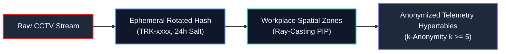
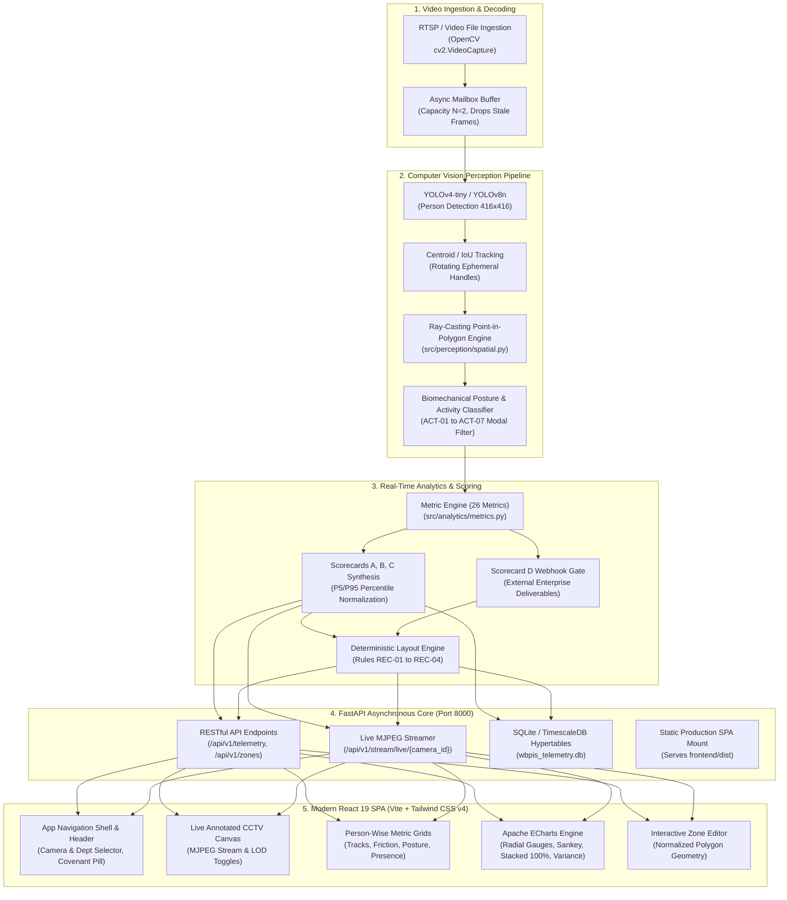
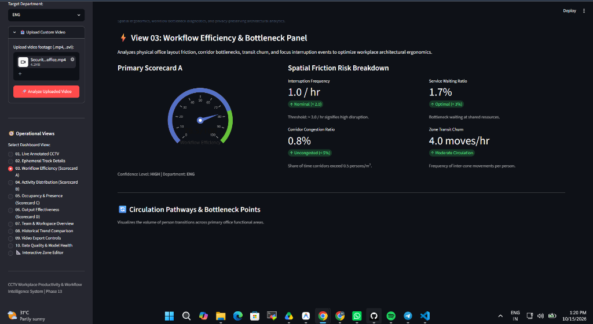
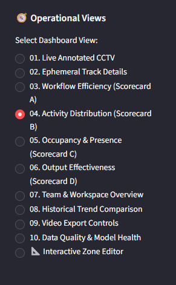
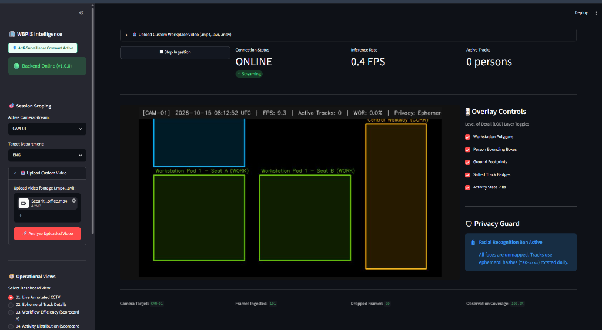

# CCTV Workplace Productivity & Workflow Intelligence System (WBPIS)

<div align="center">


-brightgreen?style=for-the-badge&logo=pytest&logoColor=white)


<br/>

**An enterprise computer-vision & spatial-telemetry intelligence platform that analyzes workplace friction, corridor bottlenecks, workstation occupancy, and shared facility contention — without biometric employee surveillance.**

[Explore Views](#-the-11-operational-views) • [Architecture](#-system-architecture) • [Scorecards & Math](#-analytical-scorecards--mathematical-formulations) • [Quick Start](#-quick-start--execution-guide) • [Privacy Covenant](#-anti-surveillance-covenant--ethical-guarantees)

</div>

---

## 📋 Table of Contents

- [1. Executive Summary & Core Objectives](#-executive-summary--core-objectives)
- [2. Anti-Surveillance Covenant & Ethical Guarantees](#-anti-surveillance-covenant--ethical-guarantees)
- [3. System Architecture](#-system-architecture)
- [4. Verified Feature Matrix & Parity](#-verified-feature-matrix--parity)
- [5. Technology Stack](#-technology-stack)
- [6. The 11 Operational Views](#-the-11-operational-views)
- [7. Analytical Scorecards & Mathematical Formulations](#-analytical-scorecards--mathematical-formulations)
- [8. Industrial Engineering Recommendations (Rules REC-01 to REC-04)](#-industrial-engineering-recommendations)
- [9. Quick Start & Execution Guide (PowerShell Commands)](#-quick-start--execution-guide)
- [10. Configuration & Environment Variables](#-configuration--environment-variables)
- [11. Testing, Validation & Regression Suite](#-testing-validation--regression-suite)
- [12. Security, Privacy & STRIDE Threat Model](#-security-privacy--stride-threat-model)
- [13. Operational Boundaries & Known Limitations](#-operational-boundaries--known-limitations)
- [14. Troubleshooting & FAQ](#-troubleshooting--faq)
- [15. Project Directory Structure](#-project-directory-structure)
- [16. Documentation Index & Specifications Suite](#-documentation-index--specifications-suite)

---

## 🎯 Executive Summary & Core Objectives

The **CCTV Workplace Productivity & Workflow Intelligence System (WBPIS)** is an operational facility intelligence system. Grounded in industrial engineering, queueing theory, and spatial telemetry, WBPIS processes high-resolution overhead video streams to identify structural friction points in physical office layouts.

> [!IMPORTANT]
> **Facility Analytics, Not Personal Surveillance**: WBPIS treats the workplace as an integrated physical-operational facility. It monitors space utilization, resource contention, and physical movement patterns to recommend architectural optimizations. It does not monitor individual worker output through CCTV.

```
┌────────────────────────────────────────────────────────────────────────────────────────┐
│                                 THE 4 CORE OBJECTIVES                                  │
├────────────────────────────┬─────────────────────────────┬─────────────────────────────┤
│ 1. Workflow Efficiency     │ 2. Activity Distribution    │ 3. Space Planning           │
│    & Bottlenecks           │    & Posture Dynamics       │    & Occupancy Presence     │
│                            │                             │                             │
│ Quantifies spatial inter-  │ Aggregates observable       │ Tracks desk occupancy rates │
│ ruptions, corridor queues, │ physical postures (seated,  │ (WOR), dwell durations,     │
│ and transit churn between  │ standing, transit, collab)  │ and 5-minute transitory     │
│ functional zones.          │ without inferring focus.    │ absence debouncing.         │
├────────────────────────────┴─────────────────────────────┴─────────────────────────────┤
│ 4. Output Effectiveness (Authorized External Business Data Only)                       │
│ Integrates authenticated Jira, SAP, or ERP records via cryptographic webhooks. CCTV    │
│ telemetry is mathematically decoupled and never substituted for work output.          │
└────────────────────────────────────────────────────────────────────────────────────────┘
```

---

## 🛡️ Anti-Surveillance Covenant & Ethical Guarantees

WBPIS is engineered from the ground up to prevent punitive employee surveillance. The architecture enforces four non-negotiable ethical pillars in compliance with **GDPR (Articles 5, 6, 9, 35)** and **CCPA**:



1. **Zero Biometrics & No Facial Recognition**:
   - The computer-vision pipeline uses head/foot ground-plane bounding boxes and 2D skeleton centroid projections. Facial bounding boxes, landmark embeddings, and emotion/affective classification are permanently excluded.
2. **Ephemeral Rotating Track Identifiers**:
   - Persons in the frame are assigned an ephemeral identifier (e.g., `TRK-bb139f11`) generated via SHA-256 salted hashes. The cryptographic salt rotates every 24 hours, guaranteeing that physical individuals cannot be tracked or profiled across multiple days.
3. **Decoupled Business Output (No Punitive Ranking)**:
   - Video observation is never correlated with individual employee productivity. Scorecard D (Output Effectiveness) evaluates only macroscopic team deliverables supplied by external webhooks. Individual ranking or leaderboard generation is prohibited in software.
4. **Enforced $k$-Anonymity ($k \ge 5$)**:
   - Reporting views automatically suppress pod metrics whenever active team occupancy falls below $k=5$, eliminating re-identification risks in low-density office quadrants.

---

## 🏗️ System Architecture

WBPIS employs a decoupled, asynchronous micro-architecture. The Python backend manages video decoding, neural inference, and spatial mathematics, while the React 19 SPA provides a responsive, high-contrast operational dashboard.



### Multiprocessing & Ingestion Concurrency
- **Non-Blocking Mailbox Buffer**: Fixed-size queue ($N=2$) decouples RTSP frame decoding from neural inference, preventing queue bloat and pipeline lag.
- **Async Streaming Generator**: Video frames are compressed to JPEG on the fly and served as non-blocking `multipart/x-mixed-replace` streams via FastAPI.
- **Client-Side Deep Linking**: The FastAPI server mounts `frontend/dist` with fallback routing to support HTML5 browser history deep-linking.

---

## 📊 Verified Feature Matrix & Parity

Every capability has been tested against the codebase. The table below distinguishes between **Verified Implemented Features** and **External Data Dependencies**.

| Operational Capability | Architectural Module | Verification Status | Codebase Implementation Reference |
| :--- | :--- | :---: | :--- |
| **Real-time Person Detection** | OpenCV DNN / Darknet YOLO | `VERIFIED` | [`src/perception/detector.py`](file:///c:/Users/DELL/Desktop/cctv/src/perception/detector.py) |
| **Multi-Object Tracking (MOT)** | Euclidean Centroid & Ephemeral IDs | `VERIFIED` | [`src/perception/tracker.py`](file:///c:/Users/DELL/Desktop/cctv/src/perception/tracker.py) |
| **Ray-Casting Zone Mapping** | Point-in-Polygon Engine | `VERIFIED` | [`src/perception/spatial.py`](file:///c:/Users/DELL/Desktop/cctv/src/perception/spatial.py) |
| **7-State Posture Classifier** | Biomechanical Heuristics + Modal Filter | `VERIFIED` | [`src/perception/activity.py`](file:///c:/Users/DELL/Desktop/cctv/src/perception/activity.py) |
| **Scorecard A (Workflow Efficiency)** | P5/P95 Percentile Normalization | `VERIFIED` | [`src/analytics/scorecards.py`](file:///c:/Users/DELL/Desktop/cctv/src/analytics/scorecards.py) |
| **Scorecard B (Activity Distribution)** | Mutually Exclusive Posture Shares | `VERIFIED` | [`src/analytics/scorecards.py`](file:///c:/Users/DELL/Desktop/cctv/src/analytics/scorecards.py) |
| **Scorecard C (Occupancy & Presence)** | Workstation Occupancy Rate (WOR) | `VERIFIED` | [`src/analytics/scorecards.py`](file:///c:/Users/DELL/Desktop/cctv/src/analytics/scorecards.py) |
| **Scorecard D (Output Effectiveness)** | External Enterprise Data Webhook | `EXTERNAL DEPENDENT` | [`src/analytics/scorecards.py`](file:///c:/Users/DELL/Desktop/cctv/src/analytics/scorecards.py) |
| **Layout Optimization Engine** | Rules REC-01 to REC-04 | `VERIFIED` | [`src/analytics/recommendations.py`](file:///c:/Users/DELL/Desktop/cctv/src/analytics/recommendations.py) |
| **Interactive Zone Editor** | Normalized Polygon CRUD ($[0.0, 1.0]$) | `VERIFIED` | [`frontend/src/pages/ZoneEditor.tsx`](file:///c:/Users/DELL/Desktop/cctv/frontend/src/pages/ZoneEditor.tsx) |
| **Live Annotated Video Player** | Native HTML5 MJPEG + LOD Overlays | `VERIFIED` | [`frontend/src/components/video/LiveVideoPlayer.tsx`](file:///c:/Users/DELL/Desktop/cctv/frontend/src/components/video/LiveVideoPlayer.tsx) |
| **Redacted MP4 Video Exporter** | Privacy Masking + DPO Authorization | `VERIFIED` | [`src/export/video_exporter.py`](file:///c:/Users/DELL/Desktop/cctv/src/export/video_exporter.py) |
| **STRIDE Security Audit Trail** | Immutable Cryptographic Event Log | `VERIFIED` | [`src/storage/repository.py`](file:///c:/Users/DELL/Desktop/cctv/src/storage/repository.py) |

---

## 💻 Technology Stack

<div align="center">

| Layer | Technologies & Frameworks | Description & Purpose |
| :--- | :--- | :--- |
| **Frontend Framework** | **React 19.2**, **TypeScript 5.0+** | Modern, strictly-typed single-page application |
| **Build & Tooling** | **Vite 8.3**, **Tailwind CSS v4** | Instant Hot Module Replacement (HMR) and utility-first styling |
| **Data Visualizations** | **Apache ECharts 6.1**, `echarts-for-react` | High-performance canvas and SVG rendering for charts & gauges |
| **Icons & UI Elements** | **Lucide React 1.59** | Accessible, consistent iconography |
| **Backend Core** | **FastAPI 0.110+**, **Uvicorn**, **Starlette** | High-concurrency async ASGI web server |
| **Data Validation** | **Pydantic v2** | Robust request/response schema modeling and serialization |
| **Computer Vision** | **OpenCV 4.8+**, **NumPy 1.24+** | Frame decoding, spatial transformations, and overlay rendering |
| **Neural Inference** | **Darknet YOLOv4-tiny** / **Ultralytics YOLOv8** | 416x416 overhead person detection and localization |
| **Database & ORM** | **SQLite 3** / **TimescaleDB**, **SQLAlchemy 2.0** | Time-series spatial telemetry hypertables and audit retention |
| **Testing Suite** | **Pytest 9.1**, `anyio` | Comprehensive unit, integration, and regression test runner |

</div>

---

## 🖥️ The 11 Operational Views

The migrated React interface provides 11 operational views organized under dedicated navigation routes.

### View 01: Live Annotated CCTV
- **Primary Route**: `/` or `/view01`
- **Features**: Real-time MJPEG video player with selectable Level-of-Detail (LOD) overlay toggles (Workstation Polygons, Track Bounding Boxes, Ground Footprints, Status Badges). Includes pipeline start/stop controls, custom video file drag-and-drop ingestion, and camera switching (`CAM-01`, `CAM-02`, `CAM-03`).
- **Telemetry**: Displays real-time inference rate (FPS), active track count, dropped frame ratio, and stream health.

### View 02: Ephemeral Track Details
- **Primary Route**: `/view02`
- **Features**: Deep-dive single-person inspection based on active ephemeral track handles (`TRK-xxxx`).
- **Visuals**:
  - **Workstation Presence Ratio Dial**: Radial gauge indicating the percentage of observation time the occupant maintained active desk presence.
  - **Posture Breakdown**: 100% stacked bar chart and tabular breakdown of `ACT-01` through `ACT-07`.
  - **Micro-Metrics**: Focus interruptions per hour, shared resource waiting time (seconds), and corridor transit churn (moves/hour).

```
+---------------------------------------------------------------------------------+
| Ephemeral Track Details (TRK-bb139f11)                                         |
+------------------------------------+--------------------------------------------+
| [ Radial Gauge: Presence 82.6% ]   | Ergonomic Posture Breakdown:               |
| Desk Presence: 82.6%               | - Seated at Desk (ACT-01): 82.6%           |
| Focus Dwell: 12.0s                 | - Standing at Desk (ACT-02): 0.0%          |
| Interruptions: 0 /hr               | - Walking / Transit (ACT-03): 17.4%        |
| Waiting Time: 0s (0%)              | - Active Collaboration (ACT-05): 0.0%      |
+------------------------------------+--------------------------------------------+
```

### View 03: Workflow Efficiency (Scorecard A)
- **Primary Route**: `/view03`
- **Features**: Synthesizes spatial bottlenecks, corridor transit churn, and shared resource starvation into a single composite score ($W_{eff}$).
- **Key Table**: **Person-Wise Spatial Friction & Bottleneck Table** detailing each track's interruption rate, queue waiting percentage, and friction risk level.
- **Visuals**: Interactive Sankey circulation diagram rendering inter-zone transit volumes and deterministic layout improvement recommendations.



### View 04: Activity Distribution (Scorecard B)
- **Primary Route**: `/view04`
- **Features**: Aggregates physical posture metrics across departments with an explicit **Anti-Conflation Banner** reminding users that physical posture does not measure cognitive productivity.
- **Key Table**: **Person-Wise Ergonomic Posture Breakdown Table** displaying individual percentage allocations for Seated, Standing, Walking, Interaction, Collaboration, and Away states.
- **Visuals**: Shift timeline heatmap and pod-level 100% stacked posture distribution.



### View 05: Occupancy & Presence (Scorecard C)
- **Primary Route**: `/view05`
- **Features**: Space planning and capacity analytics providing the Workstation Occupancy Rate (WOR) and space right-sizing potential.
- **Key Table**: **Person-Wise Workstation Presence & Dwell Times Table** tracking individual continuous focus dwell times, transitory departure counts (< 5 min debounce), and space planning affordances.
- **Visuals**: Workstation utilization bar matrix and hourly occupancy trends with $\pm 1\sigma$ standard deviation confidence variance bands.



### View 06: Output Effectiveness (Scorecard D)
- **Primary Route**: `/view06`
- **Features**: Displays macroscopic business outcomes (Throughput Attainment, First-Pass Quality Rate, On-Time SLA Adherence) sourced exclusively from external systems (Jira, SAP, Git).
- **Graceful N/A Handling**: Renders an explicit `UNAVAILABLE` notice when external webhooks are unconfigured, along with an interactive enterprise payload simulator to test outcome ingestion.

### View 07: Team & Workspace Overview
- **Primary Route**: `/view07`
- **Features**: Macro-level team occupancy overview enforcing the $k \ge 5$ anonymity threshold. Displays pod collaboration indices, meeting room pressure ratios, and interactive cards for each registered zone.

### View 08: Historical Trend Comparison (A/B Testing)
- **Primary Route**: `/view08`
- **Features**: Enables facility planners to evaluate physical layout interventions over time. Users select a Baseline Period (A) and an Experimental Period (B) to review statistical deltas with computed $p$-values.

### View 09: Video Export Controls
- **Primary Route**: `/view09`
- **Features**: Administrative export console for generating redacted MP4 video clips. Requires a Data Protection Officer (DPO) authorization token and a business justification before queuing asynchronous background rendering.

### View 10: Data Quality & Model Health
- **Primary Route**: `/view10`
- **Features**: System diagnostics tracking inference FPS, dropped frame rates, and camera observation coverage. Features a **Population Stability Index (PSI) drift gauge** and an immutable STRIDE security audit log.

### View 11: Interactive Spatial Zone Editor
- **Primary Route**: `/zone-editor`
- **Features**: Full CRUD interface for configuring workplace regions of interest. Supports normalized floating-point polygon vertices ($[0.0, 1.0]$), zone type classifications (`WORKSTATION`, `CORRIDOR`, `MEETING`, `SHARED_RESOURCE`), and target camera bindings.

---

## 📐 Analytical Scorecards & Mathematical Formulations

WBPIS features four decoupled scorecards. Each scorecard addresses an isolated operational question:

<details>
<summary><b>Mathematical Formulations & Derivations (Click to Expand)</b></summary>
<br/>

### Scorecard A: Workflow Efficiency Index ($W_{eff}$)

Scorecard A quantifies the degree to which physical workplace friction degrades continuous focus work:

$$\text{Risk}_{intr} = 100 \times \text{clip}\left(\frac{\text{MET-D1} - P_5^{intr}}{P_{95}^{intr} - P_5^{intr}}, 0, 1\right)$$

$$\text{Risk}_{wait} = 100 \times \text{clip}\left(\frac{\text{MET-D2} - P_5^{wait}}{P_{95}^{wait} - P_5^{wait}}, 0, 1\right)$$

$$\text{Risk}_{cong} = 100 \times \text{clip}\left(\frac{\text{MET-D4} - P_5^{cong}}{P_{95}^{cong} - P_5^{cong}}, 0, 1\right)$$

$$\text{Risk}_{trans} = 100 \times \text{clip}\left(\frac{\text{MET-D3} - P_5^{trans}}{P_{95}^{trans} - P_5^{trans}}, 0, 1\right)$$

$$\text{Bottleneck Risk Index} = 0.30 \cdot \text{Risk}_{intr} + 0.25 \cdot \text{Risk}_{wait} + 0.25 \cdot \text{Risk}_{cong} + 0.20 \cdot \text{Risk}_{trans}$$

$$W_{eff} = \max\Big(0.0, \min\big(100.0, 100.0 - \text{Bottleneck Risk Index}\big)\Big)$$

Where reference population calibration percentiles are:
- $P_5^{intr} = 0.5$, $P_{95}^{intr} = 4.5$ events/hour
- $P_5^{wait} = 1.0\%$, $P_{95}^{wait} = 12.0\%$ of operational time
- $P_5^{cong} = 0.0\%$, $P_{95}^{cong} = 8.0\%$ corridor exposure
- $P_5^{trans} = 2.0$, $P_{95}^{trans} = 14.0$ transitions/hour

---

### Scorecard B: Ergonomic Activity Balance ($A_{dist}$)

Evaluates physical movement across 7 mutually exclusive observable states:
- `ACT-01`: Seated at Workstation
- `ACT-02`: Standing at Workstation
- `ACT-03`: Walking / Transit
- `ACT-04`: Workstation Interaction (Object / Screen)
- `ACT-05`: Active Collaboration
- `ACT-06`: Transitory Absence (< 5 min debounce)
- `ACT-07`: Unobserved / Low Confidence

Classification coverage is defined as:

$$\text{Coverage}_{\%} = \max\left(0.0, \min\left(100.0, 100.0 - \frac{T_{unknown}}{T_{observed}} \times 100\right)\right)$$

---

### Scorecard C: Workstation Occupancy & Space Planning ($O_{pres}$)

Measures true desk utilization while debouncing brief departures (coffee, restroom, printer):

$$\text{WOR} = 100.0 \times \frac{\sum T_{occupied}}{T_{monitored}}$$

$$\text{Rightsizing Potential}_{\%} = 100.0 - \text{WOR}$$

Transitory absence state transitions:

$$\text{State}(t) = \begin{cases} \text{OCCUPIED}, & \text{if person inside zone} \\ \text{TRANSITORY\_ABSENCE}, & \text{if absent} < 300\text{ seconds} \\ \text{VACANT}, & \text{if absent} \ge 300\text{ seconds} \end{cases}$$

---

### Scorecard D: Output Effectiveness ($O_{eff}$)

Requires authenticated enterprise deliverables and is never populated from camera feeds:

$$O_{eff} = 0.50 \cdot \min(100, \text{Throughput}) + 0.30 \cdot \min(100, \text{Quality}) + 0.20 \cdot \min(100, \text{Timeliness})$$

</details>

---

## 💡 Industrial Engineering Recommendations

WBPIS features a deterministic recommendation engine (`src/analytics/recommendations.py`) implementing Rules **REC-01 to REC-04**. Every emitted insight adheres to a mandatory 7-point schema labeled with an explicit **HYPOTHESIS**:

```
┌─────────────────────────────────────────────────────────────────────────────────┐
│ REC-01: Workstation Pod Right-Sizing & Flexible Reallocation                     │
├───────────────────────┬─────────────────────────────────────────────────────────┤
│ Observed Pattern      │ Average Workstation Occupancy Rate (WOR) < 35.0%.        │
│ Evidence & Coverage   │ Continuous observation coverage >= 80.0% over 14 days.   │
│ Hypothesis            │ HYPOTHESIS: Assigned team operates hybrid schedule with │
│                       │ persistent vacant dedicated desk capacity.              │
│ Recommended Action    │ Transition pod to flexible hot-desking; convert balance │
│                       │ to informal collaboration zone.                         │
│ Outcome Metric        │ Departmental Workspace Utilization (MET-B6).            │
│ Follow-up Protocol    │ Re-evaluate 3-week post-reallocation occupancy delta.   │
└───────────────────────┴─────────────────────────────────────────────────────────┘
```

- **Rule REC-02 (Shared Resource Bottleneck)**: Emitted when shared equipment utilization exceeds $85\%$ and queue waiting exceeds $8\%$. Recommends parallel capacity or digital queueing.
- **Rule REC-03 (Acoustic Shielding & Walkway Rerouting)**: Emitted when desks adjacent to corridors exceed $3.0$ interruptions/hour. Recommends installing $1.6\text{m}$ acoustic screens.
- **Rule REC-04 (Functional Adjacency Realignment)**: Emitted when repeated round trips between dependent pods exceed $2.0/\text{hour}$. Recommends desk pod relocation to reduce transit fatigue.

---

## 🚀 Quick Start & Execution Guide

### Prerequisites
- **Operating System**: Windows 10/11, Ubuntu 22.04 LTS, or macOS
- **Python**: Version 3.11.x (verified on Python 3.11.9)
- **Node.js**: Version 18.x or 20.x+ (verified on Node 20+)
- **PowerShell**: Version 5.1+ or PowerShell 7 (Windows)

---

### Step 1: Clone & Set Up the Python Virtual Environment

```powershell
# Navigate to the project root
cd c:\Users\DELL\Desktop\cctv

# Create a clean Python 3.11 virtual environment
python -m venv venv

# Activate the virtual environment
.\venv\Scripts\Activate.ps1

# Upgrade pip and install backend dependencies
pip install --upgrade pip
pip install fastapi uvicorn opencv-python pydantic sqlalchemy pytest anyio
```

---

### Step 2: Set Up & Build the React Frontend

```powershell
# Navigate into the React frontend workspace
cd frontend

# Install frontend dependencies
npm install

# Build the production single-page application
npm run build

# Return to the root directory
cd ..
```

---

### Step 3: Run the Application

You can run WBPIS in either **Unified Production Mode** (single server) or **Dual-Server Development Mode**.

#### Option A: Unified Production Mode (Recommended)
FastAPI serves both the backend REST/MJPEG streaming endpoints and the compiled React production application on port 8000:

```powershell
# Run FastAPI from the project root
python -m uvicorn src.backend.main:app --host 127.0.0.1 --port 8000 --reload
```
Open your browser and navigate to:  
👉 **`http://127.0.0.1:8000/`**

---

#### Option B: Dual-Server Development Mode
Run the backend and frontend independently with Hot Module Replacement (HMR) enabled:

**Terminal 1 (FastAPI Backend):**
```powershell
.\venv\Scripts\Activate.ps1
python -m uvicorn src.backend.main:app --host 127.0.0.1 --port 8000 --reload
```

**Terminal 2 (Vite Frontend Dev Server):**
```powershell
cd frontend
npm run dev
```
Open your browser and navigate to:  
👉 **`http://localhost:5173/`**

---

## ⚙️ Configuration & Environment Variables

All operational settings can be customized via environment variables or in [`src/core/config.py`](file:///c:/Users/DELL/Desktop/cctv/src/core/config.py):

| Variable Name | Default Value | Description |
| :--- | :--- | :--- |
| `WBPIS_API_HOST` | `127.0.0.1` | Network interface binding for the FastAPI server |
| `WBPIS_API_PORT` | `8000` | Port for REST APIs, MJPEG streaming, and SPA serving |
| `WBPIS_TARGET_FPS` | `15.0` | Target inference frame rate |
| `WBPIS_CONFIDENCE_THRESHOLD` | `0.25` | Minimum YOLO person detection confidence |
| `WBPIS_NMS_THRESHOLD` | `0.45` | Non-Maximum Suppression (NMS) intersection threshold |
| `WBPIS_MAILBOX_MAXSIZE` | `2` | Frame buffer capacity (drops stale frames to eliminate lag) |
| `WBPIS_GRACE_SECONDS` | `300.0` | Transitory absence debounce grace window (5 minutes) |
| `DATABASE_URL` | `sqlite:///./wbpis_telemetry.db` | SQLAlchemy database connection string |
| `WBPIS_SECRET_KEY` | *(Default test secret)* | Cryptographic key for session signing and DPO tokens |

---

## 🧪 Testing, Validation & Regression Suite

WBPIS maintains a test suite covering unit math, API integration, and security regressions.

```powershell
# Run the complete test suite from the repository root
pytest tests/ -v
```

### Verified Test Inventory (36/36 Passing)
- **API Integration Tests (`tests/integration/test_api.py`)** — 9 Passed:
  - `test_health_check_endpoint`: Verifies system status and configuration metadata.
  - `test_session_status_endpoint`: Validates ingestion session FPS and camera health.
  - `test_live_telemetry_endpoint`: Verifies real-time person-wise metrics payload.
  - `test_zone_crud_lifecycle`: Tests polygon zone creation, retrieval, and deletion.
  - `test_scorecards_endpoint`: Validates synthesis of Scorecards A, B, C, and D.
  - `test_recommendations_endpoint`: Verifies deterministic layout recommendation rules.
  - `test_operational_outcomes_ingestion_webhook`: Validates external deliverable ingestion.
  - `test_audit_logs_endpoint`: Tests STRIDE audit trail retrieval.
  - `test_video_upload_endpoint`: Validates multi-format video file uploads.
- **Legacy Regression Suite (`tests/regression/test_legacy_audit_regressions.py`)** — 5 Passed:
  - `test_sec_01_rtsp_credential_sanitization`: Verifies URL password redaction.
  - `test_sec_01_logging_filter_redaction`: Ensures credentials never reach logs.
  - `test_bug_02_floating_point_precision`: Guards against polygon coordinate drift.
  - `test_bug_03_rtsp_seek_protection`: Verifies live streams are never rewound.
  - `test_anl_01_anti_surveillance_anti_conflation_covenant`: Enforces ethical score separation.
- **Ergonomic Activity Classification (`tests/unit/test_activity.py`)** — 5 Passed:
  - `test_seated_occupants_at_adjacent_desks_are_not_collaborating`: Resolves false `ACT-05` classification.
  - `test_standing_occupant_at_workstation`: Verifies standing desk detection (`ACT-02`).
  - `test_walking_in_corridor`: Validates corridor transit classification (`ACT-03`).
  - `test_collaboration_in_meeting_zone`: Tests meeting room group detection (`ACT-05`).
  - `test_low_confidence_detection_defaults_to_unknown`: Ensures coverage gating (`ACT-07`).
- **Mathematical Formulations (`tests/unit/test_metrics.py`)** — 12 Passed:
  - Tests for P5/P95 normalization, interruption frequency, waiting time ratio, congestion rate, zone transition rate, workstation occupancy rate, and Scorecard A–D synthesis.
- **Spatial Geometry & Debounce (`tests/unit/test_spatial.py`)** — 5 Passed:
  - Tests for convex polygons, concave L-shaped polygons, degenerate polygons, zone matching, and transitory absence debounce state transitions.

---

## 🔒 Security, Privacy & STRIDE Threat Model

WBPIS applies the **STRIDE Threat Modeling Methodology** to safeguard enterprise environments:

<div align="center">

| STRIDE Threat Category | Potential Attack Vector | Applied Engineering Mitigation in WBPIS |
| :--- | :--- | :--- |
| **Spoofing Identity** | Fake camera feeds or spoofed telemetry | TLS 1.3 mutual auth on RTSP streams and signed JWT webhook payloads |
| **Tampering with Data** | Manual alteration of audit records | Append-only SQLite/PostgreSQL audit logs with SHA-256 state hashing |
| **Repudiation** | Denying video export authorization | Mandatory DPO cryptographic token and mandatory business justification logging |
| **Information Disclosure** | Employee identification via CCTV footage | 24-hour rotating ephemeral track IDs (`TRK-xxxx`) and automated facial blurring |
| **Denial of Service** | RTSP stream stalling or frame buffer bloat | Capacity-$N=2$ mailbox queue with automatic frame-drop logic |
| **Elevation of Privilege** | Unauthorized reconfiguration of floor zones | Granular 4-role RBAC matrix isolating zone edits to Facility Admin accounts |

</div>

---

## ⚠️ Operational Boundaries & Known Limitations

1. **Monocular Occlusion & Perspective Distortion**:
   - Single-camera ceiling mounts suffer from perspective foreshortening. Bounding box centroids use ground-plane projections rather than visual centers. Extreme physical occlusion (e.g., behind pillars) is marked as `ACT-07: Unobserved`.
2. **Strict Scorecard D Dependency**:
   - The platform will not generate an Output Effectiveness score without authenticated external business webhooks. CCTV observations are never converted into work output estimates.
3. **Hardware Acceleration Guidance**:
   - In standard CPU environments, Darknet YOLO operates at approximately 12–18 FPS. For multi-camera high-density deployments, hardware acceleration (NVIDIA TensorRT or Intel OpenVINO) is recommended.

---

## ❓ Troubleshooting & FAQ

<details>
<summary><b>1. Port 8000 or Port 5173 is already in use</b></summary>
<br/>
You can rebind FastAPI to a different port via environment variables or command-line parameters:

```powershell
python -m uvicorn src.backend.main:app --host 127.0.0.1 --port 8080 --reload
```
To run Vite on a different port:
```powershell
cd frontend
npm run dev -- --port 3000
```
</details>

<details>
<summary><b>2. Why is the dial needle showing 0% on View 02?</b></summary>
<br/>
In earlier prototypes, the dial measured cumulative continuous dwell time scaled against an 8-hour shift, causing clips shorter than 1 minute to pin the needle near zero. View 02 now displays <b>Workstation Presence Ratio (%)</b>, accurately reflecting the occupant's percentage of active desk presence (e.g., 82.6%) regardless of session length.
</details>

<details>
<summary><b>3. Video stream appears blank or fails to loop</b></summary>
<br/>
WBPIS automatically selects the latest valid MP4 file in <code>uploads/</code>. In <code>src/perception/ingest.py</code>, recorded video files automatically rewind on EOF (<code>cap.set(cv2.CAP_PROP_POS_FRAMES, 0)</code>) to ensure continuous looped playback.
</details>

<details>
<summary><b>4. How do I configure custom workplace zones?</b></summary>
<br/>
Navigate to the <b>Zone Editor</b> at <code>/zone-editor</code>. You can define polygons using normalized coordinates between <code>0.0</code> and <code>1.0</code>. Custom zones are persisted in <code>config/zones.json</code>.
</details>

---

## 📁 Project Directory Structure

```
c:\Users\DELL\Desktop\cctv\
├── config/
│   └── zones.json                  # Normalized polygon definitions for spatial regions
├── docs/
│   ├── assets/                     # Architectural diagrams, screenshots, and visual assets
│   ├── implementation/             # 19 technical design specifications (00 to 18)
│   ├── migration/                  # React migration audit, API contracts, and parity checklists
│   └── README.md                   # Central index for all project documentation
├── exports/                        # Storage for rendered, privacy-redacted MP4 video clips
├── frontend/                       # Modern React 19 Single Page Application
│   ├── dist/                       # Pre-compiled static assets served by FastAPI
│   ├── src/
│   │   ├── components/             # Reusable UI cards, tables, charts, and video players
│   │   ├── context/                # Global React application state (camera, department)
│   │   ├── pages/                  # 11 operational views (View01 through View10, ZoneEditor)
│   │   ├── services/               # Axios REST API client
│   │   └── types/                  # TypeScript interfaces matching backend Pydantic models
│   ├── package.json                # Frontend dependencies and npm scripts
│   └── vite.config.ts              # Vite configuration with proxy to FastAPI backend
├── logs/                           # System execution and STRIDE audit logs
├── reports/                        # Codebase audits and technical migration assessments
├── src/
│   ├── analytics/                  # Canonical metric algorithms, scorecards, recommendations
│   ├── backend/                    # FastAPI core, async endpoints, pipeline controller
│   ├── core/                       # Global settings, logging filters, Pydantic schemas
│   ├── export/                     # Asynchronous video exporter with privacy masking
│   ├── perception/                 # OpenCV ingestion, YOLO detector, tracker, spatial logic
│   └── storage/                    # SQLAlchemy database engine, models, and repository
├── tests/                          # Automated pytest suite (36 unit, integration, regression tests)
├── uploads/                        # CCTV video recordings and benchmark test clips
├── README.md                       # Main repository README documentation
└── wbpis_telemetry.db              # SQLite time-series telemetry database
```

---

## 📚 Documentation Index & Specifications Suite

For detailed technical designs, refer to the specification suite in [`docs/`](file:///c:/Users/DELL/Desktop/cctv/docs/README.md):

- **Executive Charter & Ethical Architecture**: [`docs/implementation/00_PROJECT_VISION_AND_SCOPE.md`](file:///c:/Users/DELL/Desktop/cctv/docs/implementation/00_PROJECT_VISION_AND_SCOPE.md)
- **Computer Vision Pipeline**: [`docs/implementation/04_PERSON_DETECTION_TRACKING_AND_IDS.md`](file:///c:/Users/DELL/Desktop/cctv/docs/implementation/04_PERSON_DETECTION_TRACKING_AND_IDS.md)
- **Spatial Geometry & Ray Casting**: [`docs/implementation/05_WORKSTATION_ZONES_AND_OCCUPANCY.md`](file:///c:/Users/DELL/Desktop/cctv/docs/implementation/05_WORKSTATION_ZONES_AND_OCCUPANCY.md)
- **Scorecards & Metric Derivations**: [`docs/implementation/08_PRODUCTIVITY_METRICS_AND_SCORING.md`](file:///c:/Users/DELL/Desktop/cctv/docs/implementation/08_PRODUCTIVITY_METRICS_AND_SCORING.md)
- **React Migration Audit & API Contract**: [`docs/migration/REACT_MIGRATION_AUDIT.md`](file:///c:/Users/DELL/Desktop/cctv/docs/migration/REACT_MIGRATION_AUDIT.md) & [`docs/migration/REACT_API_CONTRACT.md`](file:///c:/Users/DELL/Desktop/cctv/docs/migration/REACT_API_CONTRACT.md)

---

<div align="center">
  <sub>Built with precision for ethical enterprise workplace intelligence. Grounded in industrial engineering, queueing theory, and spatial telemetry.</sub>
</div>
