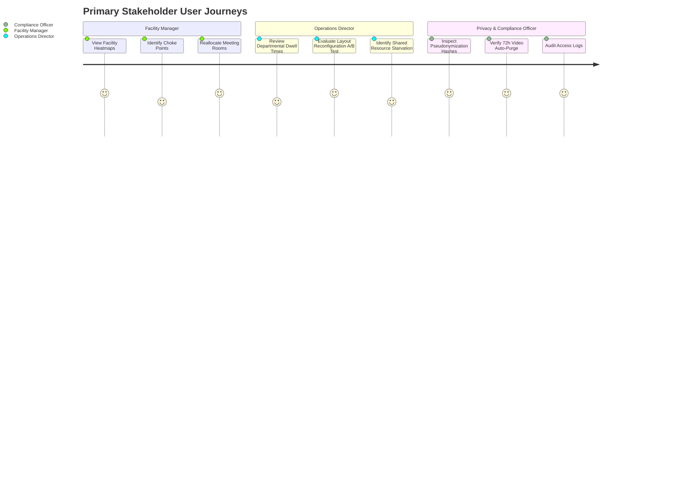

# Phase 00: Project Vision and Scope Specification

## 1. Document Overview

### 1.1 Purpose
This document establishes the strategic charter, scope boundaries, stakeholder personas, and core objectives for the CCTV Workplace Productivity and Workflow Intelligence System (WBPIS). It provides an authoritative definition of system capabilities and non-goals to prevent mission creep into intrusive, unscientific, or counterproductive employee surveillance.

### 1.2 Scope
- **In-Scope**: Office space spatial analytics, multi-camera corridor and workstation occupancy modeling, queue dwell time calculation, shared equipment contention monitoring, spatial transition modeling, and layout optimization A/B testing.
- **Out-of-Scope**: Individual employee performance scoring, disciplinary monitoring, facial recognition/identification, affective state or emotion detection, keystroke/screen monitoring, and automated employment decisions.

### 1.3 Target Audience
- Executive Sponsors & Facilities Directors
- Legal, Compliance, and Data Protection Officers
- Computer Vision and Machine Learning Engineers
- Backend & Distributed Systems Architects
- Human Resources & Industrial Engineering Specialists

---

## 2. Existing Implementation Findings

Grounding assessment based on [`reports/CCTV_PRODUCTIVITY_CODEBASE_AUDIT.md`](file:///C:/Users/DELL/Desktop/cctv/reports/CCTV_PRODUCTIVITY_CODEBASE_AUDIT.md):

| Component / Feature | Codebase Source | Verified Status | Audit Assessment & Deficiencies |
| :--- | :--- | :--- | :--- |
| **Desk Occupancy & Absence Timing** | `audit_extracted/.../app.py` | `EXISTING_VERIFIED` | Simple bounding box intersection with manually hardcoded desktop boxes. Suffers from `BUG-02` integer truncation on floating coordinates. |
| **Single-Camera Darknet Detection** | `audit_extracted/.../` | `EXISTING_VERIFIED` | YOLOv4-tiny person class detection running in a background C-thread. Suffers from segmentation faults and thread locks upon RTSP disconnection. |
| **Affective / Psychometric Profiling** | `video/choriwala_code.py` | `EXISTING_UNVERIFIED` | MediaPipe FaceMesh combined with PyTorch ResNet claiming to predict "Genuineness", "Attention Level", and Big-5 Personality traits. Deemed statistically unscientific and ethically invalid for workplace evaluation. |
| **End-to-End Workflow Optimization** | Neither | `UNAVAILABLE` | Neither legacy codebase contains workflow bottleneck metrics, corridor congestion tracking, queue dwell detection, or layout recommendation logic. |

---

## 3. Core Objectives & System Charter

The WBPIS system is architected around four foundational pillars designed to treat the workplace as an integrated physical-operational facility:

```
                  ┌───────────────────────────────────────────┐
                  │ CCTV Workplace Productivity & Intelligence│
                  └─────────────────────┬─────────────────────┘
                                        │
         ┌──────────────────┬───────────┴───────────┬──────────────────┐
         ▼                  ▼                       ▼                  ▼
┌─────────────────┐ ┌─────────────────┐ ┌─────────────────┐ ┌─────────────────┐
│  Objective A    │ │  Objective B    │ │  Objective C    │ │  Objective D    │
│    Workflow     │ │   Activity &    │ │   Occupancy &   │ │   Output &      │
│   Efficiency    │ │Time Distribution│ │   Attendance    │ │ Effectiveness   │
└─────────────────┘ └─────────────────┘ └─────────────────┘ └─────────────────┘
```

### 3.1 Objective A: Workflow Efficiency
Identifies observable physical bottlenecks, spatial friction, and resource starvation across the office layout:
- **Interruption Detection**: Measurable physical intrusions into focused workstation zones.
- **Queue Dwell & Choke-Point Monitoring**: Wait times and congestion spikes around shared operational assets (printers, meeting hubs, review counters).
- **Spatial Churn & Transit Waste**: Excessive traversing between disconnected interdependent functional zones.
- **Before-and-After Layout Evaluation**: Rigorous A/B testing of spatial layout reorganizations using objective physical transit metrics.

### 3.2 Objective B: Activity and Time Distribution
Measures aggregate time allocations across observable, physical posture and motion categories without psychological inferences:
- **7 Discrete Activity States**: Seated at Desk, Standing at Desk, Walking/Transit, Shared Resource Interaction, Active Collaboration, Away from Monitored Zone, Unknown/Unclassified.
- **Temporal Stability**: Rolling-window modal smoothing to eliminate frame-level inference jitter.
- **Coverage & Uncertainty Accounting**: Explicit tracking of observation coverage and unclassified time ratios.

### 3.3 Objective C: Occupancy and Attendance Patterns
Analyzes spatial utilization to optimize real estate allocations, heating/cooling zones, and desk-sharing policies:
- **True Occupancy vs. Field-of-View Loss**: Explicit mathematical separation between a person leaving a zone versus camera occlusion or video pipeline dropouts.
- **Macro Facility Utilization**: Ratio of occupied workstation-hours to total commissioned workstation-hours.
- **Temporal Density Mapping**: Heatmaps capturing peak load hours and underutilized quiet hours.

### 3.4 Objective D: Productivity and Output Outcomes
Provides structured ingestion pipelines for verified operational outcome data from external enterprise systems (ticketing, ERP, CRM, code commits):
- **Decoupled Attribution**: Clear boundary preventing CCTV posture metrics from acting as a surrogate for actual cognitive output.
- **Outcome Triangulation**: Correlating physical workflow bottlenecks (Objective A) with operational delays (Objective D) to diagnose systemic operational hurdles.
- **Graceful Fallback**: If external outcome data is absent, output productivity metrics report explicitly as `N/A`, never synthesized from camera feeds.

---

## 4. Stakeholder Personas & Use Cases



### 4.1 Persona 1: Facilities & Workplace Experience Manager
- **Role**: Responsible for real estate planning, desk allocation, ergonomic workstation provisioning, and physical plant efficiency.
- **Key Pain Point**: Reliance on subjective annual employee surveys or static badge-swipe logs that fail to show how desks and collaborative zones are utilized throughout the day.
- **System Value**: Real-time and historical utilization heatmaps showing under-utilized pods, overcrowded corridors, and peak occupancy hours.

### 4.2 Persona 2: Operations & Industrial Engineering Director
- **Role**: Oversees cross-departmental business processes, inter-team handoffs, and physical workflow efficiency.
- **Key Pain Point**: Unexplained productivity dips across shifts or teams due to physical friction (e.g., long walks to shared printers, loud transit corridors interrupting focused teams).
- **System Value**: Quantified zone transition rates, queue dwell times, and objective before-after comparison tools for workstation realignments.

### 4.3 Persona 3: Data Protection & Works Council Representative
- **Role**: Protects employee civil liberties, legal privacy rights (GDPR/CCPA/BDSG), and workplace dignity.
- **Key Pain Point**: Fear of automated surveillance panopticons, micromanagement, biometric profiling, and unfair algorithmic disciplinary actions.
- **System Value**: Verifiable zero-biometrics architecture, cryptographic ephemeral tracking, strictly aggregated team-level reporting, and complete absence of individual performance scoring.

---

## 5. Functional & Non-Functional Requirements

### 5.1 Functional Requirements (FR)

| ID | Description | Source Objective | Priority |
| :--- | :--- | :--- | :--- |
| **FR-01** | Ingest multi-camera RTSP video feeds (H.264/H.265) over TCP with mailbox-based frame dropping to maintain sub-second latency. | Architecture | P0 |
| **FR-02** | Detect all human bodies in frame and maintain pseudonymous track IDs across occlusions using ByteTrack. | Perceptual Engine | P0 |
| **FR-03** | Provide an interactive UI canvas for defining polygon workstation zones, shared resources, and corridors. | Objective C | P0 |
| **FR-04** | Classify person activity into 7 discrete, mutually exclusive physical states with a 5-second rolling modal filter. | Objective B | P0 |
| **FR-05** | Calculate spatial occupancy, queue dwell times, and corridor transit churn over configurable sliding windows. | Objective A, C | P0 |
| **FR-06** | Ingest external batch outcome metrics (tickets, units, quality) via authenticated REST webhook. | Objective D | P1 |
| **FR-07** | Generate deterministic spatial layout optimization recommendations based on bottleneck thresholds. | Objective A | P1 |
| **FR-08** | Render live annotated video streams and export timestamped MP4 evidence clips with overlay toggles. | Visualization | P1 |
| **FR-09** | Enforce an automated 72-hour cryptographic shredding policy for all stored raw edge video footage. | Ethics & Security | P0 |

### 5.2 Non-Functional Requirements (NFR)

| ID | Category | Requirement Specification | Metric / Target |
| :--- | :--- | :--- | :--- |
| **NFR-01** | **Latency** | End-to-end latency from RTSP camera capture to dashboard metric display. | $\le 2.0\text{ seconds}$ |
| **NFR-02** | **Throughput** | Sustained real-time inference across 4 concurrent 1080p camera streams on edge workstation. | $\ge 15\text{ FPS per stream}$ |
| **NFR-03** | **Accuracy (Detection)** | Person detection precision and recall across standardized office lighting conditions. | $\text{mAP@50} \ge 0.88$ |
| **NFR-04** | **Tracking Continuity** | Identity switch rate across continuous 15-minute multi-person video clips. | $\text{ID Switches} \le 1.5 / \text{min}$ |
| **NFR-05** | **Privacy** | Ephemeral identity persistence. Session track IDs rotate periodically and never link to HR identities. | Zero PII in DB |
| **NFR-06** | **Reliability** | Mean Time Between Failures (MTBF) under continuous 24/7 RTSP streaming with automated reconnect. | $\ge 720\text{ hours}$ |
| **NFR-07** | **Data Integrity** | Database write throughput and zero message loss for spatial event logging. | $0\%\text{ dropped events}$ |

---

## 6. Anti-Surveillance Covenant & Explicit Exclusions

To establish complete legal compliance and organizational trust, the system incorporates hard technical and architectural boundaries:

```
┌────────────────────────────────────────────────────────────────────────┐
│                   EXPLICIT PROHIBITIONS & NON-GOALS                    │
├────────────────────────────────────────────────────────────────────────┤
│ ❌ NO Facial Recognition, Face Embeddings, or Biometric Template Matching │
│ ❌ NO Emotion Recognition, Affective Analysis, or Micro-expression Scans  │
│ ❌ NO Keystroke Logging, Screen Recording, or Network Sniffing          │
│ ❌ NO Individual Employee Productivity Ranking or Performance Scoring    │
│ ❌ NO Automated Disciplinary Triggers, Alerts, or Termination Workflows │
│ ❌ NO Conflation of Desk Absence with Inactivity, Loitering, or Slacking │
│ ❌ NO Cross-Camera Re-Identification Linking Identity Across Facilities  │
└────────────────────────────────────────────────────────────────────────┘
```

1. **Rejection of Affective Computing**: Facial expression analysis (e.g., classifying smile, frown, anger, or drowsiness) is explicitly banned. Empirical scientific literature establishes that camera-based micro-expression tracking cannot reliably infer internal psychological state, motivation, or productivity.
2. **Rejection of Individual Surveillance**: Metrics are computed at the **Zone**, **Pod**, and **Facility** level. Individual track IDs exist solely as transient computational handles to prevent double-counting individuals during spatial transit.
3. **Absence $\ne$ Unproductive**: Knowledge workers, managers, and engineers frequently engage in creative thought, analog reading, cross-departmental coordination, or remote meetings outside their primary desk. Bounding box absence is recorded strictly as physical absence from a coordinate, never as unproductivity.

---

## 7. Failure Modes & Edge Case Taxonomy

| Failure Mode ID | Scenario | Root Cause | System Remediation & Fallback State |
| :--- | :--- | :--- | :--- |
| **FAIL-01** | **Camera Blindness / Occlusion** | Physical obstruction, lens glare, or lighting blackout. | Trigger `COVERAGE_LOW` warning; freeze occupancy timer; mark observation metrics as `UNAVAILABLE` (`N/A`). |
| **FAIL-02** | **Dense Cluster Merging** | Multiple individuals huddle tightly around a desk; ByteTrack merges them into a single bounding box. | Revert footprint point to multi-person centroid; flag zone state as `COLLABORATIVE_HUDDLE`; suppress individual desk absence timers. |
| **FAIL-03** | **Chair / Mannequin False Positive** | Static object (e.g., coat on office chair) repeatedly detected as a stationary person. | Stationary persistence filter: If a track exhibits zero motion vectors ($\Delta v < 0.02\text{ m/s}$) for $> 45\text{ mins}$, reclassify as static clutter and suppress occupancy. |
| **FAIL-04** | **Network RTSP Packet Drop** | Camera switch bandwidth saturation causing corrupted H.264 macroblocks. | Mailbox buffer flushes corrupted frames; video clock resynchronizes against monotonic wall clock; logs gap in audit table. |

---

## 8. Cross-Reference Index

- **Ethics & Privacy Policies**: Detailed compliance mandates are formalized in [`01_REQUIREMENTS_AND_ETHICS.md`](file:///C:/Users/DELL/Desktop/cctv/docs/implementation/01_REQUIREMENTS_AND_ETHICS.md).
- **Core Architecture**: Hardware, containerization, and dataflow topologies are specified in [`02_SYSTEM_ARCHITECTURE.md`](file:///C:/Users/DELL/Desktop/cctv/docs/implementation/02_SYSTEM_ARCHITECTURE.md).
- **Perception Pipelines**: Ingestion and tracking algorithms are specified in [`03_VIDEO_INGESTION_AND_PREPROCESSING.md`](file:///C:/Users/DELL/Desktop/cctv/docs/implementation/03_VIDEO_INGESTION_AND_PREPROCESSING.md) and [`04_PERSON_DETECTION_TRACKING_AND_IDS.md`](file:///C:/Users/DELL/Desktop/cctv/docs/implementation/04_PERSON_DETECTION_TRACKING_AND_IDS.md).
- **Metric Definitions**: Formal mathematical formulas for all objectives are codified in [`07_WORKFLOW_BOTTLENECK_METRICS.md`](file:///C:/Users/DELL/Desktop/cctv/docs/implementation/07_WORKFLOW_BOTTLENECK_METRICS.md) and [`08_PRODUCTIVITY_METRICS_AND_SCORING.md`](file:///C:/Users/DELL/Desktop/cctv/docs/implementation/08_PRODUCTIVITY_METRICS_AND_SCORING.md).
- **Implementation Schedule**: Work breakdown structure and sprint timelines are located in [`18_IMPLEMENTATION_ROADMAP.md`](file:///C:/Users/DELL/Desktop/cctv/docs/implementation/18_IMPLEMENTATION_ROADMAP.md).
