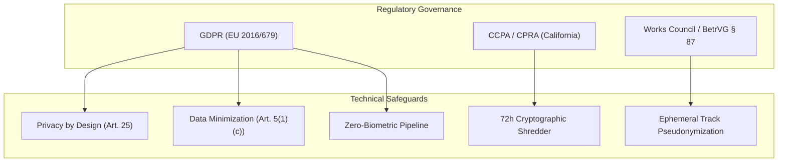
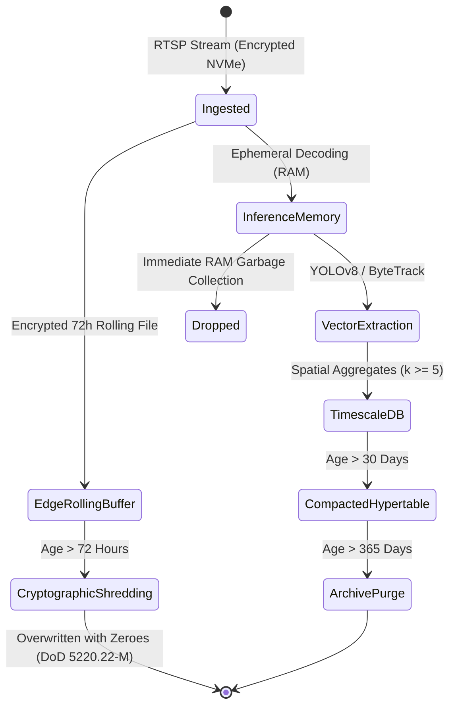

# Phase 01: Requirements and Ethics Specification

## 1. Document Overview

### 1.1 Purpose
This document establishes the ethical, legal, and regulatory requirements governing the CCTV Workplace Productivity and Workflow Intelligence System (WBPIS). It translates international privacy regulations (GDPR, CCPA/CPRA, German Works Council Act / BetrVG) into strict, verifiable architectural constraints, guaranteeing that the system functions solely as an industrial engineering and layout optimization platform rather than an intrusive employee surveillance panopticon.

### 1.2 Scope
- **Regulatory Frameworks**: GDPR (General Data Protection Regulation - EU), CCPA/CPRA (California Consumer Privacy Act / California Privacy Rights Act - US), and Workplace Privacy Directives.
- **Architectural Mandates**: Data minimization, purpose limitation, zero-biometrics enforcement, cryptographic pseudonymization, edge retention boundaries, and DPIA (Data Protection Impact Assessment) guidelines.

---

## 2. Existing Implementation Findings

Grounding assessment based on [`reports/CCTV_PRODUCTIVITY_CODEBASE_AUDIT.md`](file:///C:/Users/DELL/Desktop/cctv/reports/CCTV_PRODUCTIVITY_CODEBASE_AUDIT.md):

| Feature / Artifact | Codebase Location | Audit Status | Compliance & Privacy Vulnerability |
| :--- | :--- | :--- | :--- |
| **Plaintext Credential Leakage** | `audit_extracted/.../app.py` | `EXISTING_VERIFIED` (`SEC-01`) | RTSP URL containing plaintext camera passwords logged directly to `employee_log.txt`. Severe violation of GDPR Art. 32 (Security of Processing). |
| **Individual Desk Absence Logging** | `audit_extracted/.../app.py` | `EXISTING_VERIFIED` | Logs absolute absence duration against specific workstation numbers with no cryptographic pseudonymization or purpose limitation. |
| **Affective / Emotion Profiling** | `video/choriwala_code.py` | `EXISTING_UNVERIFIED` | Implements facial emotion, gaze deception, and "genuineness" metrics using PyTorch/MediaPipe. Completely incompatible with GDPR Art. 9 (Special Category Data) and AI Act high-risk classification. |
| **Automated Data Purge Mechanism** | Neither codebase | `UNAVAILABLE` | Neither prototype contains automated video file shredding or log retention policies; video and logs persist indefinitely on disk. |

---

## 3. Regulatory Alignment Matrix



### 3.1 GDPR (EU 2016/679) Compliance Architecture

| GDPR Article | Legal Mandate | Technical Enforcement in WBPIS |
| :--- | :--- | :--- |
| **Article 5(1)(a)** | Lawfulness, Fairness, and Transparency | Mandatory physical signage, digital workplace policy notices, and employee council transparency briefings before camera activation. |
| **Article 5(1)(b)** | Purpose Limitation | Processing restricted exclusively to spatial layout planning, choke-point detection, and facility utilization. Explicit prohibition of secondary disciplinary use. |
| **Article 5(1)(c)** | Data Minimization | High-resolution frames processed in ephemeral memory. Face regions blurred or eliminated at detection stage; zero storage of raw facial pixels in the analytical database. |
| **Article 5(1)(e)** | Storage Limitation | Raw encrypted video retained at the edge for maximum 72 hours via automated rolling FIFO buffer, followed by DoD 5220.22-M cryptographic shredding. |
| **Article 9** | Prohibition of Special Category Biometric Data | Zero face embedding generation, zero identity verification, zero emotional or health-state inference. Complete architectural ban on affective computing. |
| **Article 25** | Data Protection by Design & Default | Access control enforced via JWT RBAC. All RTSP credentials stored exclusively in hardware vaults or environment variables. Zero plaintext URL logging. |
| **Article 35** | Data Protection Impact Assessment (DPIA) | Complete DPIA documentation package provided to enterprise compliance officers prior to camera deployment. |

### 3.2 US State Law (CCPA / CPRA) & Workplace Directives
- **No Sale or Sharing of Personal Data**: CCTV telemetry is processed on on-premise edge hardware or private customer VPCs. Telemetry is never transmitted to public clouds or third-party brokers.
- **Right to Know & Audit**: Aggregated zone analytics are made accessible to employees via transparent internal workplace experience portals.

---

## 4. Anti-Surveillance Technical Covenant

To preserve employee trust and ensure compliance with global labor regulations (including Germany's BetrVG § 87(1) Nr. 6 regarding automated employee monitoring), the following technical constraints are hardcoded into the pipeline:

```
┌────────────────────────────────────────────────────────────────────────┐
│               HARDCODED ETHICAL BOUNDARIES & CONSTRAINTS               │
├────────────────────────────────────────────────────────────────────────┤
│ 1. ZERO BIOMETRICS: No face recognition, face identification, or      │
│    iris/retinal scanning. Detection is restricted to full-body boxes.  │
│ 2. ZERO EMOTION / AFFECT: No classification of facial valence,         │
│    arousal, gaze fixation, eye-blink frequency, or posture-based       │
│    inferences of concentration, frustration, or engagement.            │
│ 3. EPHEMERAL TRACK IDS: Person track IDs (e.g., `TRK-0841`) exist only  │
│    within a camera session. They expire upon leaving the frame and     │
│    are salted and rotated hourly to prevent cross-day tracking.        │
│ 4. AGGREGATED SPATIAL METRICS: No individual "employee productivity    │
│    scorecards". Analytics are reported at the zone, corridor, or       │
│    workstation cluster level (minimum cluster aggregation k >= 5).     │
│ 5. NO AUTOMATED DISCIPLINARY ACTIONS: CCTV indicators cannot trigger  │
│    HR alerts, warnings, reprimands, or compensation adjustments.       │
└────────────────────────────────────────────────────────────────────────┘
```

---

## 5. Threat Model & Privacy Risks (STRIDE Methodology)

The system incorporates the STRIDE threat model to evaluate and mitigate workplace privacy risks:

| STRIDE Threat Category | Specific Workplace Threat Scenario | Risk Level | Architectural Mitigation |
| :--- | :--- | :--- | :--- |
| **Spoofing Identity** | Unauthorized actor poses as facility manager to access live CCTV streams. | High | Multi-factor authentication (MFA) and short-lived OAuth2/JWT access tokens enforced on FastAPI endpoints. |
| **Tampering with Data** | Rogue administrator modifies zone boundaries or occupancy logs to falsely implicate a team. | Medium | Cryptographic SHA-256 HMAC event hashing and append-only database audit tables with TimescaleDB immutability policies. |
| **Repudiation** | Facility manager alters layout recommendations without logging justification. | Low | Comprehensive administrative audit log recording all zone modifications, user logins, and export actions. |
| **Information Disclosure** | Leakage of raw CCTV footage revealing sensitive documents or employee conversations. | Critical | Edge-only video decoding; video disk storage encrypted with AES-256-XTS; mandatory 72-hour automated deletion. |
| **Denial of Service** | Flooding RTSP endpoints to disable facility monitoring during an operational shift. | Medium | Ingestion rate limiting, isolated internal camera VLANs, and mailbox buffer dropping to protect system memory. |
| **Elevation of Privilege** | Dashboard viewer extracts raw frame snapshots via unauthorized API parameters. | High | Strict RBAC decoupling: viewers can query aggregated scalar metrics; only super-admins with Dual-Control Authorization can export video. |

---

## 6. Retention & Cryptographic Deletion Lifecycle



### 6.1 Data Retention Tiers

| Data Tier | Storage Medium | Retention Limit | Security Control | Purge Mechanism |
| :--- | :--- | :--- | :--- | :--- |
| **Raw Video Frames** | Ephemeral RAM | $< 200\text{ ms}$ | Process isolation | Explicit Python memory deallocation (`del frame`) |
| **Edge Video Clips (Audit)** | Encrypted NVMe SSD | $\le 72\text{ hours}$ | AES-256-XTS; LUKS | Automated rolling FIFO cron; cryptographic overwrite |
| **Raw Per-Second Track Events** | TimescaleDB Hypertable | 14 Days | Row-Level Security | TimescaleDB automated drop_chunks policy |
| **Hourly Zone Aggregates** | TimescaleDB Hypertable | 90 Days | Read-only permissions | Automated roll-up summarization |
| **Monthly Facility Benchmarks**| PostgreSQL Table | 365 Days | Encrypted at rest | Manual annual compliance review |

---

## 7. Dual-Control Authorization for Video Export

Exporting video containing human figures introduces privacy risk. WBPIS implements a **Dual-Control "Four-Eyes" Authorization Workflow** for any raw or annotated MP4 export:

1. **Initiation**: A facility manager or safety engineer submits an export request specifying the camera ID, time window ($\le 15\text{ minutes}$), and business justification.
2. **Review & Approval**: The request is routed to an independent Data Protection Officer (DPO) or Works Council delegate.
3. **Automated Redaction**: Upon approval, the export engine automatically blurs all non-relevant human figures and face regions before file generation.
4. **Watermarking & Expiry**: The generated MP4 is stamped with the requester's user ID, IP address, and timestamp. The download link expires in 24 hours.

---

## 8. Verification and Acceptance Criteria

| ID | Test / Acceptance Criterion | Verification Method | Pass Threshold |
| :--- | :--- | :--- | :--- |
| **AC-ETH-01** | Verification that zero face embeddings or biometric features exist in the schema. | SQL schema inspection & ORM model audit. | Zero biometric columns in DB. |
| **AC-ETH-02** | Automated deletion of edge video files exceeding 72 hours. | Simulated time-acceleration automated test. | $100\%$ files $>72\text{h}$ deleted and overwritten. |
| **AC-ETH-03** | Absence of plaintext camera passwords in logs and traces (`SEC-01` remediation). | Automated log scanner scanning for regex `rtsp://.*:.*@`. | Zero plaintext credentials detected. |
| **AC-ETH-04** | Enforcement of minimum aggregation threshold ($k \ge 5$) on public dashboard views. | API integration test querying zones with $< 5$ individuals. | Response returns masked or `N/A` aggregate. |

---

## 9. Open Questions & Assumptions

> [!WARNING]
> ### 1. Works Council Co-Determination Scope
> *Assumption*: The deployment facility operates under standard corporate workplace privacy frameworks.
> *Open Question*: In jurisdictions requiring formal Works Council approval (e.g., Germany BetrVG § 87), does the agreement permit full-body bounding box tracking, or must all live preview screens apply full silhouette blurring by default?

> [!NOTE]
> ### 2. Face Blurring at Ingestion vs. Export
> *Current Design*: Face regions are ignored during feature extraction and blurred prior to MP4 export.
> *Alternative*: Apply automated OpenCV Gaussian blur to all detected head boxes on every live frame prior to inference. Adds $\sim 4\text{ ms}$ processing overhead per frame.

---

## 10. Related Documentation Links

- **Strategic Scope**: Defined in [`00_PROJECT_VISION_AND_SCOPE.md`](file:///C:/Users/DELL/Desktop/cctv/docs/implementation/00_PROJECT_VISION_AND_SCOPE.md).
- **System Architecture**: Security boundary topology in [`02_SYSTEM_ARCHITECTURE.md`](file:///C:/Users/DELL/Desktop/cctv/docs/implementation/02_SYSTEM_ARCHITECTURE.md).
- **Access Control & RBAC**: Implementation details in [`16_SECURITY_PRIVACY_AND_ACCESS_CONTROL.md`](file:///C:/Users/DELL/Desktop/cctv/docs/implementation/16_SECURITY_PRIVACY_AND_ACCESS_CONTROL.md).
- **Database Retention Policies**: Formal SQL DDL in [`11_DATABASE_AND_DATA_RETENTION.md`](file:///C:/Users/DELL/Desktop/cctv/docs/implementation/11_DATABASE_AND_DATA_RETENTION.md).
