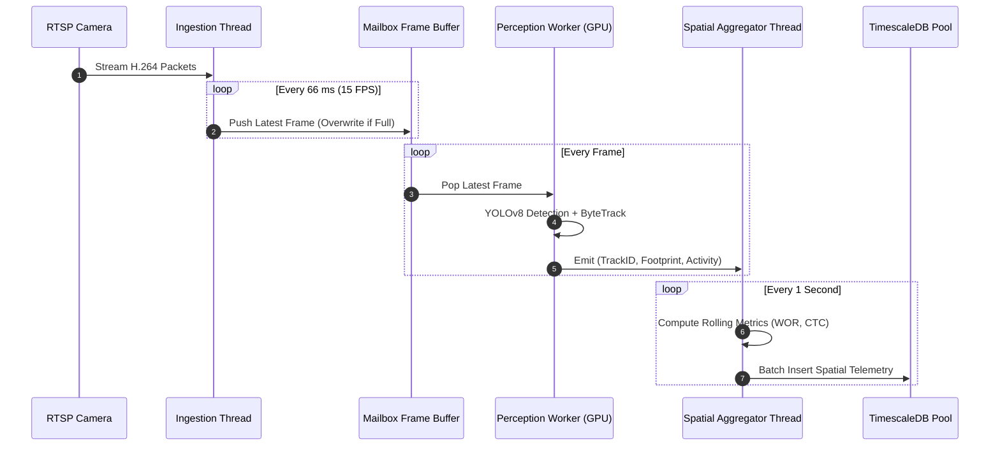

# Phase 02: System Architecture Specification

## 1. Document Overview

### 1.1 Purpose
This document specifies the end-to-end technical system architecture for the CCTV Workplace Productivity and Workflow Intelligence System (WBPIS). It defines the pipeline stages, component topologies, communication interfaces, process concurrency models, and dataflow paths required to transform raw RTSP surveillance video into actionable workplace layout and workflow intelligence.

### 1.2 Scope
- **Architectural Scope**: Edge-to-backend perception pipelines, spatial geometric engines, temporal aggregation routines, TimescaleDB time-series storage, FastAPI REST/WebSocket layers, and Streamlit visualization components.
- **Architectural Boundaries**: Replaces the conflicting legacy prototypes (monolithic Flask app and unverified Streamlit script) with a unified, containerized micro-service architecture.

---

## 2. Existing Implementation Findings

Grounding assessment based on [`reports/CCTV_PRODUCTIVITY_CODEBASE_AUDIT.md`](file:///C:/Users/DELL/Desktop/cctv/reports/CCTV_PRODUCTIVITY_CODEBASE_AUDIT.md):

| Architectural Area | Codebase Location | Status | Audit Assessment & Deficiencies |
| :--- | :--- | :--- | :--- |
| **Monolithic Flask Backend** | `audit_extracted/.../app.py` | `EXISTING_VERIFIED` | Combines video capture, Darknet inference, HTML rendering, and CSV logging into a single blocking Python process. Suffers from UI freeze and browser polling loop failures (`BUG-01`). |
| **Streamlit Script Analytics** | `video/choriwala_code.py` | `EXISTING_VERIFIED` | Standalone Streamlit script relying on client-side WebRTC or file uploads. Lacks persistent database storage, multi-camera synchronization, and REST API interfaces. |
| **Process Decoupling** | Neither codebase | `UNAVAILABLE` | Neither system separates video acquisition from neural network inference. Any frame drop or inference slowdown immediately degrades network streaming and UI responsiveness. |
| **Structured Relational Storage** | Neither codebase | `UNAVAILABLE` | Data persistence relies on unstructured plaintext files (`employee_log.txt`) or ephemeral JSONL files without indexing, transactions, or schema migrations. |

---

## 3. End-to-End System Architecture (C4 Container Diagram)

The target architecture decouples high-bandwidth computer vision perception from low-latency analytical querying using a modular, containerized topology:

```mermaid
flowchart TB
    subgraph Physical Office Environment
        CAM1["CCTV IP Camera 1<br>(RTSP / H.264)"]
        CAM2["CCTV IP Camera 2<br>(RTSP / H.264)"]
        EXT_DATA["External Enterprise Systems<br>(Jira, ERP, Ticketing Webhooks)"]
    end

    subgraph WBPIS Edge & Compute Server
        subgraph Perception Service [Container: wbpis-perception]
            INGEST["Multi-Stream Video Ingestion<br>(OpenCV / GStreamer / Mailbox Queue)"]
            DET["Person Detection<br>(YOLOv8 INT8)"]
            TRACK["Multi-Object Tracking<br>(ByteTrack MOT)"]
            SPATIAL["Spatial Occupancy Engine<br>(Ray-Casting Point-in-Polygon)"]
            ACTIVITY["Activity Classifier<br>(2D Skeleton + Modal Filter)"]
            OVERLAY["Annotated Stream Publisher<br>(WebRTC / RTSP Out)"]
        end

        subgraph Storage Tier [Container: wbpis-db]
            TSDB[("TimescaleDB 16<br>(Hypertables: Spatial Events, Metrics, Audit)")]
            NVME["Encrypted Rolling Buffer<br>(72h NVMe Video Buffer)"]
        end

        subgraph Backend API [Container: wbpis-api]
            FASTAPI["FastAPI Engine<br>(REST / WebSockets / Auth / Webhooks)"]
            RULES["Industrial Engineering Rule Engine<br>(REC-01 to REC-04 Layout Insights)"]
        end

        subgraph Visualization Tier [Container: wbpis-dashboard]
            STREAMLIT["Streamlit Dashboard<br>(Apache ECharts, Interactive Floor Plan)"]
        end
    end

    subgraph Stakeholder Browsers
        USER["Facilities & Operations Dashboard<br>(HTTPS / WSS)"]
    end

    CAM1 -->|RTSP over TCP| INGEST
    CAM2 -->|RTSP over TCP| INGEST
    INGEST --> DET --> TRACK --> SPATIAL --> ACTIVITY
    ACTIVITY -->|Batch Spatial Events (1 Hz)| TSDB
    INGEST -.->|Raw Clips| NVME
    TRACK --> OVERLAY
    EXT_DATA -->|JSON Payload| FASTAPI
    FASTAPI <--> TSDB
    FASTAPI --> RULES
    STREAMLIT <-->|Internal REST / WS| FASTAPI
    STREAMLIT -->|Render Visualizations| USER
    OVERLAY -.->|Live MJPEG / WebRTC| USER
```

---

## 4. Pipeline Stages & Dataflow Lifecycle

The dataflow transitions through 8 distinct processing stages, guaranteeing separation of concerns and deterministic latency:

```
[Camera Stream] 
       │ 
       ▼ (1) Ingestion Stage: RTSP over TCP -> Mailbox Buffer -> Monotonic Video Clock
[Clean Frame]
       │
       ▼ (2) Perception Stage: YOLOv8 Person Detection -> Footprint Calculation (Bottom-Center)
[Detections]
       │
       ▼ (3) Tracking Stage: ByteTrack Kalman Filter -> Ephemeral Track ID Assignment
[Tracks]
       │
       ▼ (4) Spatial Stage: Ray-Casting Point-in-Polygon -> Zone & Workstation Mapping
[Zone Events]
       │
       ▼ (5) Activity Stage: 2D Keypoint Extraction -> 5s Rolling Modal Activity State
[State Events]
       │
       ▼ (6) Aggregation Stage: 5-Minute Sliding Window -> Metric Engine (WOR, CTC, QDT)
[Aggregates]
       │
       ▼ (7) Persistence Stage: Batch Insert -> TimescaleDB Hypertables (Zero Drops)
[Database]
       │
       ▼ (8) Presentation Stage: FastAPI REST/WS -> Streamlit Dashboard & ECharts
```

### 4.1 Detailed Pipeline Descriptions

| Stage | Processing Component | Input | Output | Latency Budget |
| :--- | :--- | :--- | :--- | :--- |
| **1. Ingestion** | `VideoIngestWorker` | RTSP H.264 stream from IP cameras | Decoded BGR numpy arrays + monotonic timestamps | $< 15\text{ ms}$ |
| **2. Detection** | `YOLOv8InferenceEngine` | 1080p frame resized to $640\times 640$ | Person bounding boxes $[x_1, y_1, x_2, y_2, \text{conf}]$ | $< 25\text{ ms}$ (GPU) |
| **3. Tracking** | `ByteTrackAssociator` | Frame bounding boxes + historical tracks | Track IDs $[\text{id}, \text{box}, \text{velocity}, \text{footprint}]$ | $< 5\text{ ms}$ |
| **4. Spatial Engine** | `PolygonZoneEngine` | Footprint coordinates $(x_f, y_f)$ | Zone assignments (Desk 14, Corridor B, Queue Area) | $< 2\text{ ms}$ |
| **5. Activity Engine** | `PhysicalPostureClassifier` | 2D body keypoints | Filtered activity state (`ACT-01` to `ACT-07`) | $< 10\text{ ms}$ |
| **6. Aggregation** | `SlidingMetricAggregator` | Continuous zone events | 1-minute and 5-minute spatial metric rollups | Asynchronous ($1\text{ Hz}$) |
| **7. Persistence** | `TimescaleWriterPool` | Metric tuples + system health logs | Committed SQL records in hypertables | Asynchronous ($0.5\text{ Hz}$) |
| **8. Presentation** | `FastAPIService` + Streamlit | Client WebSocket / REST requests | JSON payloads + interactive Apache ECharts charts | $< 50\text{ ms}$ query |

---

## 5. Concurrency & Inter-Process Communication (IPC)

To eliminate thread blocking and prevent the GUI freezes observed in legacy codebases, the system uses a multi-threaded, asynchronous multiprocessing model:



### 5.1 Concurrency Safeguards
1. **Mailbox Queue Buffer**: The video queue maintains a maximum capacity of $N=2$ frames. If the GPU inference worker slows down, the ingestion thread drops obsolete frames rather than building up an unbounded memory queue.
2. **Asynchronous Database Writes**: Detection workers never execute blocking SQL queries. Telemetry is passed over an in-memory ring buffer to an asynchronous connection pool (`asyncpg`) that performs batched multi-row inserts.
3. **Decoupled Video Streaming**: Live stream visualization runs on an independent MJPEG/WebRTC streaming loop, preventing dashboard rendering from stalling CV analytics.

---

## 6. Hardware & Deployment Topologies

The system is engineered to run on both edge workstation hardware and centralized private server deployments:

### 6.1 Hardware Sizing Matrix

| Deployment Tier | Camera Streams | Target Hardware Specification | Inference Runtime | Expected System Load |
| :--- | :--- | :--- | :--- | :--- |
| **Tier 1: Edge Workstation (Small Office)** | 1–4 Cameras (1080p @ 15 FPS) | NVIDIA RTX 4060 (8GB VRAM), Intel i7 13th Gen, 32GB RAM, 1TB NVMe | TensorRT INT8 | GPU: $\sim 45\%$, CPU: $\sim 30\%$ |
| **Tier 2: Edge Server (Floor Hub)** | 4–12 Cameras (1080p @ 15 FPS) | NVIDIA RTX 4090 / A4000 (16GB VRAM), AMD Ryzen 9, 64GB RAM, 2TB NVMe | TensorRT FP16 / INT8 | GPU: $\sim 70\%$, CPU: $\sim 50\%$ |
| **Tier 3: Enterprise Datacenter** | 12–32 Cameras (1080p @ 15 FPS) | Dual NVIDIA L4 / A10 Tensor Core GPUs, Dual Xeon Silver, 128GB RAM | Triton Inference Server | GPU: $\sim 65\%$, CPU: $\sim 45\%$ |
| **Fallback: CPU Only (Pilot / Dev)** | 1 Camera (720p @ 10 FPS) | Intel Core i7 / AMD Ryzen 7 (AVX-512 support), 16GB RAM | OpenVINO INT8 | CPU: $\sim 85\%$ |

---

## 7. Migration from Legacy Codebases

The system supersedes the architectural deficiencies discovered during the codebase audit:

```
┌────────────────────────────────────────────────────────────────────────┐
│                      LEGACY ARCHITECTURE MIGRATION                     │
├────────────────────────────────────────────────────────────────────────┤
│ ❌ DEPRECATED: Flask Monolithic App (`app.py`)                         │
│    -> Replaced by: FastAPI Microservice (`src/backend/`)               │
│ ❌ DEPRECATED: Darknet C-Python Shared Library Binding                 │
│    -> Replaced by: Ultralytics YOLOv8 ONNX/TensorRT Runtime            │
│ ❌ DEPRECATED: Ad-hoc Hardcoded Coordinates Array                      │
│    -> Replaced by: Interactive GeoJSON Polygon Configuration UI        │
│ ❌ DEPRECATED: Plaintext `employee_log.txt` File Storage              │
│    -> Replaced by: PostgreSQL 16 + TimescaleDB Hypertables             │
│ ❌ DEPRECATED: Unverified FaceMesh / Emotion Analysis Scripts          │
│    -> Replaced by: Objective Body Keypoint Spatial Analytics          │
│ ❌ DEPRECATED: Polling `/status` Endpoint Loop                         │
│    -> Replaced by: Asynchronous WebSockets (`/ws/live-telemetry`)      │
└────────────────────────────────────────────────────────────────────────┘
```

---

## 8. Verification and Acceptance Criteria

| ID | Test / Acceptance Criterion | Verification Method | Pass Threshold |
| :--- | :--- | :--- | :--- |
| **AC-ARCH-01** | Sustained multi-stream pipeline throughput across 4 concurrent 1080p RTSP feeds. | Automated 12-hour stress test harness. | $\ge 15.0\text{ FPS sustained per stream}$ |
| **AC-ARCH-02** | End-to-end telemetry latency from physical camera event to database commit. | Network packet timestamp delta measurement. | $\le 1.8\text{ seconds}$ |
| **AC-ARCH-03** | Resilience against network camera disconnects and reconnections. | Scripted network switch port toggling (10 disconnect cycles). | Auto-reconnect $\le 5\text{ seconds}$; zero crash |
| **AC-ARCH-04** | Process memory leak check over 48 hours of continuous execution. | Periodic memory consumption logging. | RAM growth $\le 50\text{ MB}$ over 48 hours |

---

## 9. Open Questions & Assumptions

> [!IMPORTANT]
> ### 1. Video Distribution Protocol: WebRTC vs. Low-Latency HLS vs. MJPEG
> *Current Default*: MJPEG over HTTP for edge administrative live preview, WebSockets for scalar overlay coordinates.
> *Open Question*: Should multi-camera remote monitoring adopt WebRTC (MediaSoup / WebRTC-streamer) to minimize bandwidth over corporate WANs, at the expense of adding an extra signaling container?

> [!NOTE]
> ### 2. TimescaleDB Deployment: Embedded vs. External Managed Instance
> *Current Default*: Local containerized TimescaleDB instance running on edge server storage.
> *Open Question*: Does enterprise infrastructure dictate routing all spatial events to an existing corporate Amazon RDS or Azure Database for PostgreSQL?

---

## 10. Related Documentation Links

- **Vision & Scope**: Business objectives in [`00_PROJECT_VISION_AND_SCOPE.md`](file:///C:/Users/DELL/Desktop/cctv/docs/implementation/00_PROJECT_VISION_AND_SCOPE.md).
- **Video Ingestion Details**: Detailed decoding routines in [`03_VIDEO_INGESTION_AND_PREPROCESSING.md`](file:///C:/Users/DELL/Desktop/cctv/docs/implementation/03_VIDEO_INGESTION_AND_PREPROCESSING.md).
- **Perception & Tracking**: YOLOv8 + ByteTrack details in [`04_PERSON_DETECTION_TRACKING_AND_IDS.md`](file:///C:/Users/DELL/Desktop/cctv/docs/implementation/04_PERSON_DETECTION_TRACKING_AND_IDS.md).
- **Database Architecture**: Full DDL schema and indexes in [`11_DATABASE_AND_DATA_RETENTION.md`](file:///C:/Users/DELL/Desktop/cctv/docs/implementation/11_DATABASE_AND_DATA_RETENTION.md).
- **Backend API Specifications**: REST and WebSocket contracts in [`12_BACKEND_APIS_AND_INTEGRATION.md`](file:///C:/Users/DELL/Desktop/cctv/docs/implementation/12_BACKEND_APIS_AND_INTEGRATION.md).
- **Frontend Architecture**: Dashboard design in [`13_FRONTEND_DASHBOARD_AND_VISUALIZATIONS.md`](file:///C:/Users/DELL/Desktop/cctv/docs/implementation/13_FRONTEND_DASHBOARD_AND_VISUALIZATIONS.md).
