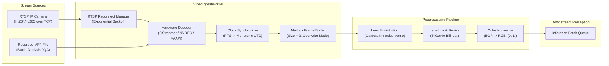
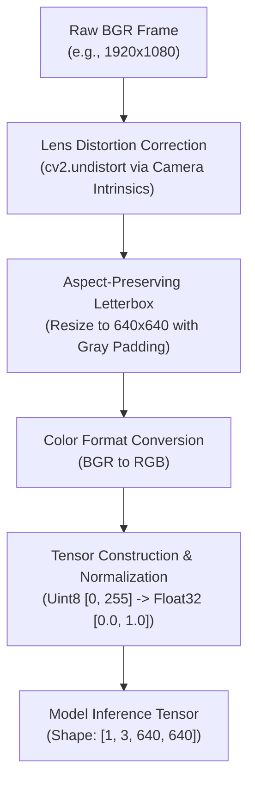
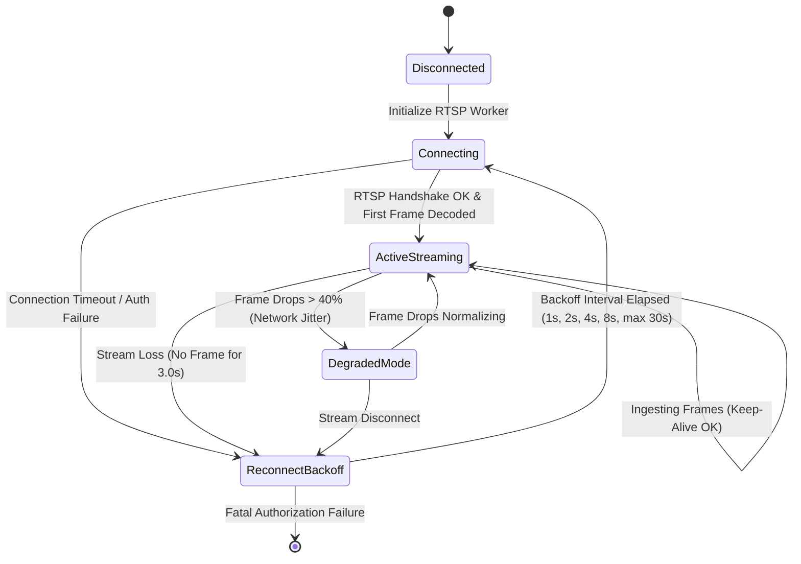

# Phase 03: Video Ingestion and Preprocessing Specification

## 1. Document Overview

### 1.1 Purpose
This document specifies the video acquisition, stream ingestion, hardware-accelerated decoding, timestamp synchronization, and frame preprocessing pipeline for the CCTV Workplace Productivity and Workflow Intelligence System (WBPIS). It provides deterministic handling of RTSP streams over unreliable IP networks and recorded video files, ensuring that downstream computer vision modules receive clean, timestamp-aligned frames without memory leaks or unbounded latency.

### 1.2 Scope
- **Input Formats**: RTSP IP camera streams (H.264 / H.265 over TCP), recorded video files (MP4, MKV, AVI).
- **Processing Scope**: Hardware decoding (NVIDIA NVDEC, Intel VAAPI, CPU fallback), frame resizing and letterboxing, color-space normalization, lens distortion correction, and mailbox queue management.
- **Exclusions**: Downstream neural network inference (covered in Phase 04 and 06).

---

## 2. Existing Implementation Findings

Grounding assessment based on [`reports/CCTV_PRODUCTIVITY_CODEBASE_AUDIT.md`](file:///C:/Users/DELL/Desktop/cctv/reports/CCTV_PRODUCTIVITY_CODEBASE_AUDIT.md):

| Feature / Artifact | Codebase Location | Audit Status | Audit Assessment & Deficiencies |
| :--- | :--- | :--- | :--- |
| **OpenCV `VideoCapture` Loop** | `audit_extracted/.../app.py` | `EXISTING_VERIFIED` | Raw `cv2.VideoCapture("rtsp://...")` called directly in the main thread with default UDP transport, causing packet loss, macroblock corruption, and deadlocks on connection drop. |
| **Calibration Video Rewind Bug** | `audit_extracted/.../app.py` | `EXISTING_VERIFIED` (`BUG-03`) | Calls `cap.set(cv2.CAP_PROP_POS_FRAMES, 0)` inside a 5-frame calibration loop. For live RTSP streams, this causes silent stream corruption or fatal segmentation faults. |
| **Timestamp Alignment** | Neither codebase | `UNAVAILABLE` | Neither system captures or stores camera PTS (Presentation Timestamp) or monotonic clock times; metrics rely on system wall-clock time when frames are popped from memory. |
| **Frame Drop Handling** | `video/choriwala_code.py` | `EXISTING_UNVERIFIED` | Relies on default Streamlit WebRTC buffers which buffer unbounded frames in memory during inference spikes, leading to 10+ second lag spikes. |

---

## 3. Ingestion Architecture & Protocol Specification



### 3.1 Network Transport: RTSP over TCP Enforcement
Real-time IP surveillance cameras frequently drop UDP packets over corporate Wi-Fi or congested Ethernet switches, resulting in severe H.264 macroblock tearing and decoding corruption. WBPIS mandates **RTSP over TCP**:

```bash
# GStreamer Pipeline String for Production Video Capture
rtspsrc location="rtsp://camera_host:554/live/ch0" protocols=tcp latency=100 drop-on-latency=true \
! rtph264depay ! h264parse ! nvdec ! video/x-raw(memory:NVMM) ! nvvidconv \
! video/x-raw, format=BGRx ! videoconvert ! video/x-raw, format=BGR ! appsink drop=true max-buffers=2
```

- `protocols=tcp`: Forces interleaved RTSP/RTP over TCP, guaranteeing zero packet drop.
- `latency=100`: Bounds internal camera jitter buffer to $100\text{ ms}$.
- `drop-on-latency=true`: Drops older RTP packets if network jitter exceeds buffer limits.

---

## 4. Mailbox Frame Buffer & Latency Control

To ensure that inference latency does not cause cumulative streaming lag, the system implements a **Mailbox Buffer Queue (Capacity = 2)** with an atomic overwrite policy:

```python
import threading
from typing import Optional, Tuple
import numpy as np

class MailboxFrameBuffer:
    """Thread-safe single-slot mailbox buffer guaranteeing real-time delivery."""
    def __init__(self, maxsize: int = 2):
        self._buffer: Optional[Tuple[np.ndarray, float]] = None
        self._lock = threading.Lock()
        self._new_frame_event = threading.Event()
        self._dropped_frames_count = 0

    def put(self, frame: np.ndarray, timestamp_monotonic: float) -> None:
        """Pushes latest frame, atomically overwriting older unread frames."""
        with self._lock:
            if self._buffer is not None:
                self._dropped_frames_count += 1
            self._buffer = (frame, timestamp_monotonic)
            self._new_frame_event.set()

    def get(self, timeout: float = 1.0) -> Tuple[np.ndarray, float]:
        """Pops the freshest available frame, blocking if empty."""
        if not self._new_frame_event.wait(timeout):
            raise TimeoutError("Frame mailbox starved: no frames received.")
        with self._lock:
            frame, ts = self._buffer
            self._buffer = None
            self._new_frame_event.clear()
            return frame, ts
```

- **Guaranteed Real-Time**: When the GPU perception worker is executing a $40\text{ ms}$ inference cycle, the ingestion thread discards intervening frames rather than accumulating an unbounded memory backlog.
- **Accurate Telemetry**: Dropped frame counts are logged to TimescaleDB as an observation quality metric (`MET-A3`).

---

## 5. Clock Synchronization: Video Clock vs. Wall Clock

A primary failure mode of naive analytics systems is conflating the camera frame arrival time with the actual moment of physical occurrence.

```
Camera Sensor Capture (PTS) ───────> Network Transit (Δt_net) ───────> Ingest Decoded ───────> Inference
            │                                                                 │
            ▼                                                                 ▼
      PTS Timestamp                                                     System Clock
 (e.g. 10:14:02.120)                                               (e.g. 10:14:02.480)
```

### 5.1 Timestamp Alignment Algorithm
1. **RTP RTCP Synchronization**: The ingestion engine extracts the sender NTP timestamp embedded in RTCP sender reports, binding camera sensor capture time to global UTC.
2. **Monotonic Fallback Clock**: For cameras lacking RTCP synchronization:
   $$\text{FrameTime}_k = t_0 + \frac{k - k_0}{\text{FPS}_\text{calibrated}}$$
   where $t_0$ is the high-resolution monotonic start time (`time.monotonic()`), $k$ is the frame sequence number, and $\text{FPS}_\text{calibrated}$ is the empirically measured ingestion frame rate.
3. **Drift Compensation**: Every 60 seconds, the drift between frame sequence time and system monotonic time is evaluated. If drift exceeds $\pm 200\text{ ms}$, the base timestamp $t_0$ is smoothly resynchronized using a low-pass filter.

---

## 6. Frame Preprocessing Pipeline

Before feeding raw BGR frames to YOLOv8 and downstream tracking modules, frames undergo standardized preprocessing:



### 6.1 Aspect-Preserving Letterboxing
To preserve spatial aspect ratios without geometric distortion:
$$\text{scale} = \min\left(\frac{640}{W_\text{orig}}, \frac{640}{H_\text{orig}}\right), \quad W_\text{new} = \lfloor W_\text{orig} \cdot \text{scale} \rfloor, \quad H_\text{new} = \lfloor H_\text{orig} \cdot \text{scale} \rfloor$$
$$\text{pad}_x = \frac{640 - W_\text{new}}{2}, \quad \text{pad}_y = \frac{640 - H_\text{new}}{2}$$
The padding offsets $(\text{pad}_x, \text{pad}_y)$ and scale factor are stored in the frame metadata to allow downstream modules to invert coordinates back to the original camera pixel space with sub-pixel precision.

### 6.2 Remediation of Legacy Calibration Rewind Bug (`BUG-03`)
In `audit_extracted/.../app.py`, the initialization code contained:
```python
# DEFECTIVE LEGACY CODE:
for i in range(5):
    ret, frame = cap.read()
    cap.set(cv2.CAP_PROP_POS_FRAMES, 0) # BUG-03: Crashes or freezes live RTSP streams
```
**Remediation**: In WBPIS, calibration frames are read into an in-memory ring buffer without altering camera capture properties:
```python
# REMEDIATED IMPLEMENTATION:
calibration_frames = []
for _ in range(5):
    ret, frame = cap.read()
    if ret and frame is not None:
        calibration_frames.append(frame.copy())
```

---

## 7. Stream Reconnection & Failure Resilience State Machine



### 7.1 Automated Reconnect Policy
- **Heartbeat Watchdog**: A watchdog thread checks frame arrival every $1.0\text{ second}$. If no frame arrives for $> 3.0\text{ seconds}$, the RTSP connection is declared dead.
- **Graceful Resource Release**: The underlying GStreamer/OpenCV capture handle is explicitly released (`cap.release()`), freeing hardware decoder contexts.
- **Exponential Backoff**: Reconnection attempts follow:
  $$t_\text{backoff} = \min\left(t_\text{base} \cdot 2^{\text{retry}}, 30.0\right)\text{ seconds}$$
  where $t_\text{base} = 1.0\text{ s}$.

---

## 8. Verification and Acceptance Criteria

| ID | Test / Acceptance Criterion | Verification Method | Pass Threshold |
| :--- | :--- | :--- | :--- |
| **AC-ING-01** | Multi-stream RTSP decoding throughput at 1080p @ 15 FPS across 4 cameras. | Automated 8-hour continuous test harness. | $\ge 14.8\text{ FPS average per camera}$ |
| **AC-ING-02** | Zero pipeline deadlocks upon deliberate network cable disconnect. | Simulated network loss for 30s during active run. | Auto-reconnect $\le 5.0\text{ s}$ after network restore |
| **AC-ING-03** | End-to-end ingestion pipeline buffering latency under CPU saturation. | Timestamp delta $(\text{IngestTime} - \text{CaptureTime})$. | Mailbox latency $\le 120\text{ ms}$ |
| **AC-ING-04** | Complete elimination of live RTSP seek calls (`BUG-03` regression). | Static code analysis & unit test on RTSP worker. | Zero calls to `cap.set(CAP_PROP_POS_FRAMES)` |

---

## 9. Open Questions & Assumptions

> [!NOTE]
> ### 1. Camera Fisheye Lens Calibration
> *Assumption*: CCTV cameras use standard wide-angle lenses ($70^\circ\text{ to }95^\circ\text{ HFOV}$) where standard OpenCV rectilinear correction suffices.
> *Open Question*: If ultra-wide $180^\circ$ fisheye cameras are installed, should a dedicated equi-angular fisheye undistortion shader be added to the GStreamer pipeline before letterboxing?

---

## 10. Related Documentation Links

- **System Architecture**: Overall pipeline topology in [`02_SYSTEM_ARCHITECTURE.md`](file:///C:/Users/DELL/Desktop/cctv/docs/implementation/02_SYSTEM_ARCHITECTURE.md).
- **Perception Pipeline**: Person detection inputs in [`04_PERSON_DETECTION_TRACKING_AND_IDS.md`](file:///C:/Users/DELL/Desktop/cctv/docs/implementation/04_PERSON_DETECTION_TRACKING_AND_IDS.md).
- **Observation Coverage Metric**: Formulation of `MET-A3` in [`08_PRODUCTIVITY_METRICS_AND_SCORING.md`](file:///C:/Users/DELL/Desktop/cctv/docs/implementation/08_PRODUCTIVITY_METRICS_AND_SCORING.md).
- **Docker Deployment**: GStreamer and NVDEC configuration in [`17_DEPLOYMENT_AND_PERFORMANCE_OPTIMIZATION.md`](file:///C:/Users/DELL/Desktop/cctv/docs/implementation/17_DEPLOYMENT_AND_PERFORMANCE_OPTIMIZATION.md).
