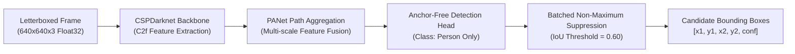
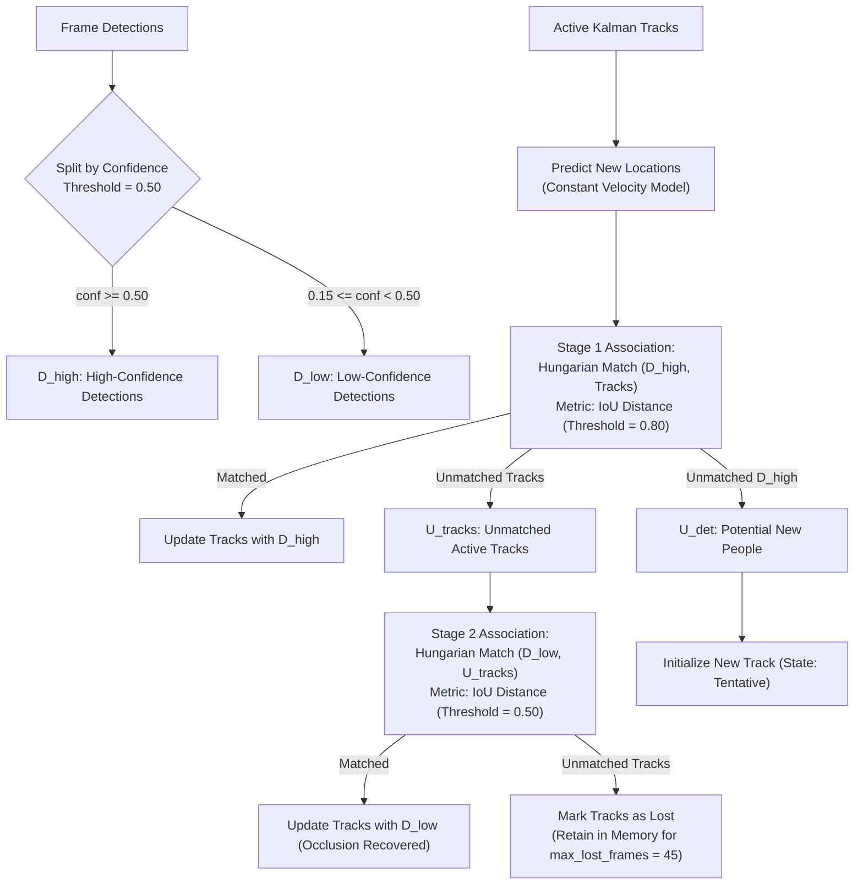

# Phase 04: Person Detection, Tracking, and Pseudonymous IDs Specification

## 1. Document Overview

### 1.1 Purpose
This document specifies the multi-person detection and multi-object tracking (MOT) pipeline for the CCTV Workplace Productivity and Workflow Intelligence System (WBPIS). It details the neural network architecture, ground-plane footprint projection, ByteTrack association algorithm, track state machine, and the ephemeral pseudonymous ID system.

### 1.2 Scope
- **Perception Scope**: YOLOv8 person detection, ByteTrack Kalman filtering, two-stage bipartite matching, occlusion recovery, track lifecycle management.
- **Privacy Scope**: Pseudonymous session tracking, identity rotation, and complete architectural separation between computer vision track handles and employee HR records.
- **Exclusions**: Spatial zone assignment (Phase 05) and physical posture classification (Phase 06).

---

## 2. Existing Implementation Findings

Grounding assessment based on [`reports/CCTV_PRODUCTIVITY_CODEBASE_AUDIT.md`](file:///C:/Users/DELL/Desktop/cctv/reports/CCTV_PRODUCTIVITY_CODEBASE_AUDIT.md):

| Feature / Artifact | Codebase Location | Audit Status | Audit Assessment & Deficiencies |
| :--- | :--- | :--- | :--- |
| **Darknet YOLOv4-tiny Detection** | `audit_extracted/.../app.py` | `EXISTING_VERIFIED` | Raw Darknet C-bindings detecting `person` class. Zero multi-object tracking algorithm; detections in frame $t+1$ have no association with frame $t$. |
| **Identity Association** | `audit_extracted/.../app.py` | `EXISTING_VERIFIED` | Inferred identity solely by which static desk rectangle a bounding box intersected. If an employee walked to a colleague's desk, the system falsely misattributed their identity to that desk's owner. |
| **MediaPipe Pose / Face** | `video/choriwala_code.py` | `EXISTING_UNVERIFIED` | Single-person tracking only. When multiple people appear in the field of view, MediaPipe arbitrarily snaps between individuals, causing catastrophic track fragmentation. |
| **Ground-Plane Footprint Calculation** | Neither codebase | `UNAVAILABLE` | Neither system calculates the person's ground contact point, relying on bounding box center or corners which cause severe false-positive zone overlaps. |

---

## 3. Person Detection Architecture (YOLOv8)

To support multiple individuals in complex office environments with partial occlusions (e.g., behind computer monitors or partitions), WBPIS deploys **YOLOv8** (Nano or Small variant, INT8 quantized):



### 3.1 Model Specifications

| Parameter | Nano Profile (`yolov8n.onnx`) | Small Profile (`yolov8s.onnx`) | Notes |
| :--- | :--- | :--- | :--- |
| **Target Runtime** | Edge Workstation / CPU | Dedicated GPU (RTX / Jetson) | Auto-selected based on hardware tier |
| **Precision** | INT8 / FP16 | INT8 / FP16 | Quantized via TensorRT or OpenVINO |
| **Input Resolution** | $640 \times 640 \times 3$ | $640 \times 640 \times 3$ | Letterboxed with bilinear interpolation |
| **Detection Classes** | Filtered to `Class 0: person` | Filtered to `Class 0: person` | All other 79 COCO classes suppressed |
| **Confidence Threshold** | $\tau_\text{high} = 0.50, \tau_\text{low} = 0.15$ | $\tau_\text{high} = 0.50, \tau_\text{low} = 0.15$ | Two-stage thresholding for ByteTrack |
| **Inference Latency** | $\sim 18\text{ ms}$ (GPU) / $\sim 65\text{ ms}$ (CPU) | $\sim 28\text{ ms}$ (GPU) / $\sim 110\text{ ms}$ (CPU) | Per 1080p stream |

---

## 4. Multi-Object Tracking via ByteTrack

Traditional tracking algorithms discard detections below a strict confidence threshold (e.g., $\text{conf} < 0.5$), resulting in broken tracks when a worker sits behind a desk or bends down. WBPIS implements **ByteTrack**, retaining low-confidence detections to preserve track continuity through occlusions:



### 4.1 Ground-Plane Footprint Projection
A major source of false-positive desk occupancy in legacy systems was using the bounding box center $(x_c, y_c)$. When a person stands in a corridor *behind* a desk, their torso overlaps the desk box, falsely triggering occupancy. 

WBPIS calculates the **Ground-Plane Footprint Point** $(x_f, y_f)$:
$$x_f = \frac{x_1 + x_2}{2}, \quad y_f = y_2$$
where $y_2$ is the bottom-most coordinate of the bounding box (representing ground contact). All spatial polygon intersection tests (Phase 05) use this single $(x_f, y_f)$ coordinate rather than the area bounding box.

---

## 5. Track Lifecycle State Machine

```mermaid
stateDiagram-v2
    [*] --> Tentative: Detection Conf >= 0.50
    Tentative --> Confirmed: Matched in 3 Consecutive Frames
    Tentative --> Deleted: Unmatched in Next 2 Frames
    
    Confirmed --> Confirmed: Continuously Matched (D_high or D_low)
    Confirmed --> Lost: Unmatched in Frame (Occlusion / Walkout)
    
    Lost --> Confirmed: Re-associated via Stage 2 ByteTrack Match
    Lost --> Expired: Lost Duration > 45 Frames (3.0s at 15 FPS)
    
    Expired --> [*]: Purged from RAM; Emits Session Exit Event
```



### 5.1 Lifecycle Parameters
- `min_hits`: 3 frames required to transition from `Tentative` to `Confirmed`, filtering out transient optical reflections.
- `max_lost_frames`: 45 frames ($3.0\text{ seconds}$ at 15 FPS) retained in memory during total occlusion before track termination.
- `kalman_process_noise`: Tuned for typical human walking velocities ($0.8\text{ to }1.5\text{ m/s}$), rejecting abrupt unphysical coordinate jumps.

---

## 6. Ephemeral Pseudonymous IDs & Anti-Identification Policy

To guarantee strict compliance with privacy mandates (Phase 01), track identifiers are decoupled from physical person identities:

```
Camera Frame Track Handle:  `TRK-0841` (Local to Camera 02)
                                 │
                                 ▼
Salted Ephemeral Hash:      SHA256(`TRK-0841` + `DailyRotatingSalt` + `Floor01`)
                                 │
                                 ▼
Database Analytical Handle: `ANON-SESSION-7f8a9e`
```

1. **No Facial Embeddings**: The perception pipeline contains no face recognition neural networks (e.g., FaceNet, ArcFace, or InsightFace are completely omitted).
2. **Ephemeral Scope**: A track ID is created when a person enters the camera field of view and permanently terminates when they leave.
3. **Daily Salt Rotation**: The salt string used for pseudonymization rotates every 24 hours at midnight. Even if the exact same desk is occupied daily, the database records completely uncorrelated session hashes across different days.
4. **No Cross-Camera Stitching**: Re-identification feature extractors across disconnected cameras are prohibited in the core system to prevent building continuous building-wide travel itineraries of individual employees.

---

## 7. Mandatory Metric Catalogue: Group A (Observation Quality)

### Metric A1: Detection Confidence (`MET-A1`)
1. **Metric Name & ID**: Detection Confidence (`MET-A1`)
2. **Objective Served**: Perceptual Quality & Reliability
3. **Exact Definition**: The softmax probability assigned by the YOLOv8 person detector to the bounding box prediction for a given frame.
4. **Mathematical Formula**:
   $$\text{Conf}_k = P(\text{class} = \text{person} \mid \text{box}_k)$$
5. **Variables & Units**: $\text{Conf}_k \in [0.0, 1.0]$ (Dimensionless probability).
6. **Required Source Signals**: Raw BGR video frame.
7. **Required Model**: YOLOv8n / YOLOv8s person detection head.
8. **Aggregation Window**: Frame-level; aggregated into 1-minute and 5-minute mean values per camera.
9. **Calculation Frequency**: Every processed frame ($15\text{ Hz}$).
10. **Validity Conditions**: Processed frame must not be corrupted or dropped.
11. **Missing-Data Handling**: If frame is dropped, confidence is recorded as `N/A`, excluded from aggregate denominator.
12. **Confidence Calculation**: Self-referential base metric.
13. **Score Direction**: Higher is better.
14. **Normalization Method**: Identity mapping ($[0.0, 1.0]$).
15. **Threshold Calibration**: $\tau_\text{high} \ge 0.50$ for new track initialization.
16. **Interpretation**: Measures the perceptual clarity of the subject under current lighting, angle, and distance conditions.
17. **Known Failure Modes**: Backlit windows, heavy shadows, and loose clothing can depress confidence to $0.20\text{–}0.35$.
18. **What It Cannot Establish**: Does NOT prove the person is awake, working, or correctly identified.
19. **Database Fields**: `detection_confidence REAL` in `fact_frame_detections`.
20. **API Response Fields**: `detection_confidence: float` in `/api/v1/telemetry/tracks`.
21. **Dashboard Representation**: Small gray pill indicator next to track box on live video overlay.
22. **Validation Method**: Evaluated against WBPIS-BENCH-V1 labeled bounding boxes.
23. **Implementation Priority**: P0.
*Status*: `PROPOSED` (Supersedes Darknet uncalibrated scores).

---

### Metric A2: Tracking Continuity (`MET-A2`)
1. **Metric Name & ID**: Tracking Continuity (`MET-A2`)
2. **Objective Served**: Multi-Object Tracking Stability
3. **Exact Definition**: The temporal duration and fragmentation rate of an active track before an identity switch or termination occurs.
4. **Mathematical Formula**:
   $$\text{Continuity}(\%) = 100 \times \frac{T_\text{continuous\_frames}}{T_\text{total\_track\_frames} + N_\text{frag} \cdot \Delta_\text{penalty}}$$
5. **Variables & Units**: Percentage $[0, 100]\%$; $N_\text{frag}$ (integer count of lost-frame episodes), $\Delta_\text{penalty} = 15\text{ frames}$.
6. **Required Source Signals**: ByteTrack track association logs.
7. **Required Model**: ByteTrack Kalman Associator.
8. **Aggregation Window**: Full track lifetime; summarized hourly.
9. **Calculation Frequency**: Computed upon track termination or every 60 seconds.
10. **Validity Conditions**: Track must achieve `Confirmed` state ($\ge 3$ initial hits).
11. **Missing-Data Handling**: Tentative tracks that abort are excluded from continuity metrics.
12. **Confidence Indicator**: Ratio of high-confidence hits to total track duration.
13. **Score Direction**: Higher is better.
14. **Normalization Method**: Percentage bounded at $[0, 100]\%$.
15. **Threshold Calibration**: Baseline continuity target $\ge 90\%$ in standard office lighting.
16. **Interpretation**: Quantifies how reliably the vision pipeline follows a person without breaking or switching IDs.
17. **Known Failure Modes**: Intersecting paths of two similarly dressed individuals can cause identity swaps (ID switches).
18. **What It Cannot Establish**: Does NOT establish that the person remained at the same physical task.
19. **Database Fields**: `track_duration_seconds INT`, `fragmentation_count INT` in `fact_track_sessions`.
20. **API Response Fields**: `continuity_score: float` in `/api/v1/analytics/quality`.
21. **Dashboard Representation**: Rendered on the "Model Health & Data Quality" panel.
22. **Validation Method**: MOTA / IDF1 evaluation on benchmark ground-truth video.
23. **Implementation Priority**: P0.
*Status*: `PROPOSED`.

---

### Metric A3: Valid Observation Coverage (`MET-A3`)
1. **Metric Name & ID**: Valid Observation Coverage (`MET-A3`)
2. **Objective Served**: Data Quality & Sensor Availability
3. **Exact Definition**: The ratio of time a monitored zone or camera feed was actively functioning and free of occlusion, stream drop, or camera blindness.
4. **Mathematical Formula**:
   $$\text{Coverage}(\%) = 100 \times \frac{T_\text{valid\_observed}}{T_\text{expected\_observation}}$$
5. **Variables & Units**: Percentage $[0, 100]\%$; durations in seconds.
6. **Required Source Signals**: Ingestion pipeline watchdog logs, frame drop counters, lens occlusion detector.
7. **Required Model**: Video ingest watchdog + camera occlusion heuristic.
8. **Aggregation Window**: 1 hour, 8-hour shift, or 24-hour day.
9. **Calculation Frequency**: Hourly rollup.
10. **Validity Conditions**: Camera must be scheduled as active in the facility registry.
11. **Missing-Data Handling**: Scheduled camera maintenance or authorized privacy blackout periods are excluded from $T_\text{expected}$.
12. **Confidence Indicator**: Proportional to continuous uptime.
13. **Score Direction**: Higher is better.
14. **Normalization Method**: Percentage bounded at $[0, 100]\%$.
15. **Threshold Calibration**: Coverage $< 85\%$ triggers an administrative alert and marks zone metrics as low-confidence.
16. **Interpretation**: Measures data completeness; prevents false conclusions derived from sensor outages.
17. **Known Failure Modes**: Network switch packet drops; deliberate camera covering.
18. **What It Cannot Establish**: Does NOT measure worker presence; measures hardware sensor availability.
19. **Database Fields**: `coverage_ratio REAL` in `fact_camera_hourly_health`.
20. **API Response Fields**: `observation_coverage_pct: float` in `/api/v1/health/cameras`.
21. **Dashboard Representation**: Status badge (Green $\ge 95\%$, Amber $85\text{–}94\%$, Red $< 85\%$) on dashboard header.
22. **Validation Method**: Ingestion watchdog synthetic drop simulation.
23. **Implementation Priority**: P0.
*Status*: `PROPOSED`.

---

### Metric A4: Unknown-State Ratio (`MET-A4`)
1. **Metric Name & ID**: Unknown-State Ratio (`MET-A4`)
2. **Objective Served**: Data Integrity & Uncertainty Quantification
3. **Exact Definition**: The proportion of monitored observation time where a confirmed person was visible but their posture or zone assignment could not be resolved with sufficient model confidence.
4. **Mathematical Formula**:
   $$\text{Unknown Ratio}(\%) = 100 \times \frac{T_\text{unclassified}}{T_\text{total\_observed}}$$
5. **Variables & Units**: Percentage $[0, 100]\%$; durations in seconds.
6. **Required Source Signals**: Posture classifier confidence scores, zone assignment ambiguity scores.
7. **Required Model**: Activity classifier confidence thresholding ($\tau_\text{act} < 0.40$).
8. **Aggregation Window**: 5 minutes, 1 hour.
9. **Calculation Frequency**: Computed every minute.
10. **Validity Conditions**: At least one confirmed person track must be present in the zone.
11. **Missing-Data Handling**: When no people are present, ratio is reported as `0.0%` (or `N/A` if camera is offline).
12. **Confidence Indicator**: Inversely proportional to the unknown ratio.
13. **Score Direction**: Lower is better (Zero is ideal).
14. **Normalization Method**: Percentage $[0, 100]\%$.
15. **Threshold Calibration**: Target $< 10\%$. Ratios $> 25\%$ indicate poor camera angles or severe partial occlusions.
16. **Interpretation**: Transparently quantifies system uncertainty rather than forcing ambiguous observations into incorrect classifications.
17. **Known Failure Modes**: Worker seated deep behind a high monitor partition where only the top of the head is visible.
18. **What It Cannot Establish**: Does NOT mean the worker is uncooperative; indicates camera vantage limitations.
19. **Database Fields**: `unknown_duration_seconds INT` in `fact_zone_hourly_metrics`.
20. **API Response Fields**: `unknown_state_ratio_pct: float` in `/api/v1/analytics/activity`.
21. **Dashboard Representation**: Hatched gray slice on the Activity Distribution stacked bar chart.
22. **Validation Method**: Ground-truth benchmark video comparison.
23. **Implementation Priority**: P0.
*Status*: `PROPOSED`.

---

## 8. Verification and Acceptance Criteria

| ID | Test / Acceptance Criterion | Verification Method | Pass Threshold |
| :--- | :--- | :--- | :--- |
| **AC-TRK-01** | Multi-person detection accuracy across standard office lighting conditions. | WBPIS-BENCH-V1 evaluation suite. | $\text{mAP@50} \ge 0.88$ |
| **AC-TRK-02** | Tracking continuity and occlusion recovery during temporary desk crossings. | 15-minute multi-person test clip. | $\text{ID Switches} \le 1.5 / \text{min}$; $\text{MOTA} \ge 0.75$ |
| **AC-TRK-03** | Footprint bottom-center calculation accuracy vs. manual bounding box inspection. | Unit test comparing calculated $(x_f, y_f)$ to box coordinates. | $x_f = (x_1+x_2)/2 \pm 0.5\text{px}$, $y_f = y_2 \pm 0.5\text{px}$ |
| **AC-TRK-04** | Track termination and memory cleanup upon leaving camera field of view. | Automated synthetic trajectory test harness. | RAM purged within 45 frames of exit |

---

## 9. Open Questions & Assumptions

> [!NOTE]
> ### 1. Camera Tilt Angle & Footprint Occlusion
> *Assumption*: CCTV cameras are mounted at ceiling height ($2.8\text{ to }3.5\text{ meters}$) with a downward pitch angle of $25^\circ\text{ to }45^\circ$, ensuring clear visibility of feet/floor contact.
> *Open Question*: For horizontal or low-angle cameras where desk bodies completely occlude the floor, should the footprint fallback to the bottom-center of the visible torso plus a calibrated offset?

---

## 10. Related Documentation Links

- **Video Ingestion**: Upstream frame delivery in [`03_VIDEO_INGESTION_AND_PREPROCESSING.md`](file:///C:/Users/DELL/Desktop/cctv/docs/implementation/03_VIDEO_INGESTION_AND_PREPROCESSING.md).
- **Workstation Zones**: Downstream spatial mapping in [`05_WORKSTATION_ZONES_AND_OCCUPANCY.md`](file:///C:/Users/DELL/Desktop/cctv/docs/implementation/05_WORKSTATION_ZONES_AND_OCCUPANCY.md).
- **Activity Classification**: Pose extraction in [`06_ACTIVITY_CLASSIFICATION_AND_TIME_DISTRIBUTION.md`](file:///C:/Users/DELL/Desktop/cctv/docs/implementation/06_ACTIVITY_CLASSIFICATION_AND_TIME_DISTRIBUTION.md).
- **Benchmark Evaluation**: Testing protocols in [`15_TESTING_AND_VALIDATION.md`](file:///C:/Users/DELL/Desktop/cctv/docs/implementation/15_TESTING_AND_VALIDATION.md).
