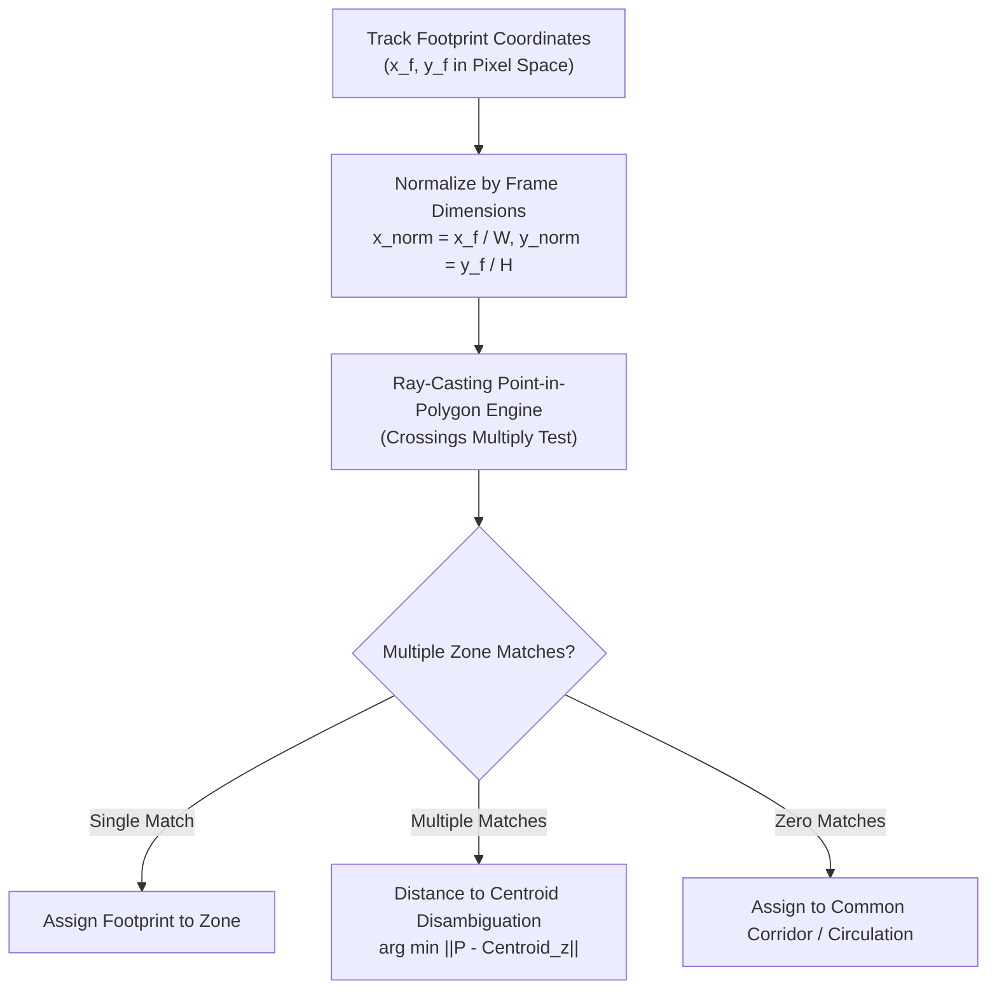
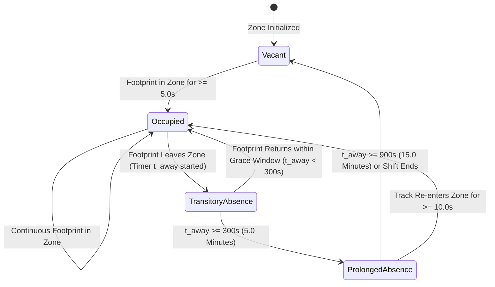

# Phase 05: Workstation Zones and Occupancy Specification

## 1. Document Overview

### 1.1 Purpose
This document specifies the spatial geometry engine, polygon zone configuration, ray-casting point-in-polygon algorithms, and occupancy state machine for the CCTV Workplace Productivity and Workflow Intelligence System (WBPIS). It provides deterministic mapping between tracked human bodies and functional office zones (individual desks, collaboration pods, meeting spaces, corridors, and shared facilities), establishing reliable occupancy metrics without false-positive overlaps.

### 1.2 Scope
- **Spatial Scope**: 2D polygon region-of-interest (ROI) definition, normalized coordinates, ray-casting point-in-polygon (PIP) testing, margin tolerances, multi-zone disambiguation.
- **State Machine Scope**: Desk occupancy transitions, presence timers, transitory absence grace periods, and schedule alignment.
- **Metric Scope**: Canonical specifications for Metrics B1 through B6.

---

## 2. Existing Implementation Findings

Grounding assessment based on [`reports/CCTV_PRODUCTIVITY_CODEBASE_AUDIT.md`](file:///C:/Users/DELL/Desktop/cctv/reports/CCTV_PRODUCTIVITY_CODEBASE_AUDIT.md):

| Feature / Artifact | Codebase Location | Audit Status | Audit Assessment & Deficiencies |
| :--- | :--- | :--- | :--- |
| **Hardcoded Coordinate Arrays** | `audit_extracted/.../app.py` | `EXISTING_VERIFIED` | Desk coordinates hardcoded directly in Python source code as static rectangular tuples $[x_1, y_1, x_2, y_2]$. Inflexible; any camera nudge requires code redeployment. |
| **Coordinate Truncation Bug** | `audit_extracted/.../app.py` | `EXISTING_VERIFIED` (`BUG-02`) | User-submitted coordinates parsed via `int(float(coord))` which truncated normalized coordinates (e.g., `"0.45"` converted to `0`), destroying zone boundaries and causing permanent empty desk states. |
| **Bounding Box Intersection** | `audit_extracted/.../app.py` | `EXISTING_VERIFIED` | Tested IoU overlap between the entire person bounding box and the desk rectangle. Persons standing in walkways *behind* a desk were falsely flagged as occupying the desk. |
| **Absence State Machine** | Neither codebase | `UNAVAILABLE` | Neither system implements a grace period for normal physiological needs (bathroom, water, short collaboration), instantly logging every 5-second movement as an unexcused absence. |

---

## 3. Polygon Zone Geometry & Coordinate Normalization

To ensure independence from camera sensor resolutions (720p, 1080p, 4K) and prevent coordinate truncation bugs (`BUG-02`), all spatial zones are defined as **Normalized Convex/Concave Polygons** in $[0.0, 1.0]$ coordinate space:

```json
{
  "zone_id": "ZONE-DESK-POD-04",
  "zone_type": "WORKSTATION",
  "camera_id": "CAM-FLOOR2-EAST",
  "name": "Engineering Pod 4 - Seat B",
  "capacity": 1,
  "polygon_normalized": [
    [0.345, 0.420],
    [0.480, 0.420],
    [0.510, 0.680],
    [0.320, 0.680]
  ],
  "buffer_margin_px": 10
}
```



### 3.1 Ray-Casting Point-in-Polygon (PIP) Algorithm
To test whether the person's ground footprint $P = (x_0, y_0)$ resides inside a polygon $V = \{v_1, v_2, \dots, v_n\}$:
1. Cast an infinite horizontal ray from $(x_0, y_0)$ along the $+x$ axis.
2. Count the number of intersections with polygon edges $(v_i, v_{i+1})$:
   $$\text{intersects} = \left(y_i > y_0 \neq y_{i+1} > y_0\right) \wedge \left(x_0 < \frac{x_{i+1} - x_i}{y_{i+1} - y_i} \cdot (y_0 - y_i) + x_i\right)$$
3. If the intersection count is odd, the point is strictly inside the zone; if even, it is outside.
4. Ray-casting executes in $< 1.5\ \mu\text{s}$ per track in optimized C-extensions.

---

## 4. Workstation Occupancy State Machine

To prevent instantaneous flicker between occupied and absent states caused by brief posture shifts, WBPIS implements a formal **Temporal Debounce State Machine**:



### 4.1 State Definitions & Transition Rules

| State Name | Condition & Meaning | Occupancy Accounting |
| :--- | :--- | :--- |
| **`VACANT`** | Zero human bodies have interacted with the workstation for $> 15\text{ minutes}$. | Recorded as Available / Unoccupied ($0\%$). |
| **`OCCUPIED`** | Confirmed person footprint resides inside the zone for $\ge 5\text{ consecutive seconds}$. | Recorded as Actively Occupied ($100\%$). |
| **`TRANSITORY_ABSENCE`** | Person stepped away (e.g., restroom, water cooler, quick discussion); absence duration $t_\text{away} < 300\text{ seconds}$ ($5\text{ mins}$). | Maintained as "Assigned / Temporarily Stepped Away"; NOT penalized as vacancy in short-term metrics. |
| **`PROLONGED_ABSENCE`** | Person absent for $> 5\text{ minutes}$ but $< 15\text{ minutes}$. | Transitioned to Unoccupied for capacity planning; flagged for workflow analysis. |

---

## 5. Mandatory Metric Catalogue: Group B (Occupancy & Presence)

### Metric B1: Workstation Occupancy Rate (`MET-B1`)
1. **Metric Name & ID**: Workstation Occupancy Rate (`MET-B1`)
2. **Objective Served**: Objective C: Occupancy and Attendance Patterns
3. **Exact Definition**: The percentage of scheduled or monitored operational time during which a specific workstation zone is confirmed as occupied.
4. **Mathematical Formula**:
   $$\text{WOR}(\%) = 100 \times \frac{\sum_{i} \Delta t_{\text{occupied}, i}}{T_\text{monitored} - T_\text{unmonitored\_outage}}$$
5. **Variables & Units**: Percentage $[0, 100]\%$; durations in seconds.
6. **Required Source Signals**: Zone footprint containment events from `fact_zone_occupancy_events`.
7. **Required Model**: YOLOv8 + ByteTrack + Polygon Ray-Casting.
8. **Aggregation Window**: 1 hour, 8-hour shift, or 24-hour day.
9. **Calculation Frequency**: Hourly batch rollup.
10. **Validity Conditions**: Zone must be registered as active; camera observation coverage must be $\ge 85\%$.
11. **Missing-Data Handling**: Camera offline periods are subtracted from $T_\text{monitored}$. If coverage $< 85\%$, rate is marked `N/A`.
12. **Confidence Indicator**: Camera coverage ratio $\times$ mean tracking continuity.
13. **Score Direction**: Neutral / Context-dependent (Facility target typically $65\text{–}80\%$).
14. **Normalization Method**: Percentage $[0, 100]\%$.
15. **Threshold Calibration**: Target baseline determined by departmental work policy (e.g., hybrid vs. in-office).
16. **Interpretation**: Measures physical desk utilization; highlights underutilized desks available for hot-desking.
17. **Known Failure Modes**: Chair coats causing false positives; deep monitor occlusions causing false negatives.
18. **What It Cannot Establish**: Does NOT establish that the person is productive, focused, or performing work.
19. **Database Fields**: `occupancy_rate_pct REAL` in `fact_workstation_hourly_metrics`.
20. **API Response Fields**: `occupancy_rate_pct: float` in `/api/v1/analytics/workstations`.
21. **Dashboard Representation**: Color-coded workstation node on floor plan (Green $> 70\%$, Yellow $40\text{–}70\%$, Gray $< 40\%$).
22. **Validation Method**: Ground-truth stop-watch audit on annotated 60-minute video clips.
23. **Implementation Priority**: P0.
*Status*: `EXISTING_VERIFIED` (Concept verified; formula and ray-casting completely remediated).

---

### Metric B2: Observed Presence Duration (`MET-B2`)
1. **Metric Name & ID**: Observed Presence Duration (`MET-B2`)
2. **Objective Served**: Objective C: Occupancy and Attendance Patterns
3. **Exact Definition**: The cumulative sum of valid, confirmed time intervals during which a tracked person is reliably visible within a monitored functional zone.
4. **Mathematical Formula**:
   $$\text{Presence Duration} = \sum_{k=1}^{M} (t_{\text{exit}, k} - t_{\text{entry}, k})$$
5. **Variables & Units**: Cumulative seconds or decimal hours ($\text{hours}$).
6. **Required Source Signals**: Confirmed track session start/end timestamps within zone boundaries.
7. **Required Model**: ByteTrack tracker + zone intersection.
8. **Aggregation Window**: Daily shift window.
9. **Calculation Frequency**: Calculated continuously at $1\text{ Hz}$.
10. **Validity Conditions**: Track must be confirmed; gaps $< 3.0\text{ seconds}$ are bridged.
11. **Missing-Data Handling**: Video outages pause the accumulator; gaps are not bridged without detection evidence.
12. **Confidence Indicator**: Ratio of confirmed detection hits to total interval duration.
13. **Score Direction**: Informational.
14. **Normalization Method**: Absolute elapsed time ($\text{hours}$).
15. **Threshold Calibration**: Dependent on scheduled shift length.
16. **Interpretation**: Records physical presence within camera coverage.
17. **Known Failure Modes**: Leaving camera field of view pauses the timer; cannot determine activity outside camera range.
18. **What It Cannot Establish**: Does NOT prove the employee was working during observed presence.
19. **Database Fields**: `presence_duration_seconds INT` in `fact_track_zone_sessions`.
20. **API Response Fields**: `observed_presence_seconds: int` in `/api/v1/telemetry/zones`.
21. **Dashboard Representation**: Horizontal bar on the "Occupancy and Presence" timeline.
22. **Validation Method**: Comparison against access control badge-swipe timestamps.
23. **Implementation Priority**: P0.
*Status*: `PROPOSED`.

---

### Metric B3: Away-Time Ratio (`MET-B3`)
1. **Metric Name & ID**: Away-Time Ratio (`MET-B3`)
2. **Objective Served**: Objective C: Workstation Presence Patterns
3. **Exact Definition**: The percentage of eligible shift time during which an assigned workstation is unoccupied while the facility is actively operational.
4. **Mathematical Formula**:
   $$\text{Away Ratio}(\%) = 100 \times \frac{T_\text{eligible\_shift} - T_\text{observed\_presence}}{T_\text{eligible\_shift}}$$
5. **Variables & Units**: Percentage $[0, 100]\%$.
6. **Required Source Signals**: Workstation occupancy state machine + facility operating schedule.
7. **Required Model**: Zone state machine (`VACANT` + `PROLONGED_ABSENCE` duration).
8. **Aggregation Window**: Shift-level (e.g., 9:00 AM – 5:00 PM).
9. **Calculation Frequency**: End-of-shift rollup.
10. **Validity Conditions**: Shift schedule must be configured; camera coverage must be $\ge 90\%$.
11. **Missing-Data Handling**: If camera is offline, away ratio is reported as `UNAVAILABLE` (`N/A`) to prevent falsely reporting camera blindness as employee absence.
12. **Confidence Indicator**: Equal to camera coverage ratio during the shift.
13. **Score Direction**: Neutral (High away time is normal for mobile roles, managers, field engineers).
14. **Normalization Method**: Percentage $[0, 100]\%$.
15. **Threshold Calibration**: Role-specific baseline (e.g., software dev baseline $\sim 25\%$, sales baseline $\sim 65\%$).
16. **Interpretation**: Highlights mobility patterns and desk utilization efficiency.
17. **Known Failure Modes**: If camera angle fails to cover meeting areas, legitimate collaboration is counted as away time.
18. **What It Cannot Establish**: Does NOT establish slacking, truancy, or lack of work.
19. **Database Fields**: `away_ratio_pct REAL` in `fact_workstation_shift_summary`.
20. **API Response Fields**: `away_time_ratio_pct: float` in `/api/v1/analytics/presence`.
21. **Dashboard Representation**: Donut chart slice representing desk absence.
22. **Validation Method**: Manual ground-truth audit of 8-hour shift video.
23. **Implementation Priority**: P1.
*Status*: `PROPOSED`.

---

### Metric B4: Schedule Adherence (`MET-B4`)
1. **Metric Name & ID**: Schedule Adherence (`MET-B4`)
2. **Objective Served**: Objective C: Attendance Alignment
3. **Exact Definition**: The percentage of authorized, scheduled shift hours during which observed presence is recorded within designated facility zones.
4. **Mathematical Formula**:
   $$\text{Adherence}(\%) = 100 \times \frac{\sum \text{Presence Interval} \cap \text{Scheduled Interval}}{\text{Duration of Authorized Schedule}}$$
5. **Variables & Units**: Percentage $[0, 100]\%$.
6. **Required Source Signals**: CCTV presence intervals + external HR/shift roster table.
7. **Required Model**: Temporal intersection engine.
8. **Aggregation Window**: Daily shift or weekly payroll cycle.
9. **Calculation Frequency**: Nightly batch aggregation.
10. **Validity Conditions**: Authorized schedule data must be present in `dim_authorized_schedules`.
11. **Missing-Data Handling**: If no schedule data is provided, metric returns `REQUIRES_EXTERNAL_DATA` (`N/A`).
12. **Confidence Indicator**: Camera coverage ratio across scheduled hours.
13. **Score Direction**: Higher is better (relative to schedule target, typically with $\pm 15\text{ min}$ grace buffer).
14. **Normalization Method**: Percentage $[0, 100]\%$.
15. **Threshold Calibration**: Configurable grace periods (e.g., 10-minute flex-start).
16. **Interpretation**: Measures alignment between scheduled operational hours and physical facility presence.
17. **Known Failure Modes**: Shift schedule changes not updated in HR database; off-site customer visits.
18. **What It Cannot Establish**: Never use as a productivity score; physical presence does not equal output.
19. **Database Fields**: `schedule_adherence_pct REAL` in `fact_schedule_adherence_daily`.
20. **API Response Fields**: `schedule_adherence_pct: float` in `/api/v1/analytics/adherence`.
21. **Dashboard Representation**: Adherence percentage card with schedule delta indicator.
22. **Validation Method**: Cross-referencing against HR badge-in logs.
23. **Implementation Priority**: P2.
*Status*: `REQUIRES_EXTERNAL_DATA`.

---

### Metric B5: Occupancy Variation (`MET-B5`)
1. **Metric Name & ID**: Occupancy Variation (`MET-B5`)
2. **Objective Served**: Objective C: Facility Load Stability
3. **Exact Definition**: The standard deviation of occupancy rates across discrete hourly time intervals over a multi-day or multi-week window.
4. **Mathematical Formula**:
   $$\sigma_\text{occ} = \sqrt{\frac{1}{N-1} \sum_{h=1}^{N} \left(\text{WOR}_h - \overline{\text{WOR}}\right)^2}$$
5. **Variables & Units**: Percentage points ($\%$) or standard deviation value.
6. **Required Source Signals**: Hourly workstation occupancy rates from `fact_workstation_hourly_metrics`.
7. **Required Model**: Statistical aggregation query over TimescaleDB.
8. **Aggregation Window**: 1 week or 1 month (minimum $N \ge 40$ operational hours).
9. **Calculation Frequency**: Weekly batch aggregation.
10. **Validity Conditions**: Minimum sample size $N \ge 40$ hours with coverage $\ge 85\%$.
11. **Missing-Data Handling**: Outage hours excluded from standard deviation calculation.
12. **Confidence Indicator**: Number of valid samples $N / N_\text{expected}$.
13. **Score Direction**: Lower is better for predictable facility planning (High variation indicates severe peak/valley load imbalance).
14. **Normalization Method**: Standard deviation scaling.
15. **Threshold Calibration**: $\sigma_\text{occ} > 25\%$ indicates severe utilization spikes.
16. **Interpretation**: Quantifies facility utilization volatility; guides flexible desk-sharing policies.
17. **Known Failure Modes**: Irregular public holidays distorting variance if not flagged in calendar table.
18. **What It Cannot Establish**: Does NOT reflect individual consistency; measures macro facility demand.
19. **Database Fields**: `occupancy_variance REAL` in `fact_facility_weekly_summary`.
20. **API Response Fields**: `occupancy_variation: float` in `/api/v1/analytics/facility`.
21. **Dashboard Representation**: Error bands or box plots on the Hourly Occupancy Trend chart.
22. **Validation Method**: Automated statistical unit test comparing against NumPy reference calculation.
23. **Implementation Priority**: P1.
*Status*: `PROPOSED`.

---

### Metric B6: Workspace Utilization (`MET-B6`)
1. **Metric Name & ID**: Workspace Utilization (`MET-B6`)
2. **Objective Served**: Objective C: Real Estate Efficiency
3. **Exact Definition**: The ratio of total occupied workstation-minutes to total available, commissioned workstation-minutes across an entire department, floor, or facility.
4. **Mathematical Formula**:
   $$\text{Workspace Utilization}(\%) = 100 \times \frac{\sum_{z=1}^{Z} \text{Occupied Minutes}_z}{\sum_{z=1}^{Z} \text{Available Minutes}_z - \text{Outage Minutes}_z}$$
5. **Variables & Units**: Percentage $[0, 100]\%$.
6. **Required Source Signals**: Aggregated occupancy minutes across all registered workstation zones.
7. **Required Model**: Multi-zone TimescaleDB rollup.
8. **Aggregation Window**: Daily, weekly, or monthly.
9. **Calculation Frequency**: Hourly update.
10. **Validity Conditions**: All included zones must have valid geometry and active camera coverage.
11. **Missing-Data Handling**: Workstations under maintenance or with dead cameras are subtracted from available minutes.
12. **Confidence Indicator**: Mean camera coverage across all cameras covering the zone cluster.
13. **Score Direction**: Target-based (Optimal corporate target $70\text{–}85\%$).
14. **Normalization Method**: Percentage $[0, 100]\%$.
15. **Threshold Calibration**: Utilization $< 40\%$ indicates surplus real estate; $> 90\%$ indicates space starvation.
16. **Interpretation**: Executive metric for facility right-sizing, lease renewals, and hybrid desk allocation.
17. **Known Failure Modes**: Including decommissioned desks in the denominator depresses utilization.
18. **What It Cannot Establish**: Does NOT measure individual employee presence; measures physical asset utilization.
19. **Database Fields**: `workspace_utilization_pct REAL` in `fact_department_daily_metrics`.
20. **API Response Fields**: `workspace_utilization_pct: float` in `/api/v1/analytics/workspace`.
21. **Dashboard Representation**: Primary KPI gauge card and floor plan heat map on executive overview.
22. **Validation Method**: Cross-validation against enterprise badge-swipe and facility sensor logs.
23. **Implementation Priority**: P0.
*Status*: `PROPOSED`.

---

## 6. Verification and Acceptance Criteria

| ID | Test / Acceptance Criterion | Verification Method | Pass Threshold |
| :--- | :--- | :--- | :--- |
| **AC-ZONE-01** | Ray-casting point-in-polygon precision for complex concave polygons. | Geometric unit test with 1,000 synthetic test points. | $100\%$ classification accuracy vs. Shapely reference |
| **AC-ZONE-02** | Coordinate parsing without floating-point truncation (`BUG-02` regression). | Unit test passing `"0.345"`, `"0.680"` into zone configuration API. | Coordinates parsed as `float` with 4 decimal places |
| **AC-ZONE-03** | Transitory absence debounce handling ($< 5.0\text{ mins}$). | Simulated 3-minute stepping away scenario. | Zone state remains `TRANSITORY_ABSENCE`; occupancy preserved |
| **AC-ZONE-04** | Execution throughput of multi-zone ray-casting for 20 concurrent people. | Performance benchmarking harness. | PIP calculation $\le 1.5\text{ ms}$ per frame |

---

## 7. Open Questions & Assumptions

> [!NOTE]
> ### 1. Workstation Buffer Margins
> *Assumption*: Desks have a $10\text{ px}$ buffer margin around the drawn polygon to accommodate slight chair rollbacks.
> *Open Question*: Should the buffer margin be specified in normalized coordinates (e.g., $0.02$) or absolute pixels scaled by camera resolution?

---

## 8. Related Documentation Links

- **Perception & Footprints**: Upstream coordinate delivery in [`04_PERSON_DETECTION_TRACKING_AND_IDS.md`](file:///C:/Users/DELL/Desktop/cctv/docs/implementation/04_PERSON_DETECTION_TRACKING_AND_IDS.md).
- **Activity Classification**: Complementary posture states in [`06_ACTIVITY_CLASSIFICATION_AND_TIME_DISTRIBUTION.md`](file:///C:/Users/DELL/Desktop/cctv/docs/implementation/06_ACTIVITY_CLASSIFICATION_AND_TIME_DISTRIBUTION.md).
- **Productivity Scoring**: Scorecard C integration in [`08_PRODUCTIVITY_METRICS_AND_SCORING.md`](file:///C:/Users/DELL/Desktop/cctv/docs/implementation/08_PRODUCTIVITY_METRICS_AND_SCORING.md).
- **Database Schema**: Zone DDL and spatial tables in [`11_DATABASE_AND_DATA_RETENTION.md`](file:///C:/Users/DELL/Desktop/cctv/docs/implementation/11_DATABASE_AND_DATA_RETENTION.md).
