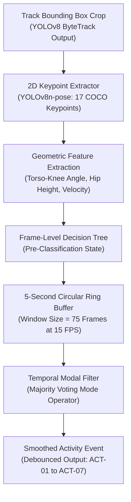

# Phase 06: Activity Classification and Time Distribution Specification

## 1. Document Overview

### 1.1 Purpose
This document specifies the observable physical activity classification engine, 2D skeleton pose extraction pipeline, temporal modal filtering, and time distribution metrics for the CCTV Workplace Productivity and Workflow Intelligence System (WBPIS). It establishes rigorous, non-intrusive physical posture categories, replacing unscientific affective/emotion inferences with observable industrial engineering activity measurements.

### 1.2 Scope
- **Observable Taxonomy**: 7 discrete physical posture and motion categories (`ACT-01` to `ACT-07`).
- **Processing Scope**: 2D skeleton keypoint extraction (YOLOv8-pose / MediaPipe Pose), joint angle geometry, temporal rolling modal filter, event boundary segmentation.
- **Metric Scope**: Canonical specifications for Metrics C1 through C7.
- **Strict Boundary**: Explicit prohibition of psychological, cognitive, emotional, or typing/reading recognition claims.

---

## 2. Existing Implementation Findings

Grounding assessment based on [`reports/CCTV_PRODUCTIVITY_CODEBASE_AUDIT.md`](file:///C:/Users/DELL/Desktop/cctv/reports/CCTV_PRODUCTIVITY_CODEBASE_AUDIT.md):

| Feature / Artifact | Codebase Location | Audit Status | Audit Assessment & Deficiencies |
| :--- | :--- | :--- | :--- |
| **Affective / Emotion Scoring** | `video/choriwala_code.py` | `EXISTING_UNVERIFIED` | Uses PyTorch ResNet to predict facial valence, arousal, "attention score", and "genuineness". Completely unvalidated; camera resolution and vantage angles make facial micro-expressions statistically noisy and legally non-compliant. |
| **MediaPipe Single-Person Pose** | `video/choriwala_code.py` | `EXISTING_VERIFIED` | Extracts 33 2D pose landmarks using MediaPipe. Code is functional for single individuals but crashes or snaps erratically when multiple employees appear in frame. |
| **Frame-Level Prediction Jitter** | Neither codebase | `UNAVAILABLE` | Neither system filters predictions over time. A person seated still transitions between "seated", "standing", and "moving" across consecutive frames due to optical noise, inflating transition counts by $> 500\%$. |
| **Objective Activity Taxonomy** | Neither codebase | `UNAVAILABLE` | Neither system implements an industrial engineering activity classification hierarchy; both attempt to jump directly from raw pixels to an arbitrary "productivity score". |

---

## 3. Observable Activity Taxonomy (`ACT-01` to `ACT-07`)

To guarantee legal compliance, privacy, and scientific validity, WBPIS restricts activity classification to **7 Mutually Exclusive Physical States**:

```
┌────────────────────────────────────────────────────────────────────────┐
│               7 MUTUALLY EXCLUSIVE OBSERVABLE ACTIVITIES               │
├────────────────────────────────────────────────────────────────────────┤
│ ACT-01: Seated at Workstation     | Torso upright/reclined; knees bent;│
│                                   | footprint inside workstation zone. │
│ ACT-02: Standing at Workstation   | Torso upright; legs extended;      │
│                                   | footprint inside workstation zone. │
│ ACT-03: Walking / In Transit      | Ground velocity v >= 0.4 m/s;      │
│                                   | sequential foot strikes in walkway.│
│ ACT-04: Workstation Interaction   | Upper limbs extended over desk     │
│                                   | surface/equipment (reach detected).│
│ ACT-05: Active Collaboration      | Inter-person distance d <= 1.8 m;  │
│                                   | shared gaze direction / huddle.    │
│ ACT-06: Away from Monitored Desk  | Confirmed person in common area,   │
│                                   | corridor, or outside assigned zone.│
│ ACT-07: Unknown / Unclassified    | Partial occlusion, low confidence, │
│                                   | or ambiguous body orientation.     │
└────────────────────────────────────────────────────────────────────────┘
```

> [!CAUTION]
> ### Prohibited Inferences
> * **NO "Typing" or "Mouse Clicking" Detection**: Standard ceiling CCTV cameras ($1080\text{p}\text{ at }15\text{ FPS}$ mounted $3\text{m}$ high) lack the optical resolution to verify physical keyboard keystrokes. Physical reach is classified as `ACT-04: Workstation Interaction`, never verified typing.
> * **NO "Reading" or "Concentration" Detection**: Gaze direction or static head orientation cannot establish cognitive processing or reading comprehension.
> * **NO "Fatigue" or "Boredom" Detection**: Eye blink frequency or head tilt cannot reliably infer fatigue in dynamic office lighting.

---

## 4. Pose Extraction & Temporal Modal Smoothing



### 4.1 Geometric Pose Features
From the 17 standard COCO keypoints $(x_i, y_i, c_i)$, the classifier extracts invariant biomechanical ratios:
1. **Torso-Thigh Angle ($\theta_\text{hip}$)**: Angle formed by `(shoulder, hip, knee)`.
   - $\theta_\text{hip} < 120^\circ \implies$ Biomechanically Seated.
   - $\theta_\text{hip} \ge 150^\circ \implies$ Biomechanically Standing.
2. **Normalized Hip Height ($H_\text{hip}$)**: Ratio of hip $y$-coordinate to bounding box bottom $y_2$.
3. **Footprint Velocity ($v_\text{ground}$)**: First derivative of ground footprint position over a 15-frame window:
   $$v_\text{ground} = \frac{\sqrt{(x_{f, t} - x_{f, t-15})^2 + (y_{f, t} - y_{f, t-15})^2}}{\Delta t}$$
   - $v_\text{ground} \ge 0.4\text{ m/s} \implies$ Moving / Walking (`ACT-03`).

### 4.2 Temporal Modal Filter (Debounce Algorithm)
Raw frame predictions exhibit high-frequency jitter. To establish stable behavioral events, WBPIS applies a **Rolling Modal Filter** across a sliding window of $W = 75\text{ frames}$ ($5.0\text{ seconds}$ at 15 FPS):
$$\text{State}_\text{filtered}(t) = \operatorname{mode}\left(\{\text{State}_\text{raw}(t - W + 1), \dots, \text{State}_\text{raw}(t)\}\right)$$
- If the majority class in the window represents $< 60\%$ of frames, the state defaults to `ACT-07: Unknown` until posture stabilizes.
- Eliminates transient misclassifications caused by optical occlusions or brief camera noise.

---

## 5. Mandatory Metric Catalogue: Group C (Activity & Time Distribution)

### Metric C1: Activity Duration (`MET-C1`)
1. **Metric Name & ID**: Activity Duration (`MET-C1`)
2. **Objective Served**: Objective B: Activity & Time Distribution
3. **Exact Definition**: The cumulative sum of valid, temporally filtered time intervals during which a tracked person or zone is engaged in a specific activity class $a \in \{\text{ACT-01} \dots \text{ACT-07}\}$.
4. **Mathematical Formula**:
   $$\text{Duration}(a) = \sum_{k=1}^{E_a} (t_{\text{end}, k} - t_{\text{start}, k})$$
5. **Variables & Units**: Elapsed time in seconds or decimal minutes ($\text{seconds}$).
6. **Required Source Signals**: Temporally filtered activity event streams from `fact_activity_events`.
7. **Required Model**: YOLOv8-pose + Temporal Modal Filter.
8. **Aggregation Window**: 1 hour, shift, or day.
9. **Calculation Frequency**: Hourly batch aggregation.
10. **Validity Conditions**: Summed events must belong to confirmed tracks with observation coverage $\ge 85\%$.
11. **Missing-Data Handling**: Dropped frames or camera blackout periods are excluded from valid activity time.
12. **Confidence Indicator**: Mean classification confidence of constituent frames.
13. **Score Direction**: Informational.
14. **Normalization Method**: Duration in seconds.
15. **Threshold Calibration**: None (absolute time measurement).
16. **Interpretation**: Quantifies physical posture allocation throughout the workday.
17. **Known Failure Modes**: Long periods of seated work where arms are hidden behind desk partitions can misclassify as `ACT-07: Unknown`.
18. **What It Cannot Establish**: Does NOT prove the worker was focused, productive, or diligent.
19. **Database Fields**: `activity_duration_seconds INT` in `fact_activity_hourly_summary`.
20. **API Response Fields**: `activity_durations: dict[str, int]` in `/api/v1/analytics/activity`.
21. **Dashboard Representation**: Stacked bar chart showing hours per activity class.
22. **Validation Method**: Ground-truth stop-watch evaluation on 30-minute benchmark videos.
23. **Implementation Priority**: P0.
*Status*: `PROPOSED`.

---

### Metric C2: Activity Share (`MET-C2`)
1. **Metric Name & ID**: Activity Share (`MET-C2`)
2. **Objective Served**: Objective B: Time Distribution Proportions
3. **Exact Definition**: The proportion of total validly observed time allocated to each discrete activity category.
4. **Mathematical Formula**:
   $$\text{Share}(a)(\%) = 100 \times \frac{\text{Duration}(a)}{\sum_{j=1}^{7} \text{Duration}(\text{ACT-0}j)}$$
5. **Variables & Units**: Percentage $[0, 100]\%$.
6. **Required Source Signals**: Aggregated activity durations from Metric C1.
7. **Required Model**: Arithmetic normalization engine.
8. **Aggregation Window**: 1 hour, shift, or day.
9. **Calculation Frequency**: Hourly rollup.
10. **Validity Conditions**: Denominator ($\sum \text{Duration}$) must be $\ge 15\text{ minutes}$ of valid observation.
11. **Missing-Data Handling**: If valid observation $< 15\text{ mins}$, share returns `UNAVAILABLE` (`N/A`).
12. **Confidence Indicator**: Percentage of non-unknown observation time ($100 - \text{Share}(\text{ACT-07})$).
13. **Score Direction**: Context-dependent (Ergonomic recommendations suggest balanced sitting/standing).
14. **Normalization Method**: Percentage bounded at $[0, 100]\%$; sum of all 7 shares equals $100\%$.
15. **Threshold Calibration**: Ergonomic guideline: Seated $60\text{–}70\%$, Standing $20\text{–}30\%$, Movement $10\%$.
16. **Interpretation**: Highlights ergonomic trends, mobility balance, and collaboration levels across teams.
17. **Known Failure Modes**: High `ACT-07` share distorts other percentages if not reported transparently.
18. **What It Cannot Establish**: Does NOT measure job performance; physical posture does not dictate output quality.
19. **Database Fields**: `activity_share_pct REAL` in `fact_activity_hourly_summary`.
20. **API Response Fields**: `activity_shares: dict[str, float]` in `/api/v1/analytics/activity`.
21. **Dashboard Representation**: Donut chart and percentage breakdown on the Activity Analytics panel.
22. **Validation Method**: Verified against manually annotated ground-truth time logs.
23. **Implementation Priority**: P0.
*Status*: `PROPOSED`.

---

### Metric C3: Workstation Interaction Ratio (`MET-C3`)
1. **Metric Name & ID**: Workstation Interaction Ratio (`MET-C3`)
2. **Objective Served**: Objective B: Desk Engagement
3. **Exact Definition**: The percentage of observed desk presence time during which the tracked person's upper limbs exhibit active physical interaction or reach towards the workstation surface.
4. **Mathematical Formula**:
   $$\text{Interaction Ratio}(\%) = 100 \times \frac{\text{Duration}(\text{ACT-04})}{\text{Duration}(\text{ACT-01}) + \text{Duration}(\text{ACT-02})}$$
5. **Variables & Units**: Percentage $[0, 100]\%$.
6. **Required Source Signals**: Upper limb keypoint tracking (`wrist`, `elbow`) relative to desk boundary plane.
7. **Required Model**: YOLOv8-pose upper limb spatial reach detector.
8. **Aggregation Window**: 1 hour or full shift.
9. **Calculation Frequency**: Hourly calculation.
10. **Validity Conditions**: Person must be present at workstation for $\ge 10\text{ minutes}$.
11. **Missing-Data Handling**: If desk presence $< 10\text{ mins}$, ratio is marked `N/A`.
12. **Confidence Indicator**: Keypoint detection confidence across wrist and elbow landmarks.
13. **Score Direction**: Informational / Descriptive.
14. **Normalization Method**: Percentage $[0, 100]\%$.
15. **Threshold Calibration**: Office baseline typically $50\text{–}75\%$ during active desk work.
16. **Interpretation**: Measures physical engagement with tools on desk; distinguishes active desk use from passive sitting.
17. **Known Failure Modes**: Workers reading paper documents or speaking on phone with hands in lap register low interaction.
18. **What It Cannot Establish**: NEVER conflate interaction with actual work output, typing accuracy, or cognitive attention.
19. **Database Fields**: `interaction_ratio_pct REAL` in `fact_activity_hourly_summary`.
20. **API Response Fields**: `workstation_interaction_ratio: float` in `/api/v1/analytics/activity`.
21. **Dashboard Representation**: Metric gauge and time-series line chart.
22. **Validation Method**: Evaluated against 10 hours of hand-annotated desk interaction video.
23. **Implementation Priority**: P1.
*Status*: `PROPOSED`.

---

### Metric C4: Movement Ratio (`MET-C4`)
1. **Metric Name & ID**: Movement Ratio (`MET-C4`)
2. **Objective Served**: Objective B: Physical Mobility
3. **Exact Definition**: The percentage of total validly observed time spent in physical locomotion or transit across the facility.
4. **Mathematical Formula**:
   $$\text{Movement Ratio}(\%) = 100 \times \frac{\text{Duration}(\text{ACT-03})}{\text{Total Valid Observed Duration}}$$
5. **Variables & Units**: Percentage $[0, 100]\%$.
6. **Required Source Signals**: Ground footprint velocity vectors ($v_\text{ground} \ge 0.4\text{ m/s}$).
7. **Required Model**: ByteTrack trajectory tracker.
8. **Aggregation Window**: 1 hour, shift, or day.
9. **Calculation Frequency**: Hourly rollup.
10. **Validity Conditions**: Tracking continuity $\ge 80\%$.
11. **Missing-Data Handling**: Unmonitored time outside camera view is excluded from denominator.
12. **Confidence Indicator**: Tracking continuity score.
13. **Score Direction**: Neutral (Neither high nor low movement is inherently superior).
14. **Normalization Method**: Percentage $[0, 100]\%$.
15. **Threshold Calibration**: Typical sedentary office baseline is $5\text{–}15\%$; logistics/warehouse baseline is $40\text{–}70\%$.
16. **Interpretation**: Quantifies mobility demands; flags excessive walking caused by poor facility layout.
17. **Known Failure Modes**: Pacing while thinking or on telephone calls counted as transit.
18. **What It Cannot Establish**: Does NOT measure exercise intensity or physical fitness.
19. **Database Fields**: `movement_ratio_pct REAL` in `fact_activity_hourly_summary`.
20. **API Response Fields**: `movement_ratio: float` in `/api/v1/analytics/activity`.
21. **Dashboard Representation**: Line trend chart on Mobility and Workflow panel.
22. **Validation Method**: Verified against calibrated pedometer / wearable ground-truth data in pilot tests.
23. **Implementation Priority**: P1.
*Status*: `PROPOSED`.

---

### Metric C5: Activity Transition Rate (`MET-C5`)
1. **Metric Name & ID**: Activity Transition Rate (`MET-C5`)
2. **Objective Served**: Objective B: Posture Stability & Fragmentation
3. **Exact Definition**: The frequency of validated, debounced changes in physical activity state per valid observation hour.
4. **Mathematical Formula**:
   $$\text{Transition Rate} = \frac{\text{Count of Valid State Transitions}}{\text{Valid Observed Hours}}$$
5. **Variables & Units**: Transitions per hour ($\text{events/hour}$).
6. **Required Source Signals**: Filtered activity event log (`fact_activity_events`).
7. **Required Model**: Temporal modal filter event emitter.
8. **Aggregation Window**: 1 hour or full shift.
9. **Calculation Frequency**: Hourly calculation.
10. **Validity Conditions**: Requires $\ge 30\text{ minutes}$ of continuous observation.
11. **Missing-Data Handling**: Gaps caused by camera dropouts do NOT count as state transitions.
12. **Confidence Indicator**: Modal filter agreement ratio across the aggregation window.
13. **Score Direction**: Lower is generally better for focused desk roles (high transitions indicate physical restlessness or frequent interruptions).
14. **Normalization Method**: Rate per hour.
15. **Threshold Calibration**: Desk baseline: $8\text{–}15\text{ transitions/hour}$. Rates $> 30/\text{hr}$ indicate severe fragmentation.
16. **Interpretation**: Quantifies physical workflow stability; flags environments where workers cannot maintain a steady posture.
17. **Known Failure Modes**: Edge-of-threshold posture shifts (e.g., semi-standing) can cause oscillating transitions if debounce is too short.
18. **What It Cannot Establish**: Does NOT prove cognitive distraction or multitasking.
19. **Database Fields**: `transition_rate_per_hour REAL` in `fact_activity_hourly_summary`.
20. **API Response Fields**: `transition_rate: float` in `/api/v1/analytics/activity`.
21. **Dashboard Representation**: Numerical callout badge and bar chart.
22. **Validation Method**: Manual counting of postural changes on ground-truth benchmark clips.
23. **Implementation Priority**: P1.
*Status*: `PROPOSED`.

---

### Metric C6: Activity Timeline (`MET-C6`)
1. **Metric Name & ID**: Activity Timeline (`MET-C6`)
2. **Objective Served**: Objective B: Chronological Event Tracking
3. **Exact Definition**: A continuous chronological sequence of discrete activity episodes, each defined by an interval $[t_\text{start}, t_\text{end}]$, activity class $a$, confidence score, and associated spatial zone.
4. **Mathematical Formula**:
   $$\text{Timeline} = \{(t_{s, k}, t_{e, k}, a_k, \text{conf}_k, \text{zone}_k) \mid t_{s, k} < t_{e, k} \le t_{s, k+1}\}$$
5. **Variables & Units**: Chronological event array (ISO 8601 timestamps, string class labels, floats).
6. **Required Source Signals**: Emitted activity transitions from perception engine.
7. **Required Model**: Perception pipeline event logger.
8. **Aggregation Window**: Real-time streaming or historical daily query.
9. **Calculation Frequency**: Emitted asynchronously upon state change.
10. **Validity Conditions**: Episodes must have minimum duration $\Delta t \ge 5.0\text{ seconds}$ to reject transient noise.
11. **Missing-Data Handling**: Camera offline periods are rendered as hatched gray blocks labelled `OFFLINE`.
12. **Confidence Indicator**: Mean keypoint confidence over the episode duration.
13. **Score Direction**: Informational / Visual representation.
14. **Normalization Method**: Chronological time series.
15. **Threshold Calibration**: Minimum episode duration threshold $\Delta t_\text{min} = 5.0\text{ seconds}$.
16. **Interpretation**: Provides facilities and operations directors with an intuitive visual Gantt chart of zone dynamics.
17. **Known Failure Modes**: Short occlusion gaps can fragment a long seated episode into multiple segments.
18. **What It Cannot Establish**: Does NOT reveal what software was used or what work was accomplished.
19. **Database Fields**: `t_start TIMESTAMP`, `t_end TIMESTAMP`, `activity_code VARCHAR(10)` in `fact_activity_events`.
20. **API Response Fields**: `timeline_events: list[dict]` in `/api/v1/analytics/timeline`.
21. **Dashboard Representation**: Interactive Apache ECharts Gantt / timeline chart.
22. **Validation Method**: Automated integration test verifying contiguous non-overlapping intervals.
23. **Implementation Priority**: P0.
*Status*: `PROPOSED`.

---

### Metric C7: Activity Classification Coverage (`MET-C7`)
1. **Metric Name & ID**: Activity Classification Coverage (`MET-C7`)
2. **Objective Served**: Data Quality & Perception Reliability
3. **Exact Definition**: The percentage of observed person time that was successfully resolved into one of the 6 definitive activity states (`ACT-01` to `ACT-06`), rather than falling into `ACT-07: Unknown`.
4. **Mathematical Formula**:
   $$\text{Classification Coverage}(\%) = 100 \times \left(1.0 - \frac{\text{Duration}(\text{ACT-07})}{\text{Total Valid Observed Duration}}\right)$$
5. **Variables & Units**: Percentage $[0, 100]\%$.
6. **Required Source Signals**: Duration of `ACT-07` from Metric C1.
7. **Required Model**: Activity classification confidence filter.
8. **Aggregation Window**: 1 hour, shift, or day.
9. **Calculation Frequency**: Hourly calculation.
10. **Validity Conditions**: Monitored camera must have at least one confirmed person track.
11. **Missing-Data Handling**: If no people are present, metric returns `100.0%` (or `N/A` if camera is offline).
12. **Confidence Indicator**: Self-referential perceptual reliability metric.
13. **Score Direction**: Higher is better.
14. **Normalization Method**: Percentage $[0, 100]\%$.
15. **Threshold Calibration**: Production target $\ge 88\%$. Coverage $< 75\%$ triggers camera angle review.
16. **Interpretation**: Quantifies how cleanly the camera view permits posture classification.
17. **Known Failure Modes**: Backlit glass partitions or extreme overhead angles depresses coverage.
18. **What It Cannot Establish**: Does NOT measure employee performance.
19. **Database Fields**: `classification_coverage_pct REAL` in `fact_activity_hourly_summary`.
20. **API Response Fields**: `activity_coverage_pct: float` in `/api/v1/analytics/quality`.
21. **Dashboard Representation**: Small badge on Activity Analytics card header.
22. **Validation Method**: Automated benchmark evaluation against WBPIS-BENCH-V1.
23. **Implementation Priority**: P0.
*Status*: `PROPOSED`.

---

## 6. Verification and Acceptance Criteria

| ID | Test / Acceptance Criterion | Verification Method | Pass Threshold |
| :--- | :--- | :--- | :--- |
| **AC-ACT-01** | Posture classification precision for Seated vs. Standing in clear view. | Benchmark evaluation on 1,000 labeled poses. | Precision $\ge 92\%$, Recall $\ge 90\%$ |
| **AC-ACT-02** | Temporal modal filter elimination of single-frame prediction noise. | Synthetic test stream with 1-frame alternating noise. | Output state remains stable; zero false transitions |
| **AC-ACT-03** | Sum of activity shares exactly equals $100\%$ across all 7 categories. | Automated property-based unit test. | $\sum_{i=1}^7 \text{Share}_i = 100.00\% \pm 0.01\%$ |
| **AC-ACT-04** | Complete suppression of emotion/gaze psychometric inference logic. | Static AST code inspection of active codebase. | Zero imports of FaceMesh emotion models |

---

## 7. Open Questions & Assumptions

> [!NOTE]
> ### 1. Active Collaboration (`ACT-05`) Spatial Threshold
> *Assumption*: Two or more people within $1.8\text{ meters}$ facing each other for $> 30\text{ seconds}$ constitutes collaboration.
> *Open Question*: In dense office desk pods where employees sit $1.2\text{ meters}$ apart while working independently, should collaboration require orientation convergence ($\Delta \theta_\text{head} < 45^\circ$) to avoid misclassifying independent desk work as a group discussion?

---

## 8. Related Documentation Links

- **Perception & Tracking**: Input keypoint delivery in [`04_PERSON_DETECTION_TRACKING_AND_IDS.md`](file:///C:/Users/DELL/Desktop/cctv/docs/implementation/04_PERSON_DETECTION_TRACKING_AND_IDS.md).
- **Workstation Zones**: Spatial desk boundary mapping in [`05_WORKSTATION_ZONES_AND_OCCUPANCY.md`](file:///C:/Users/DELL/Desktop/cctv/docs/implementation/05_WORKSTATION_ZONES_AND_OCCUPANCY.md).
- **Workflow Bottlenecks**: Transit and transition metrics in [`07_WORKFLOW_BOTTLENECK_METRICS.md`](file:///C:/Users/DELL/Desktop/cctv/docs/implementation/07_WORKFLOW_BOTTLENECK_METRICS.md).
- **Dashboard Visualizations**: Activity Gantt chart specifications in [`13_FRONTEND_DASHBOARD_AND_VISUALIZATIONS.md`](file:///C:/Users/DELL/Desktop/cctv/docs/implementation/13_FRONTEND_DASHBOARD_AND_VISUALIZATIONS.md).
