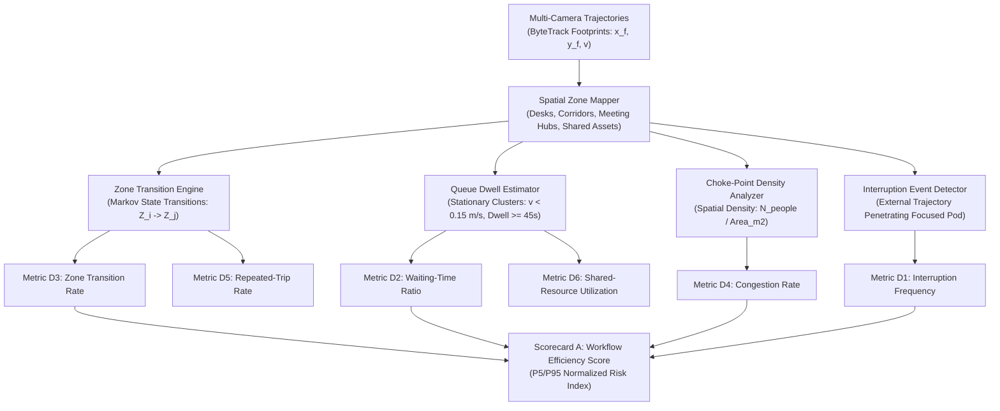

# Phase 07: Workflow Bottleneck Metrics Specification

## 1. Document Overview

### 1.1 Purpose
This document specifies the operational bottleneck detection algorithms, corridor transit modeling, queue dwell time estimation, and workflow disruption metrics for the CCTV Workplace Productivity and Workflow Intelligence System (WBPIS). Serving **Objective A: Workflow Efficiency**, this specification provides facility directors and industrial engineers with objective physical evidence of operational friction, shared equipment contention, and layout inefficiencies.

### 1.2 Scope
- **Metric Scope**: Canonical specifications for Metrics D1 through D7 (Interruption frequency, waiting-time ratio, zone transition rate, congestion rate, repeated-trip rate, shared-resource utilization, and bottleneck indicator synthesis).
- **Analytical Scope**: Trajectory churn modeling, Markov zone transition matrices, queue boundary clustering, and before-and-after layout A/B testing.
- **Epistemological Boundary**: Clear demarcation separating observable physical events from inferred operational causes. CCTV establishes *where* and *when* physical delays occur; external workflow context is required to establish *why*.

---

## 2. Existing Implementation Findings

Grounding assessment based on [`reports/CCTV_PRODUCTIVITY_CODEBASE_AUDIT.md`](file:///C:/Users/DELL/Desktop/cctv/reports/CCTV_PRODUCTIVITY_CODEBASE_AUDIT.md):

| Feature / Artifact | Codebase Location | Audit Status | Audit Assessment & Deficiencies |
| :--- | :--- | :--- | :--- |
| **Corridor Congestion Modeling** | Neither codebase | `UNAVAILABLE` | Neither prototype contains corridor tracking, person density estimation, or walkway choke-point detection. |
| **Queue Dwell Time Estimation** | Neither codebase | `UNAVAILABLE` | Neither system models shared resource queueing or stationary dwell times around shared office assets (e.g., printers, review counters). |
| **Workflow Transition Tracking** | Neither codebase | `UNAVAILABLE` | Tracks were treated as isolated single-frame detections; neither system maintains spatial Markov transition matrices between functional zones. |
| **Fictitious "Productivity" Metrics** | `audit_extracted/.../app.py` | `EXISTING_VERIFIED` (`ANL-01`) | Legacy prototype displayed an arbitrary "Productivity Score: 85%" calculated solely as the ratio of seated desk time to total elapsed time. Highly misleading; ignores true workflow dynamics. |

---

## 3. Physical Workflow Modeling Architecture

---

## 4. Mandatory Metric Catalogue: Group D (Workflow & Bottleneck Metrics)

### Metric D1: Interruption Frequency (`MET-D1`)
1. **Metric Name & ID**: Interruption Frequency (`MET-D1`)
2. **Objective Served**: Objective A: Workflow Efficiency & Focus Protection
3. **Exact Definition**: The number of validated physical intrusion events per hour where a roving individual enters the immediate personal workstation boundary of a seated worker and initiates close-proximity standing interaction.
4. **Mathematical Formula**:
   $$\text{Interruption Frequency} = \frac{\sum_{k=1}^{M} \mathbb{I}(\text{Event}_k = \text{Interruption})}{T_\text{observed\_focus\_hours}}$$
   $$\text{Event}_k \iff (d(P_\text{roving}, P_\text{seated}) \le 1.5\text{m}) \wedge (\Delta t_\text{interaction} \ge 15\text{s}) \wedge (\text{Zone}_\text{roving} \ne \text{Zone}_\text{assigned})$$
5. **Variables & Units**: Events per hour ($\text{events/hour}$).
6. **Required Source Signals**: Dual-track proximity vectors, workstation zone ownership, posture states (`ACT-01` seated vs. `ACT-02` standing).
7. **Required Model**: Spatio-temporal interaction detector.
8. **Aggregation Window**: 1 hour, 4-hour block, or full shift.
9. **Calculation Frequency**: Hourly calculation.
10. **Validity Conditions**: Seated person must be continuously present at workstation for $\ge 15\text{ minutes}$ prior to the event.
11. **Missing-Data Handling**: If camera view is occluded during an encounter, event is discarded to avoid false counts.
12. **Confidence Indicator**: Joint tracking continuity score of both interacting tracks.
13. **Score Direction**: Lower is better (High interruption frequency correlates with cognitive fragmentation).
14. **Normalization Method**: P5/P95 percentile normalization (Baseline: P5 = 0.5/hr, P95 = 4.5/hr).
15. **Threshold Calibration**: $> 3.0\text{ interruptions/hour}$ triggers a workflow layout warning.
16. **Interpretation**: Measures physical disruption to focused work; identifies desks positioned too close to busy walkways.
17. **Known Failure Modes**: Pre-scheduled, welcome collaborative discussions misclassified as interruptions.
18. **What It Cannot Establish**: Cannot determine the *content* or *value* of the interaction (e.g., urgent operational alert vs. casual chat).
19. **Database Fields**: `interruption_count INT`, `focus_hours REAL` in `fact_workstation_hourly_metrics`.
20. **API Response Fields**: `interruption_frequency_per_hour: float` in `/api/v1/analytics/workflow`.
21. **Dashboard Representation**: Metric card with red/amber warning threshold indicator.
22. **Validation Method**: Ground-truth validation against 10 hours of video audited by human industrial observers.
23. **Implementation Priority**: P1.
*Status*: `PROPOSED`.

---

### Metric D2: Waiting-Time Ratio (`MET-D2`)
1. **Metric Name & ID**: Waiting-Time Ratio (`MET-D2`)
2. **Objective Served**: Objective A: Workflow Bottlenecks & Resource Starvation
3. **Exact Definition**: The percentage of operational time spent in a stationary, non-seated posture within a designated shared equipment or service queue buffer zone without active equipment operation.
4. **Mathematical Formula**:
   $$\text{Waiting Ratio}(\%) = 100 \times \frac{\sum_{k} \Delta t_{\text{waiting}, k}}{T_\text{monitored\_operational\_duration}}$$
   $$\text{Waiting Condition} \iff (P_f \in \text{Zone}_\text{queue}) \wedge (v_\text{ground} < 0.15\text{ m/s}) \wedge (\Delta t \ge 30\text{s}) \wedge (\text{ACT} = \text{ACT-02})$$
5. **Variables & Units**: Percentage $[0, 100]\%$.
6. **Required Source Signals**: Footprint position in queue polygon, ground velocity vectors, standing posture duration.
7. **Required Model**: Stationary queue detector.
8. **Aggregation Window**: 1 hour, shift, or day.
9. **Calculation Frequency**: Hourly rollup.
10. **Validity Conditions**: Queue buffer zone must be formally registered around a shared operational asset.
11. **Missing-Data Handling**: If queue area is unmonitored or camera is offline, metric returns `UNAVAILABLE` (`N/A`).
12. **Confidence Indicator**: Tracking continuity in the queue zone.
13. **Score Direction**: Lower is better (Zero is ideal).
14. **Normalization Method**: P5/P95 percentile normalization (Baseline: P5 = 1.0%, P95 = 12.0%).
15. **Threshold Calibration**: Ratio $> 8.0\%$ indicates significant shared equipment starvation.
16. **Interpretation**: Quantifies idle time lost while employees wait for shared resources (printers, lab equipment, review kiosks).
17. **Known Failure Modes**: Employees socializing near the water cooler counted as waiting if zones overlap.
18. **What It Cannot Establish**: Cannot confirm whether an employee is waiting for a machine or waiting for a person.
19. **Database Fields**: `waiting_duration_seconds INT` in `fact_zone_hourly_metrics`.
20. **API Response Fields**: `waiting_time_ratio_pct: float` in `/api/v1/analytics/workflow`.
21. **Dashboard Representation**: Amber gauge bar on the Bottleneck Indicators panel.
22. **Validation Method**: Stop-watch timing of physical queues in shared printer/lab areas.
23. **Implementation Priority**: P1.
*Status*: `PROPOSED`.

---

### Metric D3: Zone Transition Rate (`MET-D3`)
1. **Metric Name & ID**: Zone Transition Rate (`MET-D3`)
2. **Objective Served**: Objective A: Spatial Churn & Transit Efficiency
3. **Exact Definition**: The total count of verified boundary crossings between distinct functional office zones per monitored hour.
4. **Mathematical Formula**:
   $$\text{Transition Rate} = \frac{\sum_{k=1}^{N} \mathbb{I}(\text{Zone}(t_k) \ne \text{Zone}(t_{k-1}))}{T_\text{monitored\_hours}}$$
5. **Variables & Units**: Boundary crossings per hour ($\text{transitions/hour}$).
6. **Required Source Signals**: Sequential zone assignment stream from spatial engine.
7. **Required Model**: Markov zone boundary transition tracker.
8. **Aggregation Window**: 1 hour or full shift.
9. **Calculation Frequency**: Hourly calculation.
10. **Validity Conditions**: Transitions must persist in the new zone for $\ge 5.0\text{ seconds}$ to eliminate boundary oscillation noise.
11. **Missing-Data Handling**: Camera hand-off gaps do NOT generate transition counts.
12. **Confidence Indicator**: Mean spatial classification confidence across crossing events.
13. **Score Direction**: Context-dependent (High transitions indicate high spatial churn or poor adjacencies).
14. **Normalization Method**: P5/P95 percentile normalization (Baseline: P5 = 2.0/hr, P95 = 14.0/hr).
15. **Threshold Calibration**: Baseline established per functional role.
16. **Interpretation**: Measures physical mobility between departments; high rates between distant rooms suggest layout separation friction.
17. **Known Failure Modes**: Loitering on a drawn boundary line causing oscillating crossings (mitigated by $5\text{s}$ debounce).
18. **What It Cannot Establish**: Does NOT evaluate whether travel was productive or wasteful.
19. **Database Fields**: `transition_count INT` in `fact_zone_hourly_metrics`.
20. **API Response Fields**: `zone_transition_rate_per_hour: float` in `/api/v1/analytics/workflow`.
21. **Dashboard Representation**: Sankey diagram and transition matrix heatmap on the Dashboard.
22. **Validation Method**: Automated verification against simulated synthetic trajectory paths.
23. **Implementation Priority**: P0.
*Status*: `PROPOSED`.

---

### Metric D4: Congestion Rate (`MET-D4`)
1. **Metric Name & ID**: Congestion Rate (`MET-D4`)
2. **Objective Served**: Objective A: Corridor Choke-Point Detection
3. **Exact Definition**: The percentage of monitored time during which a designated corridor or circulation zone exceeds its calibrated design capacity density ($\rho \ge 0.5\text{ persons/m}^2$).
4. **Mathematical Formula**:
   $$\text{Congestion Rate}(\%) = 100 \times \frac{\sum \Delta t(\rho(t) \ge \rho_\text{crit})}{T_\text{monitored}}$$
   $$\rho(t) = \frac{\text{Count of Confirmed People in Zone at Time } t}{\text{Area of Zone in Square Meters}}$$
5. **Variables & Units**: Percentage $[0, 100]\%$; density in $\text{persons/m}^2$; $\rho_\text{crit} = 0.5\text{ persons/m}^2$.
6. **Required Source Signals**: Concurrent confirmed track counts in corridor polygon + calibrated floor area ($m^2$).
7. **Required Model**: Spatial multi-track density accumulator.
8. **Aggregation Window**: 1 hour, shift, or day.
9. **Calculation Frequency**: Hourly rollup.
10. **Validity Conditions**: Monitored corridor zone must have calibrated physical square-meter dimensions.
11. **Missing-Data Handling**: If camera drops frames, congestion duration is computed over valid frames only.
12. **Confidence Indicator**: Camera observation coverage ratio.
13. **Score Direction**: Lower is better (Zero is ideal).
14. **Normalization Method**: P5/P95 percentile normalization (Baseline: P5 = 0.0%, P95 = 8.0%).
15. **Threshold Calibration**: Rates $> 5.0\%$ indicate physical bottlenecks impeding office circulation.
16. **Interpretation**: Highlights severe corridor choke points where employees encounter physical delays and crowding.
17. **Known Failure Modes**: Temporary huddles or announcements in corridors inflating congestion duration.
18. **What It Cannot Establish**: Does NOT prove safety code violations without local fire marshal calibration.
19. **Database Fields**: `congestion_duration_seconds INT`, `max_density REAL` in `fact_corridor_hourly_metrics`.
20. **API Response Fields**: `congestion_rate_pct: float` in `/api/v1/analytics/workflow`.
21. **Dashboard Representation**: Red thermal overlay on corridor sections of interactive floor plan.
22. **Validation Method**: Manual headcount verification on recorded peak-hour clips (e.g., lunch hour rush).
23. **Implementation Priority**: P0.
*Status*: `PROPOSED`.

---

### Metric D5: Repeated-Trip Rate (`MET-D5`)
1. **Metric Name & ID**: Repeated-Trip Rate (`MET-D5`)
2. **Objective Served**: Objective A: Workflow Friction & Transit Waste
3. **Exact Definition**: The frequency of repetitive round-trip transits between a primary workstation and a secondary resource zone occurring within a compressed time window ($< 15\text{ minutes}$ between trips).
4. **Mathematical Formula**:
   $$\text{Repeated-Trip Rate} = \frac{\text{Count of Recurrent Round Trips }(Z_\text{desk} \to Z_\text{asset} \to Z_\text{desk})}{T_\text{monitored\_hours}}$$
5. **Variables & Units**: Recurrent trips per hour ($\text{trips/hour}$).
6. **Required Source Signals**: Track trajectory history, zone entry/exit timestamp sequences.
7. **Required Model**: Trajectory pattern mining engine.
8. **Aggregation Window**: 4-hour half-day or 8-hour shift.
9. **Calculation Frequency**: Shift rollup.
10. **Validity Conditions**: Track continuity must be preserved throughout the round trip.
11. **Missing-Data Handling**: Incomplete loops (person leaves camera coverage) are discarded.
12. **Confidence Indicator**: Tracking continuity across trip legs.
13. **Score Direction**: Lower is better.
14. **Normalization Method**: P5/P95 percentile normalization (Baseline: P5 = 0.2/hr, P95 = 2.5/hr).
15. **Threshold Calibration**: $> 1.5\text{ repeated trips/hour}$ indicates layout separation between dependent tasks.
16. **Interpretation**: Diagnoses workflow friction; proves that tools, supplies, or collaborators are situated too far from the team.
17. **Known Failure Modes**: Healthy movement breaks (e.g., getting water) misclassified as operational waste without workflow context.
18. **What It Cannot Establish**: Cannot establish whether the trip was operationally mandatory or discretionary.
19. **Database Fields**: `repeated_trip_count INT` in `fact_workstation_shift_summary`.
20. **API Response Fields**: `repeated_trip_rate: float` in `/api/v1/analytics/workflow`.
21. **Dashboard Representation**: Directed arrow thickness on the Workflow Transit Map.
22. **Validation Method**: Automated trajectory loop test against synthetic agent-based simulation.
23. **Implementation Priority**: P2.
*Status*: `PROPOSED`.

---

### Metric D6: Shared-Resource Utilization (`MET-D6`)
1. **Metric Name & ID**: Shared-Resource Utilization (`MET-D6`)
2. **Objective Served**: Objective A: Asset Capacity Optimization
3. **Exact Definition**: The percentage of available operational time during which a designated shared physical asset (plotter, conference booth, testing bench) is actively occupied.
4. **Mathematical Formula**:
   $$\text{SRU}(\%) = 100 \times \frac{\sum \Delta t_\text{occupied\_asset}}{T_\text{available} - T_\text{maintenance}}$$
5. **Variables & Units**: Percentage $[0, 100]\%$.
6. **Required Source Signals**: Bounding polygon of shared equipment zone, presence events.
7. **Required Model**: Spatial polygon ray-casting engine.
8. **Aggregation Window**: 1 hour, shift, or week.
9. **Calculation Frequency**: Hourly calculation.
10. **Validity Conditions**: Zone must be registered as `SHARED_RESOURCE` in asset catalog.
11. **Missing-Data Handling**: Asset downtime / maintenance periods are excluded from denominator.
12. **Confidence Indicator**: Camera coverage ratio over the resource zone.
13. **Score Direction**: Target-based (Optimal utilization $60\text{–}80\%$).
14. **Normalization Method**: Percentage $[0, 100]\%$.
15. **Threshold Calibration**: Utilization $> 85\%$ triggers capacity expansion recommendation (`REC-02`); $< 20\%$ triggers decommissioning.
16. **Interpretation**: Informs capital expenditure; proves whether expensive shared hardware is oversubscribed or wasted.
17. **Known Failure Modes**: Boxes or discarded chairs placed in the zone triggering false occupancy.
18. **What It Cannot Establish**: Does NOT prove the machine is functioning properly; measures human presence.
19. **Database Fields**: `resource_utilization_pct REAL` in `fact_shared_resource_hourly`.
20. **API Response Fields**: `shared_resource_utilization: float` in `/api/v1/analytics/resources`.
21. **Dashboard Representation**: Color-coded asset icon (Red $> 85\%$, Green $50\text{–}85\%$, Gray $< 20\%$).
22. **Validation Method**: Cross-validation against printer job logs or room booking software.
23. **Implementation Priority**: P1.
*Status*: `PROPOSED`.

---

### Metric D7: Bottleneck Indicator Synthesis (`MET-D7`)
1. **Metric Name & ID**: Bottleneck Indicator Synthesis (`MET-D7`)
2. **Objective Served**: Objective A: Composite Workflow Risk Index
3. **Exact Definition**: A multi-factor risk index combining normalized waiting time, congestion rates, interruption frequency, and transit churn to identify operational hot-spots across the floor plan.
4. **Mathematical Formula**:
   $$\text{Bottleneck Risk} = w_1 \cdot \text{Risk}_\text{intr} + w_2 \cdot \text{Risk}_\text{wait} + w_3 \cdot \text{Risk}_\text{cong} + w_4 \cdot \text{Risk}_\text{transit}$$
   $$\text{Risk}_i = 100 \times \operatorname{clip}\left(\frac{x_i - P5_i}{P95_i - P5_i}, 0, 1\right)$$
   Provisional weights: $w_1 = 0.30$ (Interruptions), $w_2 = 0.25$ (Waiting), $w_3 = 0.25$ (Congestion), $w_4 = 0.20$ (Transit Churn).
5. **Variables & Units**: Index $[0, 100]$; higher indicates more severe operational bottleneck.
6. **Required Source Signals**: Metrics D1, D2, D3, D4.
7. **Required Model**: Normalization and weighted linear synthesis engine.
8. **Aggregation Window**: 1 day or 1 week.
9. **Calculation Frequency**: Daily rollup.
10. **Validity Conditions**: All 4 constituent metrics must have observation coverage $\ge 85\%$.
11. **Missing-Data Handling**: If any component is unavailable, the remaining valid weights are renormalized to sum to $1.0$. If $> 2$ components are missing, index returns `UNAVAILABLE` (`N/A`).
12. **Confidence Indicator**: Harmonic mean of constituent metric confidence scores.
13. **Score Direction**: Lower is better (Zero risk is ideal).
14. **Normalization Method**: P5/P95 percentile clipping.
15. **Threshold Calibration**: Risk $> 65.0$ automatically generates a Layout Optimization Ticket.
16. **Interpretation**: Synthesizes complex spatial friction into a single prioritized ranking of facility problem areas.
17. **Known Failure Modes**: Unequal camera coverage across zones distorting relative comparisons.
18. **What It Cannot Establish**: Does NOT attribute blame to workers; reflects physical architecture flaws.
19. **Database Fields**: `bottleneck_risk_index REAL` in `fact_facility_daily_summary`.
20. **API Response Fields**: `bottleneck_risk_index: float` in `/api/v1/analytics/bottlenecks`.
21. **Dashboard Representation**: Thermal gradient ranking table on the Workflow Bottlenecks panel.
22. **Validation Method**: Verified by comparing high-risk zones against facility incident reports.
23. **Implementation Priority**: P1.
*Status*: `PROPOSED`.

---

## 5. Verification and Acceptance Criteria

| ID | Test / Acceptance Criterion | Verification Method | Pass Threshold |
| :--- | :--- | :--- | :--- |
| **AC-BOT-01** | Accurate detection of standing queues ($\ge 45\text{s}$) in shared resource areas. | Benchmark evaluation on 20 staged queue scenarios. | Detection precision $\ge 88\%$, Recall $\ge 85\%$ |
| **AC-BOT-02** | Corridor congestion calculation scaling linearly with person count. | Synthetic density test harness ($1\text{ to }10\text{ people}$). | Density matches ground truth $\pm 0.05\text{ persons/m}^2$ |
| **AC-BOT-03** | Missing-data handling in Bottleneck Indicator (`MET-D7`) returns `N/A`. | Unit test passing `None` for waiting time and congestion. | Output returns `None` (`N/A`); zero crash |
| **AC-BOT-04** | Complete elimination of arbitrary legacy productivity formula (`ANL-01` remediation). | Code audit on all metric calculation modules. | Zero reliance on desk-sitting ratio as productivity |

---

## 6. Open Questions & Assumptions

> [!NOTE]
> ### 1. Provisional Metric Weights in `MET-D7`
> *Assumption*: Initial weights ($0.30, 0.25, 0.25, 0.20$) represent industrial engineering best practices.
> *Open Question*: Should facility managers have UI controls to adjust component weights based on organizational priorities (e.g., heavily weighting interruptions in software R&D vs. weighting waiting time in customer service pods)?

---

## 7. Related Documentation Links

- **Workstation Zones**: Spatial foundation in [`05_WORKSTATION_ZONES_AND_OCCUPANCY.md`](file:///C:/Users/DELL/Desktop/cctv/docs/implementation/05_WORKSTATION_ZONES_AND_OCCUPANCY.md).
- **Activity Classification**: Posture inputs in [`06_ACTIVITY_CLASSIFICATION_AND_TIME_DISTRIBUTION.md`](file:///C:/Users/DELL/Desktop/cctv/docs/implementation/06_ACTIVITY_CLASSIFICATION_AND_TIME_DISTRIBUTION.md).
- **Productivity Scoring**: Integration into Scorecard A in [`08_PRODUCTIVITY_METRICS_AND_SCORING.md`](file:///C:/Users/DELL/Desktop/cctv/docs/implementation/08_PRODUCTIVITY_METRICS_AND_SCORING.md).
- **Workplace Recommendations**: Automated layout rules (`REC-01` to `REC-04`) in [`14_REPORTS_AND_WORKPLACE_RECOMMENDATIONS.md`](file:///C:/Users/DELL/Desktop/cctv/docs/implementation/14_REPORTS_AND_WORKPLACE_RECOMMENDATIONS.md).
