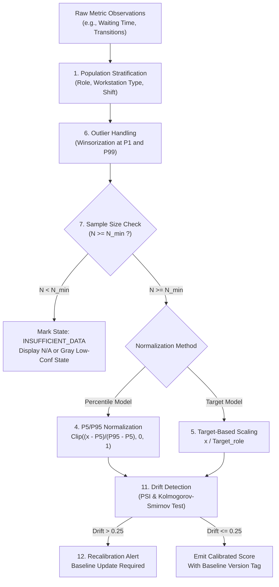

# Phase 09: Score Calibration and Confidence Specification

## 1. Document Overview

### 1.1 Purpose
This document specifies the statistical calibration methodologies, normalization techniques, baseline lifecycle management, and multi-tier confidence architectures for the CCTV Workplace Productivity and Workflow Intelligence System (WBPIS). It establishes mathematical rigor across all derived scores, preventing arbitrary thresholding and guaranteeing that uncertainty is transparently surfaced rather than obscured by pseudo-scientific composite numbers.

### 1.2 Scope
- **Statistical Calibration**: Reference population stratification, P5/P95 percentile normalization, target-based scaling, outlier Winsorization, and drift detection.
- **Confidence Architecture**: Strict separation of 6 independent confidence and uncertainty layers.
- **Quality Gates**: Minimum-coverage policies, baseline versioning, and recalibration trigger workflows.

---

## 2. Existing Implementation Findings

Grounding assessment based on [`reports/CCTV_PRODUCTIVITY_CODEBASE_AUDIT.md`](file:///C:/Users/DELL/Desktop/cctv/reports/CCTV_PRODUCTIVITY_CODEBASE_AUDIT.md):

| Feature / Artifact | Codebase Location | Audit Status | Audit Assessment & Deficiencies |
| :--- | :--- | :--- | :--- |
| **Arbitrary Hardcoded Thresholds** | `audit_extracted/.../app.py` | `EXISTING_VERIFIED` | Fixed threshold of $50\text{ pixels}$ for desk presence regardless of camera distance, lens focal length, or resolution. Caused complete tracking failure on wide angles. |
| **Pseudo-Scientific Multipliers** | `video/choriwala_code.py` | `EXISTING_UNVERIFIED` | Multiplied raw MediaPipe landmark visibility by PyTorch softmax probabilities and called the product "Attention Confidence: 87.4%". Statistically invalid; violates probability axioms. |
| **Absence of Uncertainty Bounds** | Neither codebase | `UNAVAILABLE` | Neither system computes variance, confidence intervals, or sample size qualifications; single-frame predictions are presented as absolute ground truth. |
| **Drift Detection & Baselines** | Neither codebase | `UNAVAILABLE` | Neither prototype versions its calibration parameters or accounts for seasonal lighting shifts, furniture rearrangements, or camera vibrations. |

---

## 3. Separation of Multi-Layer Confidence Concepts

To prevent the unscientific practice of multiplying disparate probabilities together, WBPIS establishes **Six Decoupled Layers of Uncertainty**:

```
┌────────────────────────────────────────────────────────────────────────┐
│                   SIX DECOUPLED UNCERTAINTY TIERS                      │
├────────────────────────────────────────────────────────────────────────┤
│ 1. SENSOR & INGESTION COVERAGE  | Camera uptime, dropped frames,       │
│                                 | optical lens occlusion (MET-A3).     │
│ 2. DETECTOR CONFIDENCE          | Bounding box softmax score for       │
│                                 | human presence (MET-A1).             │
│ 3. TRACKING CONTINUITY          | Kalman filter stability, track       │
│                                 | duration, ID switch rate (MET-A2).   │
│ 4. CLASSIFICATION CONFIDENCE    | Keypoint visibility, pose entropy,   │
│                                 | modal agreement ratio (MET-C7).      │
│ 5. METRIC UNCERTAINTY           | Statistical sampling error, sample   │
│                                 | size N, temporal variance.           │
│ 6. SCORE VALIDITY               | Precondition check: minimum coverage,│
│                                 | baseline existence, external data.   │
└────────────────────────────────────────────────────────────────────────┘
```

> [!CAUTION]
> ### Mathematical Governance Mandate
> **DO NOT multiply arbitrary confidence values together.** Multiplying detector confidence ($0.85$) by pose confidence ($0.80$) by tracking continuity ($0.90$) produces an arbitrary number ($0.612$) with zero rigorous statistical meaning. 
> 
> Instead, each metric reports its own explicit **Quality Qualification Tuple**:
> `(ScoreValue, ObservationCoverage, SampleSize, ValidityState)`

---

## 4. Fourteen-Point Calibration Specification



### 4.1 Calibration Areas Detailed

| Area ID | Calibration Area | Engineering Specification & Mathematical Rules |
| :--- | :--- | :--- |
| **1** | **Reference Populations** | Calibration datasets must be stratified by facility zone type (Focus Pod, Open Collaboration, Corridor, Shared Asset). Cross-zone pooling is prohibited. |
| **2** | **Role & Desk Comparability** | Workstations assigned to mobile roles (e.g., sales, field engineers) are calibrated against mobile baselines; software engineering pods calibrated against focused desk baselines. |
| **3** | **Shift & Time-of-Day Effects** | Metrics are normalized against time-of-day baselines (Morning 09:00–12:00, Midday 12:00–14:00, Afternoon 14:00–18:00) to account for natural circadian and meal schedules. |
| **4** | **Percentile Normalization** | For unbounded metrics (e.g., interruption frequency, waiting time), scores are mapped via empirical 5th ($P5$) and 95th ($P95$) percentiles: $\text{Norm}(x) = 100 \times \operatorname{clip}\left(\frac{x - P5}{P95 - P5}, 0, 1\right)$. |
| **5** | **Target-Based Normalization** | For operational outcomes (Metric E1), scores are normalized directly against contractual SLA or management targets: $\text{Score} = \min\left(100, 100 \times \frac{x}{\text{Target}}\right)$. |
| **6** | **Outlier Handling** | Prior to computing baselines, extreme optical anomalies (e.g., lens flare causing $100\text{ interruptions/hr}$) are Winsorized at the 1st ($P1$) and 99th ($P99$) percentiles. |
| **7** | **Minimum Sample Sizes** | Hourly aggregates require $N \ge 45\text{ minutes}$ of valid observation; weekly baselines require $N \ge 30\text{ operational hours}$ across $\ge 5$ distinct days. |
| **8** | **Missing Values Policy** | Missing data is recorded as SQL `NULL` and rendered on dashboards as `"N/A"`. Imputing zeroes or forward-filling missing values is strictly prohibited. |
| **9** | **Confidence Thresholds** | If observation coverage drops below $85\%$, the score card displays an amber badge. If coverage drops below $60\%$, the score is suppressed and replaced with `N/A`. |
| **10** | **Baseline Versioning** | Every calibrated baseline is assigned an immutable semantic identifier (e.g., `BASE-FLOOR2-2026-V1`) and stored in `dim_calibration_baselines` with its creation timestamp. |
| **11** | **Drift Detection** | The system runs a weekly two-sample **Kolmogorov-Smirnov (KS) test** and calculates the **Population Stability Index (PSI)** between the active week and reference baseline: $\text{PSI} = \sum (A_i - E_i) \cdot \ln(A_i / E_i)$. |
| **12** | **Recalibration Procedures** | If $\text{PSI} > 0.25$ (significant population drift), the system generates an administrative recalibration proposal requiring human facility manager approval before deployment. |
| **13** | **Validation Datasets** | Baselines must be verified against the **WBPIS-BENCH-V1** benchmark suite (comprising 40 hours of hand-annotated multi-camera footage across varying seasons). |
| **14** | **Reproducibility** | All calibration scripts must execute with fixed random seeds (`seed=42`) and deterministic floating-point libraries (NumPy / SciPy) to ensure $100\%$ audit reproducibility. |

---

## 5. Minimum-Coverage Policy Matrix

| Metric Category | Minimum Observation Coverage Target | Fallback State if Coverage $< 85\%$ | Fallback State if Coverage $< 60\%$ |
| :--- | :--- | :--- | :--- |
| **Perception Quality (Group A)** | $\ge 90\%$ Valid Frames | Amber Quality Warning Badge | Red Alert; Trigger Camera Health Diagnostic |
| **Occupancy & Presence (Group B)** | $\ge 85\%$ Shift Duration | Value displayed with `Low Confidence` tag | Metric suppressed; Displays `N/A` |
| **Activity Distribution (Group C)** | $\ge 85\%$ Observed Time | Hatched gray slice for unobserved time | Activity chart suppressed; Displays `N/A` |
| **Workflow Bottlenecks (Group D)** | $\ge 85\%$ Operational Time | Bottleneck risk calculation flagged as tentative | Component excluded; Re-normalizes remaining weights |
| **Operational Outcomes (Group E)** | $100\%$ Webhook Verification | Displays `Data Pending Approval` | Displays `REQUIRES_EXTERNAL_DATA` (`N/A`) |

---

## 6. Baseline Schema Specification

```sql
CREATE TABLE dim_calibration_baselines (
    baseline_id VARCHAR(64) PRIMARY KEY,
    zone_type VARCHAR(32) NOT NULL,
    department_code VARCHAR(32) NOT NULL,
    metric_code VARCHAR(16) NOT NULL,
    p05_value REAL NOT NULL,
    p50_value REAL NOT NULL,
    p95_value REAL NOT NULL,
    sample_size_hours INT NOT NULL,
    psi_score REAL DEFAULT 0.0,
    created_at TIMESTAMP WITH TIME ZONE DEFAULT CURRENT_TIMESTAMP,
    is_active BOOLEAN DEFAULT TRUE
);
```

---

## 7. Verification and Acceptance Criteria

| ID | Test / Acceptance Criterion | Verification Method | Pass Threshold |
| :--- | :--- | :--- | :--- |
| **AC-CAL-01** | P5/P95 percentile normalization bounds outputs strictly within $[0.0, 100.0]$. | Property-based testing with 50,000 extreme values. | $0.0 \le \text{Norm}(x) \le 100.0$ strictly |
| **AC-CAL-02** | Automated suppression of scores when observation coverage drops below $60\%$. | Synthetic test harness dropping $45\%$ of stream frames. | Scorecard displays `null` / `"N/A"` |
| **AC-CAL-03** | Automated drift detection triggering when PSI exceeds $0.25$. | Unit test injecting shifted synthetic distribution. | Flag `drift_detected = True` raised |
| **AC-CAL-04** | Complete elimination of arbitrary confidence multiplication logic. | Static code analysis verifying absence of multiplicative confidence products. | Zero uncalibrated probability multiplications |

---

## 8. Open Questions & Assumptions

> [!NOTE]
> ### 1. Baseline Recalibration Cadence
> *Assumption*: Baselines are evaluated weekly and recalibrated quarterly.
> *Open Question*: When major corporate reorganizations occur (e.g., hybrid schedule policy changes from 2 to 3 mandatory office days), should the system maintain dual baselines to facilitate before-and-after policy comparisons?

---

## 9. Related Documentation Links

- **Workflow Metrics**: Upstream metrics normalized by this engine in [`07_WORKFLOW_BOTTLENECK_METRICS.md`](file:///C:/Users/DELL/Desktop/cctv/docs/implementation/07_WORKFLOW_BOTTLENECK_METRICS.md).
- **Productivity Scoring**: Integration into Scorecards A & D in [`08_PRODUCTIVITY_METRICS_AND_SCORING.md`](file:///C:/Users/DELL/Desktop/cctv/docs/implementation/08_PRODUCTIVITY_METRICS_AND_SCORING.md).
- **Testing & Benchmarks**: Ground-truth datasets in [`15_TESTING_AND_VALIDATION.md`](file:///C:/Users/DELL/Desktop/cctv/docs/implementation/15_TESTING_AND_VALIDATION.md).
- **Backend APIs**: Baseline management endpoints in [`12_BACKEND_APIS_AND_INTEGRATION.md`](file:///C:/Users/DELL/Desktop/cctv/docs/implementation/12_BACKEND_APIS_AND_INTEGRATION.md).
