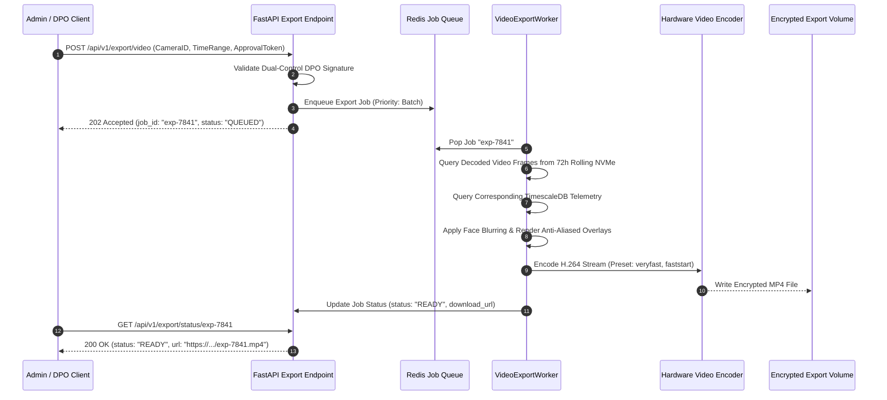

# Phase 10: Annotated Video and Export Specification

## 1. Document Overview

### 1.1 Purpose
This document specifies the video rendering engine, live annotated streaming pipeline, visual hierarchy and Level-of-Detail (LOD) overlay controls, and on-demand MP4 clip export workflows for the CCTV Workplace Productivity and Workflow Intelligence System (WBPIS). It provides deterministic visual representations of spatial occupancy and activity while preventing visual clutter, preserving original video fidelity, and enforcing strict privacy redaction rules.

### 1.2 Scope
- **Streaming Pipeline**: Live low-latency annotated video preview (MJPEG over HTTP / WebRTC) and on-demand MP4 file generation with burned-in telemetry.
- **Visual Design**: Dynamic Level-of-Detail (LOD) overlays, typography, anti-crowding heuristics, and `N/A` missing-data representations.
- **Operational Specifications**: The 15 mandatory video pipeline operations, hardware-accelerated video encoding (NVENC / QuickSync / libx264), and audio suppression.

---

## 2. Existing Implementation Findings

Grounding assessment based on [`reports/CCTV_PRODUCTIVITY_CODEBASE_AUDIT.md`](file:///C:/Users/DELL/Desktop/cctv/reports/CCTV_PRODUCTIVITY_CODEBASE_AUDIT.md):

| Feature / Artifact | Codebase Location | Audit Status | Audit Assessment & Deficiencies |
| :--- | :--- | :--- | :--- |
| **Flask MJPEG Streaming** | `audit_extracted/.../app.py` | `EXISTING_VERIFIED` | Uses an unthrottled Python generator `yield (b'--frame\r\n...')` calling `cv2.imencode('.jpg', frame)`. Single-client limitation; multiple browser tabs cause thread exhaustion and crash the server. |
| **Crude Text Overlays** | `audit_extracted/.../app.py` | `EXISTING_VERIFIED` | Raw `cv2.putText()` drawn in jagged green text with fixed pixel offsets. When multiple people overlap, text strings collide and become completely unreadable. |
| **Video Export Capabilities** | Neither codebase | `UNAVAILABLE` | Neither system implements MP4 video export, time-range clipping, or downloadable analytical audit packages. |
| **Audio Privacy Handling** | Neither codebase | `UNAVAILABLE` | Neither system explicitly strips audio tracks; if microphones are enabled on IP cameras, ambient workplace conversations risk unmonitored recording. |

---

## 3. Fifteen-Point Video Pipeline Specification

```mermaid
flowchart TD
    RAW["1. Video Ingestion<br>(PTS-Aligned BGR Frame)"] --> DET["2. Detection & Tracking<br>(YOLOv8 + ByteTrack)"]
    DET --> TEMP["3. Temporal Aggregation<br>(5-Minute Rolling Ring Buffer)"]
    TEMP --> MET["4. Metric Calculation<br>(WOR, CTC, QDT, Activity Share)"]
    
    MET --> DISPATCH{"Output Target"}
    
    DISPATCH -->|Live Administrative Preview| LIVE["5. Overlay Rendering (LOD)<br>6. Live Streamer (MJPEG / WebRTC)<br>10. FPS Control (15 FPS)<br>11. Native Resolution (1080p)"]
    
    DISPATCH -->|Export Job (DPO Approved)| EXPORT["7. Video Encoding (H.264 NVENC)<br>8. MP4 Container (+FastStart)<br>9. Audio Stripping (Mute/Strip)<br>12. Timestamp Burn-in<br>13. Job Status Worker<br>14. Hardware Allocation<br>15. Error Recovery"]
```

### 3.1 Detailed Pipeline Operations

| Operation ID | Pipeline Stage | Technical Specification & Operational Rules |
| :--- | :--- | :--- |
| **1** | **Frame Processing Order** | Strictly chronological based on camera sensor Presentation Timestamp (PTS). Frames arriving out-of-order over network jitter buffers are sorted before inference. |
| **2** | **Detection & Tracking** | Executes YOLOv8 bounding box detection followed by ByteTrack association, assigning ephemeral track handles (e.g., `TRK-0841`). |
| **3** | **Temporal Aggregation** | Metrics displayed on overlays are computed over a **5-Minute Rolling Window** using an in-memory ring buffer. **The full historical shift is NEVER recomputed per frame.** |
| **4** | **Metric Calculation** | Evaluates active occupancy state, current activity class (`ACT-01` to `ACT-07`), and rolling interaction percentages. |
| **5** | **Overlay Rendering** | Renders high-legibility vector overlays using anti-aliased Cairo/OpenCV drawing routines with dynamic Level-of-Detail (LOD). |
| **6** | **Live Video Streaming** | Encodes annotated frames into JPEG/H.264 streams served over authenticated HTTP multipart (`/api/v1/stream/live/{camera_id}`) or WebRTC data channels. |
| **7** | **Video Encoding** | Hardware-accelerated H.264 encoding via **NVIDIA NVENC** (or Intel QuickSync / VAAPI); fallback to multi-threaded `libx264` (preset: `veryfast`, tune: `zerolatency`). |
| **8** | **MP4 Containerization** | Formats export files into standard MP4 (`.mp4`) containers with the `moov` atom relocated to the beginning (`+faststart`) to enable instant browser scrubbing. |
| **9** | **Audio Stripping** | **Mandatory Privacy Control**: All incoming audio tracks (PCM, AAC, G.711) from IP cameras are explicitly discarded (`-an`). The exported MP4 contains zero audio. |
| **10** | **Frame-Rate Preservation** | Native camera frame rates ($15.0\text{ or }25.0\text{ FPS}$) are preserved exactly in exported MP4 files via constant framerate (CFR) flags. |
| **11** | **Resolution Preservation** | Video is rendered and exported at native sensor resolution ($1920 \times 1080$ or $1280 \times 720$) without lossy downsampling. |
| **12** | **Timestamp Consistency** | High-precision UTC timestamps (`YYYY-MM-DD HH:MM:SS.fff UTC`) are burned into the lower-left margin, synchronized with TimescaleDB event rows. |
| **13** | **Export Job Status** | Managed asynchronously via Celery/Redis job queues (`QUEUED` $\to$ `RENDERING` $\to$ `READY` $\to$ `EXPIRED`). Links expire after 24 hours. |
| **14** | **Resource Budgeting** | NVENC encoder sessions are capped at $2$ concurrent export jobs to ensure real-time live perception pipelines never experience GPU starvation. |
| **15** | **Error Handling** | If a frame decode fails during export rendering, the engine substitutes the prior frame and logs an anomaly rather than aborting the entire export job. |

---

## 4. Overlay Layout Hierarchy & Anti-Crowding Rules

When multiple people congregate in open office pods or corridors, naive bounding box overlays overlap, resulting in visual clutter:

```
[Standard Density: 1-4 People]            [High Density: >= 5 People (LOD Applied)]
┌──────────────────────────────────────┐  ┌──────────────────────────────────────┐
│ ┌──────────────────┐                 │  │ ┌────┐        ┌────┐        ┌────┐   │
│ │ TRK-0841 | Desk 4│                 │  │ │#08 │        │#12 │        │#15 │   │
│ │ Occupancy: 85%   │                 │  │ └────┘        └────┘        └────┘   │
│ │ State: Seated    │                 │  │                                      │
│ │ Efficiency: N/A  │                 │  │ (Detailed metrics collapsed to small │
│ └──────────────────┘                 │  │  pills; full card shows on click)    │
│ [==================]                 │  │                                      │
└──────────────────────────────────────┘  └──────────────────────────────────────┘
```

### 4.1 Dynamic Level-of-Detail (LOD) Rules
1. **LOD Level 1 (Full Card - $< 5\text{ people in view}$)**:
   - Rounded corner bounding box (Green for workstation zone, Amber for corridor transit).
   - Track ID header: `ID 07 | Zone: Desk 14`.
   - Primary activity pill: `ACT-01: Seated (5m Rolling: 92%)`.
   - Contextual metric: `Interaction: 64% | Workflow Risk: N/A`.
2. **LOD Level 2 (Compact Pill - $\ge 5\text{ people in view}$)**:
   - Thin corner brackets enclosing the person.
   - Minimalist top handle: `ID 07 (Seated)`.
   - Metrics collapsed into the side telemetry panel upon cursor hover or selection.
3. **Missing-Data Rule**:
   - If a metric cannot be calculated (e.g., Workflow Efficiency requires cross-camera transit data not available on a single frame), it displays **`N/A`**. Under no circumstances is the metric suppressed or replaced with a fake percentage.

---

## 5. Standardized Visual Overlay Template

```
┌────────────────────────────────────────────────────────────────────────┐
│ CAM-02: FLOOR 2 EAST POD   2026-10-15 14:22:08.140 UTC   FPS: 15.0     │
├────────────────────────────────────────────────────────────────────────┤
│                                                                        │
│       ┌──────────────┐                                                 │
│       │ TRK-0841     │                                                 │
│       │ Desk Pod 04  │                                                 │
│       │ ACT-01: SEAT │                                                 │
│       │ WOR (5m): 88%│                                                 │
│       │ Wkflow: N/A  │                                                 │
│       ├──────────────┤                                                 │
│       │              │                                                 │
│       │   [PERSON]   │                                                 │
│       │              │                                                 │
│       │              │                                                 │
│       │      x (x_f, y_f: Footprint)                                  │
│       └──────────────┘                                                 │
│                                                                        │
├────────────────────────────────────────────────────────────────────────┤
│ Active Tracks: 6 | Coverage: 98.4% | Privacy: Ephemeral Hashed         │
└────────────────────────────────────────────────────────────────────────┘
```

> [!NOTE]
> **Illustrative Example Disclaimer**: The visual overlay text `ID 07 | Workstation Occupancy: 82% | Interaction: 61% | Workflow Efficiency: N/A` is an illustrative design template. Values in runtime must always reflect validated mathematical engine outputs.

---

## 6. On-Demand Video Export Architecture

To comply with the Dual-Control Privacy Workflow (Phase 01), MP4 exports are executed through an asynchronous job queue:



---

## 7. Verification and Acceptance Criteria

| ID | Test / Acceptance Criterion | Verification Method | Pass Threshold |
| :--- | :--- | :--- | :--- |
| **AC-VID-01** | Live MJPEG / WebRTC streaming maintains sustained $15\text{ FPS}$ under 3 concurrent viewers. | Multi-client load test simulation. | FPS $\ge 14.5\text{ FPS}$; latency $\le 800\text{ ms}$ |
| **AC-VID-02** | Complete audio track suppression in all exported MP4 clips. | `ffprobe -show_streams` analysis on 10 exported files. | Zero audio streams detected (`nb_streams == 1`) |
| **AC-VID-03** | FastStart MP4 container validation enabling instant web playback. | Automated HTTP byte-range request test. | `moov` atom located prior to `mdat` |
| **AC-VID-04** | Anti-crowding LOD mode activation when $\ge 5\text{ people}$ enter the frame. | Synthetic multi-person video benchmark test. | Overlays switch to compact pills; zero box collision |

---

## 8. Open Questions & Assumptions

> [!NOTE]
> ### 1. Client-Side Canvas Rendering vs. Server-Side Burn-in
> *Current Default*: Server-side burn-in for live MJPEG administrative preview and exported MP4 files.
> *Alternative*: Send raw camera H.264 video to the browser over WebRTC, accompanied by a JSON WebSocket telemetry stream, rendering overlays dynamically on an HTML5 `<canvas>`.
> *Trade-off*: Client-side rendering saves server GPU cycles but allows tech-savvy users to inspect raw unblurred video if client redaction is bypassed.

---

## 9. Related Documentation Links

- **Ingestion Engine**: Video decoding input in [`03_VIDEO_INGESTION_AND_PREPROCESSING.md`](file:///C:/Users/DELL/Desktop/cctv/docs/implementation/03_VIDEO_INGESTION_AND_PREPROCESSING.md).
- **Tracking & Pseudonyms**: Bounding box handles in [`04_PERSON_DETECTION_TRACKING_AND_IDS.md`](file:///C:/Users/DELL/Desktop/cctv/docs/implementation/04_PERSON_DETECTION_TRACKING_AND_IDS.md).
- **Security & Authorization**: Dual-control signatures in [`16_SECURITY_PRIVACY_AND_ACCESS_CONTROL.md`](file:///C:/Users/DELL/Desktop/cctv/docs/implementation/16_SECURITY_PRIVACY_AND_ACCESS_CONTROL.md).
- **Backend APIs**: Export job endpoints in [`12_BACKEND_APIS_AND_INTEGRATION.md`](file:///C:/Users/DELL/Desktop/cctv/docs/implementation/12_BACKEND_APIS_AND_INTEGRATION.md).
