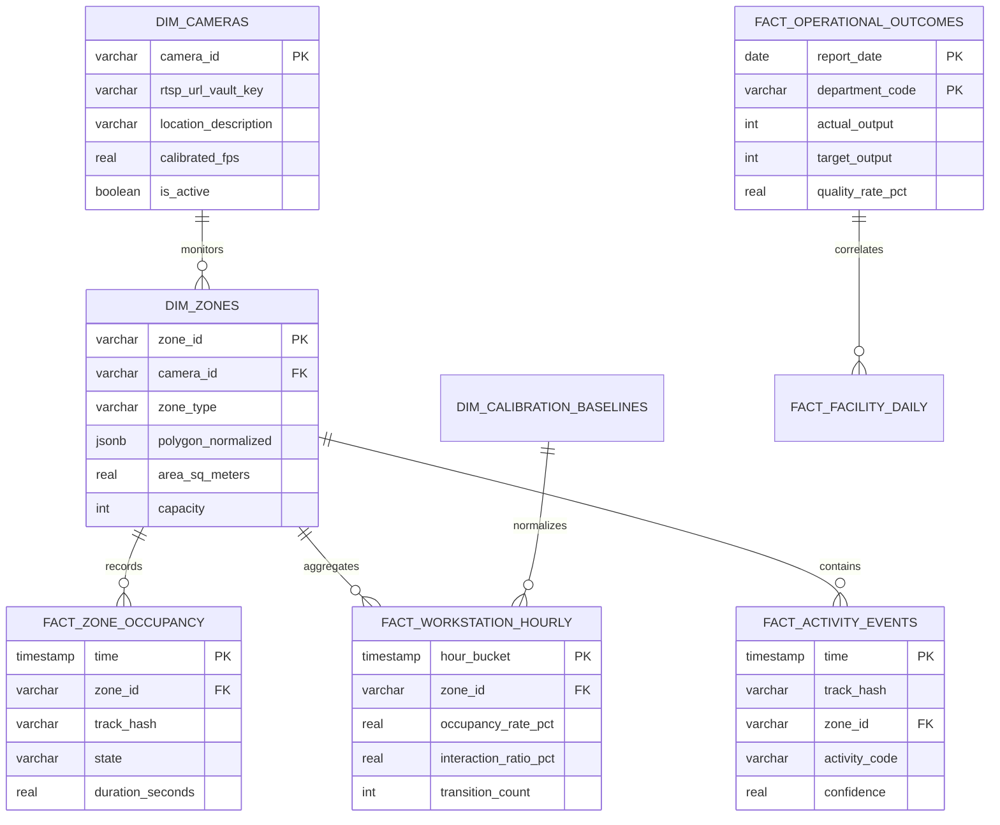
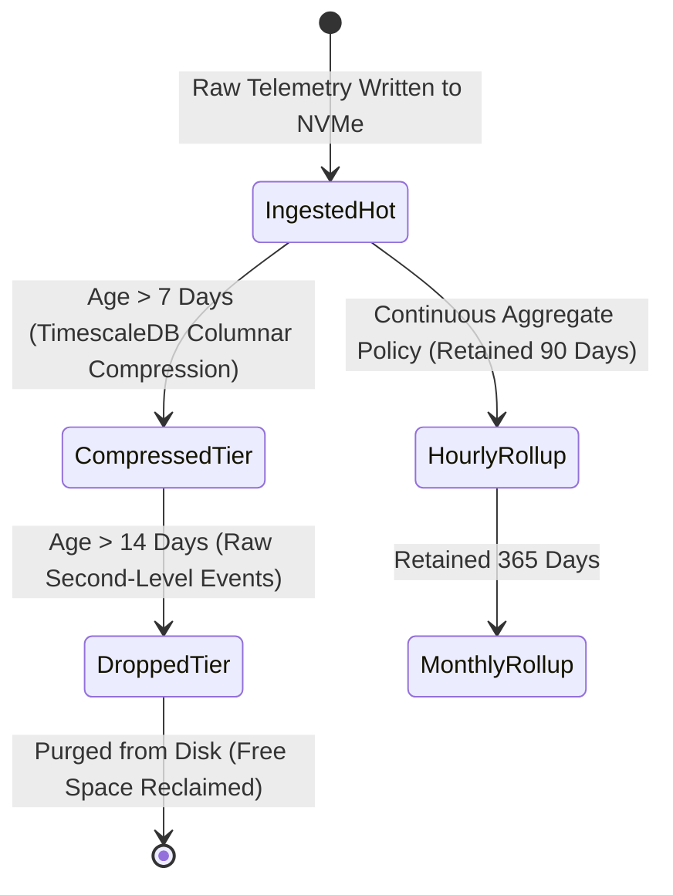

# Phase 11: Database and Data Retention Specification

## 1. Document Overview

### 1.1 Purpose
This document specifies the database architecture, entity schemas, relational DDL, TimescaleDB hypertable configurations, indexing strategies, and automated data retention policies for the CCTV Workplace Productivity and Workflow Intelligence System (WBPIS). It establishes high-throughput, structured time-series persistence, replacing insecure plaintext files with an ACID-compliant, encrypted, and audit-ready data storage tier.

### 1.2 Scope
- **Storage Technology**: PostgreSQL 16 with the TimescaleDB extension.
- **Data Modeling**: Relational dimension tables, time-series hypertables, continuous aggregates, and indexing.
- **Retention & Compliance**: Automated hypertable chunk dropping, columnar compression, and 72-hour edge video shredding.
- **Database Migrations**: Alembic version-controlled schema migration framework.

---

## 2. Existing Implementation Findings

Grounding assessment based on [`reports/CCTV_PRODUCTIVITY_CODEBASE_AUDIT.md`](file:///C:/Users/DELL/Desktop/cctv/reports/CCTV_PRODUCTIVITY_CODEBASE_AUDIT.md):

| Feature / Artifact | Codebase Location | Audit Status | Audit Assessment & Deficiencies |
| :--- | :--- | :--- | :--- |
| **Plaintext `employee_log.txt`** | `audit_extracted/.../app.py` | `EXISTING_VERIFIED` (`SEC-01`) | Unstructured CSV/text file logging desk absence intervals and camera URLs with plaintext passwords. Zero indexing, zero transactions, zero access controls. |
| **Unindexed JSONL Logging** | `video/choriwala_code.py` | `EXISTING_VERIFIED` | Appends per-frame feature vectors into flat JSONL files. Rapidly consumes disk space ($> 2\text{ GB/hour}$); querying historical trends requires full-table sequential disk scans. |
| **Data Retention Policies** | Neither codebase | `UNAVAILABLE` | Neither system implements automated data aging, compaction, or deletion policies; files accumulate indefinitely until disk exhaustion. |
| **Relational Integrity** | Neither codebase | `UNAVAILABLE` | No foreign key constraints, uniqueness constraints, or data validation logic exists to prevent duplicate or corrupt telemetry entries. |

---

## 3. Entity-Relationship & TimescaleDB Architecture

The storage model separates slow-changing facility metadata (Dimensions) from high-volume time-series telemetry (Hypertables):



---

## 4. Production DDL & Hypertable Schema

```sql
-- Enable TimescaleDB Extension
CREATE EXTENSION IF NOT EXISTS timescaledb CASCADE;

-- ==========================================
-- 1. DIMENSION TABLES (Relational Tier)
-- ==========================================

CREATE TABLE dim_cameras (
    camera_id VARCHAR(64) PRIMARY KEY,
    name VARCHAR(128) NOT NULL,
    rtsp_vault_key VARCHAR(128) NOT NULL, -- Key to secret vault, NEVER plaintext URL
    location_description VARCHAR(255),
    frame_width INT DEFAULT 1920,
    frame_height INT DEFAULT 1080,
    calibrated_fps REAL DEFAULT 15.0,
    is_active BOOLEAN DEFAULT TRUE,
    created_at TIMESTAMP WITH TIME ZONE DEFAULT CURRENT_TIMESTAMP
);

CREATE TABLE dim_zones (
    zone_id VARCHAR(64) PRIMARY KEY,
    camera_id VARCHAR(64) REFERENCES dim_cameras(camera_id) ON DELETE CASCADE,
    zone_type VARCHAR(32) NOT NULL, -- 'WORKSTATION', 'CORRIDOR', 'SHARED_RESOURCE', 'MEETING'
    name VARCHAR(128) NOT NULL,
    polygon_normalized JSONB NOT NULL, -- Array of [x, y] coordinates in [0, 1]
    area_sq_meters REAL,
    capacity INT DEFAULT 1,
    created_at TIMESTAMP WITH TIME ZONE DEFAULT CURRENT_TIMESTAMP
);

CREATE TABLE dim_calibration_baselines (
    baseline_id VARCHAR(64) PRIMARY KEY,
    zone_type VARCHAR(32) NOT NULL,
    department_code VARCHAR(32) NOT NULL,
    metric_code VARCHAR(16) NOT NULL,
    p05_value REAL NOT NULL,
    p50_value REAL NOT NULL,
    p95_value REAL NOT NULL,
    sample_size_hours INT NOT NULL,
    created_at TIMESTAMP WITH TIME ZONE DEFAULT CURRENT_TIMESTAMP,
    is_active BOOLEAN DEFAULT TRUE
);

-- ==========================================
-- 2. TIME-SERIES HYPERTABLES (Telemetry Tier)
-- ==========================================

CREATE TABLE fact_zone_occupancy_events (
    time TIMESTAMP WITH TIME ZONE NOT NULL,
    zone_id VARCHAR(64) NOT NULL,
    track_hash VARCHAR(64) NOT NULL, -- Ephemeral salted daily hash
    state VARCHAR(32) NOT NULL,       -- 'OCCUPIED', 'TRANSITORY_ABSENCE', 'VACANT'
    duration_seconds REAL NOT NULL,
    confidence REAL NOT NULL
);
SELECT create_hypertable('fact_zone_occupancy_events', 'time', chunk_time_interval => INTERVAL '1 day');
CREATE INDEX idx_occupancy_zone_time ON fact_zone_occupancy_events (zone_id, time DESC);

CREATE TABLE fact_activity_events (
    time TIMESTAMP WITH TIME ZONE NOT NULL,
    track_hash VARCHAR(64) NOT NULL,
    zone_id VARCHAR(64) NOT NULL,
    activity_code VARCHAR(16) NOT NULL, -- 'ACT-01' to 'ACT-07'
    confidence REAL NOT NULL,
    duration_seconds REAL NOT NULL
);
SELECT create_hypertable('fact_activity_events', 'time', chunk_time_interval => INTERVAL '1 day');
CREATE INDEX idx_activity_track_time ON fact_activity_events (track_hash, time DESC);

CREATE TABLE fact_workstation_hourly_metrics (
    hour_bucket TIMESTAMP WITH TIME ZONE NOT NULL,
    zone_id VARCHAR(64) NOT NULL,
    occupancy_rate_pct REAL NOT NULL,
    interaction_ratio_pct REAL,
    transition_count INT DEFAULT 0,
    interruption_count INT DEFAULT 0,
    observation_coverage_pct REAL NOT NULL,
    is_valid BOOLEAN DEFAULT TRUE
);
SELECT create_hypertable('fact_workstation_hourly_metrics', 'hour_bucket', chunk_time_interval => INTERVAL '7 days');
CREATE INDEX idx_hourly_zone_time ON fact_workstation_hourly_metrics (zone_id, hour_bucket DESC);

CREATE TABLE fact_operational_outcomes (
    report_date DATE NOT NULL,
    department_code VARCHAR(32) NOT NULL,
    actual_output INT NOT NULL,
    target_output INT NOT NULL,
    quality_rate_pct REAL NOT NULL,
    timeliness_rate_pct REAL NOT NULL,
    rework_rate_pct REAL DEFAULT 0.0,
    output_effectiveness_score REAL,
    verified_by_user_id VARCHAR(64),
    created_at TIMESTAMP WITH TIME ZONE DEFAULT CURRENT_TIMESTAMP,
    PRIMARY KEY (report_date, department_code)
);
```

---

## 5. Automated Data Retention & Compaction Lifecycle

To prevent unbounded disk consumption and ensure compliance with GDPR storage limitation mandates, WBPIS configures TimescaleDB automated data tiering:



### 5.1 Storage Lifecycle Configuration

| Data Tier | Table / Artifact | Storage Policy | Compression / Format | Retention Limit |
| :--- | :--- | :--- | :--- | :--- |
| **Edge Video Clips** | Raw Camera Storage | Local NVMe SSD | Encrypted H.264 MP4 | **72 Hours** (Cryptographically shredded) |
| **Raw Per-Second Events** | `fact_zone_occupancy_events`, `fact_activity_events` | TimescaleDB Hypertable | Columnar compression at 7 days | **14 Days** (Automated `drop_chunks`) |
| **Hourly Aggregates** | `fact_workstation_hourly_metrics` | TimescaleDB Hypertable | Row-level indexed | **90 Days** |
| **Facility Benchmarks** | `fact_operational_outcomes`, Daily Rollups | PostgreSQL Table | Standard relational | **365 Days** (Annual compliance audit) |
| **Security Audit Logs** | `dim_audit_logs` | PostgreSQL Append-Only | Write-once, append-only | **730 Days (2 Years)** |

### 5.2 TimescaleDB Automated Policies

```sql
-- 1. Enable Columnar Compression for events older than 7 days
ALTER TABLE fact_zone_occupancy_events SET (
    timescaledb.compress,
    timescaledb.compress_segmentby = 'zone_id',
    timescaledb.compress_orderby = 'time DESC'
);
SELECT add_compression_policy('fact_zone_occupancy_events', INTERVAL '7 days');

-- 2. Drop raw event chunks older than 14 days
SELECT add_retention_policy('fact_zone_occupancy_events', INTERVAL '14 days');
SELECT add_retention_policy('fact_activity_events', INTERVAL '14 days');

-- 3. Drop hourly aggregate chunks older than 90 days
SELECT add_retention_policy('fact_workstation_hourly_metrics', INTERVAL '90 days');
```

---

## 6. Migration Management (Alembic)

Database schema migrations are version-controlled using **Alembic**:
- **Directory Structure**: `src/backend/migrations/`
- **Migration Policy**: Every schema change requires a tested migration script containing both `upgrade()` and `downgrade()` methods.
- **Continuous Integration Gate**: Automated CI pipelines execute `alembic upgrade head` against an isolated PostgreSQL container before code merges.

---

## 7. Verification and Acceptance Criteria

| ID | Test / Acceptance Criterion | Verification Method | Pass Threshold |
| :--- | :--- | :--- | :--- |
| **AC-DB-01** | Sustained insert throughput of 500 spatial events/sec with zero dropped rows. | PostgreSQL pgbench / Python stress test script. | Zero deadlocks; CPU $< 25\%$ |
| **AC-DB-02** | Automated chunk dropping of events exceeding 14 days. | Synthetic timestamp injection with accelerated clock. | Old chunks dropped automatically |
| **AC-DB-03** | Total elimination of plaintext passwords in database (`SEC-01` remediation). | Automated schema string inspection for `password` or `rtsp://`. | Zero plaintext credentials found |
| **AC-DB-04** | Columnar compression ratio on telemetry hypertables. | `timescaledb_information.compression_settings` query. | Disk footprint reduction $\ge 60\%$ |

---

## 8. Open Questions & Assumptions

> [!NOTE]
> ### 1. Read-Replica Deployment for Analytical Reporting
> *Assumption*: A single TimescaleDB instance on edge server handles both real-time inserts and dashboard analytical queries.
> *Open Question*: For facilities exceeding 20 concurrent camera streams, should an asynchronous read-replica be deployed to prevent analytical reports from contending with write locks?

---

## 9. Related Documentation Links

- **System Architecture**: Storage container topology in [`02_SYSTEM_ARCHITECTURE.md`](file:///C:/Users/DELL/Desktop/cctv/docs/implementation/02_SYSTEM_ARCHITECTURE.md).
- **Backend APIs**: SQLAlchemy models and queries in [`12_BACKEND_APIS_AND_INTEGRATION.md`](file:///C:/Users/DELL/Desktop/cctv/docs/implementation/12_BACKEND_APIS_AND_INTEGRATION.md).
- **Security & RBAC**: Row-level security policies in [`16_SECURITY_PRIVACY_AND_ACCESS_CONTROL.md`](file:///C:/Users/DELL/Desktop/cctv/docs/implementation/16_SECURITY_PRIVACY_AND_ACCESS_CONTROL.md).
- **Docker Compose**: Container volume mounts in [`17_DEPLOYMENT_AND_PERFORMANCE_OPTIMIZATION.md`](file:///C:/Users/DELL/Desktop/cctv/docs/implementation/17_DEPLOYMENT_AND_PERFORMANCE_OPTIMIZATION.md).
