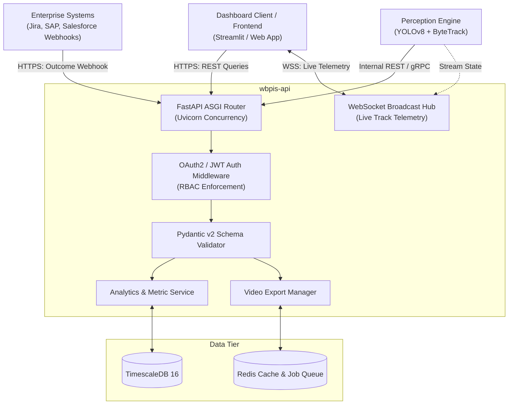

# Phase 12: Backend APIs and Integration Specification

## 1. Document Overview

### 1.1 Purpose
This document specifies the backend application architecture, RESTful API endpoints, WebSocket streaming interfaces, Pydantic data contracts, and external enterprise integration webhooks for the CCTV Workplace Productivity and Workflow Intelligence System (WBPIS). Built on **FastAPI**, this specification provides high-performance asynchronous interfaces for dashboard clients, spatial perception services, and enterprise outcome systems while eliminating the insecure, blocking polling loops of legacy prototypes.

### 1.2 Scope
- **Framework & Runtime**: FastAPI (Python 3.11+), Pydantic v2, Uvicorn / Gunicorn ASGI server.
- **API Interfaces**: Camera session lifecycle, WebSocket live telemetry, polygon zone management, analytical query contracts, dual-control video export jobs, and enterprise outcome ingestion webhooks.
- **Standards**: OpenAPI 3.1, RFC 7807 Problem Details error responses, OAuth2 / JWT bearer authentication.

---

## 2. Existing Implementation Findings

Grounding assessment based on [`reports/CCTV_PRODUCTIVITY_CODEBASE_AUDIT.md`](file:///C:/Users/DELL/Desktop/cctv/reports/CCTV_PRODUCTIVITY_CODEBASE_AUDIT.md):

| Feature / Artifact | Codebase Location | Audit Status | Audit Assessment & Deficiencies |
| :--- | :--- | :--- | :--- |
| **Flask Polling Loop** | `audit_extracted/.../app.py` | `EXISTING_VERIFIED` (`BUG-01`) | Client JavaScript polled `/status` every $500\text{ ms}$ over HTTP. Under 3+ users, Flask worker threads deadlocked, causing browser UI freeze and dropped frames. |
| **Plaintext URL Transmission** | `audit_extracted/.../app.py` | `EXISTING_VERIFIED` (`SEC-01`) | RTSP URL containing plaintext camera password passed via raw HTML form `POST /start` without TLS encryption or parameter masking. |
| **Error Handling & Schemas** | Neither codebase | `UNAVAILABLE` | No request validation schemas existed; invalid JSON payloads caused unhandled Python exceptions returning raw 500 HTML tracebacks to users. |
| **WebSocket Streaming** | Neither codebase | `UNAVAILABLE` | Neither system implements persistent WebSocket or Server-Sent Events (SSE) connections for real-time telemetry streaming. |

---

## 3. API Architecture & Communication Protocols



---

## 4. Canonical API Endpoint Contracts

### 4.1 Session & Camera Management

#### `POST /api/v1/sessions/start`
Starts a camera ingestion and perception worker thread for a configured camera ID.
- **Headers**: `Authorization: Bearer <JWT>`, `Content-Type: application/json`
- **Request Payload**:
  ```json
  {
    "camera_id": "CAM-FLOOR2-EAST",
    "enable_recording_buffer": true,
    "inference_fps": 15.0
  }
  ```
- **Response `200 OK`**:
  ```json
  {
    "session_id": "SES-9821-20261015",
    "camera_id": "CAM-FLOOR2-EAST",
    "status": "STREAMING",
    "started_at": "2026-10-15T14:30:00.000Z",
    "stream_url": "/api/v1/stream/live/CAM-FLOOR2-EAST"
  }
  ```

#### `GET /api/v1/sessions/status/{camera_id}`
Returns current ingestion health, frame rate, dropped frame ratio, and active track count.
- **Response `200 OK`**:
  ```json
  {
    "camera_id": "CAM-FLOOR2-EAST",
    "is_alive": true,
    "ingest_fps": 15.0,
    "inference_fps": 14.8,
    "dropped_frames_pct": 0.4,
    "active_tracks_count": 6,
    "observation_coverage_pct": 99.2,
    "uptime_seconds": 14200
  }
  ```

---

### 4.2 Live Telemetry via WebSockets (Remediation of `BUG-01`)

#### `WebSocket /ws/live-telemetry/{camera_id}`
Replaces the broken HTTP polling loop with an asynchronous bi-directional WebSocket connection streaming JSON frames at $5\text{ Hz}$:
- **Connection Handshake**: `wss://host:8000/ws/live-telemetry/CAM-FLOOR2-EAST?token=<JWT>`
- **Server Stream Message (JSON)**:
  ```json
  {
    "timestamp": "2026-10-15T14:30:02.200Z",
    "camera_id": "CAM-FLOOR2-EAST",
    "tracks": [
      {
        "track_id": "TRK-0841",
        "bounding_box": [340, 210, 480, 560],
        "footprint": [410, 560],
        "zone_id": "ZONE-DESK-POD-04",
        "activity_code": "ACT-01",
        "confidence": 0.91,
        "rolling_5m_occupancy_pct": 88.0,
        "rolling_5m_interaction_pct": 64.0
      }
    ],
    "zones_summary": {
      "ZONE-DESK-POD-04": {"state": "OCCUPIED", "occupant_track": "TRK-0841"},
      "ZONE-CORRIDOR-A": {"state": "CLEAR", "density_persons_per_m2": 0.0}
    }
  }
  ```

---

### 4.3 Polygon Zone Management

#### `POST /api/v1/zones`
Registers or updates a spatial region of interest (ROI) polygon.
- **Request Payload**:
  ```json
  {
    "zone_id": "ZONE-DESK-POD-04",
    "camera_id": "CAM-FLOOR2-EAST",
    "name": "Engineering Pod 4 - Seat B",
    "zone_type": "WORKSTATION",
    "polygon_normalized": [
      [0.345, 0.420],
      [0.480, 0.420],
      [0.510, 0.680],
      [0.320, 0.680]
    ],
    "area_sq_meters": 3.5,
    "capacity": 1
  }
  ```
- **Response `201 Created`**: Returns registered zone entity with timestamp.

---

### 4.4 Analytics & Scorecards

#### `GET /api/v1/analytics/scorecards`
Fetches the four decoupled scorecards for a specified facility department and time window.
- **Query Parameters**: `department_code=ENG&time_window=1d&date=2026-10-15`
- **Response `200 OK`**:
  ```json
  {
    "department_code": "ENG",
    "date": "2026-10-15",
    "observation_coverage_pct": 98.4,
    "scorecards": {
      "scorecard_a_workflow_efficiency": {
        "workflow_efficiency_score": 82.4,
        "bottleneck_risk_index": 17.6,
        "interruption_frequency_per_hour": 1.2,
        "waiting_time_ratio_pct": 2.4,
        "congestion_rate_pct": 0.8,
        "zone_transition_rate_per_hour": 5.4,
        "status": "OPTIMAL"
      },
      "scorecard_b_activity_analytics": {
        "activity_shares_pct": {
          "ACT-01_seated": 64.2,
          "ACT-02_standing": 18.5,
          "ACT-03_walking": 8.1,
          "ACT-04_interaction": 58.0,
          "ACT-05_collaboration": 6.2,
          "ACT-06_away": 11.2,
          "ACT-07_unknown": 3.0
        },
        "classification_coverage_pct": 97.0
      },
      "scorecard_c_occupancy_presence": {
        "workstation_occupancy_rate_pct": 74.8,
        "workspace_utilization_pct": 71.2,
        "away_time_ratio_pct": 25.2,
        "occupancy_variation_std": 14.1,
        "schedule_adherence_pct": null,
        "schedule_adherence_status": "REQUIRES_EXTERNAL_DATA"
      },
      "scorecard_d_output_effectiveness": {
        "output_effectiveness_score": 91.5,
        "throughput_attainment_pct": 104.0,
        "quality_rate_pct": 98.2,
        "timeliness_rate_pct": 95.0,
        "status": "VALIDATED_EXTERNAL_DATA"
      }
    }
  }
  ```

---

### 4.5 External Operational Outcomes Ingestion Webhook

#### `POST /api/v1/ingest/operational-outcomes`
Receives authenticated business outcome batches from Jira, SAP, or ticketing systems to populate Scorecard D.
- **Headers**: `X-Webhook-Secret: <HMAC_SECRET>`, `Content-Type: application/json`
- **Request Payload**:
  ```json
  {
    "report_date": "2026-10-15",
    "department_code": "ENG",
    "actual_completed_units": 48,
    "target_planned_units": 45,
    "quality_accepted_units": 47,
    "quality_assessed_units": 48,
    "on_time_units": 46,
    "total_deadline_units": 48,
    "source_system": "Jira-Enterprise-Cloud",
    "auth_signature": "sha256=9f8a7e6b5c4d3e2f..."
  }
  ```
- **Response `202 Accepted`**:
  ```json
  {
    "status": "INGESTED",
    "derived_metrics": {
      "throughput_attainment_pct": 106.67,
      "quality_rate_pct": 97.92,
      "timeliness_rate_pct": 95.83,
      "output_effectiveness_score": 92.88
    }
  }
  ```

---

### 4.6 Dual-Control Video Export Endpoints

#### `POST /api/v1/export/video`
Initiates an asynchronous MP4 export job with burned-in overlays, requiring DPO dual-control authorization.
- **Request Payload**:
  ```json
  {
    "camera_id": "CAM-FLOOR2-EAST",
    "start_time": "2026-10-15T10:00:00Z",
    "end_time": "2026-10-15T10:15:00Z",
    "reason": "Facility Ergonomic Bottleneck Review",
    "dpo_approval_token": "jwt.token.signed.by.dpo",
    "blur_faces": true,
    "include_overlays": true
  }
  ```
- **Response `202 Accepted`**: Returns `{"job_id": "exp-9812", "status": "QUEUED"}`.

---

## 5. Standardized Error Handling (RFC 7807)

All non-2xx responses adhere to the **RFC 7807 Problem Details** standard:
```json
{
  "type": "https://api.wbpis.local/errors/zone-not-found",
  "title": "Zone Identifier Not Found",
  "status": 404,
  "detail": "The zone_id 'ZONE-DESK-99' is not registered under camera 'CAM-02'.",
  "instance": "/api/v1/zones/ZONE-DESK-99",
  "timestamp": "2026-10-15T14:35:10.120Z",
  "error_code": "ERR_ZONE_NOT_FOUND"
}
```

---

## 6. Verification and Acceptance Criteria

| ID | Test / Acceptance Criterion | Verification Method | Pass Threshold |
| :--- | :--- | :--- | :--- |
| **AC-API-01** | WebSocket telemetry streaming latency under 5 concurrent subscribers. | End-to-end WebSocket timestamp delta test. | Latency $\le 200\text{ ms}$; zero socket disconnects |
| **AC-API-02** | Complete elimination of broken legacy HTTP polling loop (`BUG-01` remediation). | Code review & network traffic trace during UI run. | Zero rapid polling requests to `/status` |
| **AC-API-03** | RFC 7807 error response compliance upon invalid JSON submission. | Automated schema mutation fuzzing suite. | $100\%$ error responses match RFC 7807 schema |
| **AC-API-04** | Webhook HMAC signature verification rejects unauthorized requests. | Security penetration test sending forged signature. | HTTP 401 Unauthorized returned |

---

## 7. Open Questions & Assumptions

> [!NOTE]
> ### 1. Rate Limiting on Analytical Queries
> *Assumption*: Dashboard queries are cached in Redis with a 15-second TTL.
> *Open Question*: Should API rate limiting be enforced via Redis token bucket ($60\text{ req/min per user}$) to prevent heavy queries from impacting TimescaleDB?

---

## 8. Related Documentation Links

- **System Architecture**: Container mapping in [`02_SYSTEM_ARCHITECTURE.md`](file:///C:/Users/DELL/Desktop/cctv/docs/implementation/02_SYSTEM_ARCHITECTURE.md).
- **Video Export Specs**: Asynchronous export worker in [`10_ANNOTATED_VIDEO_AND_EXPORT.md`](file:///C:/Users/DELL/Desktop/cctv/docs/implementation/10_ANNOTATED_VIDEO_AND_EXPORT.md).
- **Database Schema**: Hypertable entities in [`11_DATABASE_AND_DATA_RETENTION.md`](file:///C:/Users/DELL/Desktop/cctv/docs/implementation/11_DATABASE_AND_DATA_RETENTION.md).
- **Frontend Dashboard**: UI consumer of these APIs in [`13_FRONTEND_DASHBOARD_AND_VISUALIZATIONS.md`](file:///C:/Users/DELL/Desktop/cctv/docs/implementation/13_FRONTEND_DASHBOARD_AND_VISUALIZATIONS.md).
