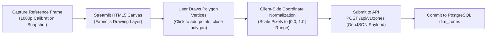

# Phase 13: Frontend Dashboard and Visualizations Specification

## 1. Document Overview

### 1.1 Purpose
This document specifies the user interface architecture, visualization components, interactive canvas polygon configuration tools, and the ten mandatory operational views for the CCTV Workplace Productivity and Workflow Intelligence System (WBPIS). Built on **Streamlit** integrated with **Apache ECharts**, this specification replaces the unstable, blocking Flask prototype with a responsive, role-based analytical suite designed for facilities directors, industrial engineers, and workplace experience planners.

### 1.2 Scope
- **Framework & Technology**: Streamlit, `streamlit-echarts`, HTML5 Canvas zone editor, WebSocket bi-directional state management.
- **Ten Operational Views**: Comprehensive specifications for Views 01 through 10.
- **Design Guidelines**: Ephemeral session labeling, clear missing-data (`N/A`) representations, and strict prohibition of individual employee ranking leaderboards.

---

## 2. Existing Implementation Findings & Stack Unification

Grounding assessment based on [`reports/CCTV_PRODUCTIVITY_CODEBASE_AUDIT.md`](file:///C:/Users/DELL/Desktop/cctv/reports/CCTV_PRODUCTIVITY_CODEBASE_AUDIT.md):

| Component / Artifact | Codebase Location | Audit Status | Audit Assessment & Deficiencies |
| :--- | :--- | :--- | :--- |
| **Flask Monolithic HTML/JS** | `audit_extracted/.../templates/` | `EXISTING_VERIFIED` (`BUG-01`) | Raw HTML with jQuery polling `/status` every $500\text{ ms}$. Caused browser lockups, unhandled DOM exceptions, and zero responsive charting. |
| **Streamlit ECharts Analytics** | `video/choriwala_code.py`, `video/horiz.py` | `EXISTING_VERIFIED` | Demonstrates functional Apache ECharts radar charts, horizontal bars, and gauge widgets in Streamlit. Direct reusable foundation for WBPIS analytics. |
| **Zone Drawing Interface** | Neither codebase | `UNAVAILABLE` | Neither system provides an interactive GUI to draw polygons; both rely on hardcoded source code arrays or manual text entry of pixel coordinates. |
| **Individual Leaderboards** | `audit_extracted/.../` | `EXISTING_VERIFIED` | Rendered a sorted HTML table ranking individual desk numbers by "Productivity %", encouraging surveillance and punitive micromanagement. |

### 2.1 Architectural Decision: Unified Frontend Selection
- **Deprecated**: The Flask frontend in `audit_extracted` is completely retired due to lack of modern charting capabilities, thread blocking, and security vulnerabilities (`BUG-01`, `SEC-01`).
- **Primary Analytics Platform**: **Streamlit** coupled with **Apache ECharts** (`streamlit-echarts`) is established as the primary dashboard. It natively renders complex spatial heatmaps, Sankey diagrams, and real-time Gantt charts while querying the asynchronous FastAPI backend via HTTP and WebSockets.

---

## 3. Ten Mandatory Dashboard Views

```
┌────────────────────────────────────────────────────────────────────────┐
│                   TEN MANDATORY OPERATIONAL VIEWS                      │
├────────────────────────────────────────────────────────────────────────┤
│ 1. Live Annotated CCTV View        | 6. Output Effectiveness Panel     │
│ 2. Ephemeral Track Details Panel   | 7. Team & Workspace Overview      │
│ 3. Workflow Efficiency Panel       | 8. Historical Trend Comparison    │
│ 4. Activity Distribution & Timeline| 9. Video Export Controls          │
│ 5. Occupancy & Presence Panel      | 10. Data Quality & Model Health   │
└────────────────────────────────────────────────────────────────────────┘
```

---

### View 01: Live Annotated CCTV View
- **Purpose**: Provides facility managers with real-time visual verification of camera operation, zone boundaries, and spatial presence.
- **Components**:
  - Live MJPEG / WebRTC video player with dynamic LOD overlay toggles.
  - Interactive overlay controls (toggle bounding boxes, zone outlines, track handles, metric pills).
  - Camera switcher dropdown selector (`CAM-01`, `CAM-02`, etc.).
- **Required API Calls**:
  - `GET /api/v1/sessions/status/{camera_id}`
  - `WebSocket /ws/live-telemetry/{camera_id}`
- **User Interactions**: Click on a detected person box to focus their telemetry in View 02; click "Edit Zones" to launch canvas editor.
- **States**: Loading (spinner), Offline (gray screen with reconnect button), Degraded (amber border with dropped frame warning).

---

### View 02: Ephemeral Track Details Panel
- **Purpose**: Inspects active track behavior without compromising employee privacy.
- **Components**:
  - Ephemeral handle badge (e.g., `TRK-0841 - Session Active`).
  - Active zone indicator (`Zone: Desk Pod 04 - Seat B`).
  - Current physical posture pill (`ACT-01: Seated at Workstation`).
  - 5-Minute rolling mini-gauges: Workstation Occupancy ($88\%$), Interaction ($64\%$).
- **Privacy Enforcement**: Zero employee names, photos, badge numbers, or historical daily logs displayed.
- **States**: Empty state ("Select an active track from the video stream to inspect real-time metrics").

---

### View 03: Workflow Efficiency Panel (Scorecard A)
- **Purpose**: Evaluates facility layout bottlenecks, waiting times, corridor congestion, and spatial churn.
- **Components**:
  - Primary KPI: **Workflow Efficiency Score** (Large radial gauge, scale $0\text{–}100$).
  - Bottleneck Risk breakdown cards: Interruption Risk, Waiting Risk, Congestion Risk, Transit Risk.
  - Corridor Choke-Point Density Heatmap (Spatial thermal map over floor plan).
  - Zone Transition Sankey Diagram (visualizing circulation flows between departments).
- **Required API Calls**: `GET /api/v1/analytics/scorecards?department=ENG`
- **Chart Types**: Apache ECharts Sankey flow, thermal gradient density map, horizontal risk bars.
- **Filters**: Floor selector, Department dropdown, Time-of-day slider.

---

### View 04: Activity Distribution & Timeline (Scorecard B)
- **Purpose**: Displays physical ergonomics and aggregate posture time distributions.
- **Components**:
  - 100% Stacked Bar Chart: Proportion of time in `ACT-01` to `ACT-07`.
  - Chronological Gantt Chart: Real-time and historical activity timeline across the shift.
  - Mobility & Posture Transition Rate gauge (debounced transitions per hour).
  - Unknown-state ratio indicator (transparent uncertainty quantification).
- **Chart Types**: Apache ECharts stacked horizontal bar, interactive Gantt timeline.
- **Anti-Conflation Banner**: Explicit callout: *"Physical posture indicates ergonomic behavior; it does not measure cognitive attention or job productivity."*

---

### View 05: Occupancy & Presence Panel (Scorecard C)
- **Purpose**: Real estate and facility space planning analytics.
- **Components**:
  - Desk Utilization Matrix: Color-coded grid showing all workstations on the floor.
  - Hourly Occupancy Trend line chart with standard deviation variance bands (`MET-B5`).
  - Away-time ratio breakdown (distinguishing transitory coffee breaks from prolonged vacancy).
  - Schedule adherence comparison card (visible only when external HR schedules are configured).
- **Chart Types**: Heatmap calendar, multi-line trend with shaded confidence bands.

---

### View 06: Output Effectiveness Panel (Scorecard D)
- **Purpose**: Displays verified operational business deliverables ingested from external enterprise software.
- **Components**:
  - Output Effectiveness Score card (provisional weighted composite).
  - Throughput Attainment progress bar ($104\%$ of sprint target).
  - Quality Rate radial gauge ($98.2\%$ acceptance).
  - Timeliness & SLA compliance trend chart.
- **Missing-Data Behavior**: If external webhook has not delivered data, entire panel renders a clean placeholder:
  `"Scorecard D Unavailable: External Operational Data Pipeline Unconfigured."` Zero camera features are substituted.

---

### View 07: Team & Workspace Overview
- **Purpose**: High-level macro dashboard for department heads and facility directors.
- **Components**:
  - Interactive SVG Floor Plan: Clickable zones colored by real-time occupancy.
  - Aggregate Department Utilization metrics (minimum aggregation $k \ge 5$ people).
  - Active Collaboration Index (measuring group huddles and meeting space utilization).
- **Strict Anti-Ranking Policy**: Completely omits individual employee comparisons; all metrics aggregated at the pod level.

---

### View 08: Historical Trend Comparison (A/B Testing Engine)
- **Purpose**: Evaluates spatial layout reorganizations and operational policy changes.
- **Components**:
  - Before-and-After Layout Comparison Selector (Baseline Period A vs. Test Period B).
  - Comparative Metric Delta Table: $\Delta\text{WOR}$, $\Delta\text{Congestion}$, $\Delta\text{Transit Churn}$, $\Delta\text{Workflow Efficiency}$.
  - Statistical Significance indicator ($p$-value derived from two-sample $t$-test).

---

### View 09: Video Export Controls
- **Purpose**: Secure, DPO-governed interface for requesting redacted video clips.
- **Components**:
  - Camera selector and interactive dual-slider time window selector ($\le 15\text{ mins}$).
  - Mandatory Business Justification text area.
  - DPO Dual-Control Approval Token input field.
  - Automated Face Blurring toggle (enforced on by default).
  - Asynchronous Export Job Queue table with status badges (`QUEUED`, `RENDERING`, `READY`).
  - 24-hour expiring download button.

---

### View 10: Data Quality & Model Health Panel
- **Purpose**: Operational diagnostic suite for computer vision and infrastructure engineers.
- **Components**:
  - Camera Ingestion Health table: Status, Input FPS, Inference FPS, Dropped Frames $\%$, Observation Coverage $\%$.
  - Tracking Stability metric: Mean Tracking Continuity ($\%$), ID switch frequency.
  - Baseline Drift Monitor: Population Stability Index (PSI) gauge with recalibration warning indicator.
  - STRIDE Security Audit Log viewer: Real-time table of user logins, zone edits, and export requests.

---

## 4. Interactive Polygon Canvas Editor

To eliminate hardcoded coordinate arrays and prevent coordinate truncation bugs (`BUG-02`), WBPIS incorporates an HTML5 Canvas drawing tool within Streamlit:



### 4.1 Coordinate Validation Rules
- Polygons must contain at least 3 vertices and at most 12 vertices.
- Self-intersecting edges (complex polygons) are rejected with a real-time UI warning.
- Coordinates are transmitted as 4-decimal floating-point numbers in $[0.0, 1.0]$, completely immune to `int()` truncation.

---

## 5. UI State Management & Error States

| State | Visual Treatment | User Action / Fallback |
| :--- | :--- | :--- |
| **Loading State** | Skeleton shimmer cards and non-blocking spinners. | Background API query executing; UI remains interactive. |
| **Empty State** | Clean vector illustration with actionable prompt. | e.g., *"No zones defined. Click 'Draw Zones' to initialize."* |
| **Error State** | RFC 7807 Alert banner in crimson with error code. | "Retry Connection" button; logs sent to audit log. |
| **Low-Confidence State** | Amber border with warning tooltip. | Indicates observation coverage dropped below $85\%$. |
| **Missing Data (`N/A`)** | Muted gray font displaying `"N/A"`. | Explanatory tooltip: *"Requires external operational data."* |

---

## 6. Verification and Acceptance Criteria

| ID | Test / Acceptance Criterion | Verification Method | Pass Threshold |
| :--- | :--- | :--- | :--- |
| **AC-UI-01** | Dashboard page load time under cold cache. | Automated browser Lighthouse audit. | Initial render $\le 1.8\text{ seconds}$ |
| **AC-UI-02** | Interactive canvas polygon export matches normalized coordinates. | Geometric unit test on drawn rectangle. | Pixel to $[0, 1]$ precision $\le 0.001$ error |
| **AC-UI-03** | Complete absence of individual employee ranking tables. | Visual inspection and DOM tree scraper. | Zero leaderboard components found |
| **AC-UI-04** | Responsive rendering across desktop ($1920\times 1080$) and tablet ($1024\times 768$). | Multi-resolution viewport automated test. | Zero visual clipping or horizontal overflow |

---

## 7. Open Questions & Assumptions

> [!NOTE]
> ### 1. WebSocket Auto-Reconnect in Streamlit
> *Assumption*: Streamlit custom components maintain an active WebSocket connection to FastAPI.
> *Open Question*: Should network dropouts automatically trigger a 3-second retry loop with an exponential backoff banner?

---

## 8. Related Documentation Links

- **Backend APIs**: Endpoints powering the UI in [`12_BACKEND_APIS_AND_INTEGRATION.md`](file:///C:/Users/DELL/Desktop/cctv/docs/implementation/12_BACKEND_APIS_AND_INTEGRATION.md).
- **Annotated Video**: Video player embedding in [`10_ANNOTATED_VIDEO_AND_EXPORT.md`](file:///C:/Users/DELL/Desktop/cctv/docs/implementation/10_ANNOTATED_VIDEO_AND_EXPORT.md).
- **Productivity Scoring**: Scorecards displayed on panels in [`08_PRODUCTIVITY_METRICS_AND_SCORING.md`](file:///C:/Users/DELL/Desktop/cctv/docs/implementation/08_PRODUCTIVITY_METRICS_AND_SCORING.md).
- **Recommendations**: Insight display in [`14_REPORTS_AND_WORKPLACE_RECOMMENDATIONS.md`](file:///C:/Users/DELL/Desktop/cctv/docs/implementation/14_REPORTS_AND_WORKPLACE_RECOMMENDATIONS.md).
