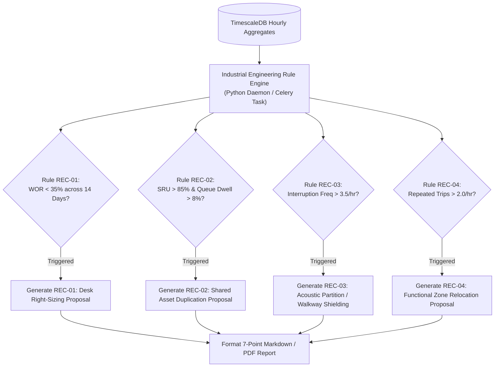
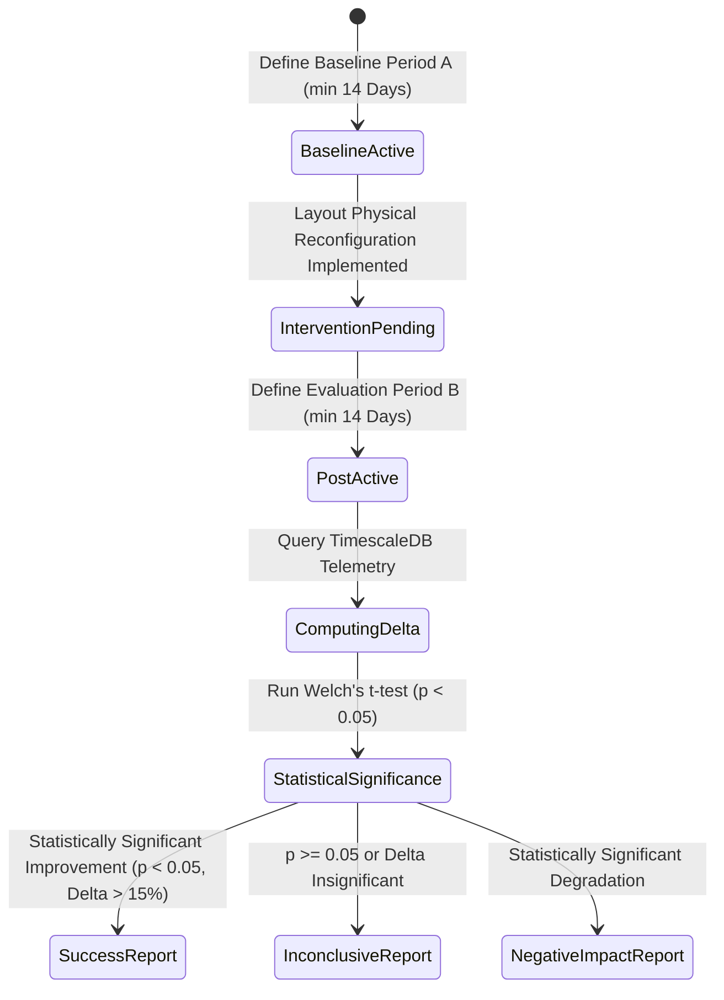

# Phase 14: Reports and Workplace Recommendations Specification

## 1. Document Overview

### 1.1 Purpose
This document specifies the automated recommendation engine, spatial layout optimization rules, A/B layout testing framework, and executive reporting pipelines for the CCTV Workplace Productivity and Workflow Intelligence System (WBPIS). It establishes algorithms that transform aggregated spatial telemetry into actionable, empirical workplace design interventions, prioritizing facility layout, ergonomics, and shared resource capacity over individual behavioral scrutiny.

### 1.2 Scope
- **Recommendation Engine**: Deterministic industrial engineering rules (`REC-01` to `REC-04`).
- **Reporting Architecture**: Mandatory 7-field structured insight schema, A/B layout evaluation engine, and privacy-preserving executive summary generation.
- **Ethical Focus**: Structural, physical, and team-level operational improvements; strict prohibition of punitive or individual disciplinary recommendations.

---

## 2. Existing Implementation Findings

Grounding assessment based on [`reports/CCTV_PRODUCTIVITY_CODEBASE_AUDIT.md`](file:///C:/Users/DELL/Desktop/cctv/reports/CCTV_PRODUCTIVITY_CODEBASE_AUDIT.md):

| Feature / Artifact | Codebase Location | Audit Status | Audit Assessment & Deficiencies |
| :--- | :--- | :--- | :--- |
| **Automated Recommendations** | Neither codebase | `UNAVAILABLE` | Neither system generates actionable recommendations or layout insights; both terminate at raw detection metrics or simplistic charts. |
| **A/B Testing Framework** | Neither codebase | `UNAVAILABLE` | Neither prototype supports comparing baseline periods against post-intervention periods to evaluate physical layout changes. |
| **Root-Cause Hypothesis Modeling** | Neither codebase | `UNAVAILABLE` | No capability exists to formulate structured hypotheses separating observable symptoms from potential operational root causes. |

---

## 3. Seven-Point Mandatory Recommendation Schema

To prevent unscientific speculation and guarantee actionable engineering rigor, **every automated recommendation generated by WBPIS must populate all seven mandatory fields**:

```
┌────────────────────────────────────────────────────────────────────────┐
│               SEVEN-POINT MANDATORY RECOMMENDATION SCHEMA              │
├────────────────────────────────────────────────────────────────────────┤
│ 1. OBSERVED PATTERN     | Quantified physical telemetry anomaly.       │
│ 2. RELEVANT TIME WINDOW | Specific date/shift/hour window analyzed.    │
│ 3. EVIDENCE & COVERAGE  | Sample size N, camera coverage %, confidence.│
│ 4. HYPOTHESIS           | Potential explanation, EXPLICITLY LABELED    │
│                         | AS A HYPOTHESIS (never asserted as fact).    │
│ 5. RECOMMENDED EXPERIMENT| Reversible physical layout or operational    │
│                         | trial (e.g., 2-week relocation test).        │
│ 6. OUTCOME METRIC       | Specific KPI used to measure success/failure.│
│ 7. FOLLOW-UP METHOD     | Automated post-intervention audit protocol.  │
└────────────────────────────────────────────────────────────────────────┘
```

---

## 4. Deterministic Recommendation Rule Engine



---

### Recommendation 01: Workstation Right-Sizing & Flexible Reallocation (`REC-01`)
1. **Observed Pattern**: A cluster of 8 assigned desks in Engineering Pod C exhibited an average Workstation Occupancy Rate ($\text{WOR}$) of $28.4\%$ over a 14-day operational window, with peak concurrent occupancy never exceeding 3 persons.
2. **Relevant Time Window**: 14 Operational Days (09:00 – 17:00, Monday through Friday).
3. **Evidence & Data Coverage**: Sample size $N = 112\text{ hours}$; camera observation coverage was $98.6\%$; tracking continuity averaged $94.2\%$.
4. **Potential Explanation (Hypothesis)**: *HYPOTHESIS*: The assigned team has transitioned to a high-mobility hybrid work schedule, leaving dedicated physical desks vacant for $> 70\%$ of the operational week.
5. **Recommended Operational Experiment**: Convert the 8 dedicated desks into a 4-desk unassigned flexible hot-desking pod, reallocating the remaining 4 desks as a collaborative team stand-up area.
6. **Outcome Metric**: Departmental Workspace Utilization (`MET-B6`) and Collaboration Duration (`MET-C1: ACT-05`).
7. **Follow-Up Evaluation Method**: Re-evaluate occupancy and collaboration telemetry over a 3-week post-reallocation trial period using the A/B Testing Engine.

---

### Recommendation 02: Shared Resource Capacity Expansion (`REC-02`)
1. **Observed Pattern**: The 3D Prototyping Laboratory review kiosk exhibited a Shared-Resource Utilization ($\text{SRU}$) of $89.2\%$, accompanied by an average Waiting-Time Ratio ($\text{MET-D2}$) of $11.4\%$ with standing queues forming during afternoon peak hours.
2. **Relevant Time Window**: Prior 30 Days, concentrated between 13:00 and 16:00.
3. **Evidence & Data Coverage**: $N = 240\text{ hours}$; Queue buffer zone coverage was $99.1\%$; queue detection confidence $\ge 0.88$.
4. **Potential Explanation (Hypothesis)**: *HYPOTHESIS*: The single review workstation is an operational bottleneck creating work-in-progress (WIP) starvation for downstream engineering assembly teams.
5. **Recommended Operational Experiment**: Commission a secondary parallel inspection terminal or deploy an asynchronous digital review queue kiosk.
6. **Outcome Metric**: Queue Dwell Time / Waiting-Time Ratio (`MET-D2`) and Corridor Transit Churn (`MET-D3`).
7. **Follow-Up Evaluation Method**: Run an automated before-and-after comparison across 14 operational days post-installation; pass threshold is a $\ge 50\%$ reduction in waiting time ratio ($\text{MET-D2} < 5.0\%$).

---

### Recommendation 03: Acoustic & Focus Protection Shielding (`REC-03`)
1. **Observed Pattern**: Workstations adjacent to the primary central corridor in Pod A recorded an Interruption Frequency (`MET-D1`) of $4.2\text{ events/hour}$, compared to the facility baseline of $1.1\text{ events/hour}$.
2. **Relevant Time Window**: Past 10 Operational Days (09:00 – 18:00).
3. **Evidence & Data Coverage**: $N = 90\text{ hours}$; camera coverage $97.8\%$; spatial interaction proximity detected within $1.5\text{m}$.
4. **Potential Explanation (Hypothesis)**: *HYPOTHESIS*: The lack of physical shielding between the main walkway and desks exposes seated workers to constant visual distractions and spontaneous, non-urgent transit interruptions.
5. **Recommended Operational Experiment**: Install a $1.6\text{m}$ frosted acoustic privacy screen and re-route secondary corridor traffic using modular planter boxes.
6. **Outcome Metric**: Interruption Frequency (`MET-D1`) and Activity Transition Rate (`MET-C5`).
7. **Follow-Up Evaluation Method**: Measure interruption frequency over 14 days following partition installation; success defined as reduction of interruptions to $\le 1.8/\text{hour}$.

---

### Recommendation 04: Functional Zone Proximity Realignment (`REC-04`)
1. **Observed Pattern**: The Quality Assurance team exhibited a Repeated-Trip Rate (`MET-D5`) of $2.8\text{ round trips/hour}$ between their desk pod and the Hardware Testing Bay, traversing an average distance of $45\text{ meters}$ per leg through a high-congestion corridor.
2. **Relevant Time Window**: Past 20 Operational Days.
3. **Evidence & Data Coverage**: $N = 160\text{ hours}$; tracking continuity across corridor cameras $\ge 88\%$; trajectory loop pattern count $= 448$ validated round trips.
4. **Potential Explanation (Hypothesis)**: *HYPOTHESIS*: The spatial separation between the QA desk pod and the physical test bay introduces transit fatigue and corridor churn.
5. **Recommended Operational Experiment**: Swap physical pod assignments to relocate the QA team to the open pod directly adjacent to the Hardware Testing Bay.
6. **Outcome Metric**: Corridor Transit Churn (`MET-D3`), Repeated Trips (`MET-D5`), and Task Timeliness (`MET-E3`).
7. **Follow-Up Evaluation Method**: Automated A/B trajectory churn comparison over a 4-week post-relocation trial; target is a $> 60\%$ reduction in transit churn.

---

## 5. Before-and-After A/B Layout Testing Framework

To scientifically validate that layout interventions produce positive outcomes, WBPIS implements an automated **A/B Intervention Evaluation Pipeline**:

$$\Delta\text{Metric} = \overline{M}_\text{post} - \overline{M}_\text{baseline}$$
$$t\text{-statistic} = \frac{\overline{M}_\text{post} - \overline{M}_\text{baseline}}{\sqrt{\frac{s_\text{post}^2}{N_\text{post}} + \frac{s_\text{baseline}^2}{N_\text{baseline}}}}, \quad p\text{-value} = 2 \cdot (1 - \Phi(|t|))$$



---

## 6. Executive Reporting & PDF Export Generation

The system includes an automated reporting worker generating monthly executive briefing PDFs:
- **Architecture**: Asynchronous report generation using Jinja2 HTML templates and WeasyPrint / CairoSVG.
- **Privacy Enforcement**: All employee faces are redacted; all telemetry is aggregated to pods ($k \ge 5$); zero individual metrics appear in the final report.
- **Download Format**: Cryptographically signed PDF with SHA-256 audit hash.

---

## 7. Verification and Acceptance Criteria

| ID | Test / Acceptance Criterion | Verification Method | Pass Threshold |
| :--- | :--- | :--- | :--- |
| **AC-REC-01** | Rule engine populates all 7 mandatory fields for every generated recommendation. | Automated JSON schema validation test. | $100\%$ generated recommendations contain all 7 fields |
| **AC-REC-02** | Explicit labeling of root-cause explanations as hypotheses. | Regex scan on generated text for `HYPOTHESIS:`. | $100\%$ compliance; zero unverified assertions |
| **AC-REC-03** | A/B testing statistical significance calculation matches SciPy reference. | Unit test on synthetic shifted dataset. | $t$-statistic and $p$-value match SciPy $\pm 0.0001$ |
| **AC-REC-04** | Total exclusion of punitive or individual disciplinary proposals. | NLP sentiment / keyword policy linter. | Zero disciplinary recommendations emitted |

---

## 8. Open Questions & Assumptions

> [!NOTE]
> ### 1. Local LLM Narrative Synthesis vs. Deterministic Templates
> *Current Default*: Deterministic Jinja2 templates for all recommendation text.
> *Optional Extension*: Feed the 7-field structured JSON into an on-premise offline LLM (Ollama Llama-3-8B) to generate executive summary prose.
> *Constraint*: The LLM must be strictly offline with zero external network connectivity to prevent data leakage.

---

## 9. Related Documentation Links

- **Workflow Metrics**: Input telemetry in [`07_WORKFLOW_BOTTLENECK_METRICS.md`](file:///C:/Users/DELL/Desktop/cctv/docs/implementation/07_WORKFLOW_BOTTLENECK_METRICS.md).
- **Productivity Scoring**: Output outcomes in [`08_PRODUCTIVITY_METRICS_AND_SCORING.md`](file:///C:/Users/DELL/Desktop/cctv/docs/implementation/08_PRODUCTIVITY_METRICS_AND_SCORING.md).
- **Dashboard Views**: A/B view in [`13_FRONTEND_DASHBOARD_AND_VISUALIZATIONS.md`](file:///C:/Users/DELL/Desktop/cctv/docs/implementation/13_FRONTEND_DASHBOARD_AND_VISUALIZATIONS.md).
- **Backend APIs**: Recommendation endpoints in [`12_BACKEND_APIS_AND_INTEGRATION.md`](file:///C:/Users/DELL/Desktop/cctv/docs/implementation/12_BACKEND_APIS_AND_INTEGRATION.md).
