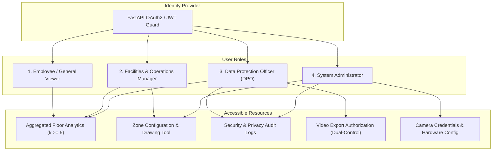
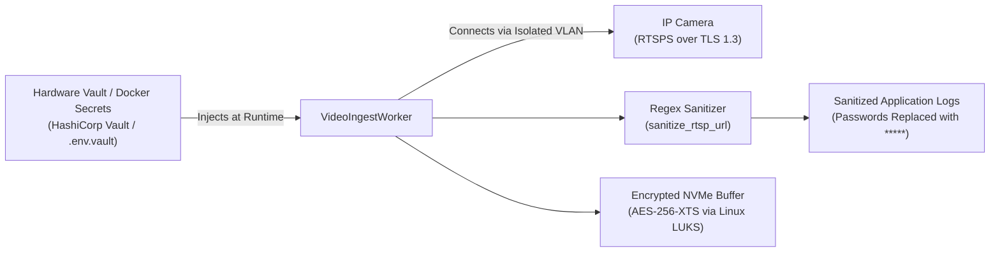
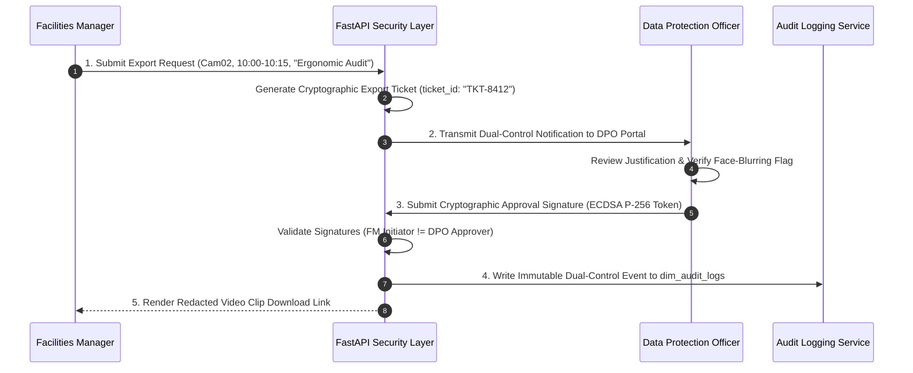

# Phase 16: Security, Privacy, and Access Control Specification

## 1. Document Overview

### 1.1 Purpose
This document specifies the technical security architecture, Role-Based Access Control (RBAC) matrix, cryptographic standards, credential isolation protocols, and immutable audit logging for the CCTV Workplace Productivity and Workflow Intelligence System (WBPIS). It establishes enterprise-grade security controls to protect video streams, telemetry data, and employee privacy while remediating the critical credential leak vulnerabilities uncovered during the codebase audit.

### 1.2 Scope
- **Identity & Access Management**: OAuth2 with JWT tokens, Argon2 password hashing, and four granular RBAC roles.
- **Network & Cryptographic Security**: TLS 1.3, RTSPS stream encryption, AES-256-XTS storage encryption, and hardware secret vaults.
- **Audit & Governance**: Append-only security audit trail, log sanitization (`SEC-01` remediation), and dual-control authorization.

---

## 2. Existing Implementation Findings

Grounding assessment based on [`reports/CCTV_PRODUCTIVITY_CODEBASE_AUDIT.md`](file:///C:/Users/DELL/Desktop/cctv/reports/CCTV_PRODUCTIVITY_CODEBASE_AUDIT.md):

| Security Domain | Codebase Location | Audit Status | Audit Assessment & Critical Vulnerabilities |
| :--- | :--- | :--- | :--- |
| **Plaintext Credential Leakage** | `audit_extracted/.../app.py` | `EXISTING_VERIFIED` (`SEC-01`) | RTSP connection string containing camera username and password logged directly into `employee_log.txt` and printed to stdout. |
| **Zero Authentication** | `audit_extracted/.../app.py` | `EXISTING_VERIFIED` | All Flask endpoints (`/`, `/video_feed`, `/update_pos`) lacked authentication. Any employee on the office LAN could watch live streams or alter desk boundaries. |
| **Unencrypted Stream Transport** | `audit_extracted/.../app.py` | `EXISTING_VERIFIED` | Raw unencrypted MJPEG streamed over plain HTTP port 5000, vulnerable to network packet sniffing and man-in-the-middle (MITM) inspection. |
| **Audit Logging** | Neither codebase | `UNAVAILABLE` | Neither system logged administrative logins, zone alterations, or data export actions; complete lack of non-repudiation. |

---

## 3. Role-Based Access Control (RBAC) Matrix

WBPIS enforces strict separation of duties across **Four Distinct User Roles**:



### 3.1 Granular Permissions Matrix

| Operational Capability | Employee / Viewer | Facilities Manager | Data Protection Officer | System Administrator |
| :--- | :---: | :---: | :---: | :---: |
| **View Macro Floor Heatmaps ($k \ge 5$)** | Yes | Yes | Yes | Yes |
| **View Live Unredacted CCTV Stream** | No | No | No | Only during setup |
| **View Live Redacted (Blurred) Stream**| No | Yes | Yes | Yes |
| **Draw & Modify Polygon Zones** | No | Yes | No | Yes |
| **View Scorecards A, B, C, D** | Aggregated only | Yes | Yes | Yes |
| **Request Video Clip Export** | No | Yes (Initiator) | No | No |
| **Authorize Video Clip Export** | No | No | Yes (Approver) | No |
| **Inspect Security Audit Logs** | No | No | Yes | Yes |
| **Configure Camera Credentials** | No | No | No | Yes |

---

## 4. Cryptographic Standards & Credential Isolation



### 4.1 Remediating Plaintext Credential Leakage (`SEC-01`)
1. **RTSP Secret Masking**: The core logging subsystem incorporates a mandatory regex sanitization filter that intercepts all log emissions containing URL strings:
   ```python
   import re

   def sanitize_rtsp_url(raw_url: str) -> str:
       """Masks username and password in RTSP strings."""
       return re.sub(r'(rtsp://)([^:]+):([^@]+)@', r'\1\2:*****@', raw_url)
   ```
2. **Environment & Vault Storage**: Camera passwords and RTSP URLs are strictly prohibited in application source code, configuration files, and database tables. Credentials are stored in Docker secrets or HashiCorp Vault and resolved at runtime via environment references (`RTSP_CRED_KEY_CAM01`).

### 4.2 Network & Storage Cryptography
- **In-Transit Encryption**: All web traffic between browsers and FastAPI is encrypted via **TLS 1.3** using modern cipher suites (`TLS_AES_256_GCM_SHA384`).
- **Camera Network Isolation**: CCTV cameras reside on a physically isolated camera management VLAN (`VLAN 40: CCTV-PRIVATE`) with zero direct internet access.
- **At-Rest Storage Encryption**: Edge video storage partitions on NVMe SSDs are formatted using **LUKS2 (Linux Unified Key Setup)** with **AES-256-XTS** cipher modes.

---

## 5. Dual-Control Authorization Architecture

To prevent unilateral access to surveillance video, exporting raw or annotated video requires **Dual-Control "Four-Eyes" Cryptographic Sign-Off**:



---

## 6. Immutable Security Audit Trail DDL

All administrative actions, authentication attempts, zone edits, and export requests are recorded in an append-only PostgreSQL table:

```sql
CREATE TABLE dim_audit_logs (
    log_id BIGSERIAL PRIMARY KEY,
    timestamp TIMESTAMP WITH TIME ZONE DEFAULT CURRENT_TIMESTAMP,
    user_id VARCHAR(64) NOT NULL,
    user_role VARCHAR(32) NOT NULL,
    action_type VARCHAR(64) NOT NULL, -- 'LOGIN', 'ZONE_UPDATE', 'EXPORT_REQUEST', 'EXPORT_APPROVE'
    resource_id VARCHAR(128) NOT NULL,
    client_ip VARCHAR(45) NOT NULL,
    status_code INT NOT NULL,
    payload_hash VARCHAR(64) NOT NULL, -- SHA-256 hash of request body
    details JSONB
);

CREATE INDEX idx_audit_user_time ON dim_audit_logs (user_id, timestamp DESC);
CREATE INDEX idx_audit_action_time ON dim_audit_logs (action_type, timestamp DESC);

-- Enforce Append-Only Immutability via Database Trigger
CREATE OR REPLACE FUNCTION enforce_audit_immutability()
RETURNS TRIGGER AS $$
BEGIN
    RAISE EXCEPTION 'dim_audit_logs is append-only. UPDATE and DELETE operations are prohibited.';
END;
$$ LANGUAGE plpgsql;

CREATE TRIGGER trg_audit_immutable
BEFORE UPDATE OR DELETE ON dim_audit_logs
FOR EACH ROW EXECUTE FUNCTION enforce_audit_immutability();
```

---

## 7. Verification and Acceptance Criteria

| ID | Test / Acceptance Criterion | Verification Method | Pass Threshold |
| :--- | :--- | :--- | :--- |
| **AC-SEC-01** | Total absence of plaintext camera passwords in logs and console (`SEC-01`). | Automated log file regex scanner. | Zero occurrences of unmasked camera passwords |
| **AC-SEC-02** | Rejection of unauthenticated API calls to perception and analytical routes. | Automated HTTP request test without JWT token. | HTTP 401 Unauthorized strictly returned |
| **AC-SEC-03** | Dual-control enforcement prevents single-user video export execution. | Unit test attempting export approval using same account as initiator. | HTTP 403 Forbidden: Initiator cannot approve own export |
| **AC-SEC-04** | Immutability trigger on `dim_audit_logs` prevents record tampering. | SQL test executing `DELETE FROM dim_audit_logs;`. | PostgreSQL exception raised; zero rows deleted |

---

## 8. Open Questions & Assumptions

> [!NOTE]
> ### 1. Enterprise SSO Integration (SAML 2.0 / OIDC)
> *Assumption*: Initial deployments use internal OAuth2 with JWT tokens.
> *Open Question*: Should the authentication middleware include native SAML 2.0 / Okta connectors for corporate Active Directory single sign-on?

---

## 9. Related Documentation Links

- **Ethics & Privacy**: Foundational policies in [`01_REQUIREMENTS_AND_ETHICS.md`](file:///C:/Users/DELL/Desktop/cctv/docs/implementation/01_REQUIREMENTS_AND_ETHICS.md).
- **Backend APIs**: Authentication middleware in [`12_BACKEND_APIS_AND_INTEGRATION.md`](file:///C:/Users/DELL/Desktop/cctv/docs/implementation/12_BACKEND_APIS_AND_INTEGRATION.md).
- **Database Architecture**: Audit schema in [`11_DATABASE_AND_DATA_RETENTION.md`](file:///C:/Users/DELL/Desktop/cctv/docs/implementation/11_DATABASE_AND_DATA_RETENTION.md).
- **Video Export**: Export controls in [`10_ANNOTATED_VIDEO_AND_EXPORT.md`](file:///C:/Users/DELL/Desktop/cctv/docs/implementation/10_ANNOTATED_VIDEO_AND_EXPORT.md).
