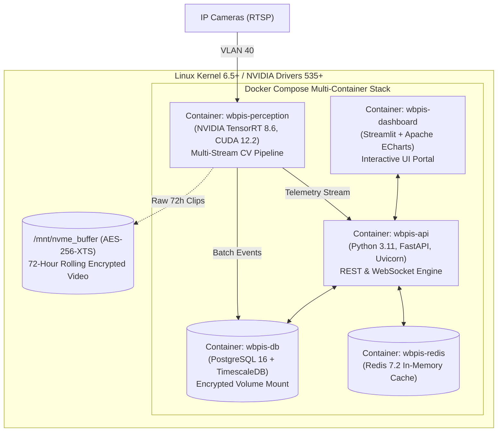
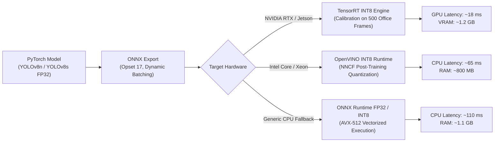

# Phase 17: Deployment and Performance Optimization Specification

## 1. Document Overview

### 1.1 Purpose
This document specifies the containerized deployment architecture, multi-service orchestration, hardware acceleration pipelines, neural network quantization workflows, and runtime performance budgets for the CCTV Workplace Productivity and Workflow Intelligence System (WBPIS). It establishes reproducible, enterprise-ready infrastructure, replacing brittle bare-metal dependency conflicts with an isolated Docker Compose and Kubernetes topology.

### 1.2 Scope
- **Container Orchestration**: Docker Compose multi-service stack (`wbpis-perception`, `wbpis-api`, `wbpis-db`, `wbpis-dashboard`, `wbpis-redis`).
- **Hardware Acceleration**: NVIDIA TensorRT INT8/FP16 quantization, Intel OpenVINO compilation, and CPU AVX-512 fallbacks.
- **Performance Engineering**: Mailbox buffer thread scheduling, dynamic frame-skipping, NVMe rolling disk management, and memory leak mitigation.

---

## 2. Existing Implementation Findings

Grounding assessment based on [`reports/CCTV_PRODUCTIVITY_CODEBASE_AUDIT.md`](file:///C:/Users/DELL/Desktop/cctv/reports/CCTV_PRODUCTIVITY_CODEBASE_AUDIT.md):

| Deployment Aspect | Codebase Location | Audit Status | Audit Assessment & Environment Fragility |
| :--- | :--- | :--- | :--- |
| **Bare-Metal Dependency Hell** | `audit_extracted/.../` | `EXISTING_VERIFIED` | Required compiling legacy Darknet C source code with MSVC or GCC. Missing Windows DLLs (`pthreads.dll`, `opencv_world340.dll`) prevented reproducible execution. |
| **Conflicting Python Runtimes** | Both codebases | `EXISTING_VERIFIED` | Prototype required Python 3.7 with legacy OpenCV; host analytics required Python 3.10 with PyTorch 2.0 and MediaPipe. Running both simultaneously failed without manual virtual environment switching. |
| **Zero Hardware Optimization** | Both codebases | `EXISTING_UNVERIFIED` | Models executed in unquantized FP32 mode. Darknet saturated $100\%$ CPU cores; PyTorch saturated GPU VRAM, limiting execution to a single low-res stream. |
| **Process Supervision** | Neither codebase | `UNAVAILABLE` | Neither system used process supervisors (systemd, Docker); unhandled network drops permanently crashed the server requiring manual terminal reboots. |

---

## 3. Containerized Multi-Service Architecture



---

## 4. Production Docker Compose Specification

```yaml
version: '3.8'

services:
  wbpis-db:
    image: timescale/timescaledb-ha:pg16
    container_name: wbpis-db
    restart: unless-stopped
    environment:
      POSTGRES_DB: wbpis_telemetry
      POSTGRES_USER: wbpis_admin
      POSTGRES_PASSWORD_FILE: /run/secrets/db_password
    volumes:
      - db_data:/home/postgres/pgdata/data
    secrets:
      - db_password
    ports:
      - "127.0.0.1:5432:5432"
    healthcheck:
      test: ["CMD-SHELL", "pg_isready -U wbpis_admin -d wbpis_telemetry"]
      interval: 10s
      timeout: 5s
      retries: 5

  wbpis-redis:
    image: redis:7.2-alpine
    container_name: wbpis-redis
    restart: unless-stopped
    command: redis-server --appendonly yes --requirepass_file /run/secrets/redis_password
    secrets:
      - redis_password
    volumes:
      - redis_data:/data

  wbpis-perception:
    image: wbpis/perception:latest
    container_name: wbpis-perception
    restart: unless-stopped
    deploy:
      resources:
        reservations:
          devices:
            - driver: nvidia
              count: 1
              capabilities: [gpu, video]
    volumes:
      - /mnt/nvme_buffer:/mnt/nvme_buffer:rw
    environment:
      - DATABASE_URL=postgresql://wbpis_admin@wbpis-db:5432/wbpis_telemetry
      - INFERENCE_BACKEND=TENSORRT_INT8
      - MAX_CONCURRENT_CAMERAS=4
    depends_on:
      wbpis-db:
        condition: service_healthy

  wbpis-api:
    image: wbpis/api:latest
    container_name: wbpis-api
    restart: unless-stopped
    ports:
      - "8000:8000"
    environment:
      - DATABASE_URL=postgresql://wbpis_admin@wbpis-db:5432/wbpis_telemetry
      - REDIS_URL=redis://wbpis-redis:6379
    depends_on:
      - wbpis-db
      - wbpis-redis

  wbpis-dashboard:
    image: wbpis/dashboard:latest
    container_name: wbpis-dashboard
    restart: unless-stopped
    ports:
      - "8501:8501"
    environment:
      - BACKEND_API_URL=http://wbpis-api:8000
    depends_on:
      - wbpis-api

volumes:
  db_data:
  redis_data:

secrets:
  db_password:
    file: ./secrets/db_password.txt
  redis_password:
    file: ./secrets/redis_password.txt
```

---

## 5. Neural Network Quantization & Acceleration

To achieve real-time throughput across multiple concurrent 1080p camera streams without GPU memory exhaustion, WBPIS quantizes models from FP32 to **INT8 and FP16**:



### 5.1 INT8 Calibration Pipeline
1. **Calibration Dataset**: 500 representative frames extracted from WBPIS-BENCH-V1 capturing diverse workplace lighting conditions.
2. **Quantization Scheme**: Symmetric per-tensor quantization for activations; symmetric per-channel quantization for convolution weights.
3. **Accuracy Preservation Gate**: An INT8 model is accepted if and only if:
   $$\Delta\text{mAP@50} = \text{mAP}_\text{FP32} - \text{mAP}_\text{INT8} \le 0.015\ (1.5\%)$$

---

## 6. Runtime Resource Budgets & Trade-Off Matrix

| Resource Dimension | Tier 1: Small Office (4 Cameras) | Tier 2: Floor Hub (12 Cameras) | Tier 3: Enterprise (32 Cameras) |
| :--- | :--- | :--- | :--- |
| **Target GPU** | 1x NVIDIA RTX 4060 (8GB) | 1x NVIDIA RTX 4090 (24GB) | 2x NVIDIA L4 (24GB each) |
| **CPU Allocation** | 8 Cores (Intel i7 13th Gen) | 16 Cores (AMD Ryzen 9) | 32 Cores (Dual Xeon Silver) |
| **System Memory (RAM)** | 32 GB DDR5 | 64 GB DDR5 | 128 GB ECC Registered |
| **Edge Storage (72h)** | 1 TB NVMe SSD (Encrypted) | 2 TB NVMe SSD (Encrypted) | 8 TB Enterprise NVMe Array |
| **Camera Ingest FPS** | 15.0 FPS per camera | 15.0 FPS per camera | 15.0 FPS per camera |
| **Frame Skip Policy** | Process every frame (15 FPS) | Process every frame (15 FPS) | Process 1-in-2 frames (7.5 FPS) |
| **GPU Utilization Target** | $40\text{–}50\%$ | $65\text{–}75\%$ | $60\text{–}70\%$ |

---

## 7. Process Supervision & Auto-Recovery

- **Container Health Checks**: Docker daemon monitors `/health` endpoints every 10 seconds.
- **Automated Restart Policy**: `restart: unless-stopped` guarantees recovery after host power cycling.
- **OOM Protection**: Docker container memory limits (`mem_limit: 8G`) prevent memory leaks from starving host OS processes.
- **Watchdog Reboot**: If the perception engine fails to process frames for $> 15\text{ seconds}$, an internal software watchdog terminates the process, triggering Docker auto-restart.

---

## 8. Verification and Acceptance Criteria

| ID | Test / Acceptance Criterion | Verification Method | Pass Threshold |
| :--- | :--- | :--- | :--- |
| **AC-DEP-01** | Full Docker Compose stack boots cleanly from `docker compose up -d`. | Automated CI test harness on clean host. | All containers healthy in $\le 90\text{ seconds}$ |
| **AC-DEP-02** | TensorRT INT8 model mAP degradation within permitted budget. | WBPIS-BENCH-V1 evaluation suite. | $\Delta\text{mAP@50} \le 0.015$ vs. FP32 baseline |
| **AC-DEP-03** | Automated container recovery upon simulated perception process crash. | Shell command `docker kill -s SIGKILL wbpis-perception`. | Container auto-restarted and healthy in $\le 10\text{ s}$ |
| **AC-DEP-04** | Total disk space consumption over 72 hours bounded within 1 TB. | Automated file growth monitoring test. | NVMe buffer occupancy $\le 850\text{ GB}$ |

---

## 9. Open Questions & Assumptions

> [!NOTE]
> ### 1. Kubernetes / Helm Deployment for Enterprise Clouds
> *Assumption*: Initial on-premise installations use Docker Compose.
> *Open Question*: Should the deployment package include production Helm charts and Kubernetes manifests (K8s) for enterprise clients operating private on-premise clusters?

---

## 10. Related Documentation Links

- **System Architecture**: High-level topology in [`02_SYSTEM_ARCHITECTURE.md`](file:///C:/Users/DELL/Desktop/cctv/docs/implementation/02_SYSTEM_ARCHITECTURE.md).
- **Ingestion Pipelines**: Decoding routines in [`03_VIDEO_INGESTION_AND_PREPROCESSING.md`](file:///C:/Users/DELL/Desktop/cctv/docs/implementation/03_VIDEO_INGESTION_AND_PREPROCESSING.md).
- **Security & Secrets**: Secret vault setup in [`16_SECURITY_PRIVACY_AND_ACCESS_CONTROL.md`](file:///C:/Users/DELL/Desktop/cctv/docs/implementation/16_SECURITY_PRIVACY_AND_ACCESS_CONTROL.md).
- **Roadmap**: Deployment milestones in [`18_IMPLEMENTATION_ROADMAP.md`](file:///C:/Users/DELL/Desktop/cctv/docs/implementation/18_IMPLEMENTATION_ROADMAP.md).
