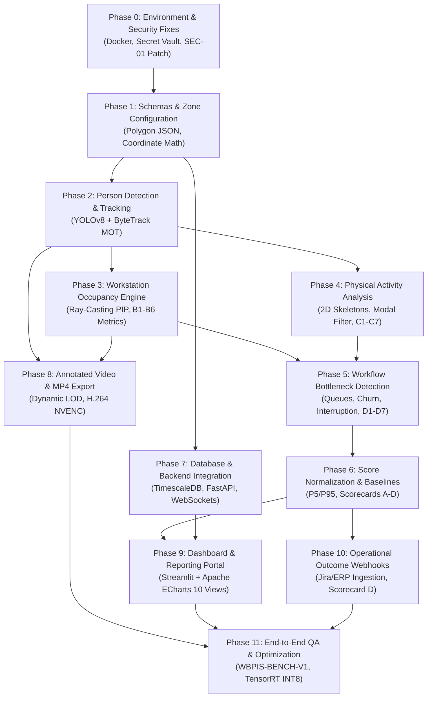

# Phase 18: Implementation Roadmap Specification

## 1. Document Overview

### 1.1 Purpose
This document specifies the dependency-aware, phased implementation roadmap, prioritized work breakdown structure (WBS), milestone gate criteria, and risk mitigation strategies for the CCTV Workplace Productivity and Workflow Intelligence System (WBPIS). It establishes a structured engineering schedule across 12 distinct implementation phases (Phase 0 through Phase 11), ensuring that technical dependencies, security remediations, and testing gates are respected before downstream feature development begins.

### 1.2 Scope
- **Engineering Timeline**: 12 sequential and concurrent development phases.
- **Work Breakdown Structure**: Prioritized backlog items categorized across P0 (Critical Path MVP), P1 (Core Analytics), P2 (Enterprise Integration), and P3 (Advanced Optimization).
- **Quality Gates**: Formal exit criteria required to transition between phases.

---

## 2. Existing Implementation Findings

Grounding assessment based on [`reports/CCTV_PRODUCTIVITY_CODEBASE_AUDIT.md`](file:///C:/Users/DELL/Desktop/cctv/reports/CCTV_PRODUCTIVITY_CODEBASE_AUDIT.md):

| Area | Codebase Location | Audit Status | Audit Assessment & Roadmap Implications |
| :--- | :--- | :--- | :--- |
| **Monolithic Prototype Code** | `audit_extracted/.../app.py` | `EXISTING_VERIFIED` | Required complete architectural replacement. Cannot be incrementally refactored due to thread locking, security bugs (`SEC-01`), and deprecated C-libraries. |
| **Reusable Analytics UI** | `video/choriwala_code.py` | `EXISTING_VERIFIED` | ECharts visualization components can be adapted for the Streamlit dashboard in Phase 9, accelerating frontend delivery by $\sim 3\text{ weeks}$. |
| **Prioritization Gaps** | Neither codebase | `UNAVAILABLE` | Neither prototype established clear milestone dependencies; development jumped directly to UI rendering before resolving tracking stability or data persistence. |

---

## 3. Dependency-Aware Roadmap Architecture

---

## 4. Phase-by-Phase Implementation Specifications

### Phase 0: Audit Remediation, Security Fixes, and Environment Scaffolding
- **Objective**: Eliminate critical vulnerabilities (`SEC-01`), isolate camera credentials, and establish a reproducible containerized development environment.
- **Affected Modules**: `docker-compose.yml`, `src/backend/security/`, `.env.example`, `pyproject.toml`.
- **Prerequisites**: Access to project repository and edge server hardware.
- **Implementation Tasks**:
  1. Configure Python 3.11 virtual environment using Poetry or uv.
  2. Implement `sanitize_rtsp_url()` regex filter to prevent camera password logging (`SEC-01` remediation).
  3. Deploy local Docker Compose scaffold with PostgreSQL 16 / TimescaleDB and Redis.
  4. Establish Git pre-commit hooks enforcing Black, Ruff, and MyPy static type checking.
- **Tests**: `tests/regression/test_legacy_audit_regressions.py` (`SEC-01` test).
- **Deliverables**: Working Docker Compose dev environment, credential-free git tree.
- **Priority**: **P0 (Blocker)**.

---

### Phase 1: Metric Definitions, Event Schemas, and Zone Configuration
- **Objective**: Establish mathematical foundations, Pydantic schemas, and normalized coordinate geometry.
- **Affected Modules**: `src/common/schemas/`, `src/perception/spatial/`.
- **Prerequisites**: Phase 0 completed.
- **Implementation Tasks**:
  1. Author Pydantic v2 schemas for all 26 metrics and the 4 scorecards.
  2. Implement normalized polygon coordinate parser (`[0.0, 1.0]` range) resolving `BUG-02`.
  3. Build ray-casting point-in-polygon (PIP) C-extension with Shapely unit test harness.
- **Tests**: Geometric boundary tests with 1,000 synthetic concave and convex points.
- **Deliverables**: Tested spatial geometry library and typed event schemas.
- **Priority**: **P0 (Critical Path)**.

---

### Phase 2: Multi-Person Detection and Ephemeral Tracking IDs
- **Objective**: Deploy real-time YOLOv8 person detection and ByteTrack multi-object tracking.
- **Affected Modules**: `src/perception/detector/`, `src/perception/tracker/`.
- **Prerequisites**: Phase 1 completed; camera RTSP stream available.
- **Implementation Tasks**:
  1. Implement GStreamer/OpenCV RTSP ingestion worker with mailbox frame buffer (Phase 03).
  2. Integrate YOLOv8n ONNX runtime with batched Non-Maximum Suppression (NMS).
  3. Implement ByteTrack two-stage bipartite association using Kalman filter constant velocity.
  4. Build ground-plane footprint calculator ($x_f = (x_1+x_2)/2, y_f = y_2$).
  5. Implement daily rotating salt hashing for ephemeral track handles (`TRK-xxxx`).
- **Tests**: Single-camera multi-person tracking test clip evaluating ID switch rate.
- **Deliverables**: Python perception daemon outputting track streams with $< 30\text{ ms}$ latency.
- **Priority**: **P0 (Critical Path)**.

---

### Phase 3: Workstation Assignment and Occupancy Metrics
- **Objective**: Calculate real-time desk presence, absence timers, and facility utilization (Metrics B1–B6).
- **Affected Modules**: `src/perception/occupancy/`, `src/analytics/presence/`.
- **Prerequisites**: Phase 2 completed.
- **Implementation Tasks**:
  1. Build workstation state machine (`VACANT`, `OCCUPIED`, `TRANSITORY_ABSENCE`, `PROLONGED_ABSENCE`).
  2. Implement 5-minute grace period debounce logic for transitory absences.
  3. Build analytical aggregators for Workstation Occupancy Rate (`MET-B1`) and Workspace Utilization (`MET-B6`).
- **Tests**: Simulated stepping-away test scenarios verifying occupancy persistence during 3-minute coffee breaks.
- **Deliverables**: Real-time zone occupancy event stream committed to TimescaleDB.
- **Priority**: **P0 (Critical Path)**.

---

### Phase 4: Physical Activity Classification & Temporal Aggregation
- **Objective**: Classify observable physical posture states (`ACT-01` to `ACT-07`) with temporal modal smoothing.
- **Affected Modules**: `src/perception/pose/`, `src/analytics/activity/`.
- **Prerequisites**: Phase 2 completed.
- **Implementation Tasks**:
  1. Deploy YOLOv8-pose keypoint extraction on detected person crops.
  2. Implement torso-knee angle and ground velocity heuristic decision tree.
  3. Build 75-frame rolling circular ring buffer executing modal majority voting.
  4. Aggregate Activity Duration (`MET-C1`), Share (`MET-C2`), and Interaction (`MET-C3`).
- **Tests**: Pose classification benchmark test across 1,000 labeled office poses.
- **Deliverables**: Filtered activity event publisher emitting clean behavioral states.
- **Priority**: **P1 (Core Analytics)**.

---

### Phase 5: Workflow Bottleneck Detection Engine
- **Objective**: Detect corridor congestion, queue dwell times, repeated trips, and interruptions (Metrics D1–D7).
- **Affected Modules**: `src/analytics/bottlenecks/`, `src/perception/queues/`.
- **Prerequisites**: Phase 3 and Phase 4 completed.
- **Implementation Tasks**:
  1. Build stationary cluster queue detector ($v < 0.15\text{ m/s}$, dwell $\ge 30\text{s}$) for shared equipment zones.
  2. Implement corridor density tracking ($\text{persons/m}^2$) and Congestion Rate (`MET-D4`).
  3. Implement proximity-based Interruption Event detector (`MET-D1`).
  4. Build trajectory Markov transition matrix tracking Zone Transition Rates (`MET-D3`).
- **Tests**: Synthetic trajectory simulation testing queue and congestion threshold alerts.
- **Deliverables**: Workflow bottleneck event logger and composite risk index calculator.
- **Priority**: **P1 (Core Analytics)**.

---

### Phase 6: Score Normalization, Confidence, and Baseline Versioning
- **Objective**: Implement empirical percentile scaling, multi-layer confidence scoring, and Scorecards A–D.
- **Affected Modules**: `src/analytics/scoring/`, `src/analytics/baselines/`.
- **Prerequisites**: Phase 5 completed.
- **Implementation Tasks**:
  1. Implement P5/P95 percentile normalization and outlier Winsorization.
  2. Construct mathematical scoring engines for Scorecard A (Workflow Efficiency) and Scorecard D (Output).
  3. Implement minimum-coverage policy (suppressing scores to `N/A` when coverage $< 60\%$).
  4. Deploy automated drift detection worker using Population Stability Index (PSI).
- **Tests**: Property-based tests verifying bounded outputs $[0.0, 100.0]$ across 50,000 random inputs.
- **Deliverables**: Standalone scoring module with automated baseline calibration.
- **Priority**: **P1 (Core Analytics)**.

---

### Phase 7: Database Hypertables and FastAPI Backend Integration
- **Objective**: Deploy production TimescaleDB tables, Alembic migrations, REST endpoints, and WebSockets.
- **Affected Modules**: `src/backend/`, `src/backend/api/`, `src/backend/migrations/`.
- **Prerequisites**: Phase 1 and Phase 6 completed.
- **Implementation Tasks**:
  1. Author and execute Alembic migrations for all dimension tables and hypertables.
  2. Implement TimescaleDB automated chunk dropping (14 days) and columnar compression (7 days).
  3. Build FastAPI REST routers for sessions, zones, and scorecard queries.
  4. Implement `/ws/live-telemetry/{camera_id}` WebSocket broadcasting stream (`BUG-01` remediation).
- **Tests**: Locust load test simulating 25 concurrent dashboard queries.
- **Deliverables**: Production FastAPI service running on port 8000.
- **Priority**: **P0 (Critical Path)**.

---

### Phase 8: Annotated Video Streaming and On-Demand MP4 Export
- **Objective**: Build live annotated preview stream and asynchronous dual-control MP4 clip export.
- **Affected Modules**: `src/perception/overlay/`, `src/backend/export/`.
- **Prerequisites**: Phase 2 and Phase 7 completed.
- **Implementation Tasks**:
  1. Build anti-aliased OpenCV/Cairo overlay renderer with dynamic Level-of-Detail (LOD).
  2. Build MJPEG streaming endpoint for real-time camera preview.
  3. Implement asynchronous Celery export worker encoding H.264 via NVENC.
  4. Implement automated audio stripping (`-an`) and face blurring on exported video clips.
- **Tests**: Export pipeline test verifying MP4 FastStart container and zero audio streams.
- **Deliverables**: Working video stream endpoint and downloadable MP4 export service.
- **Priority**: **P1 (Core Feature)**.

---

### Phase 9: Frontend Dashboard and Historical Reporting Portal
- **Objective**: Deploy the full Streamlit + Apache ECharts dashboard covering all 10 operational views.
- **Affected Modules**: `src/frontend/`, `src/frontend/views/`, `src/frontend/components/`.
- **Prerequisites**: Phase 7 and Phase 8 completed.
- **Implementation Tasks**:
  1. Build multi-page Streamlit dashboard structure with role-based navigation guards.
  2. Integrate Apache ECharts components (radar, Gantt timeline, Sankey flows, heatmaps).
  3. Implement interactive HTML5 Canvas drawing tool for defining polygon zones.
  4. Build Views 01 through 10 according to Phase 13 specifications.
- **Tests**: Playwright automated UI test verifying rendering across all 10 views.
- **Deliverables**: Fully functional analytical web application accessible on port 8501.
- **Priority**: **P0 (Critical Path MVP)**.

---

### Phase 10: Operational Outcome Webhooks & Layout Recommendations
- **Objective**: Integrate external enterprise outcome webhooks and deploy the automated recommendation engine.
- **Affected Modules**: `src/backend/webhooks/`, `src/analytics/recommendations/`.
- **Prerequisites**: Phase 6 and Phase 9 completed.
- **Implementation Tasks**:
  1. Implement authenticated webhook endpoint `/api/v1/ingest/operational-outcomes`.
  2. Build deterministic recommendation engine executing Rules `REC-01` to `REC-04`.
  3. Implement 7-field structured insight generator with explicit `HYPOTHESIS:` labeling.
  4. Build automated before-and-after A/B layout testing evaluation pipeline.
- **Tests**: End-to-end integration test posting simulated Jira sprint output and verifying Scorecard D.
- **Deliverables**: Operational outcome ingestion pipeline and layout optimization report generator.
- **Priority**: **P2 (Enterprise Integration)**.

---

### Phase 11: End-to-End Testing, Optimization, and Production Deployment
- **Objective**: Execute WBPIS-BENCH-V1 evaluation, compile INT8 TensorRT engines, and package Docker stack.
- **Affected Modules**: `deployment/`, `tests/benchmarks/`, `docker-compose.prod.yml`.
- **Prerequisites**: All prior phases completed.
- **Implementation Tasks**:
  1. Execute 40-hour WBPIS-BENCH-V1 evaluation suite; verify $\text{mAP} \ge 0.88$ and $\text{MOTA} \ge 0.75$.
  2. Quantize YOLOv8 models to TensorRT INT8 on edge hardware.
  3. Execute 48-hour continuous stress and memory leak endurance test.
  4. Finalize production Docker Compose deployment scripts, secrets management, and systemd services.
- **Tests**: Full automated regression test run and acceptance criteria verification.
- **Deliverables**: Production-certified, hardened release package with deployment documentation.
- **Priority**: **P1 (Production Readiness)**.

---

## 5. Prioritized Work Breakdown Matrix

| Phase | Core Milestone Name | Target Sprints | Priority | Key Exit Gate Criteria |
| :---: | :--- | :---: | :---: | :--- |
| **0** | Environment & Security Scaffolding | Sprint 1 | **P0** | Plaintext credentials eliminated; Docker boots cleanly. |
| **1** | Schemas & Normalized Zone Math | Sprint 1 | **P0** | Ray-casting PIP unit test passing; coordinate float parsing verified. |
| **2** | YOLOv8 Person Detection & ByteTrack | Sprint 2–3 | **P0** | Multi-person tracking operational; $\text{MOTA} \ge 0.75$; sub-30ms latency. |
| **3** | Workstation Occupancy State Machine | Sprint 3 | **P0** | Transitory absence debounce operational; zero flicker on short breaks. |
| **4** | Physical Activity Classification | Sprint 4 | **P1** | 7 physical states classified; rolling modal filter eliminates noise. |
| **5** | Workflow Bottlenecks & Queues | Sprint 5 | **P1** | Queue dwell and corridor congestion metrics operational. |
| **6** | Calibration & Scorecards A–D | Sprint 6 | **P1** | P5/P95 scaling validated; missing data renders strictly as `N/A`. |
| **7** | TimescaleDB & FastAPI WebSockets | Sprint 6–7 | **P0** | Hypertable ingestion at 500 events/s; `/ws/live-telemetry` streaming. |
| **8** | Annotated Preview & MP4 Export | Sprint 7–8 | **P1** | Live stream rendering at 15 FPS; NVENC MP4 export without audio. |
| **9** | Streamlit + ECharts Dashboard | Sprint 8–9 | **P0** | All 10 views rendered; canvas zone editor functional; zero leaderboards. |
| **10**| Enterprise Webhooks & Layout Rules | Sprint 10 | **P2** | Jira/SAP outcome ingestion active; Rules `REC-01`–`REC-04` emitting. |
| **11**| Benchmarks, INT8 & Hardened Deploy | Sprint 11–12 | **P1** | 48h endurance test passed; TensorRT INT8 compiled; release certified. |

---

## 6. Implementation Integrity Covenant

> [!CAUTION]
> **Implementation Integrity Declaration**: The authoring and publishing of these 18 specification documents establishes the technical blueprints for WBPIS. **It does NOT assert that the application code has been implemented, tested, or deployed.** Implementation must proceed strictly through the phases outlined above, respecting all quality gates and acceptance criteria.

---

## 7. Related Documentation Links

- **System Architecture**: High-level design in [`02_SYSTEM_ARCHITECTURE.md`](file:///C:/Users/DELL/Desktop/cctv/docs/implementation/02_SYSTEM_ARCHITECTURE.md).
- **Backend APIs**: Phase 7 interfaces in [`12_BACKEND_APIS_AND_INTEGRATION.md`](file:///C:/Users/DELL/Desktop/cctv/docs/implementation/12_BACKEND_APIS_AND_INTEGRATION.md).
- **Frontend Dashboard**: Phase 9 UI views in [`13_FRONTEND_DASHBOARD_AND_VISUALIZATIONS.md`](file:///C:/Users/DELL/Desktop/cctv/docs/implementation/13_FRONTEND_DASHBOARD_AND_VISUALIZATIONS.md).
- **Quality Assurance**: Testing procedures in [`15_TESTING_AND_VALIDATION.md`](file:///C:/Users/DELL/Desktop/cctv/docs/implementation/15_TESTING_AND_VALIDATION.md).
- **Master Index**: Navigation and reading order in [`README.md`](file:///C:/Users/DELL/Desktop/cctv/docs/implementation/README.md).
