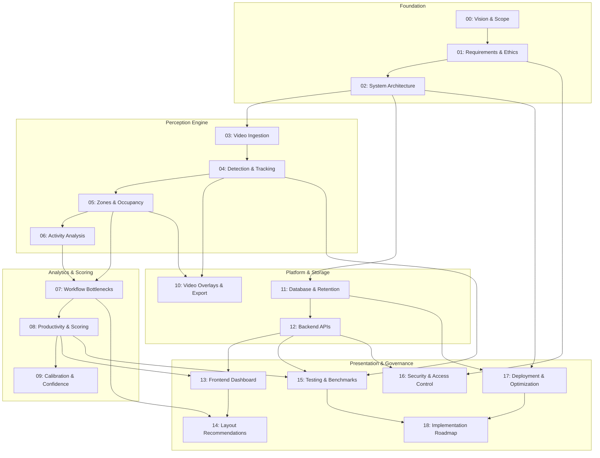

# CCTV Workplace Productivity and Workflow Intelligence System (WBPIS)
## Complete Technical Implementation Specification Suite

---

## 1. Executive Overview

This documentation suite establishes the complete, implementation-ready architectural and engineering specifications for an enterprise-grade **CCTV Workplace Productivity and Workflow Intelligence System (WBPIS)**. 

Grounded in an exhaustive audit of prior prototypes ([`reports/CCTV_PRODUCTIVITY_CODEBASE_AUDIT.md`](file:///C:/Users/DELL/Desktop/cctv/reports/CCTV_PRODUCTIVITY_CODEBASE_AUDIT.md)), this system fundamentally rejects individual employee surveillance, facial recognition, and affective/emotion scoring. Instead, it models the workplace as an integrated physical-operational facility, deploying computer vision to analyze **workflow bottlenecks, shared resource contention, corridor transit churn, and workstation utilization** to provide evidence-based spatial layout improvement recommendations.

> [!IMPORTANT]
> **DOCUMENTATION-ONLY STATUS**: This documentation establishes the complete technical blueprints, mathematical formulas, database schemas, and API contracts. It does not implement application code, train models, or alter production runtime environments.

---

## 2. Master Specification Index

The specification suite comprises 19 modular, cross-referenced technical documents organized in `docs/implementation/`:

| File | Document Title | Scope & Technical Focus | Primary Evidence Profile |
| :---: | :--- | :--- | :--- |
| **00** | [`00_PROJECT_VISION_AND_SCOPE.md`](file:///C:/Users/DELL/Desktop/cctv/docs/implementation/00_PROJECT_VISION_AND_SCOPE.md) | Strategic charter, stakeholder personas, 4 core objectives, functional/NFR requirements, anti-surveillance covenant, failure modes. | `PROPOSED` |
| **01** | [`01_REQUIREMENTS_AND_ETHICS.md`](file:///C:/Users/DELL/Desktop/cctv/docs/implementation/01_REQUIREMENTS_AND_ETHICS.md) | GDPR (Articles 5, 6, 9, 35) & CCPA alignment, zero-biometrics guarantee, STRIDE threat model, 72h encrypted video shredding. | `PROPOSED` |
| **02** | [`02_SYSTEM_ARCHITECTURE.md`](file:///C:/Users/DELL/Desktop/cctv/docs/implementation/02_SYSTEM_ARCHITECTURE.md) | End-to-end pipeline stages, C4 container diagram, multiprocessing concurrency model, hardware tiers, legacy migration path. | `PROPOSED` |
| **03** | [`03_VIDEO_INGESTION_AND_PREPROCESSING.md`](file:///C:/Users/DELL/Desktop/cctv/docs/implementation/03_VIDEO_INGESTION_AND_PREPROCESSING.md) | RTSP over TCP, GStreamer/NVDEC hardware decoding, mailbox frame buffer ($N=2$), video clock vs. wall clock synchronization. | `PROPOSED` |
| **04** | [`04_PERSON_DETECTION_TRACKING_AND_IDS.md`](file:///C:/Users/DELL/Desktop/cctv/docs/implementation/04_PERSON_DETECTION_TRACKING_AND_IDS.md) | YOLOv8 person detection, ByteTrack MOT, ground-plane footprint calculation, ephemeral rotating track handles, Metrics A1–A4. | `PROPOSED` |
| **05** | [`05_WORKSTATION_ZONES_AND_OCCUPANCY.md`](file:///C:/Users/DELL/Desktop/cctv/docs/implementation/05_WORKSTATION_ZONES_AND_OCCUPANCY.md) | Normalized polygon ROI geometry, ray-casting point-in-polygon engine, transitory absence debounce state machine, Metrics B1–B6. | `PROPOSED` / `EXISTING_VERIFIED` |
| **06** | [`06_ACTIVITY_CLASSIFICATION_AND_TIME_DISTRIBUTION.md`](file:///C:/Users/DELL/Desktop/cctv/docs/implementation/06_ACTIVITY_CLASSIFICATION_AND_TIME_DISTRIBUTION.md) | 7 observable physical postures (`ACT-01` to `ACT-07`), 2D skeleton extraction, 75-frame rolling modal filter, Metrics C1–C7. | `PROPOSED` |
| **07** | [`07_WORKFLOW_BOTTLENECK_METRICS.md`](file:///C:/Users/DELL/Desktop/cctv/docs/implementation/07_WORKFLOW_BOTTLENECK_METRICS.md) | Operational bottlenecks, queue dwell times, corridor congestion, repeated trips, shared resource starvation, Metrics D1–D7. | `PROPOSED` |
| **08** | [`08_PRODUCTIVITY_METRICS_AND_SCORING.md`](file:///C:/Users/DELL/Desktop/cctv/docs/implementation/08_PRODUCTIVITY_METRICS_AND_SCORING.md) | External outcome integration (Metrics E1–E6), 4 decoupled scorecards (A, B, C, D), strict composite score prohibition policy. | `REQUIRES_EXTERNAL_DATA` / `PROPOSED` |
| **09** | [`09_SCORE_CALIBRATION_AND_CONFIDENCE.md`](file:///C:/Users/DELL/Desktop/cctv/docs/implementation/09_SCORE_CALIBRATION_AND_CONFIDENCE.md) | 14-point calibration specification, P5/P95 percentile normalization, 6-tier confidence separation, minimum-coverage policy, PSI drift. | `PROPOSED` |
| **10** | [`10_ANNOTATED_VIDEO_AND_EXPORT.md`](file:///C:/Users/DELL/Desktop/cctv/docs/implementation/10_ANNOTATED_VIDEO_AND_EXPORT.md) | 15-point video pipeline, dynamic LOD overlays, anti-crowding heuristics, NVENC H.264 export, mandatory audio stripping. | `PROPOSED` |
| **11** | [`11_DATABASE_AND_DATA_RETENTION.md`](file:///C:/Users/DELL/Desktop/cctv/docs/implementation/11_DATABASE_AND_DATA_RETENTION.md) | PostgreSQL 16 + TimescaleDB DDL, telemetry hypertables, 7-day compression, 14-day chunk drops, Alembic migration framework. | `PROPOSED` |
| **12** | [`12_BACKEND_APIS_AND_INTEGRATION.md`](file:///C:/Users/DELL/Desktop/cctv/docs/implementation/12_BACKEND_APIS_AND_INTEGRATION.md) | FastAPI REST endpoints, WebSocket live telemetry (`/ws/live-telemetry`), enterprise webhooks, RFC 7807 error formats. | `PROPOSED` |
| **13** | [`13_FRONTEND_DASHBOARD_AND_VISUALIZATIONS.md`](file:///C:/Users/DELL/Desktop/cctv/docs/implementation/13_FRONTEND_DASHBOARD_AND_VISUALIZATIONS.md) | Streamlit + Apache ECharts UI architecture, 10 mandatory operational views, interactive HTML5 Canvas zone editor, anti-ranking policy. | `PROPOSED` / `EXISTING_VERIFIED` |
| **14** | [`14_REPORTS_AND_WORKPLACE_RECOMMENDATIONS.md`](file:///C:/Users/DELL/Desktop/cctv/docs/implementation/14_REPORTS_AND_WORKPLACE_RECOMMENDATIONS.md) | Deterministic layout rules (`REC-01` to `REC-04`), mandatory 7-point hypothesis schema, before-and-after A/B layout testing framework. | `PROPOSED` |
| **15** | [`15_TESTING_AND_VALIDATION.md`](file:///C:/Users/DELL/Desktop/cctv/docs/implementation/15_TESTING_AND_VALIDATION.md) | 4-tier testing pyramid, legacy bug regression suites (`BUG-01` to `BUG-03`, `SEC-01`, `ANL-01`), WBPIS-BENCH-V1 40h benchmark dataset. | `PROPOSED` |
| **16** | [`16_SECURITY_PRIVACY_AND_ACCESS_CONTROL.md`](file:///C:/Users/DELL/Desktop/cctv/docs/implementation/16_SECURITY_PRIVACY_AND_ACCESS_CONTROL.md) | Granular 4-role RBAC matrix, STRIDE mitigations, credential vault isolation, dual-control DPO sign-off, immutable audit logs. | `PROPOSED` |
| **17** | [`17_DEPLOYMENT_AND_PERFORMANCE_OPTIMIZATION.md`](file:///C:/Users/DELL/Desktop/cctv/docs/implementation/17_DEPLOYMENT_AND_PERFORMANCE_OPTIMIZATION.md) | Multi-container Docker Compose stack, TensorRT/OpenVINO INT8 quantization, NVMe storage budgets, container auto-recovery. | `PROPOSED` |
| **18** | [`18_IMPLEMENTATION_ROADMAP.md`](file:///C:/Users/DELL/Desktop/cctv/docs/implementation/18_IMPLEMENTATION_ROADMAP.md) | 12 dependency-aware implementation phases (Phase 0 to 11), prioritized backlog (P0–P3), sprint estimates, exit gate criteria. | `PROPOSED` |

---

## 3. Document Dependency Graph

---

## 4. Reading Paths by Engineering & Stakeholder Role

### 4.1 Executive Leadership & Compliance Officers
*Focus: Strategic objectives, statutory privacy compliance, and labor council alignment.*
1. [`00_PROJECT_VISION_AND_SCOPE.md`](file:///C:/Users/DELL/Desktop/cctv/docs/implementation/00_PROJECT_VISION_AND_SCOPE.md): System charter, personas, and anti-surveillance covenant.
2. [`01_REQUIREMENTS_AND_ETHICS.md`](file:///C:/Users/DELL/Desktop/cctv/docs/implementation/01_REQUIREMENTS_AND_ETHICS.md): GDPR/CCPA alignment and 72h data retention limits.
3. [`08_PRODUCTIVITY_METRICS_AND_SCORING.md`](file:///C:/Users/DELL/Desktop/cctv/docs/implementation/08_PRODUCTIVITY_METRICS_AND_SCORING.md): Four scorecards and composite score prohibition.
4. [`16_SECURITY_PRIVACY_AND_ACCESS_CONTROL.md`](file:///C:/Users/DELL/Desktop/cctv/docs/implementation/16_SECURITY_PRIVACY_AND_ACCESS_CONTROL.md): RBAC matrix and dual-control video export authorization.

### 4.2 Computer Vision & Machine Learning Engineers
*Focus: Video ingestion, neural network inference, multi-object tracking, and pose extraction.*
1. [`03_VIDEO_INGESTION_AND_PREPROCESSING.md`](file:///C:/Users/DELL/Desktop/cctv/docs/implementation/03_VIDEO_INGESTION_AND_PREPROCESSING.md): RTSP TCP pipelines and mailbox queue management.
2. [`04_PERSON_DETECTION_TRACKING_AND_IDS.md`](file:///C:/Users/DELL/Desktop/cctv/docs/implementation/04_PERSON_DETECTION_TRACKING_AND_IDS.md): YOLOv8 + ByteTrack MOT and footprint projection.
3. [`05_WORKSTATION_ZONES_AND_OCCUPANCY.md`](file:///C:/Users/DELL/Desktop/cctv/docs/implementation/05_WORKSTATION_ZONES_AND_OCCUPANCY.md): Ray-casting PIP and debounce state machines.
4. [`06_ACTIVITY_CLASSIFICATION_AND_TIME_DISTRIBUTION.md`](file:///C:/Users/DELL/Desktop/cctv/docs/implementation/06_ACTIVITY_CLASSIFICATION_AND_TIME_DISTRIBUTION.md): 2D pose keypoint extraction and temporal modal filter.
5. [`15_TESTING_AND_VALIDATION.md`](file:///C:/Users/DELL/Desktop/cctv/docs/implementation/15_TESTING_AND_VALIDATION.md): WBPIS-BENCH-V1 ground-truth evaluation protocols.
6. [`17_DEPLOYMENT_AND_PERFORMANCE_OPTIMIZATION.md`](file:///C:/Users/DELL/Desktop/cctv/docs/implementation/17_DEPLOYMENT_AND_PERFORMANCE_OPTIMIZATION.md): TensorRT INT8 calibration and hardware acceleration.

### 4.3 Backend & Distributed Systems Engineers
*Focus: High-throughput time-series persistence, asynchronous APIs, WebSockets, and job queues.*
1. [`02_SYSTEM_ARCHITECTURE.md`](file:///C:/Users/DELL/Desktop/cctv/docs/implementation/02_SYSTEM_ARCHITECTURE.md): Multi-process container concurrency model.
2. [`11_DATABASE_AND_DATA_RETENTION.md`](file:///C:/Users/DELL/Desktop/cctv/docs/implementation/11_DATABASE_AND_DATA_RETENTION.md): TimescaleDB hypertables, indexing, and retention chunk policies.
3. [`12_BACKEND_APIS_AND_INTEGRATION.md`](file:///C:/Users/DELL/Desktop/cctv/docs/implementation/12_BACKEND_APIS_AND_INTEGRATION.md): FastAPI endpoints, WebSockets, and Pydantic contracts.
4. [`10_ANNOTATED_VIDEO_AND_EXPORT.md`](file:///C:/Users/DELL/Desktop/cctv/docs/implementation/10_ANNOTATED_VIDEO_AND_EXPORT.md): Asynchronous Celery export workers and NVENC pipelines.

### 4.4 Frontend & UI/UX Engineers
*Focus: Analytical dashboard views, real-time visualization, and interactive zone drawing.*
1. [`13_FRONTEND_DASHBOARD_AND_VISUALIZATIONS.md`](file:///C:/Users/DELL/Desktop/cctv/docs/implementation/13_FRONTEND_DASHBOARD_AND_VISUALIZATIONS.md): Streamlit + Apache ECharts, 10 views, and canvas polygon editor.
2. [`14_REPORTS_AND_WORKPLACE_RECOMMENDATIONS.md`](file:///C:/Users/DELL/Desktop/cctv/docs/implementation/14_REPORTS_AND_WORKPLACE_RECOMMENDATIONS.md): 7-field recommendation cards and A/B testing views.

---

## 5. Canonical Terminology Glossary

| Term | Full Meaning / Definition | Context in WBPIS |
| :--- | :--- | :--- |
| **WBPIS** | Workplace Behaviour and Productivity Improvement System | The official enterprise system name. |
| **Ground Footprint** | Bottom-Center coordinate of bounding box $(x_f, y_f = y_2)$ | The single coordinate tested against polygon zones, eliminating torso overlap false positives. |
| **Mailbox Buffer** | Single-slot overwrite frame queue (Size = 2) | Ingestion queue that drops older unread frames during GPU load spikes, guaranteeing sub-second latency. |
| **WOR** | Workstation Occupancy Rate (`MET-B1`) | Ratio of occupied time to total monitored operational time. |
| **QDT** | Queue Dwell Time / Waiting-Time Ratio (`MET-D2`) | Ratio of time spent standing stationary in shared resource buffer zones. |
| **CTC** | Corridor Transit Churn (`MET-D3`) | Frequency of zone boundary crossings per monitored hour. |
| **SRU** | Shared-Resource Utilization (`MET-D6`) | Proportion of time shared physical assets (printers, kiosks) are occupied. |
| **P5 / P95** | 5th and 95th Percentile Baselines | Statistical bounds used for robust metric normalization, clipping extreme outliers. |
| **WBPIS-BENCH-V1** | Standardized Ground-Truth Dataset | 40-hour hand-annotated benchmark video suite used for perception evaluation. |
| **Ephemeral Track ID** | Pseudonymous handle (e.g., `TRK-0841`) | Transient computational identifier rotated daily; never linked to employee HR records. |
| **Anti-Surveillance Covenant** | Hardcoded technical policy restrictions | Absolute architectural ban on facial recognition, emotion analysis, and individual ranking. |

---

## 6. Metric Status Key

Every metric across the specifications is assigned exactly one authoritative status:

- **`EXISTING_VERIFIED`**: Verified in existing codebase source files and functional at runtime.
- **`EXISTING_UNVERIFIED`**: Present in source files but unvalidated, defective, or failing runtime tests.
- **`PROPOSED`**: Fully specified mathematically and architecturally; scheduled for implementation.
- **`REQUIRES_EXTERNAL_DATA`**: Requires authenticated data from enterprise business software (Jira, SAP, HR); returns `N/A` if unconfigured.
- **`UNAVAILABLE`**: Not implementable with available sensors, or explicitly prohibited by privacy policies.

---

## 7. Recommended Implementation Entry Point

Per the phased implementation schedule in [`18_IMPLEMENTATION_ROADMAP.md`](file:///C:/Users/DELL/Desktop/cctv/docs/implementation/18_IMPLEMENTATION_ROADMAP.md), development commences with **Phase 0: Environment Scaffolding and Security Remediations**:
1. Implement the `sanitize_rtsp_url()` filter to permanently eliminate camera password leakage (`SEC-01`).
2. Initialize containerized services via `docker compose up -d` (TimescaleDB 16 + Redis).
3. Establish Git pre-commit linters and automated regression test harnesses.
