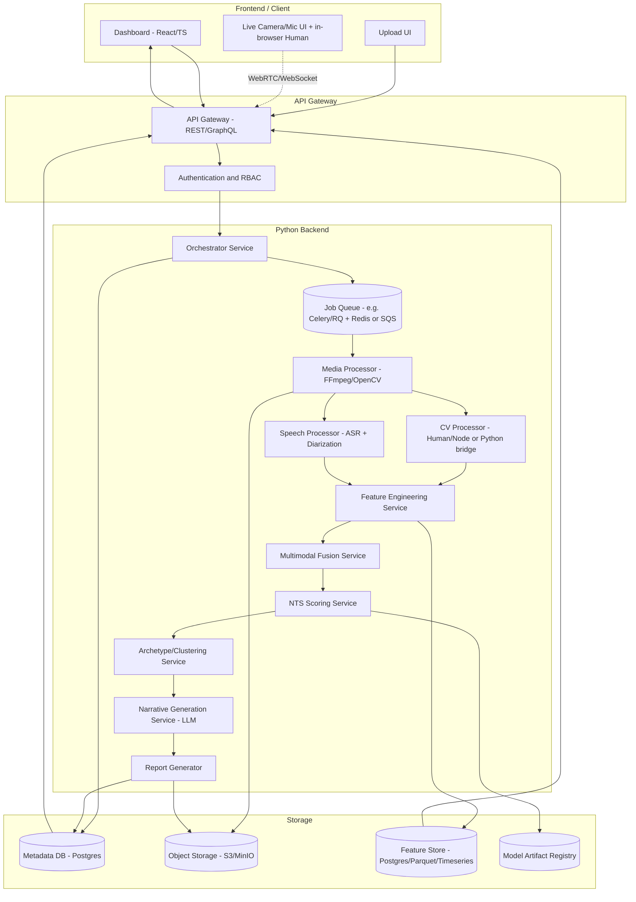
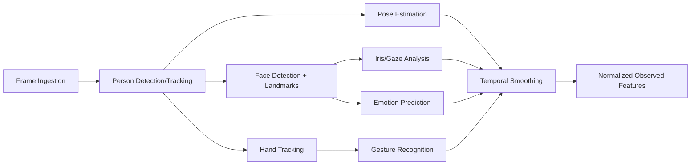
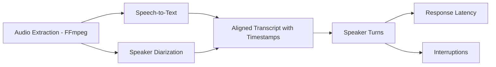
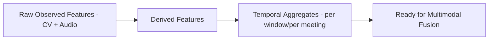
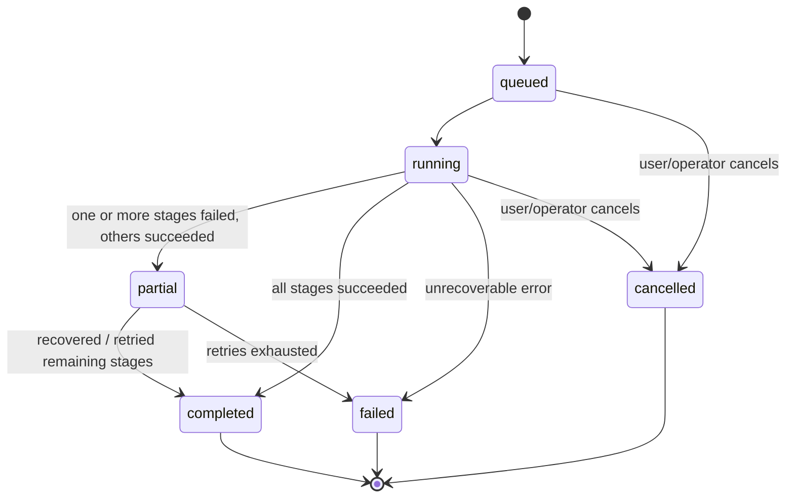
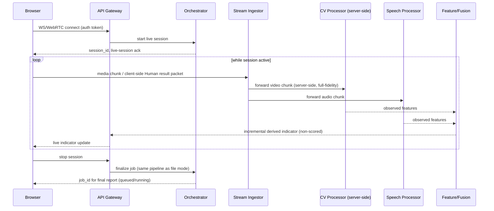
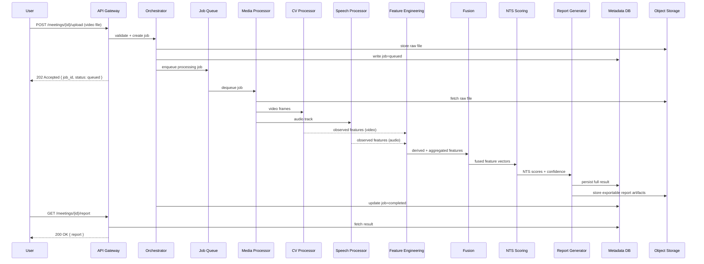
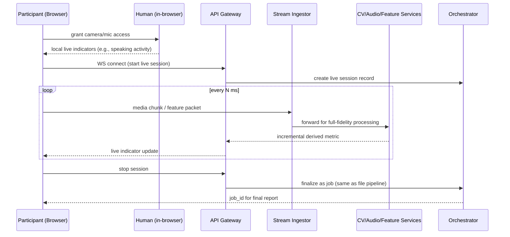
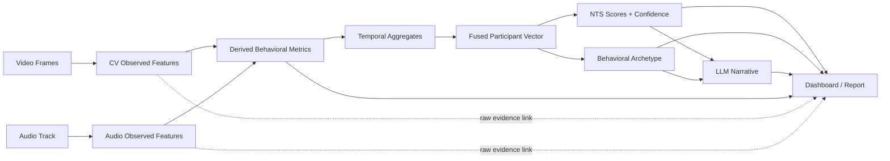
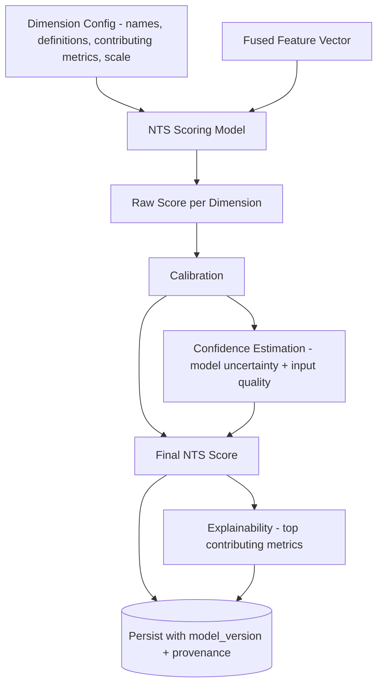

# 02 — Technical Architecture

**Project:** Video Motion Analysis for Non-Technical Skills (NTS) Reports
**Governs:** all implementation work; must be read alongside `00_MASTER_INSTRUCTIONS.md` and `01_PRD.md`.

---

## 1. Architecture Overview

The system is a modular, service-oriented architecture split into five planes:

1. **Ingestion plane** — accepts video/audio from three sources (uploaded file, live browser camera/mic, future meeting bot) and normalizes them into one internal stream representation.
2. **Processing plane** — asynchronous workers that run CV (via the Human library), audio (ASR/diarization), feature aggregation, multimodal fusion, NTS scoring, archetyping, and narrative generation.
3. **Storage plane** — separates metadata (relational DB), object storage (media/artifacts), and feature storage (time-series/structured feature store).
4. **API/orchestration plane** — a typed API gateway, an orchestrator that manages job lifecycles, and a job queue that decouples ingestion from processing.
5. **Presentation plane** — a frontend dashboard consuming the API, plus in-browser Human inference for live mode.

Core tenets carried over from the Master Instructions: Human is a **feature extractor only**; heavy processing is **always asynchronous**; raw video is **not retained by default**; every result carries **timestamps and provenance**; ingestion/extraction/scoring/reporting are **independently deployable and testable**.

---

## 2. High-Level Architecture Diagram

---

## 3. Input Architecture

### 3.1 File Mode

1. Client uploads a file (MP4/AVI/etc.) to the API Gateway via a pre-signed URL or multipart endpoint.
2. Gateway validates content-type/size and hands off to the Orchestrator, which writes metadata to the DB and the raw file to Object Storage.
3. Orchestrator enqueues a processing job; the API returns immediately with a `job_id` and `queued` status — the HTTP request is never held open for processing.
4. Media Processor pulls the file, extracts/normalizes audio and video (FFmpeg), and produces frame/segment streams for CV and Speech processors.

### 3.2 Live Camera Mode

1. Browser requests camera/mic permission; on grant, the frontend can run Human **client-side** (WebGL/WebGPU/WASM backend) for immediate, low-latency visual feedback (e.g., a live "you are speaking" or "camera engagement" indicator — never a live "score").
2. In parallel, the browser streams raw or lightly-processed media (or client-computed feature packets, depending on bandwidth/privacy configuration) to the backend over WebSocket/WebRTC.
3. Backend treats the incoming stream as a sequence of the same internal event representation used by file mode, so CV/Speech/Feature/Fusion/Scoring stages are unchanged.
4. On session stop, the orchestrator finalizes the job as it would a completed file upload, running full-fidelity backend processing over the buffered/streamed data to produce the final report.

### 3.3 Meeting Stream Mode (Future)

Adapted from the `realtime-meeting-intelligence` pattern:

1. A meeting bot (platform-specific: Teams bot via Graph/Psi-style media subscription, Zoom bot via the Zoom Meeting SDK raw audio/video hooks) joins the call as a participant.
2. The bot captures each participant's raw audio/video stream and forwards it — not the platform SDK's internal formats — into the **same common internal stream representation** as file and live modes, via a stream-processor ingestion endpoint.
3. Everything downstream of ingestion (CV, Speech, Feature, Fusion, Scoring, Archetyping, Narrative, Reporting) requires **no changes** to support this mode; only the bot/ingestion adapter is platform-specific.

> **Design implication:** the internal stream/event schema (participant-tagged audio/video frames with timestamps) is the single contract all three modes must produce. Everything after that contract point in the pipeline is mode-agnostic.

---

## 4. Human Integration

Human ([`vladmandic/human`](https://github.com/vladmandic/human)) is used strictly as a **pretrained CV feature extractor**, never as the NTS scoring model.

- **Browser inference** — Human runs in-browser (via CDN/ESM bundle) against `HTMLVideoElement`/webcam input using WebGL/WebGPU/WASM backends, chosen for live mode where minimizing round-trip latency matters and where client compute can be leveraged.
- **Node inference** — Human also runs server-side (Node.js, 14.x–22.x, via `tfjs-node` with optional CUDA acceleration, or WASM backend where GPU/tfjs binaries are unavailable) for offline/batch processing of uploaded files, invoked from the Media/CV Processor via a small Node microservice or worker that the Python backend calls over an internal RPC/HTTP contract.
- **Video processing** — for uploaded files, frames are extracted (FFmpeg) and fed to Human's Node pipeline frame-by-frame or via its built-in video-processing helpers; results are collected as a structured, timestamped sequence.
- **Webcam processing** — for live mode, Human's built-in webcam helpers manage the `<video>` element and detection loop client-side; results are simultaneously drawn locally (for user feedback) and serialized to send to the backend.
- **Result normalization** — Human's native result object (face, body, hand, gesture, emotion, gaze-adjacent fields) is mapped into this project's own internal `ObservedFeature` schema (participant_id, timestamp, feature_type, value, model_version, confidence) so the rest of the pipeline never depends on Human's internal result shape directly. This normalization layer is the single place that would change if Human's API changes or if an alternative/additional CV library is introduced later.

Human's configurable model selection (e.g., MoveNet Lightning vs. Thunder vs. MultiPose for pose, BlazeFace variants for face, etc.) is exposed through this project's own configuration, not hard-coded, so accuracy/performance tradeoffs can be tuned per deployment (laptop vs. server vs. GPU).

---

## 5. CV Pipeline

- **Frame ingestion** — decoded frames (or webcam frames) at a configurable sampling rate (not necessarily every frame, to bound compute cost).
- **Person detection/tracking** — establishes and maintains per-frame track IDs, mapped to a stable session-scoped `participant_id` (via IOU/embedding-based tracking, not persistent facial recognition).
- **Pose** — body keypoints per tracked person per frame.
- **Face** — face bounding box + landmark mesh per tracked person.
- **Iris/gaze** — derived from face landmarks/iris model; produces a gaze-direction estimate, explicitly labeled as an estimate, not "attention" or "confidence."
- **Emotion** — a probability distribution over emotion categories per frame, never collapsed to a single asserted "true" emotion in storage.
- **Hands/gestures** — hand landmark tracking and discrete recognized gestures (from Human's gesture module).
- **Temporal smoothing** — Human's built-in interpolation/temporal smoothing (or an equivalent added at the normalization layer) reduces frame-to-frame jitter before results are persisted as `ObservedFeature` records.

---

## 6. Audio Pipeline

- **Audio extraction** — FFmpeg extracts/normalizes the audio track (sample rate, channel count) from the source media.
- **Speech-to-text** — a configurable ASR engine (self-hosted or API-based) produces a word/segment-level transcript with timestamps.
- **Speaker diarization** — assigns each audio segment to a speaker label, aligned to the same `participant_id` used by CV where possible (via voice-to-face association where both modalities are available, otherwise kept as a separate audio-only participant reference until reconciled in fusion).
- **Timestamps** — every transcript segment and diarization turn carries start/end timestamps in the same clock domain as CV features, enabling multimodal alignment.
- **Speaker turns** — contiguous same-speaker segments become "turns"; turn boundaries are the basis for downstream metrics.
- **Response latency** — gap between the end of one participant's turn and the start of the next speaker's turn.
- **Interruptions** — detected via overlapping speech segments between two diarized speakers.

---

## 7. Feature Engineering Pipeline

- **Raw → Derived**: deterministic transformations, e.g. `speaking_duration` (raw) → `speaking_time_ratio` (derived, normalized by meeting duration or by total speech time); `gaze_direction` samples (raw) → `gaze_stability` (derived, variance over a window).
- **Derived → Temporal aggregates**: rolled up over configurable windows (e.g., per-minute, per-quartile-of-meeting, whole-meeting) so both fine-grained timelines and meeting-level summaries can be produced from the same underlying computation.
- This layer is **pure computation, no ML** — every derived feature and aggregate is unit-testable given fixed raw inputs, and every computation records a `computation_version` for reproducibility.

---

## 8. Multimodal Fusion

- Fusion takes the per-participant, per-window derived/aggregate features from **both** modalities (video-derived: pose/gaze/emotion/gesture metrics; audio-derived: speaking/turn/latency/interruption metrics) and produces a single **participant-level feature vector** per time window (and one for the whole meeting).
- Fusion is implemented as a well-defined, versioned feature-vector assembly step (not a black-box neural fusion model, at least in the initial architecture) so that every value in the fused vector traces back to a specific derived metric — this keeps the NTS Scoring step explainable.
- Missing-modality handling is explicit: if audio is unavailable, audio-derived fields are marked missing (not imputed silently), and any dependent NTS dimension's confidence is reduced accordingly.

---

## 9. NTS Scoring Architecture

- **Model input** — the fused participant-level feature vector for a given time window/meeting.
- **Model output** — one score per configured NTS dimension, each with a bounded scale (e.g., 0–100), plus a confidence interval or calibrated confidence score.
- **Calibration** — scoring models are calibrated against held-out labeled data (see PRD §13/§17) so that a score of "70" means the same thing across meetings and over model versions within a version family; recalibration is required whenever the underlying feature schema or model changes materially.
- **Confidence** — derived from (a) model-level predictive uncertainty and (b) input-quality signals (e.g., fraction of frames with a detected face, audio quality, session length) — low input quality lowers confidence even if the model itself is "sure."
- **Explainability** — every score is stored with references to the top contributing derived metrics (e.g., via feature-importance or a simple linear/GAM-style scoring model chosen partly for interpretability), so the dashboard can show "this leadership score of 78 was most influenced by: turn-taking initiation, speaking-time ratio, gaze stability."

Dimension configuration (name, definition, contributing metric set, scale) lives in a config/data table, not in scoring code, per Master Instructions §6.

---

## 10. Archetype System

- A clustering model (e.g., k-means, GMM, or hierarchical clustering — chosen empirically) operates on the same fused feature vectors used for NTS scoring, **not** on the NTS scores themselves, to avoid circularity between "score" and "archetype."
- Cluster centroids are given human-readable archetype labels (configurable, reviewed by domain experts) such as "Facilitator," "Quiet Contributor," "Dominant Speaker" — labels are descriptive shorthand for a feature-space region, not a diagnostic or personality-typing claim, and this caveat is surfaced in the UI wherever an archetype is shown.
- Each participant's archetype output includes the assigned label and a distance-to-centroid value, so users can see how strongly/loosely a participant fits the labeled cluster.

---

## 11. Narrative Generation

- The Narrative Generation service (LLM-based) receives **only** the structured JSON output of Scoring + Archetyping + selected derived metrics — never raw video, raw audio, or raw frame-level CV output.
- The system prompt constrains the LLM to (a) describe only values present in the structured input, (b) use hedged, evidence-linked language ("demonstrated relatively high participation, based on a 34% speaking-time share"), and (c) never assert a causal trait claim not licensed by Master Instructions §5.
- Generated narrative text is associated with the exact `result_version` (which score/metric snapshot it was generated from) so it can be regenerated or audited later, and a lightweight automated check (e.g., number/entity consistency check against the source JSON) runs before the narrative is marked final.

---

## 12. Storage Architecture

| Store | Contents | Technology (indicative) |
|---|---|---|
| **Metadata DB** | Users, orgs, meetings, participants, job status, dimension config, audit log | PostgreSQL |
| **Object Storage** | Raw media (if retained), processed artifacts (e.g., extracted audio), exported reports | S3-compatible (S3/MinIO) |
| **Feature Store** | Observed features, derived metrics, aggregates (potentially high-volume, time-indexed) | PostgreSQL (partitioned) or a columnar/time-series store (e.g., Parquet on object storage + query engine) |
| **Model Artifact Registry** | Versioned CV/audio/scoring/clustering model weights and configs | Model registry (e.g., MLflow) backed by object storage |

Metadata, object storage, and feature storage are logically and physically separable, so retention policy (e.g., delete raw video after N days) can be enforced on Object Storage without touching the Feature Store or Metadata DB.

---

## 13. Async Processing

Jobs move through an explicit, persisted state machine:

- **queued** — job accepted, not yet started; safe to cancel.
- **running** — one or more pipeline stages actively processing.
- **partial** — some stages (e.g., CV) completed while another (e.g., Speech) failed; the system surfaces whatever results are available rather than discarding everything.
- **completed** — all required stages finished; report is available.
- **failed** — unrecoverable failure after configured retries; failure reason is recorded and surfaced.
- **cancelled** — explicitly stopped by a user or operator; resources are released.

All jobs are **idempotent**: re-running a job with the same input and config version produces the same stored result (or a no-op if already completed), which is required both for retries and for reproducibility (Master Instructions §14).

---

## 14. Real-Time Architecture

Live indicators pushed to the browser during the session are **derived-metric-level only** (e.g., "your current speaking-time share this session") — NTS scores and narratives are computed only after the session ends, from the full session data, through the same pipeline as file mode.

---

## 15. Security Architecture

- **JWT** — short-lived access tokens + refresh tokens issued at login/SSO; every API and WebSocket connection is authenticated.
- **RBAC** — roles (admin, manager, researcher, participant) gate access to endpoints and data scopes (e.g., a manager can see their team's reports, not the whole org's; a researcher can see de-identified feature data, not identity-linked reports).
- **CORS** — API Gateway restricts allowed origins to known frontend deployments.
- **Rate limits** — per-user/per-org rate limiting on upload and API endpoints to prevent abuse and control processing cost.
- **File validation** — strict content-type, size, and (where feasible) codec/container validation before a file is queued for processing, to reduce attack surface from malformed media.
- **Secret management** — API keys, DB credentials, and model-provider keys live in a secrets manager (e.g., environment-injected via a vault/secret store), never bundled into frontend code or client-visible config (Master Instructions §15).

---

## 16. Observability

- **Logs** — structured (JSON) logs per service, correlated by `job_id`/`meeting_id`/`request_id`.
- **Metrics** — per-stage throughput, latency, error rate, queue depth; model-specific metrics (e.g., faces-detected-per-frame rate, ASR word error indicators where ground truth is available).
- **Traces** — distributed tracing across Gateway → Orchestrator → Queue → each processing stage, so a slow or failed job can be diagnosed end-to-end.
- **Job monitoring** — a dedicated operator view of queue depth, in-flight jobs, and failure rates, with alerting thresholds.
- **Model latency** — separately tracked per model (CV, ASR, diarization, scoring, LLM) since these have very different latency/cost profiles and different scaling needs.

---

## 17. Failure Modes

| Failure | Handling |
|---|---|
| **Video corrupted** | Fails validation at ingestion; job marked `failed` with a specific reason before any processing resources are consumed. |
| **Audio missing** | CV pipeline proceeds; audio-dependent metrics/dimensions are marked missing/low-confidence; job can still reach `completed` (partial modality) rather than `failed`. |
| **Face not detected** | Per-frame/per-window feature confidence is reduced; if no face is detected for an entire participant track, that participant's face/gaze/emotion features are omitted (not fabricated), and the report notes reduced coverage. |
| **Multiple people detected (unexpected)** | Person-tracking assigns distinct participant IDs; if participant count exceeds an expected/configured bound, the job proceeds but flags an anomaly for review rather than silently merging tracks. |
| **GPU unavailable** | CV/ASR workers fall back to CPU/WASM backends automatically where supported (Human supports WASM/CPU fallback); processing time increases but does not fail outright, within configured timeout bounds. |
| **Model unavailable** (e.g., a specific CV sub-model fails to load) | The stage runs with the reduced model set available, records which models actually ran (provenance), and reduces confidence for affected features rather than failing the whole job. |
| **LLM unavailable** | Narrative generation stage is marked `partial`/skipped; structured scores/metrics/report are still delivered without narrative text, with a clear "narrative unavailable" state rather than blocking the rest of the report. |
| **Job interrupted** (worker crash, restart) | Job state and last-completed-stage checkpoint are persisted; on restart, the orchestrator resumes from the last successful stage (idempotent design) rather than restarting from scratch. |

---

## 18. Scalability

- **One laptop** — all services (API, single worker, Postgres, object storage emulated via local disk/MinIO) run via Docker Compose for local development; CV runs on CPU/WASM backend; suitable for short test videos.
- **Single server** — same services deployed on one machine with a GPU, Docker Compose or a single-node orchestrator; a real job queue (Redis-backed) replaces any local/in-process queue; suitable for small-team pilot deployments.
- **Distributed workers** — API/Orchestrator, job queue, and each processing stage (Media, CV, Speech, Feature/Fusion, Scoring, Narrative) become independently scaled worker pools (e.g., Kubernetes deployments with HPA), so CV workers (GPU-bound) can scale independently from, say, narrative-generation workers (LLM-API-bound); object storage and DB move to managed/cloud services. This mirrors the "local dev → containerized services → Kubernetes on cloud" progression demonstrated in the `realtime-meeting-intelligence` reference repo's own infrastructure layout.

---

## 19. Architecture Decisions

| Decision | Rationale |
|---|---|
| **Human library for CV** | Mature, actively maintained, unified API across body/face/iris/emotion/hand/gesture models; runs in both browser and Node with WebGL/WebGPU/WASM/CPU backend flexibility, which directly supports both the live (browser) and file (server) input modes from one library. |
| **Human as feature extractor, not scorer** | Human has no NTS/leadership/communication output — using it only for its native, validated outputs (pose/face/gaze/emotion/hand) and building NTS scoring separately keeps the project's claims scientifically defensible and keeps Human upgrades from breaking scoring logic. |
| **Python backend** | Best ecosystem fit for ML/data processing (feature engineering, scoring models, dataset work with AMI/ELEA/NoXi/etc.), and matches the "stream-processor" role Python already plays in the reference `realtime-meeting-intelligence` architecture. |
| **JS/TS frontend with optional in-browser Human** | Browser camera/mic access requires a JS/TS frontend regardless; running Human client-side for live mode avoids a round trip for basic visual feedback and reduces backend load for immediate UI responsiveness. |
| **Async job queue for processing** | Video/audio analysis of an hour-long meeting cannot complete within an HTTP request timeout; a queue decouples ingestion latency from processing time and enables horizontal scaling of workers (Master Instructions §7). |
| **Separate metadata DB / object storage / feature store** | Different access patterns (transactional metadata vs. large binary media vs. high-volume timestamped feature rows) and different retention rules (media deletable, features retained) are cleanly enforceable only if they are physically separate stores. |
| **Meeting-bot pattern adapted, not repo merged, from `realtime-meeting-intelligence`** | That repo's bots are platform-specific, polyglot (.NET/C++) and infrastructure-heavy (Windows nodes, Kubernetes); the *pattern* (bot captures raw media → forwards to a Python stream processor) is valuable, but wholesale adoption would import unnecessary platform/language complexity before Zoom/Teams support is actually prioritized (Master Instructions §9). |
| **Explainable/linear-leaning NTS scoring model** | Prioritizing interpretability over marginal accuracy gains supports the explainability and human-review requirements (PRD §14, §17) and avoids the "black box behavioral score" risk called out in the Problem Statement. |
| **LLM narrative constrained to structured input only** | Prevents hallucinated observations and keeps the narrative auditable against the exact data that produced it (Master Instructions §7). |

---

## 20. Additional Mermaid Diagrams

### 20.1 File-Processing Sequence

### 20.2 Live-Analysis Sequence

### 20.3 Data Flow (Observed → Derived → Scores → Narrative)

### 20.4 NTS Scoring Flow

---

## 21. Cross-References

- Business requirements and non-goals: `01_PRD.md`
- Project-wide constraints and prohibitions: `00_MASTER_INSTRUCTIONS.md`
- Upcoming (not yet authored, per reading order in Master Instructions §17): Database Schema, API/Auth, Implementation Plan, Dataset/Features, File Structure
