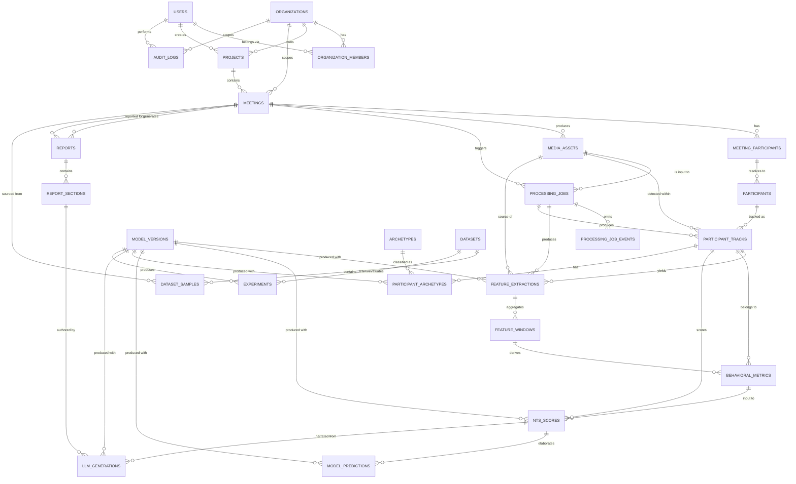

# 03 — Database Schema
## Non-verbal Trust Score (NTS) Analysis Platform

**Database engine:** PostgreSQL 15+
**Extensions used:** `uuid-ossp` (or `pgcrypto` for `gen_random_uuid()`), `citext` (case-insensitive email), `btree_gin` (composite indexes on JSONB + scalar)

This schema is informed by two source systems:

- **[vladmandic/human](https://github.com/vladmandic/human)** — a client/server TensorFlow.js library that produces per-frame `Result` objects containing `face`, `body`, `hand`, `gesture`, `emotion`, and `gaze` arrays. Human never persists anything itself — every field in `feature_extractions` / `feature_windows` below is designed to hold a **summarized, timestamped projection** of what a `Result` object would contain over a video, not the raw tensors or frames themselves.
- **[Umer-2612/realtime-meeting-intelligence](https://github.com/Umer-2612/realtime-meeting-intelligence)** — a multi-bot (Zoom SDK / Teams Graph+Psi) architecture where platform-specific bots fan out raw audio/video to a Python stream processor. This tells us `media_assets` and `processing_jobs` must be platform-agnostic: a "meeting" may originate from an uploaded file today and a live Zoom/Teams bot stream later (see Phase 13–15 in `05_IMPLEMENTATION_PLAN.md`), so no table below assumes a single ingestion path.

---

## 1. Design Principles

1. **Raw media never touches Postgres.** Every media-bearing table stores an object-storage key (`storage_bucket` + `storage_key`), never bytes. Postgres holds metadata, references, and derived numbers only.
2. **No unnecessary biometric identity data.** We do not store face descriptor embeddings, face crops, or any biometrically-identifying vector by default. `participants` links a track to a *display identity* (a name/email a meeting host supplied, or an anonymous label like `Speaker 2`) — not to a durable biometric profile. Any optional face-embedding-based re-identification feature is out of scope for MVP and, if added later, must live in a separate, explicitly-consented table (see §9).
3. **Four distinct derivation layers, never conflated:**
   `media_assets` (raw) → `feature_extractions` / `feature_windows` (per-frame/per-window signal, e.g. pose keypoints, gaze angle) → `behavioral_metrics` (interpretable rollups, e.g. "gaze aversion ratio", "gesture rate") → `nts_scores` (the model's scalar/composite trust prediction, versioned) → `llm_generations` / `reports` (narrative text derived from the above, versioned separately since it's a different model class).
4. **Everything versioned.** `model_versions` is the single source of truth for "which pipeline/model produced this row". `feature_extractions`, `model_predictions`, `nts_scores`, and `llm_generations` all carry a foreign key into it (or into `processing_jobs`, which itself references it) — never a bare string like `"v2"`.
5. **Multi-tenant from day one.** Every business table carries (directly or via its parent) an `organization_id`. No cross-tenant joins are possible without explicitly ignoring the tenant filter — see §11.
6. **No table invented without a job to do.** Every table maps to a concrete need in the required-entity list; none are speculative.

---

## 2. Entity-Relationship Diagram



---

## 3. Table-by-Table Specification

Conventions used below unless a table overrides them:

- Primary key: `id UUID PRIMARY KEY DEFAULT gen_random_uuid()`
- `created_at TIMESTAMPTZ NOT NULL DEFAULT now()`
- `updated_at TIMESTAMPTZ NOT NULL DEFAULT now()` maintained by a shared `set_updated_at()` trigger
- Soft-delete via nullable `deleted_at TIMESTAMPTZ` on tables that hold user-supplied or PII-adjacent data (needed for the privacy deletion strategy in §10), hard-delete elsewhere
- Tenant scoping column named `organization_id` propagated down every branch of the graph

### 3.1 `users`
**Purpose:** Login identity, independent of any one organization (a person can belong to multiple orgs).

| Column | Type | Null | Notes |
|---|---|---|---|
| id | UUID PK | no | |
| email | CITEXT | no | unique |
| password_hash | TEXT | no | bcrypt/argon2 hash, never plaintext |
| full_name | TEXT | no | |
| status | TEXT | no | `active`, `invited`, `suspended`, `deleted` |
| email_verified_at | TIMESTAMPTZ | yes | null until verified |
| last_login_at | TIMESTAMPTZ | yes | |
| created_at / updated_at | TIMESTAMPTZ | no | |
| deleted_at | TIMESTAMPTZ | yes | soft delete (GDPR/anonymize) |

**Unique:** `email`
**Indexes:** `idx_users_email` (unique, already covered), `idx_users_status`
**Why it exists:** separates authentication identity from tenant membership so SSO / multi-org users are representable without duplicating rows.

### 3.2 `organizations`
**Purpose:** The billing/tenant boundary. Every project, meeting, and downstream row is reachable from exactly one organization.

| Column | Type | Null | Notes |
|---|---|---|---|
| id | UUID PK | no | |
| name | TEXT | no | |
| slug | CITEXT | no | unique, used in URLs |
| plan_tier | TEXT | no | `free`, `pro`, `enterprise` |
| settings | JSONB | no | default `'{}'`, feature flags, retention overrides |
| created_at / updated_at | TIMESTAMPTZ | no | |
| deleted_at | TIMESTAMPTZ | yes | |

**Unique:** `slug`
**Indexes:** `idx_organizations_slug`

### 3.3 `organization_members`
**Purpose:** Many-to-many join of `users` ↔ `organizations`, carrying the RBAC role (roles defined in `04_API_AUTH.md`: ADMIN, MANAGER, ANALYST, RESEARCHER, USER).

| Column | Type | Null | Notes |
|---|---|---|---|
| id | UUID PK | no | |
| organization_id | UUID FK → organizations.id | no | ON DELETE CASCADE |
| user_id | UUID FK → users.id | no | ON DELETE CASCADE |
| role | TEXT | no | `ADMIN`\|`MANAGER`\|`ANALYST`\|`RESEARCHER`\|`USER` |
| invited_by_user_id | UUID FK → users.id | yes | ON DELETE SET NULL |
| joined_at | TIMESTAMPTZ | no | |
| created_at / updated_at | TIMESTAMPTZ | no | |

**Unique:** `(organization_id, user_id)`
**Indexes:** `idx_org_members_user`, `idx_org_members_org_role (organization_id, role)`
**Why it exists:** avoids a `role` column on `users` (which would break multi-org membership) and gives RBAC middleware one predictable join.

### 3.4 `projects`
**Purpose:** A named grouping of meetings (e.g. "Q3 Sales Coaching", "Candidate Interviews — Backend Team"). Scopes permissions and reporting one level below the organization.

| Column | Type | Null | Notes |
|---|---|---|---|
| id | UUID PK | no | |
| organization_id | UUID FK → organizations.id | no | ON DELETE CASCADE |
| name | TEXT | no | |
| description | TEXT | yes | |
| created_by_user_id | UUID FK → users.id | no | ON DELETE RESTRICT |
| status | TEXT | no | `active`, `archived` |
| created_at / updated_at | TIMESTAMPTZ | no | |
| deleted_at | TIMESTAMPTZ | yes | |

**Indexes:** `idx_projects_org (organization_id)`, `idx_projects_org_status (organization_id, status)`
**Unique:** `(organization_id, name)` — prevents duplicate project names inside one org while allowing the same name across orgs.

### 3.5 `meetings`
**Purpose:** One analyzed session — the umbrella row every media asset, job, participant, score, and report ultimately hangs off.

| Column | Type | Null | Notes |
|---|---|---|---|
| id | UUID PK | no | |
| organization_id | UUID FK → organizations.id | no | denormalized for fast tenant filtering; ON DELETE CASCADE |
| project_id | UUID FK → projects.id | no | ON DELETE CASCADE |
| title | TEXT | no | |
| source_type | TEXT | no | `upload`, `live_camera`, `zoom_bot`, `teams_bot` |
| scheduled_at | TIMESTAMPTZ | yes | |
| started_at | TIMESTAMPTZ | yes | actual start, set on ingestion |
| ended_at | TIMESTAMPTZ | yes | |
| duration_seconds | INTEGER | yes | denormalized from media once known |
| status | TEXT | no | `scheduled`, `recording`, `uploaded`, `processing`, `analyzed`, `failed` |
| created_by_user_id | UUID FK → users.id | no | ON DELETE RESTRICT |
| created_at / updated_at | TIMESTAMPTZ | no | |
| deleted_at | TIMESTAMPTZ | yes | |

**Indexes:** `idx_meetings_org_project (organization_id, project_id)`, `idx_meetings_status`, `idx_meetings_started_at`
**Why it exists:** decouples "the event that happened" from "the file(s) that captured it" (a meeting can have multiple media assets — e.g. separate audio/video tracks, or a live session that produced rolling chunk files).

### 3.6 `meeting_participants`
**Purpose:** The roster as declared by the meeting source (invite list, Zoom/Teams participant list) — independent of whether CV/track detection later succeeds in identifying that person on video. This is intentionally separate from `participants` (§3.11) because a roster entry can exist with zero visual detections (no-show, audio-only, camera off).

| Column | Type | Null | Notes |
|---|---|---|---|
| id | UUID PK | no | |
| meeting_id | UUID FK → meetings.id | no | ON DELETE CASCADE |
| display_name | TEXT | no | as reported by source platform or uploader |
| email | CITEXT | yes | optional — only if host supplied it |
| role_in_meeting | TEXT | yes | `host`, `interviewer`, `candidate`, `attendee` (free-form label, not RBAC) |
| external_platform_id | TEXT | yes | Zoom/Teams participant ID from the bot session, if applicable |
| joined_at | TIMESTAMPTZ | yes | |
| left_at | TIMESTAMPTZ | yes | |
| created_at / updated_at | TIMESTAMPTZ | no | |

**Indexes:** `idx_meeting_participants_meeting`
**Unique:** `(meeting_id, external_platform_id)` where `external_platform_id IS NOT NULL` (partial unique index)

### 3.7 `media_assets`
**Purpose:** Metadata for one raw file (video, audio, or a live-stream chunk) — **never the bytes**. The object-storage reference is the payload.

| Column | Type | Null | Notes |
|---|---|---|---|
| id | UUID PK | no | |
| organization_id | UUID FK → organizations.id | no | ON DELETE CASCADE |
| meeting_id | UUID FK → meetings.id | no | ON DELETE CASCADE |
| asset_type | TEXT | no | `video`, `audio`, `screen_share`, `combined` |
| storage_bucket | TEXT | no | e.g. `nts-media-prod` |
| storage_key | TEXT | no | object key / path, e.g. `orgs/{org}/meetings/{id}/raw/cam1.mp4` |
| storage_provider | TEXT | no | `s3`, `gcs`, `azure_blob`, `minio` |
| content_type | TEXT | no | MIME type |
| size_bytes | BIGINT | yes | |
| duration_seconds | NUMERIC(10,3) | yes | |
| checksum_sha256 | TEXT | yes | integrity + upload de-dup |
| resolution | TEXT | yes | e.g. `1920x1080` |
| codec | TEXT | yes | |
| upload_status | TEXT | no | `pending`, `uploaded`, `verified`, `quarantined`, `failed` |
| uploaded_by_user_id | UUID FK → users.id | yes | ON DELETE SET NULL |
| created_at / updated_at | TIMESTAMPTZ | no | |
| deleted_at | TIMESTAMPTZ | yes | supports privacy deletion (§10) without breaking FK history |

**Indexes:** `idx_media_assets_meeting`, `idx_media_assets_org`, `idx_media_assets_upload_status`
**Unique:** `(storage_bucket, storage_key)`
**Why it exists:** isolates "a large binary blob lives somewhere" from every other concern; `checksum_sha256` lets the upload API reject duplicate re-uploads idempotently (see `04_API_AUTH.md` §Idempotency).

### 3.8 `processing_jobs`
**Purpose:** One unit of asynchronous work (CV extraction, STT, feature fusion, NTS scoring, report generation). This is the backbone of the "long-running analysis must not run synchronously" requirement — every `POST /meetings/{id}/analysis` call creates one row here and returns immediately.

| Column | Type | Null | Notes |
|---|---|---|---|
| id | UUID PK | no | |
| organization_id | UUID FK → organizations.id | no | ON DELETE CASCADE |
| meeting_id | UUID FK → meetings.id | no | ON DELETE CASCADE |
| media_asset_id | UUID FK → media_assets.id | yes | ON DELETE SET NULL; null for jobs that operate across assets (e.g. fusion) |
| job_type | TEXT | no | `cv_extraction`, `stt_transcription`, `feature_fusion`, `nts_scoring`, `report_generation` |
| model_version_id | UUID FK → model_versions.id | yes | ON DELETE RESTRICT; the pipeline/model this job will run |
| status | TEXT | no | `queued`, `running`, `succeeded`, `failed`, `cancelled` |
| priority | SMALLINT | no | default 0 |
| queue_name | TEXT | no | e.g. `cv-gpu`, `stt`, `default` |
| attempt_count | SMALLINT | no | default 0 |
| max_attempts | SMALLINT | no | default 3 |
| progress_pct | SMALLINT | yes | 0–100, updated by `processing_job_events` |
| error_message | TEXT | yes | sanitized, user-safe summary only |
| error_detail | JSONB | yes | internal-only stack/context, never returned via API |
| started_at | TIMESTAMPTZ | yes | |
| finished_at | TIMESTAMPTZ | yes | |
| created_at / updated_at | TIMESTAMPTZ | no | |

**Indexes:** `idx_jobs_meeting`, `idx_jobs_status_queue (status, queue_name)`, `idx_jobs_org_status`
**Why it exists:** the single queryable "is my analysis done yet" resource behind both the polling endpoint and the WebSocket channel.

### 3.9 `processing_job_events`
**Purpose:** Append-only timeline of state transitions for a job — what both the polling API and the WebSocket `job.progress` stream replay from.

| Column | Type | Null | Notes |
|---|---|---|---|
| id | UUID PK | no | |
| processing_job_id | UUID FK → processing_jobs.id | no | ON DELETE CASCADE |
| event_type | TEXT | no | `queued`, `started`, `progress`, `succeeded`, `failed`, `retrying`, `cancelled` |
| payload | JSONB | no | default `'{}'`; e.g. `{"pct": 40, "stage": "pose_extraction"}` |
| occurred_at | TIMESTAMPTZ | no | default now() |

**Indexes:** `idx_job_events_job_time (processing_job_id, occurred_at)`
**Why it exists:** separates "current state" (mutable, on `processing_jobs`) from "history of how we got there" (append-only) — needed for debugging, audit, and WebSocket replay-on-reconnect.

### 3.10 `participants` — *(canonical, cross-meeting identity — deliberately minimal)*
**Purpose:** An organization-scoped identity that multiple `meeting_participants` rows can resolve to, so the same person's history is comparable across meetings *if and only if* the org chooses to link them (e.g. same interview candidate across two rounds). This table intentionally carries **no biometric data**.

| Column | Type | Null | Notes |
|---|---|---|---|
| id | UUID PK | no | |
| organization_id | UUID FK → organizations.id | no | ON DELETE CASCADE |
| display_name | TEXT | no | |
| external_reference | TEXT | yes | e.g. an ATS candidate ID or CRM contact ID — opaque string, not PII we interpret |
| created_at / updated_at | TIMESTAMPTZ | no | |
| deleted_at | TIMESTAMPTZ | yes | |

**Indexes:** `idx_participants_org`
**Why it exists:** without this table, "show me this candidate's trend across 3 interviews" would require fuzzy-matching names; with it, linking is an explicit, auditable action (an `audit_logs` entry), not an inferred one.

### 3.11 `participant_tracks`
**Purpose:** One continuous visual/audio track of a single detected person within a single media asset — the direct analog of a Human.js per-person detection persisted over the duration of a video, not a single frame. This is what `feature_extractions` actually belong to.

| Column | Type | Null | Notes |
|---|---|---|---|
| id | UUID PK | no | |
| organization_id | UUID FK → organizations.id | no | ON DELETE CASCADE |
| media_asset_id | UUID FK → media_assets.id | no | ON DELETE CASCADE |
| meeting_participant_id | UUID FK → meeting_participants.id | yes | ON DELETE SET NULL; null until identity resolution runs |
| participant_id | UUID FK → participants.id | yes | ON DELETE SET NULL; canonical cross-meeting link, opt-in |
| processing_job_id | UUID FK → processing_jobs.id | no | ON DELETE RESTRICT; the CV job that produced this track |
| track_label | TEXT | no | e.g. `person_1` — stable within one asset, not globally |
| first_seen_at_ms | INTEGER | no | offset from asset start |
| last_seen_at_ms | INTEGER | no | |
| detection_frame_count | INTEGER | yes | |
| avg_detection_confidence | NUMERIC(5,4) | yes | |
| created_at / updated_at | TIMESTAMPTZ | no | |

**Indexes:** `idx_tracks_media`, `idx_tracks_job`, `idx_tracks_meeting_participant`
**Why it exists:** CV detection happens per-video, before we necessarily know *who* the track is (identity resolution is a separate, later step) — this table is the join point between "an anonymous detected body/face over time" and "a named roster entry", and it's what every downstream feature/metric/score row attaches to instead of duplicating media+person context everywhere.

### 3.12 `feature_extractions`
**Purpose:** One raw signal reading at (or summarizing) a point in time, for one track — the direct persisted form of a Human.js `Result` field (`body.keypoints`, `face.emotion`, `gaze.direction`, etc.) reduced to numeric/JSON form. **This table must reference extraction pipeline version, model version, source media, and processing job — all four, per the requirement.**

| Column | Type | Null | Notes |
|---|---|---|---|
| id | UUID PK | no | |
| organization_id | UUID FK → organizations.id | no | ON DELETE CASCADE |
| participant_track_id | UUID FK → participant_tracks.id | no | ON DELETE CASCADE |
| media_asset_id | UUID FK → media_assets.id | no | ON DELETE CASCADE — *source media, required* |
| processing_job_id | UUID FK → processing_jobs.id | no | ON DELETE RESTRICT — *processing job, required* |
| model_version_id | UUID FK → model_versions.id | no | ON DELETE RESTRICT — *model version, required* |
| extraction_pipeline_version | TEXT | no | e.g. `human-cv@3.0.0+pipeline-config-hash` — *pipeline version, required*, kept as a distinct field from `model_version_id` because the same Human.js model set can run under different pre/post-processing pipeline configs |
| feature_type | TEXT | no | `face_pose`, `body_pose`, `hand_pose`, `gaze`, `emotion`, `gesture`, `voice_prosody`, `speaker_turn` |
| timestamp_ms | INTEGER | no | offset from media start — *feature tables must support timestamps* |
| frame_index | INTEGER | yes | null for audio-derived features |
| confidence | NUMERIC(5,4) | yes | |
| values | JSONB | no | e.g. `{"keypoints":[...], "emotion":{"happy":0.2,...}}` — schema-per-`feature_type`, documented in `docs/feature_schemas/` |
| created_at | TIMESTAMPTZ | no | (no `updated_at` — extractions are immutable facts, corrected only by re-running the job into a new row) |

**Indexes:** `idx_features_track_time (participant_track_id, timestamp_ms)`, `idx_features_job`, `idx_features_type_time (feature_type, timestamp_ms)`, GIN index on `values` (`idx_features_values_gin`) for ad-hoc querying
**Partitioning:** this table is high-volume (potentially 10–30 rows/sec/track); partition by `created_at` (monthly, `RANGE`) — see §7.
**Why it exists:** the atomic, replayable unit of "what the CV/audio model saw" — kept separate from `behavioral_metrics` because a metric is an interpretation (e.g. "gaze aversion") built from possibly hundreds of raw readings, and separate from `nts_scores` because a score is a *model prediction*, not a measurement.

### 3.13 `feature_windows`
**Purpose:** A time-bucketed aggregation of `feature_extractions` (e.g. one 5-second window's mean/variance of gaze angle) — the layer that makes `behavioral_metrics` computation tractable without re-scanning raw per-frame rows every time.

| Column | Type | Null | Notes |
|---|---|---|---|
| id | UUID PK | no | |
| organization_id | UUID FK → organizations.id | no | ON DELETE CASCADE |
| participant_track_id | UUID FK → participant_tracks.id | no | ON DELETE CASCADE |
| feature_type | TEXT | no | matches `feature_extractions.feature_type` |
| window_start_ms | INTEGER | no | |
| window_end_ms | INTEGER | no | |
| aggregation | JSONB | no | e.g. `{"mean":..., "std":..., "min":..., "max":..., "n":42}` |
| source_extraction_count | INTEGER | no | how many raw rows fed this window |
| created_at | TIMESTAMPTZ | no | |

**Indexes:** `idx_windows_track_time (participant_track_id, window_start_ms)`
**Unique:** `(participant_track_id, feature_type, window_start_ms, window_end_ms)`

### 3.14 `behavioral_metrics`
**Purpose:** Named, interpretable behavioral indicators (e.g. `gaze_aversion_ratio`, `gesture_rate_per_min`, `speech_overlap_ratio`, `posture_stability_score`) computed from one or more `feature_windows`. This is the layer a product dashboard chart reads from — **distinct from a raw feature and distinct from the NTS prediction**.

| Column | Type | Null | Notes |
|---|---|---|---|
| id | UUID PK | no | |
| organization_id | UUID FK → organizations.id | no | ON DELETE CASCADE |
| participant_track_id | UUID FK → participant_tracks.id | no | ON DELETE CASCADE |
| metric_key | TEXT | no | e.g. `gaze_aversion_ratio` |
| metric_category | TEXT | no | `visual`, `vocal`, `linguistic`, `temporal` |
| window_start_ms | INTEGER | yes | null = whole-meeting metric |
| window_end_ms | INTEGER | yes | |
| value | NUMERIC(12,6) | no | |
| unit | TEXT | yes | `ratio`, `count`, `per_minute`, `seconds` |
| computed_by_pipeline_version | TEXT | no | so metric definitions can evolve without silently mixing formulas |
| created_at | TIMESTAMPTZ | no | |

**Indexes:** `idx_metrics_track_key (participant_track_id, metric_key)`, `idx_metrics_key_window`
**Why it exists:** required entity, and functionally the contract between the ML feature-engineering layer and both the NTS model input and any human-facing chart — changing how a metric is computed never rewrites `feature_extractions`.

### 3.15 `nts_scores`
**Purpose:** The platform's core output — a versioned Non-verbal Trust Score prediction for one participant track (or a whole meeting, via a nullable track FK convention below). **Must reference the model version used.**

| Column | Type | Null | Notes |
|---|---|---|---|
| id | UUID PK | no | |
| organization_id | UUID FK → organizations.id | no | ON DELETE CASCADE |
| meeting_id | UUID FK → meetings.id | no | ON DELETE CASCADE |
| participant_track_id | UUID FK → participant_tracks.id | yes | ON DELETE CASCADE; null = meeting-level aggregate score |
| model_version_id | UUID FK → model_versions.id | no | ON DELETE RESTRICT — *required* |
| processing_job_id | UUID FK → processing_jobs.id | no | ON DELETE RESTRICT; the scoring job |
| nts_score | NUMERIC(6,3) | no | primary composite score, scale documented per model version (e.g. 0–100) |
| confidence_interval_low | NUMERIC(6,3) | yes | |
| confidence_interval_high | NUMERIC(6,3) | yes | |
| component_scores | JSONB | no | e.g. `{"consistency":72.1,"engagement":65.4,"composure":80.0}` |
| input_metric_ids | UUID[] | yes | snapshot of which `behavioral_metrics.id`s fed this score, for explainability |
| computed_at | TIMESTAMPTZ | no | |
| created_at | TIMESTAMPTZ | no | |

**Indexes:** `idx_nts_meeting`, `idx_nts_track`, `idx_nts_model_version`
**Why it exists:** kept separate from `behavioral_metrics` because it is a *model output*, not a measurement — it must be reproducible against a specific `model_version_id`, and re-running the same metrics through a newer model version produces a *new* row, never an overwrite.

### 3.16 `model_versions`
**Purpose:** Single registry of every model/pipeline artifact used anywhere in the system (CV pipeline builds, NTS scoring models, LLM narrative models) — the versioning backbone every other table's FK points into.

| Column | Type | Null | Notes |
|---|---|---|---|
| id | UUID PK | no | |
| model_family | TEXT | no | `cv_extraction`, `nts_scoring`, `llm_narrative`, `archetype_classifier` |
| name | TEXT | no | e.g. `human-cv`, `nts-gbm`, `nts-narrative-llm` |
| version | TEXT | no | semver or hash, e.g. `3.0.0`, `2026.08-a1` |
| artifact_uri | TEXT | yes | object-storage path to weights/config, if self-hosted |
| training_dataset_id | UUID FK → datasets.id | yes | ON DELETE SET NULL |
| hyperparameters | JSONB | yes | |
| metrics | JSONB | yes | offline eval metrics at release time (accuracy, F1, calibration) |
| status | TEXT | no | `staging`, `active`, `deprecated`, `retired` |
| released_at | TIMESTAMPTZ | yes | |
| created_at / updated_at | TIMESTAMPTZ | no | |

**Unique:** `(model_family, name, version)`
**Indexes:** `idx_model_versions_family_status (model_family, status)`
**Why it exists:** the requirement is explicit — every prediction/extraction must reference the model that made it; this table is what all those FKs point to instead of a free-text version string scattered across tables.

### 3.17 `model_predictions`
**Purpose:** Generic prediction-log table for auxiliary model outputs that aren't the headline NTS score itself (e.g. an intermediate classifier's raw probability vector, used for debugging/calibration/experimentation) — keeps `nts_scores` from becoming a dumping ground for every model's output.

| Column | Type | Null | Notes |
|---|---|---|---|
| id | UUID PK | no | |
| organization_id | UUID FK → organizations.id | no | ON DELETE CASCADE |
| model_version_id | UUID FK → model_versions.id | no | ON DELETE RESTRICT |
| nts_score_id | UUID FK → nts_scores.id | yes | ON DELETE CASCADE; link back when this prediction elaborates a score |
| subject_type | TEXT | no | `participant_track`, `meeting` |
| subject_id | UUID | no | polymorphic reference, validated at application layer |
| prediction_type | TEXT | no | e.g. `raw_probability_vector`, `feature_importance` |
| payload | JSONB | no | |
| created_at | TIMESTAMPTZ | no | |

**Indexes:** `idx_predictions_subject (subject_type, subject_id)`, `idx_predictions_model_version`

### 3.18 `archetypes`
**Purpose:** A catalog of named behavioral archetype labels the platform can assign (e.g. "Steady Communicator", "High Variability / Guarded", "Confident Closer") — kept as a lookup table so labels/descriptions can be edited without touching every assignment row.

| Column | Type | Null | Notes |
|---|---|---|---|
| id | UUID PK | no | |
| key | TEXT | no | unique, e.g. `steady_communicator` |
| display_name | TEXT | no | |
| description | TEXT | yes | |
| created_at / updated_at | TIMESTAMPTZ | no | |

**Unique:** `key`

### 3.19 `participant_archetypes`
**Purpose:** Assignment of an archetype to a track for a given model version — many-to-one-per-model, since re-scoring with a newer classifier can reassign.

| Column | Type | Null | Notes |
|---|---|---|---|
| id | UUID PK | no | |
| organization_id | UUID FK → organizations.id | no | ON DELETE CASCADE |
| participant_track_id | UUID FK → participant_tracks.id | no | ON DELETE CASCADE |
| archetype_id | UUID FK → archetypes.id | no | ON DELETE RESTRICT |
| model_version_id | UUID FK → model_versions.id | no | ON DELETE RESTRICT |
| confidence | NUMERIC(5,4) | yes | |
| created_at | TIMESTAMPTZ | no | |

**Indexes:** `idx_participant_archetypes_track`
**Unique:** `(participant_track_id, model_version_id)` — one archetype call per track per model version

### 3.20 `reports`
**Purpose:** A generated deliverable (PDF/HTML/JSON export) summarizing one meeting's NTS results — the container `report_sections` attach to.

| Column | Type | Null | Notes |
|---|---|---|---|
| id | UUID PK | no | |
| organization_id | UUID FK → organizations.id | no | ON DELETE CASCADE |
| meeting_id | UUID FK → meetings.id | no | ON DELETE CASCADE |
| generated_by_user_id | UUID FK → users.id | yes | ON DELETE SET NULL; null if system-triggered |
| processing_job_id | UUID FK → processing_jobs.id | yes | ON DELETE SET NULL; the report-generation job |
| title | TEXT | no | |
| status | TEXT | no | `draft`, `final`, `archived` |
| export_format | TEXT | yes | `pdf`, `html`, `json` |
| storage_bucket | TEXT | yes | if exported to a file |
| storage_key | TEXT | yes | |
| created_at / updated_at | TIMESTAMPTZ | no | |
| deleted_at | TIMESTAMPTZ | yes | |

**Indexes:** `idx_reports_meeting`, `idx_reports_org_status`

### 3.21 `report_sections`
**Purpose:** Ordered content blocks within a report (e.g. "Executive Summary", "Per-Participant Breakdown", "Methodology") — lets the UI render/reorder/regenerate sections independently.

| Column | Type | Null | Notes |
|---|---|---|---|
| id | UUID PK | no | |
| report_id | UUID FK → reports.id | no | ON DELETE CASCADE |
| section_key | TEXT | no | e.g. `executive_summary` |
| title | TEXT | no | |
| order_index | SMALLINT | no | |
| content_markdown | TEXT | yes | rendered/final text |
| content_source | TEXT | no | `llm_generated`, `template`, `manual_edit` |
| created_at / updated_at | TIMESTAMPTZ | no | |

**Indexes:** `idx_report_sections_report_order (report_id, order_index)`
**Unique:** `(report_id, section_key)`

### 3.22 `llm_generations`
**Purpose:** Log of every LLM call used to narrate NTS results into human-readable text — the *narrative* derivation layer, versioned and auditable separately from the NTS model itself since it's a different model class with different failure modes (hallucination risk).

| Column | Type | Null | Notes |
|---|---|---|---|
| id | UUID PK | no | |
| organization_id | UUID FK → organizations.id | no | ON DELETE CASCADE |
| report_section_id | UUID FK → report_sections.id | yes | ON DELETE SET NULL |
| nts_score_id | UUID FK → nts_scores.id | yes | ON DELETE SET NULL — *narrated from* |
| model_version_id | UUID FK → model_versions.id | no | ON DELETE RESTRICT — *required*, `model_family = 'llm_narrative'` |
| prompt_template_key | TEXT | no | e.g. `executive_summary_v3` |
| prompt_tokens | INTEGER | yes | |
| completion_tokens | INTEGER | yes | |
| input_context | JSONB | yes | the structured data (scores/metrics) fed into the prompt, for reproducibility |
| output_text | TEXT | no | |
| latency_ms | INTEGER | yes | |
| created_at | TIMESTAMPTZ | no | |

**Indexes:** `idx_llm_gen_report_section`, `idx_llm_gen_nts_score`

### 3.23 `datasets`
**Purpose:** Named collections of labeled/unlabeled samples used to train or evaluate `model_versions`.

| Column | Type | Null | Notes |
|---|---|---|---|
| id | UUID PK | no | |
| organization_id | UUID FK → organizations.id | yes | ON DELETE SET NULL; null = platform-wide/shared research dataset |
| name | TEXT | no | |
| purpose | TEXT | no | `training`, `evaluation`, `calibration` |
| description | TEXT | yes | |
| created_by_user_id | UUID FK → users.id | yes | ON DELETE SET NULL |
| created_at / updated_at | TIMESTAMPTZ | no | |

**Indexes:** `idx_datasets_org`

### 3.24 `dataset_samples`
**Purpose:** One labeled row within a dataset, referencing the meeting/track it was drawn from (never copying feature data — always a pointer, so re-extraction naturally updates what the sample "sees").

| Column | Type | Null | Notes |
|---|---|---|---|
| id | UUID PK | no | |
| dataset_id | UUID FK → datasets.id | no | ON DELETE CASCADE |
| meeting_id | UUID FK → meetings.id | yes | ON DELETE SET NULL |
| participant_track_id | UUID FK → participant_tracks.id | yes | ON DELETE SET NULL |
| label | JSONB | yes | ground-truth annotation, e.g. `{"trust_label": "high"}` |
| split | TEXT | yes | `train`, `val`, `test` |
| created_at | TIMESTAMPTZ | no | |

**Indexes:** `idx_dataset_samples_dataset`, `idx_dataset_samples_track`

### 3.25 `experiments`
**Purpose:** One training/evaluation run — links a dataset, resulting model version, and outcome metrics, so `model_versions.metrics` is reproducible back to an experiment record.

| Column | Type | Null | Notes |
|---|---|---|---|
| id | UUID PK | no | |
| dataset_id | UUID FK → datasets.id | no | ON DELETE RESTRICT |
| resulting_model_version_id | UUID FK → model_versions.id | yes | ON DELETE SET NULL |
| name | TEXT | no | |
| config | JSONB | yes | hyperparameter/run config |
| status | TEXT | no | `running`, `completed`, `failed` |
| metrics | JSONB | yes | |
| started_at | TIMESTAMPTZ | yes | |
| finished_at | TIMESTAMPTZ | yes | |
| created_by_user_id | UUID FK → users.id | yes | ON DELETE SET NULL |
| created_at / updated_at | TIMESTAMPTZ | no | |

**Indexes:** `idx_experiments_dataset`, `idx_experiments_status`

### 3.26 `audit_logs`
**Purpose:** Append-only record of security- and privacy-relevant actions (login, role change, export, deletion, model-version promotion) across the platform.

| Column | Type | Null | Notes |
|---|---|---|---|
| id | UUID PK | no | |
| organization_id | UUID FK → organizations.id | yes | ON DELETE SET NULL; null for platform-level (super-admin) actions |
| actor_user_id | UUID FK → users.id | yes | ON DELETE SET NULL; null for system/service actions |
| action | TEXT | no | e.g. `meeting.deleted`, `role.changed`, `report.exported` |
| resource_type | TEXT | no | |
| resource_id | UUID | yes | |
| ip_address | INET | yes | |
| user_agent | TEXT | yes | |
| metadata | JSONB | no | default `'{}'` |
| occurred_at | TIMESTAMPTZ | no | default now() |

**Indexes:** `idx_audit_org_time (organization_id, occurred_at)`, `idx_audit_actor`, `idx_audit_resource (resource_type, resource_id)`
**Note:** no `updated_at`/`deleted_at` — audit rows are immutable and exempt from the deletion strategy below (retained per compliance policy, anonymizing `actor_user_id` on user deletion instead of removing the row — see §10).

---

## 4. SQL DDL

```sql
-- Extensions
CREATE EXTENSION IF NOT EXISTS pgcrypto;
CREATE EXTENSION IF NOT EXISTS citext;

-- Shared trigger for updated_at
CREATE OR REPLACE FUNCTION set_updated_at() RETURNS TRIGGER AS $$
BEGIN
  NEW.updated_at = now();
  RETURN NEW;
END;
$$ LANGUAGE plpgsql;

-- 3.1 users
CREATE TABLE users (
  id UUID PRIMARY KEY DEFAULT gen_random_uuid(),
  email CITEXT NOT NULL UNIQUE,
  password_hash TEXT NOT NULL,
  full_name TEXT NOT NULL,
  status TEXT NOT NULL DEFAULT 'invited'
    CHECK (status IN ('active','invited','suspended','deleted')),
  email_verified_at TIMESTAMPTZ,
  last_login_at TIMESTAMPTZ,
  created_at TIMESTAMPTZ NOT NULL DEFAULT now(),
  updated_at TIMESTAMPTZ NOT NULL DEFAULT now(),
  deleted_at TIMESTAMPTZ
);
CREATE INDEX idx_users_status ON users(status);
CREATE TRIGGER trg_users_updated_at BEFORE UPDATE ON users
  FOR EACH ROW EXECUTE FUNCTION set_updated_at();

-- 3.2 organizations
CREATE TABLE organizations (
  id UUID PRIMARY KEY DEFAULT gen_random_uuid(),
  name TEXT NOT NULL,
  slug CITEXT NOT NULL UNIQUE,
  plan_tier TEXT NOT NULL DEFAULT 'free' CHECK (plan_tier IN ('free','pro','enterprise')),
  settings JSONB NOT NULL DEFAULT '{}'::jsonb,
  created_at TIMESTAMPTZ NOT NULL DEFAULT now(),
  updated_at TIMESTAMPTZ NOT NULL DEFAULT now(),
  deleted_at TIMESTAMPTZ
);
CREATE TRIGGER trg_organizations_updated_at BEFORE UPDATE ON organizations
  FOR EACH ROW EXECUTE FUNCTION set_updated_at();

-- 3.3 organization_members
CREATE TABLE organization_members (
  id UUID PRIMARY KEY DEFAULT gen_random_uuid(),
  organization_id UUID NOT NULL REFERENCES organizations(id) ON DELETE CASCADE,
  user_id UUID NOT NULL REFERENCES users(id) ON DELETE CASCADE,
  role TEXT NOT NULL CHECK (role IN ('ADMIN','MANAGER','ANALYST','RESEARCHER','USER')),
  invited_by_user_id UUID REFERENCES users(id) ON DELETE SET NULL,
  joined_at TIMESTAMPTZ NOT NULL DEFAULT now(),
  created_at TIMESTAMPTZ NOT NULL DEFAULT now(),
  updated_at TIMESTAMPTZ NOT NULL DEFAULT now(),
  UNIQUE (organization_id, user_id)
);
CREATE INDEX idx_org_members_user ON organization_members(user_id);
CREATE INDEX idx_org_members_org_role ON organization_members(organization_id, role);
CREATE TRIGGER trg_org_members_updated_at BEFORE UPDATE ON organization_members
  FOR EACH ROW EXECUTE FUNCTION set_updated_at();

-- 3.4 projects
CREATE TABLE projects (
  id UUID PRIMARY KEY DEFAULT gen_random_uuid(),
  organization_id UUID NOT NULL REFERENCES organizations(id) ON DELETE CASCADE,
  name TEXT NOT NULL,
  description TEXT,
  created_by_user_id UUID NOT NULL REFERENCES users(id) ON DELETE RESTRICT,
  status TEXT NOT NULL DEFAULT 'active' CHECK (status IN ('active','archived')),
  created_at TIMESTAMPTZ NOT NULL DEFAULT now(),
  updated_at TIMESTAMPTZ NOT NULL DEFAULT now(),
  deleted_at TIMESTAMPTZ,
  UNIQUE (organization_id, name)
);
CREATE INDEX idx_projects_org ON projects(organization_id);
CREATE INDEX idx_projects_org_status ON projects(organization_id, status);
CREATE TRIGGER trg_projects_updated_at BEFORE UPDATE ON projects
  FOR EACH ROW EXECUTE FUNCTION set_updated_at();

-- 3.5 meetings
CREATE TABLE meetings (
  id UUID PRIMARY KEY DEFAULT gen_random_uuid(),
  organization_id UUID NOT NULL REFERENCES organizations(id) ON DELETE CASCADE,
  project_id UUID NOT NULL REFERENCES projects(id) ON DELETE CASCADE,
  title TEXT NOT NULL,
  source_type TEXT NOT NULL CHECK (source_type IN ('upload','live_camera','zoom_bot','teams_bot')),
  scheduled_at TIMESTAMPTZ,
  started_at TIMESTAMPTZ,
  ended_at TIMESTAMPTZ,
  duration_seconds INTEGER,
  status TEXT NOT NULL DEFAULT 'scheduled'
    CHECK (status IN ('scheduled','recording','uploaded','processing','analyzed','failed')),
  created_by_user_id UUID NOT NULL REFERENCES users(id) ON DELETE RESTRICT,
  created_at TIMESTAMPTZ NOT NULL DEFAULT now(),
  updated_at TIMESTAMPTZ NOT NULL DEFAULT now(),
  deleted_at TIMESTAMPTZ
);
CREATE INDEX idx_meetings_org_project ON meetings(organization_id, project_id);
CREATE INDEX idx_meetings_status ON meetings(status);
CREATE INDEX idx_meetings_started_at ON meetings(started_at);
CREATE TRIGGER trg_meetings_updated_at BEFORE UPDATE ON meetings
  FOR EACH ROW EXECUTE FUNCTION set_updated_at();

-- 3.6 meeting_participants
CREATE TABLE meeting_participants (
  id UUID PRIMARY KEY DEFAULT gen_random_uuid(),
  meeting_id UUID NOT NULL REFERENCES meetings(id) ON DELETE CASCADE,
  display_name TEXT NOT NULL,
  email CITEXT,
  role_in_meeting TEXT,
  external_platform_id TEXT,
  joined_at TIMESTAMPTZ,
  left_at TIMESTAMPTZ,
  created_at TIMESTAMPTZ NOT NULL DEFAULT now(),
  updated_at TIMESTAMPTZ NOT NULL DEFAULT now()
);
CREATE INDEX idx_meeting_participants_meeting ON meeting_participants(meeting_id);
CREATE UNIQUE INDEX uq_meeting_participants_platform
  ON meeting_participants(meeting_id, external_platform_id)
  WHERE external_platform_id IS NOT NULL;
CREATE TRIGGER trg_meeting_participants_updated_at BEFORE UPDATE ON meeting_participants
  FOR EACH ROW EXECUTE FUNCTION set_updated_at();

-- 3.7 media_assets
CREATE TABLE media_assets (
  id UUID PRIMARY KEY DEFAULT gen_random_uuid(),
  organization_id UUID NOT NULL REFERENCES organizations(id) ON DELETE CASCADE,
  meeting_id UUID NOT NULL REFERENCES meetings(id) ON DELETE CASCADE,
  asset_type TEXT NOT NULL CHECK (asset_type IN ('video','audio','screen_share','combined')),
  storage_bucket TEXT NOT NULL,
  storage_key TEXT NOT NULL,
  storage_provider TEXT NOT NULL CHECK (storage_provider IN ('s3','gcs','azure_blob','minio')),
  content_type TEXT NOT NULL,
  size_bytes BIGINT,
  duration_seconds NUMERIC(10,3),
  checksum_sha256 TEXT,
  resolution TEXT,
  codec TEXT,
  upload_status TEXT NOT NULL DEFAULT 'pending'
    CHECK (upload_status IN ('pending','uploaded','verified','quarantined','failed')),
  uploaded_by_user_id UUID REFERENCES users(id) ON DELETE SET NULL,
  created_at TIMESTAMPTZ NOT NULL DEFAULT now(),
  updated_at TIMESTAMPTZ NOT NULL DEFAULT now(),
  deleted_at TIMESTAMPTZ,
  UNIQUE (storage_bucket, storage_key)
);
CREATE INDEX idx_media_assets_meeting ON media_assets(meeting_id);
CREATE INDEX idx_media_assets_org ON media_assets(organization_id);
CREATE INDEX idx_media_assets_upload_status ON media_assets(upload_status);
CREATE TRIGGER trg_media_assets_updated_at BEFORE UPDATE ON media_assets
  FOR EACH ROW EXECUTE FUNCTION set_updated_at();

-- 3.16 model_versions (created before jobs/features which reference it)
CREATE TABLE model_versions (
  id UUID PRIMARY KEY DEFAULT gen_random_uuid(),
  model_family TEXT NOT NULL CHECK (model_family IN ('cv_extraction','nts_scoring','llm_narrative','archetype_classifier')),
  name TEXT NOT NULL,
  version TEXT NOT NULL,
  artifact_uri TEXT,
  training_dataset_id UUID, -- FK added after datasets table exists
  hyperparameters JSONB,
  metrics JSONB,
  status TEXT NOT NULL DEFAULT 'staging' CHECK (status IN ('staging','active','deprecated','retired')),
  released_at TIMESTAMPTZ,
  created_at TIMESTAMPTZ NOT NULL DEFAULT now(),
  updated_at TIMESTAMPTZ NOT NULL DEFAULT now(),
  UNIQUE (model_family, name, version)
);
CREATE INDEX idx_model_versions_family_status ON model_versions(model_family, status);
CREATE TRIGGER trg_model_versions_updated_at BEFORE UPDATE ON model_versions
  FOR EACH ROW EXECUTE FUNCTION set_updated_at();

-- 3.8 processing_jobs
CREATE TABLE processing_jobs (
  id UUID PRIMARY KEY DEFAULT gen_random_uuid(),
  organization_id UUID NOT NULL REFERENCES organizations(id) ON DELETE CASCADE,
  meeting_id UUID NOT NULL REFERENCES meetings(id) ON DELETE CASCADE,
  media_asset_id UUID REFERENCES media_assets(id) ON DELETE SET NULL,
  job_type TEXT NOT NULL CHECK (job_type IN ('cv_extraction','stt_transcription','feature_fusion','nts_scoring','report_generation')),
  model_version_id UUID REFERENCES model_versions(id) ON DELETE RESTRICT,
  status TEXT NOT NULL DEFAULT 'queued' CHECK (status IN ('queued','running','succeeded','failed','cancelled')),
  priority SMALLINT NOT NULL DEFAULT 0,
  queue_name TEXT NOT NULL DEFAULT 'default',
  attempt_count SMALLINT NOT NULL DEFAULT 0,
  max_attempts SMALLINT NOT NULL DEFAULT 3,
  progress_pct SMALLINT CHECK (progress_pct BETWEEN 0 AND 100),
  error_message TEXT,
  error_detail JSONB,
  started_at TIMESTAMPTZ,
  finished_at TIMESTAMPTZ,
  created_at TIMESTAMPTZ NOT NULL DEFAULT now(),
  updated_at TIMESTAMPTZ NOT NULL DEFAULT now()
);
CREATE INDEX idx_jobs_meeting ON processing_jobs(meeting_id);
CREATE INDEX idx_jobs_status_queue ON processing_jobs(status, queue_name);
CREATE INDEX idx_jobs_org_status ON processing_jobs(organization_id, status);
CREATE TRIGGER trg_processing_jobs_updated_at BEFORE UPDATE ON processing_jobs
  FOR EACH ROW EXECUTE FUNCTION set_updated_at();

-- 3.9 processing_job_events
CREATE TABLE processing_job_events (
  id UUID PRIMARY KEY DEFAULT gen_random_uuid(),
  processing_job_id UUID NOT NULL REFERENCES processing_jobs(id) ON DELETE CASCADE,
  event_type TEXT NOT NULL CHECK (event_type IN ('queued','started','progress','succeeded','failed','retrying','cancelled')),
  payload JSONB NOT NULL DEFAULT '{}'::jsonb,
  occurred_at TIMESTAMPTZ NOT NULL DEFAULT now()
);
CREATE INDEX idx_job_events_job_time ON processing_job_events(processing_job_id, occurred_at);

-- 3.10 participants (canonical identity)
CREATE TABLE participants (
  id UUID PRIMARY KEY DEFAULT gen_random_uuid(),
  organization_id UUID NOT NULL REFERENCES organizations(id) ON DELETE CASCADE,
  display_name TEXT NOT NULL,
  external_reference TEXT,
  created_at TIMESTAMPTZ NOT NULL DEFAULT now(),
  updated_at TIMESTAMPTZ NOT NULL DEFAULT now(),
  deleted_at TIMESTAMPTZ
);
CREATE INDEX idx_participants_org ON participants(organization_id);
CREATE TRIGGER trg_participants_updated_at BEFORE UPDATE ON participants
  FOR EACH ROW EXECUTE FUNCTION set_updated_at();

-- 3.11 participant_tracks
CREATE TABLE participant_tracks (
  id UUID PRIMARY KEY DEFAULT gen_random_uuid(),
  organization_id UUID NOT NULL REFERENCES organizations(id) ON DELETE CASCADE,
  media_asset_id UUID NOT NULL REFERENCES media_assets(id) ON DELETE CASCADE,
  meeting_participant_id UUID REFERENCES meeting_participants(id) ON DELETE SET NULL,
  participant_id UUID REFERENCES participants(id) ON DELETE SET NULL,
  processing_job_id UUID NOT NULL REFERENCES processing_jobs(id) ON DELETE RESTRICT,
  track_label TEXT NOT NULL,
  first_seen_at_ms INTEGER NOT NULL,
  last_seen_at_ms INTEGER NOT NULL,
  detection_frame_count INTEGER,
  avg_detection_confidence NUMERIC(5,4),
  created_at TIMESTAMPTZ NOT NULL DEFAULT now(),
  updated_at TIMESTAMPTZ NOT NULL DEFAULT now()
);
CREATE INDEX idx_tracks_media ON participant_tracks(media_asset_id);
CREATE INDEX idx_tracks_job ON participant_tracks(processing_job_id);
CREATE INDEX idx_tracks_meeting_participant ON participant_tracks(meeting_participant_id);
CREATE TRIGGER trg_participant_tracks_updated_at BEFORE UPDATE ON participant_tracks
  FOR EACH ROW EXECUTE FUNCTION set_updated_at();

-- 3.12 feature_extractions (partitioned by month on created_at)
CREATE TABLE feature_extractions (
  id UUID NOT NULL DEFAULT gen_random_uuid(),
  organization_id UUID NOT NULL REFERENCES organizations(id) ON DELETE CASCADE,
  participant_track_id UUID NOT NULL REFERENCES participant_tracks(id) ON DELETE CASCADE,
  media_asset_id UUID NOT NULL REFERENCES media_assets(id) ON DELETE CASCADE,
  processing_job_id UUID NOT NULL REFERENCES processing_jobs(id) ON DELETE RESTRICT,
  model_version_id UUID NOT NULL REFERENCES model_versions(id) ON DELETE RESTRICT,
  extraction_pipeline_version TEXT NOT NULL,
  feature_type TEXT NOT NULL CHECK (feature_type IN
    ('face_pose','body_pose','hand_pose','gaze','emotion','gesture','voice_prosody','speaker_turn')),
  timestamp_ms INTEGER NOT NULL,
  frame_index INTEGER,
  confidence NUMERIC(5,4),
  values JSONB NOT NULL,
  created_at TIMESTAMPTZ NOT NULL DEFAULT now(),
  PRIMARY KEY (id, created_at)
) PARTITION BY RANGE (created_at);

CREATE TABLE feature_extractions_default PARTITION OF feature_extractions DEFAULT;
-- Example monthly partition (automate creation via migration/cron, see §7):
-- CREATE TABLE feature_extractions_2026_09 PARTITION OF feature_extractions
--   FOR VALUES FROM ('2026-09-01') TO ('2026-10-01');

CREATE INDEX idx_features_track_time ON feature_extractions(participant_track_id, timestamp_ms);
CREATE INDEX idx_features_job ON feature_extractions(processing_job_id);
CREATE INDEX idx_features_type_time ON feature_extractions(feature_type, timestamp_ms);
CREATE INDEX idx_features_values_gin ON feature_extractions USING GIN (values);

-- 3.13 feature_windows
CREATE TABLE feature_windows (
  id UUID PRIMARY KEY DEFAULT gen_random_uuid(),
  organization_id UUID NOT NULL REFERENCES organizations(id) ON DELETE CASCADE,
  participant_track_id UUID NOT NULL REFERENCES participant_tracks(id) ON DELETE CASCADE,
  feature_type TEXT NOT NULL,
  window_start_ms INTEGER NOT NULL,
  window_end_ms INTEGER NOT NULL,
  aggregation JSONB NOT NULL,
  source_extraction_count INTEGER NOT NULL DEFAULT 0,
  created_at TIMESTAMPTZ NOT NULL DEFAULT now(),
  UNIQUE (participant_track_id, feature_type, window_start_ms, window_end_ms)
);
CREATE INDEX idx_windows_track_time ON feature_windows(participant_track_id, window_start_ms);

-- 3.14 behavioral_metrics
CREATE TABLE behavioral_metrics (
  id UUID PRIMARY KEY DEFAULT gen_random_uuid(),
  organization_id UUID NOT NULL REFERENCES organizations(id) ON DELETE CASCADE,
  participant_track_id UUID NOT NULL REFERENCES participant_tracks(id) ON DELETE CASCADE,
  metric_key TEXT NOT NULL,
  metric_category TEXT NOT NULL CHECK (metric_category IN ('visual','vocal','linguistic','temporal')),
  window_start_ms INTEGER,
  window_end_ms INTEGER,
  value NUMERIC(12,6) NOT NULL,
  unit TEXT,
  computed_by_pipeline_version TEXT NOT NULL,
  created_at TIMESTAMPTZ NOT NULL DEFAULT now()
);
CREATE INDEX idx_metrics_track_key ON behavioral_metrics(participant_track_id, metric_key);
CREATE INDEX idx_metrics_key_window ON behavioral_metrics(metric_key, window_start_ms);

-- 3.15 nts_scores
CREATE TABLE nts_scores (
  id UUID PRIMARY KEY DEFAULT gen_random_uuid(),
  organization_id UUID NOT NULL REFERENCES organizations(id) ON DELETE CASCADE,
  meeting_id UUID NOT NULL REFERENCES meetings(id) ON DELETE CASCADE,
  participant_track_id UUID REFERENCES participant_tracks(id) ON DELETE CASCADE,
  model_version_id UUID NOT NULL REFERENCES model_versions(id) ON DELETE RESTRICT,
  processing_job_id UUID NOT NULL REFERENCES processing_jobs(id) ON DELETE RESTRICT,
  nts_score NUMERIC(6,3) NOT NULL,
  confidence_interval_low NUMERIC(6,3),
  confidence_interval_high NUMERIC(6,3),
  component_scores JSONB NOT NULL DEFAULT '{}'::jsonb,
  input_metric_ids UUID[],
  computed_at TIMESTAMPTZ NOT NULL DEFAULT now(),
  created_at TIMESTAMPTZ NOT NULL DEFAULT now()
);
CREATE INDEX idx_nts_meeting ON nts_scores(meeting_id);
CREATE INDEX idx_nts_track ON nts_scores(participant_track_id);
CREATE INDEX idx_nts_model_version ON nts_scores(model_version_id);

-- 3.17 model_predictions
CREATE TABLE model_predictions (
  id UUID PRIMARY KEY DEFAULT gen_random_uuid(),
  organization_id UUID NOT NULL REFERENCES organizations(id) ON DELETE CASCADE,
  model_version_id UUID NOT NULL REFERENCES model_versions(id) ON DELETE RESTRICT,
  nts_score_id UUID REFERENCES nts_scores(id) ON DELETE CASCADE,
  subject_type TEXT NOT NULL CHECK (subject_type IN ('participant_track','meeting')),
  subject_id UUID NOT NULL,
  prediction_type TEXT NOT NULL,
  payload JSONB NOT NULL,
  created_at TIMESTAMPTZ NOT NULL DEFAULT now()
);
CREATE INDEX idx_predictions_subject ON model_predictions(subject_type, subject_id);
CREATE INDEX idx_predictions_model_version ON model_predictions(model_version_id);

-- 3.18 archetypes
CREATE TABLE archetypes (
  id UUID PRIMARY KEY DEFAULT gen_random_uuid(),
  key TEXT NOT NULL UNIQUE,
  display_name TEXT NOT NULL,
  description TEXT,
  created_at TIMESTAMPTZ NOT NULL DEFAULT now(),
  updated_at TIMESTAMPTZ NOT NULL DEFAULT now()
);
CREATE TRIGGER trg_archetypes_updated_at BEFORE UPDATE ON archetypes
  FOR EACH ROW EXECUTE FUNCTION set_updated_at();

-- 3.19 participant_archetypes
CREATE TABLE participant_archetypes (
  id UUID PRIMARY KEY DEFAULT gen_random_uuid(),
  organization_id UUID NOT NULL REFERENCES organizations(id) ON DELETE CASCADE,
  participant_track_id UUID NOT NULL REFERENCES participant_tracks(id) ON DELETE CASCADE,
  archetype_id UUID NOT NULL REFERENCES archetypes(id) ON DELETE RESTRICT,
  model_version_id UUID NOT NULL REFERENCES model_versions(id) ON DELETE RESTRICT,
  confidence NUMERIC(5,4),
  created_at TIMESTAMPTZ NOT NULL DEFAULT now(),
  UNIQUE (participant_track_id, model_version_id)
);
CREATE INDEX idx_participant_archetypes_track ON participant_archetypes(participant_track_id);

-- 3.20 reports
CREATE TABLE reports (
  id UUID PRIMARY KEY DEFAULT gen_random_uuid(),
  organization_id UUID NOT NULL REFERENCES organizations(id) ON DELETE CASCADE,
  meeting_id UUID NOT NULL REFERENCES meetings(id) ON DELETE CASCADE,
  generated_by_user_id UUID REFERENCES users(id) ON DELETE SET NULL,
  processing_job_id UUID REFERENCES processing_jobs(id) ON DELETE SET NULL,
  title TEXT NOT NULL,
  status TEXT NOT NULL DEFAULT 'draft' CHECK (status IN ('draft','final','archived')),
  export_format TEXT CHECK (export_format IN ('pdf','html','json')),
  storage_bucket TEXT,
  storage_key TEXT,
  created_at TIMESTAMPTZ NOT NULL DEFAULT now(),
  updated_at TIMESTAMPTZ NOT NULL DEFAULT now(),
  deleted_at TIMESTAMPTZ
);
CREATE INDEX idx_reports_meeting ON reports(meeting_id);
CREATE INDEX idx_reports_org_status ON reports(organization_id, status);
CREATE TRIGGER trg_reports_updated_at BEFORE UPDATE ON reports
  FOR EACH ROW EXECUTE FUNCTION set_updated_at();

-- 3.21 report_sections
CREATE TABLE report_sections (
  id UUID PRIMARY KEY DEFAULT gen_random_uuid(),
  report_id UUID NOT NULL REFERENCES reports(id) ON DELETE CASCADE,
  section_key TEXT NOT NULL,
  title TEXT NOT NULL,
  order_index SMALLINT NOT NULL,
  content_markdown TEXT,
  content_source TEXT NOT NULL CHECK (content_source IN ('llm_generated','template','manual_edit')),
  created_at TIMESTAMPTZ NOT NULL DEFAULT now(),
  updated_at TIMESTAMPTZ NOT NULL DEFAULT now(),
  UNIQUE (report_id, section_key)
);
CREATE INDEX idx_report_sections_report_order ON report_sections(report_id, order_index);
CREATE TRIGGER trg_report_sections_updated_at BEFORE UPDATE ON report_sections
  FOR EACH ROW EXECUTE FUNCTION set_updated_at();

-- 3.22 llm_generations
CREATE TABLE llm_generations (
  id UUID PRIMARY KEY DEFAULT gen_random_uuid(),
  organization_id UUID NOT NULL REFERENCES organizations(id) ON DELETE CASCADE,
  report_section_id UUID REFERENCES report_sections(id) ON DELETE SET NULL,
  nts_score_id UUID REFERENCES nts_scores(id) ON DELETE SET NULL,
  model_version_id UUID NOT NULL REFERENCES model_versions(id) ON DELETE RESTRICT,
  prompt_template_key TEXT NOT NULL,
  prompt_tokens INTEGER,
  completion_tokens INTEGER,
  input_context JSONB,
  output_text TEXT NOT NULL,
  latency_ms INTEGER,
  created_at TIMESTAMPTZ NOT NULL DEFAULT now()
);
CREATE INDEX idx_llm_gen_report_section ON llm_generations(report_section_id);
CREATE INDEX idx_llm_gen_nts_score ON llm_generations(nts_score_id);

-- 3.23 datasets
CREATE TABLE datasets (
  id UUID PRIMARY KEY DEFAULT gen_random_uuid(),
  organization_id UUID REFERENCES organizations(id) ON DELETE SET NULL,
  name TEXT NOT NULL,
  purpose TEXT NOT NULL CHECK (purpose IN ('training','evaluation','calibration')),
  description TEXT,
  created_by_user_id UUID REFERENCES users(id) ON DELETE SET NULL,
  created_at TIMESTAMPTZ NOT NULL DEFAULT now(),
  updated_at TIMESTAMPTZ NOT NULL DEFAULT now()
);
CREATE INDEX idx_datasets_org ON datasets(organization_id);
CREATE TRIGGER trg_datasets_updated_at BEFORE UPDATE ON datasets
  FOR EACH ROW EXECUTE FUNCTION set_updated_at();

ALTER TABLE model_versions
  ADD CONSTRAINT fk_model_versions_dataset
  FOREIGN KEY (training_dataset_id) REFERENCES datasets(id) ON DELETE SET NULL;

-- 3.24 dataset_samples
CREATE TABLE dataset_samples (
  id UUID PRIMARY KEY DEFAULT gen_random_uuid(),
  dataset_id UUID NOT NULL REFERENCES datasets(id) ON DELETE CASCADE,
  meeting_id UUID REFERENCES meetings(id) ON DELETE SET NULL,
  participant_track_id UUID REFERENCES participant_tracks(id) ON DELETE SET NULL,
  label JSONB,
  split TEXT CHECK (split IN ('train','val','test')),
  created_at TIMESTAMPTZ NOT NULL DEFAULT now()
);
CREATE INDEX idx_dataset_samples_dataset ON dataset_samples(dataset_id);
CREATE INDEX idx_dataset_samples_track ON dataset_samples(participant_track_id);

-- 3.25 experiments
CREATE TABLE experiments (
  id UUID PRIMARY KEY DEFAULT gen_random_uuid(),
  dataset_id UUID NOT NULL REFERENCES datasets(id) ON DELETE RESTRICT,
  resulting_model_version_id UUID REFERENCES model_versions(id) ON DELETE SET NULL,
  name TEXT NOT NULL,
  config JSONB,
  status TEXT NOT NULL DEFAULT 'running' CHECK (status IN ('running','completed','failed')),
  metrics JSONB,
  started_at TIMESTAMPTZ,
  finished_at TIMESTAMPTZ,
  created_by_user_id UUID REFERENCES users(id) ON DELETE SET NULL,
  created_at TIMESTAMPTZ NOT NULL DEFAULT now(),
  updated_at TIMESTAMPTZ NOT NULL DEFAULT now()
);
CREATE INDEX idx_experiments_dataset ON experiments(dataset_id);
CREATE INDEX idx_experiments_status ON experiments(status);
CREATE TRIGGER trg_experiments_updated_at BEFORE UPDATE ON experiments
  FOR EACH ROW EXECUTE FUNCTION set_updated_at();

-- 3.26 audit_logs
CREATE TABLE audit_logs (
  id UUID PRIMARY KEY DEFAULT gen_random_uuid(),
  organization_id UUID REFERENCES organizations(id) ON DELETE SET NULL,
  actor_user_id UUID REFERENCES users(id) ON DELETE SET NULL,
  action TEXT NOT NULL,
  resource_type TEXT NOT NULL,
  resource_id UUID,
  ip_address INET,
  user_agent TEXT,
  metadata JSONB NOT NULL DEFAULT '{}'::jsonb,
  occurred_at TIMESTAMPTZ NOT NULL DEFAULT now()
);
CREATE INDEX idx_audit_org_time ON audit_logs(organization_id, occurred_at);
CREATE INDEX idx_audit_actor ON audit_logs(actor_user_id);
CREATE INDEX idx_audit_resource ON audit_logs(resource_type, resource_id);
```

---

## 5. Example Records

```sql
-- An organization and its analyst
INSERT INTO organizations (id, name, slug) VALUES
  ('00000000-0000-0000-0000-000000000001', 'Acme Talent Solutions', 'acme-talent');

INSERT INTO users (id, email, password_hash, full_name, status, email_verified_at) VALUES
  ('00000000-0000-0000-0000-000000000010', 'priya@acme-talent.com', '$argon2id$...', 'Priya Shah', 'active', now());

INSERT INTO organization_members (organization_id, user_id, role) VALUES
  ('00000000-0000-0000-0000-000000000001', '00000000-0000-0000-0000-000000000010', 'ANALYST');

-- A project and a meeting
INSERT INTO projects (id, organization_id, name, created_by_user_id) VALUES
  ('00000000-0000-0000-0000-000000000020', '00000000-0000-0000-0000-000000000001',
   'Backend Interviews — Q3', '00000000-0000-0000-0000-000000000010');

INSERT INTO meetings (id, organization_id, project_id, title, source_type, status, created_by_user_id) VALUES
  ('00000000-0000-0000-0000-000000000030', '00000000-0000-0000-0000-000000000001',
   '00000000-0000-0000-0000-000000000020', 'Candidate #482 — Round 2', 'upload', 'processing',
   '00000000-0000-0000-0000-000000000010');

-- Raw media (no bytes, just the pointer)
INSERT INTO media_assets (id, organization_id, meeting_id, asset_type, storage_bucket, storage_key,
                           storage_provider, content_type, size_bytes, duration_seconds, upload_status)
VALUES ('00000000-0000-0000-0000-000000000040', '00000000-0000-0000-0000-000000000001',
        '00000000-0000-0000-0000-000000000030', 'video', 'nts-media-prod',
        'orgs/acme-talent/meetings/0030/raw/session.mp4', 's3', 'video/mp4', 214748364, 1802.4, 'verified');

-- Model version registry entries
INSERT INTO model_versions (id, model_family, name, version, status) VALUES
  ('00000000-0000-0000-0000-000000000050', 'cv_extraction', 'human-cv', '3.0.0', 'active'),
  ('00000000-0000-0000-0000-000000000051', 'nts_scoring', 'nts-gbm', '2026.08-a1', 'active');

-- Processing job for CV extraction
INSERT INTO processing_jobs (id, organization_id, meeting_id, media_asset_id, job_type, model_version_id, status)
VALUES ('00000000-0000-0000-0000-000000000060', '00000000-0000-0000-0000-000000000001',
        '00000000-0000-0000-0000-000000000030', '00000000-0000-0000-0000-000000000040',
        'cv_extraction', '00000000-0000-0000-0000-000000000050', 'succeeded');

-- A detected track (no biometric identity stored — just "person_1")
INSERT INTO participant_tracks (id, organization_id, media_asset_id, processing_job_id, track_label,
                                 first_seen_at_ms, last_seen_at_ms, avg_detection_confidence)
VALUES ('00000000-0000-0000-0000-000000000070', '00000000-0000-0000-0000-000000000001',
        '00000000-0000-0000-0000-000000000040', '00000000-0000-0000-0000-000000000060',
        'person_1', 0, 1802400, 0.9421);

-- One raw feature reading (gaze, from a Human.js-derived pipeline)
INSERT INTO feature_extractions (id, organization_id, participant_track_id, media_asset_id, processing_job_id,
                                  model_version_id, extraction_pipeline_version, feature_type, timestamp_ms,
                                  frame_index, confidence, values)
VALUES (gen_random_uuid(), '00000000-0000-0000-0000-000000000001', '00000000-0000-0000-0000-000000000070',
        '00000000-0000-0000-0000-000000000040', '00000000-0000-0000-0000-000000000060',
        '00000000-0000-0000-0000-000000000050', 'human-cv@3.0.0+cfg-a7c1', 'gaze', 12500, 375, 0.88,
        '{"direction":{"yaw":-4.2,"pitch":1.1}, "on_screen": true}'::jsonb);

-- A derived behavioral metric
INSERT INTO behavioral_metrics (id, organization_id, participant_track_id, metric_key, metric_category,
                                 value, unit, computed_by_pipeline_version)
VALUES (gen_random_uuid(), '00000000-0000-0000-0000-000000000001', '00000000-0000-0000-0000-000000000070',
        'gaze_aversion_ratio', 'visual', 0.146, 'ratio', 'feature-eng@1.4.0');

-- The NTS score itself
INSERT INTO nts_scores (id, organization_id, meeting_id, participant_track_id, model_version_id,
                         processing_job_id, nts_score, component_scores)
VALUES (gen_random_uuid(), '00000000-0000-0000-0000-000000000001', '00000000-0000-0000-0000-000000000030',
        '00000000-0000-0000-0000-000000000070', '00000000-0000-0000-0000-000000000051',
        '00000000-0000-0000-0000-000000000060', 74.2,
        '{"consistency":72.1,"engagement":65.4,"composure":80.0}'::jsonb);
```

---

## 6. Query Examples

```sql
-- 1. All jobs currently in flight for an org (drives the /jobs list endpoint)
SELECT id, meeting_id, job_type, status, progress_pct, started_at
FROM processing_jobs
WHERE organization_id = $1 AND status IN ('queued','running')
ORDER BY created_at DESC;

-- 2. Latest NTS score per participant track for a meeting, with model version info
SELECT ns.participant_track_id, ns.nts_score, ns.component_scores, mv.name, mv.version
FROM nts_scores ns
JOIN model_versions mv ON mv.id = ns.model_version_id
WHERE ns.meeting_id = $1
  AND ns.computed_at = (
    SELECT MAX(ns2.computed_at) FROM nts_scores ns2
    WHERE ns2.participant_track_id = ns.participant_track_id
  );

-- 3. Behavioral metric time series for a track (for a dashboard chart)
SELECT metric_key, window_start_ms, value
FROM behavioral_metrics
WHERE participant_track_id = $1 AND metric_key = 'gaze_aversion_ratio'
ORDER BY window_start_ms;

-- 4. Full lineage for one NTS score: which raw features fed it (explainability)
SELECT fe.feature_type, fe.timestamp_ms, fe.values, fe.confidence
FROM nts_scores ns
JOIN behavioral_metrics bm ON bm.id = ANY(ns.input_metric_ids)
JOIN feature_windows fw ON fw.participant_track_id = bm.participant_track_id
JOIN feature_extractions fe ON fe.participant_track_id = fw.participant_track_id
  AND fe.timestamp_ms BETWEEN fw.window_start_ms AND fw.window_end_ms
WHERE ns.id = $1;

-- 5. Org-wide average NTS score trend over the last 90 days, by week
SELECT date_trunc('week', ns.computed_at) AS week, AVG(ns.nts_score) AS avg_score, COUNT(*) AS n
FROM nts_scores ns
WHERE ns.organization_id = $1 AND ns.computed_at > now() - interval '90 days'
GROUP BY 1 ORDER BY 1;

-- 6. Paginated meeting list with report status (typical dashboard query)
SELECT m.id, m.title, m.status, m.started_at,
       r.status AS report_status
FROM meetings m
LEFT JOIN reports r ON r.meeting_id = m.id AND r.status = 'final'
WHERE m.organization_id = $1 AND m.project_id = $2 AND m.deleted_at IS NULL
ORDER BY m.started_at DESC
LIMIT 20 OFFSET $3;

-- 7. Cascade of what a job produced (for job completion summary)
SELECT
  (SELECT COUNT(*) FROM participant_tracks WHERE processing_job_id = j.id) AS tracks,
  (SELECT COUNT(*) FROM feature_extractions WHERE processing_job_id = j.id) AS features
FROM processing_jobs j WHERE j.id = $1;
```

---

## 7. Migration Strategy

- **Tooling:** Alembic (paired with the FastAPI/SQLAlchemy backend in `04_API_AUTH.md`). One migration file per logical change; never edit an applied migration — always add a new one.
- **Ordering:** tables are created in dependency order (`users`, `organizations` → `organization_members` → `projects` → `meetings` → … → `audit_logs`), matching Phase 2 of `05_IMPLEMENTATION_PLAN.md`.
- **Partitioning rollout:** `feature_extractions` ships partitioned from the first migration (monthly range partitions) since it's the highest-volume table; a scheduled job (`pg_partman` or a simple cron + Alembic data migration) pre-creates the next month's partition a week in advance. All other tables start unpartitioned and are only reconsidered if volume warrants it (`behavioral_metrics`, `feature_windows` are the next candidates).
- **Backward-compatible changes only in place:** adding a nullable column, a new index (`CREATE INDEX CONCURRENTLY`), or a new table is a normal migration. Renaming/dropping a column is done via the expand-migrate-contract pattern: (1) add new column, (2) dual-write from the API layer, (3) backfill, (4) drop old column in a later release once nothing reads it.
- **Enum-like `CHECK` constraints over native `ENUM` types:** chosen deliberately — adding a new `status` value is a `DROP CONSTRAINT` + `ADD CONSTRAINT` migration, avoiding the `ALTER TYPE ... ADD VALUE` transaction restrictions of native enums.
- **Seed data:** `archetypes` and a `model_versions` row per pipeline are seeded via a dedicated `seed_reference_data` migration/script run after schema migrations, idempotent via `ON CONFLICT DO NOTHING`.
- **Zero-downtime deploys:** every migration runs before the new application version is promoted; the app must remain compatible with the *previous* schema for one deploy cycle (i.e., don't drop a column the currently-running old pods still read).

---

## 8. Data Retention Strategy

| Data class | Default retention | Mechanism |
|---|---|---|
| Raw media (`media_assets` object storage) | 90 days (configurable per `organizations.settings.retention_days`) | Object-storage lifecycle rule deletes the blob; `media_assets` row is marked `deleted_at` by a nightly job once the lifecycle event fires (via storage event notification) |
| `feature_extractions` (raw per-frame signal) | 180 days | Partition-drop: once a monthly partition ages out, `DETACH PARTITION` + drop, which is near-instant compared to row-by-row `DELETE` |
| `feature_windows`, `behavioral_metrics` | 2 years | Lower volume, interpretable — kept longer for trend analysis; deleted via batched `DELETE ... WHERE created_at < ...` in off-peak windows |
| `nts_scores`, `reports`, `llm_generations` | Retained per org contract (default: indefinite until org/account deletion) | These are the deliverable; not auto-expired |
| `audit_logs` | 7 years (compliance) | Exempt from org-level deletion; only `actor_user_id` is anonymized on user deletion |
| `datasets` / `dataset_samples` used for training | Retained until the model is retired + a grace period | Manual review before deletion, since deleting these invalidates reproducibility of a `model_versions` row |

All retention windows run as scheduled jobs (`processing_jobs` of a new internal `job_type = 'retention_sweep'`, or a separate ops cron — implementation detail for Phase 17) rather than ad-hoc scripts, so every deletion is itself auditable via `audit_logs`.

---

## 9. Privacy Deletion Strategy ("right to be forgotten")

1. **Trigger:** a `DELETE /users/{id}` (self) or an org-admin-initiated participant deletion request (see `04_API_AUTH.md`).
2. **User deletion:**
   - `users.deleted_at` set, `email` rewritten to a tombstone value (`deleted-{id}@removed.invalid`), `password_hash` cleared.
   - `organization_members` rows for that user are deleted (membership is not meaningful post-deletion).
   - Rows where the user is an *actor* (`meetings.created_by_user_id`, `projects.created_by_user_id`, etc.) are **kept** (their `ON DELETE RESTRICT`/`SET NULL` choices above are deliberate: content created by a user shouldn't vanish when they leave, but attribution to a deleted user becomes a dangling reference resolved at the API layer to "Deleted User").
   - `audit_logs.actor_user_id` is set to `NULL` (audit *action* is retained for compliance, *identity* is not).
3. **Participant/candidate deletion** (the more common real-world request — "delete my interview recording"):
   - Identify the `meeting_participants` row(s) and any linked `participants` canonical identity.
   - Cascade-delete (or soft-delete then hard-purge on schedule) everything keyed to their `participant_track_id`s: `feature_extractions`, `feature_windows`, `behavioral_metrics`, `nts_scores` (track-level only), `participant_archetypes`.
   - Delete the underlying `media_assets` object(s) if the participant was the *only* person in that asset; if co-participants exist, flag the asset for re-processing with that participant's segment blurred/removed (product decision — documented as a Phase 11+ backlog item, not required for MVP) or retain with an access restriction.
   - `reports`/`report_sections`/`llm_generations` referencing the deleted participant's data are regenerated or marked `archived` with the participant's contribution redacted.
   - Every step above writes an `audit_logs` row (`action = 'participant.data_deleted'`) before the transaction commits, so the deletion itself is provable to auditors even though the underlying data is gone.
4. **No biometric re-identification data exists to delete beyond the above** — by design (§1), there is no persistent face-embedding table to purge, which materially shrinks the deletion surface area.

---

## 10. Multi-Tenant Isolation Strategy

- **Column-level:** every business table carries `organization_id` directly (denormalized even where it's derivable through a join, e.g. `meetings.organization_id` is redundant with `projects.organization_id` but is kept so RLS policies and indexes don't require a join to enforce isolation).
- **Row-Level Security (RLS):** enabled on every tenant-scoped table with a policy keyed off a session variable the API layer sets per request:

```sql
ALTER TABLE meetings ENABLE ROW LEVEL SECURITY;
CREATE POLICY tenant_isolation_meetings ON meetings
  USING (organization_id = current_setting('app.current_org_id')::uuid);
-- Repeated for every table listed with an organization_id column.
```

  The FastAPI request-scoped DB session runs `SET LOCAL app.current_org_id = '<org-id-from-JWT>';` at the start of every transaction (see `04_API_AUTH.md` §Security). This makes tenant leakage a database-enforced invariant, not just an application-layer `WHERE` clause someone could forget.
- **Superadmin/service bypass:** a separate Postgres role (`nts_service_admin`) with `BYPASSRLS`, used only by internal migration/retention jobs — never by the request-serving API role.
- **Object storage isolation:** `storage_key` is namespaced `orgs/{organization_id}/...` so bucket policies can additionally scope IAM access per-prefix if ever needed (defense in depth beyond RLS).
- **No cross-tenant foreign keys:** every FK in this schema points within the same tenant graph (verified by the fact that `datasets`/`model_versions` — the two genuinely platform-wide tables — are the only ones with a nullable/absent `organization_id`, and they contain no per-user content, only model/training metadata).

---

## 11. Why Each Relationship Exists (summary table)

| Relationship | Reason |
|---|---|
| `organizations` → `organization_members` → `users` | many-to-many membership with a role, without duplicating user identity per org |
| `organizations` → `projects` → `meetings` | two-level scoping so permissions/reporting can be granted at the project level, not just org-wide |
| `meetings` → `media_assets` | one meeting can have multiple raw files (separate audio/video, multi-camera, chunked live stream) |
| `media_assets` → `processing_jobs` | a job always operates on a specific input (or `NULL` for cross-asset fusion jobs) — needed to know what to reprocess if a job fails |
| `processing_jobs` → `processing_job_events` | mutable current-state vs. immutable history — powers both polling and WebSocket replay |
| `meeting_participants` vs `participants` vs `participant_tracks` | three distinct concepts: *who was invited* (roster), *who this person canonically is across meetings* (opt-in identity), *what the CV pipeline actually detected on screen* (a track) — collapsing any two loses real information (e.g., a no-show has a roster entry but no track) |
| `participant_tracks` → `feature_extractions` → `feature_windows` → `behavioral_metrics` → `nts_scores` | the required four-layer separation: raw media → extracted features → derived metrics → NTS predictions, each layer independently re-runnable against a newer model version without rewriting the layer below it |
| `feature_extractions` → `model_versions` + `processing_jobs` + `media_assets` + explicit `extraction_pipeline_version` | the requirement that an extraction reference pipeline version, model version, source media, and processing job — all four are independently useful when debugging a bad extraction |
| `nts_scores` → `model_versions` | every prediction must be reproducible against the exact model that produced it |
| `archetypes` ↔ `participant_archetypes` | lookup table pattern — archetype descriptions can be edited/localized without touching millions of assignment rows |
| `reports` → `report_sections` → `llm_generations` | narrative text is a distinct, separately-versioned derivation from the NTS score itself (different model family, different risk profile — hallucination vs. miscalibration) |
| `datasets` → `dataset_samples` → `experiments` → `model_versions` | closes the loop so every deployed model traces back to the data and run that produced it |
| `audit_logs` → `users`/`organizations` (nullable) | must survive user/org deletion as an anonymized record, per §9 |
