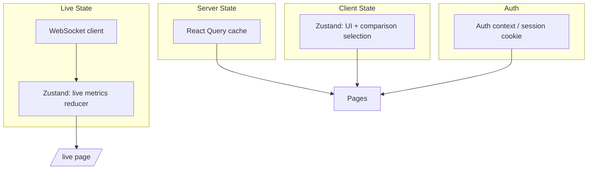
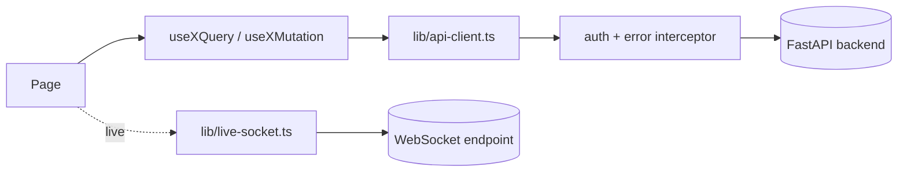

# 06. Frontend Specification — NTS Analysis Application

Stack: React + TypeScript + Next.js (App Router) + Tailwind CSS + Recharts (primary) / Plotly (only where Recharts cannot express the chart)

Audience for this document: frontend engineers implementing the app. It defines every page, the state/API/component architecture underneath them, and the language rules that keep the UI honest about what the underlying models can and cannot claim (see Section 25 of `docs/10_DATASETS_AND_FEATURES.md` and the scientific-limitation notes throughout this document).

---

## 1. Capability Coverage

| # | Capability | Where it lives |
|---|---|---|
| 1 | Authentication | `/login`, `/register` |
| 2 | Dashboard | `/dashboard` |
| 3 | Meeting creation | `/meetings/new` |
| 4 | Video upload | `/meetings/new` (upload step), `/meetings/[id]` |
| 5 | Processing progress | `/meetings/[id]/processing` |
| 6 | Live camera | `/live` |
| 7 | Participant analysis | `/meetings/[id]/participants`, `/meetings/[id]/participants/[participantId]` |
| 8 | NTS report | `/meetings/[id]/report` |
| 9 | Timeline | embedded in report + participant pages |
| 10 | Feature visualization | embedded in report + participant pages |
| 11 | Team comparison | `/meetings` (multi-select) + a comparison view |
| 12 | Settings | `/settings` |

---

## 2. Route Map

```
/login
/register
/dashboard
/meetings
/meetings/new
/meetings/[id]
/meetings/[id]/processing
/meetings/[id]/report
/meetings/[id]/participants
/meetings/[id]/participants/[participantId]
/live
/settings
```

```mermaid
flowchart LR
  Login[/login/] --> Dash[/dashboard/]
  Register[/register/] --> Dash
  Dash --> Meetings[/meetings/]
  Dash --> Live[/live/]
  Meetings --> New[/meetings/new/]
  New --> Detail[/meetings/[id]/]
  Detail --> Processing[/meetings/[id]/processing/]
  Processing --> Report[/meetings/[id]/report/]
  Report --> Participants[/meetings/[id]/participants/]
  Participants --> ParticipantDetail[/meetings/[id]/participants/[participantId]/]
  Dash --> Settings[/settings/]
```

---

## 3. Global Language Rule (applies to every page below)

The application never states a raw behavioral observation as a definitive psychological judgment. Every score, chart, or callout tied to a person uses one of these labels, rendered as a visible badge/tooltip, not just implied:

- **"Observed feature"** — a directly measured quantity (e.g., speaking time, gaze ratio).
- **"Derived metric"** — a computed combination of observed features (e.g., turn balance).
- **"Model estimate"** — the output of a trained or engineered scoring model (e.g., an NTS dimension, a leadership score).
- **"Confidence"** — always shown alongside a Model estimate; low-confidence estimates are visually de-emphasized (reduced opacity, a warning icon) rather than hidden.

Any UI copy that could be read as "this person is a leader" or "this person is disengaged" is disallowed. Approved phrasing patterns: *"Model estimate: Leadership — 0.62 (confidence: medium)"*, *"Observed: 41% of speaking time"*, never *"This person is the leader."*

---

## 4. Frontend State Architecture

- **Server state** (anything that comes from the API): managed with a query/cache layer (React Query/TanStack Query) — handles caching, refetch-on-focus, retries, and stale-while-revalidate for dashboard/report data. Every server-state hook exposes `{ data, isLoading, isError, error, refetch }`.
- **Client/UI state** (modals, form drafts, wizard step, selected participant tab): local component state or a small global store (Zustand) for cross-page UI state (e.g., "which meetings are selected for comparison").
- **Live/streaming state** (`/live`): a dedicated store (Zustand or a reducer) fed by the WebSocket client, separate from the query cache, because it updates at high frequency (per-frame/per-metric-tick) and must not trigger the query cache's revalidation machinery.
- **Auth state**: a session/auth context wrapping the app, backed by httpOnly cookies issued by the backend (see `docs/07_BACKEND.md`, `auth` module); the frontend never stores raw tokens in `localStorage`.



---

## 5. API Client Architecture

- A single typed API client module (`lib/api-client.ts`) wraps `fetch`, attaches credentials (`credentials: "include"`), centralizes base URL/env config, and exposes one function per backend endpoint group (`authApi`, `meetingsApi`, `mediaApi`, `jobsApi`, `participantsApi`, `reportsApi`, `settingsApi`).
- Every function returns a discriminated result (`{ ok: true, data } | { ok: false, error }`) rather than throwing, so pages can render error states without try/catch sprawl.
- Types are generated/kept in sync with backend Pydantic schemas (see `docs/07_BACKEND.md`) via a shared OpenAPI-derived type file, imported by both the API client and the components that render the data — this prevents field-name drift between frontend and backend (e.g., `nts_score` vs `ntsScore`).
- A single Axios/fetch interceptor handles: attaching CSRF token (if used), redirecting to `/login` on 401, and surfacing 5xx errors to a global toast/error boundary.
- WebSocket connections (`/live`) are managed by a small `lib/live-socket.ts` client with reconnect/backoff logic, separate from the REST API client.



---

## 6. Reusable Component Hierarchy

```
components/
  layout/
    AppShell            (sidebar + topbar + content slot; used by all authenticated pages)
    AuthLayout          (centered card layout; used by /login, /register)
    PageHeader          (title, breadcrumb, primary action button)
  data-display/
    StatCard            (single number + label + trend arrow — dashboard, report)
    NtsRadarChart        (Recharts radar — report)
    TimelineChart        (Recharts area/line with brush — participant, report)
    FeatureBarChart      (Recharts bar — participant)
    ParticipantCard      (avatar, name, mini NTS summary — dashboard, report)
    ConfidenceBadge      (renders the Section 3 language badges)
    DataQualityBadge     (renders extractor confidence / quality_flag from provenance, Section 20 of the datasets doc)
    EmptyState           (icon + message + primary action)
    ErrorState           (icon + message + retry action)
  forms/
    MeetingCreateForm
    VideoUploadDropzone
    SettingsForm
  feedback/
    Toast / ToastProvider
    ProgressBar          (processing page)
    Skeleton             (loading states, one variant per data-display component)
  live/
    CameraPreview        (video element + canvas overlay)
    PoseOverlayCanvas
    GazeIndicator
    ConnectionStatusPill
    FpsCounter
    ModelStatusPill
    RecordingIndicator
  privacy/
    PrivacyNotice
    ConsentToggle
    DataRetentionBadge
```

Each `data-display` component accepts `status: "loading" | "error" | "empty" | "ready"` and renders its own Skeleton/ErrorState/EmptyState internally, so pages compose them without repeating conditional rendering logic.

---

## 7. Accessibility Requirements

- All interactive elements reachable and operable via keyboard (tab order follows visual order; charts have an accessible data-table fallback via a "View as table" toggle).
- Color is never the only signal: NTS dimensions and confidence levels pair color with icons/text labels (relevant given emotion/engagement visualizations, where color-only encoding could also be misread as a diagnostic claim).
- WCAG 2.1 AA contrast minimums for all text and chart strokes.
- Live regions (`aria-live="polite"`) for processing-progress updates and live-mode connection-status changes, so status changes are announced without moving focus.
- Every chart has a text alternative (`aria-label` summarizing the trend, plus the "View as table" toggle from above).
- Form inputs have associated `<label>`s; validation errors are announced via `aria-describedby`.
- Focus is trapped correctly in modals (upload dialog, comparison picker) and returned to the triggering element on close.

---

## 8. Responsive Design

- Breakpoints: `sm` (mobile, <640px), `md` (tablet, 640–1024px), `lg` (desktop, >1024px), following Tailwind defaults.
- `AppShell` sidebar collapses to a bottom nav bar (mobile) / icon rail (tablet) / full sidebar (desktop).
- Dashboard stat cards: 1 column (mobile) → 2 columns (tablet) → 4 columns (desktop).
- NTS radar chart: full-width, fixed aspect ratio on mobile; side-by-side with participant list on desktop.
- Tables (participant lists, comparison view) collapse to stacked cards on mobile.
- Live camera view: full-width single column on mobile (metrics below video); two-column (video left, metrics right) on desktop.
- Per-page responsive notes are repeated in each page's section below where non-default.

---

## 9. Chart Specifications

| Chart | Library | Used on | Notes |
|---|---|---|---|
| NTS Radar | Recharts `RadarChart` | Report | 8 axes (Leadership, Communication, Teamwork, Influence, Engagement, Resilience, Confidence, Data Quality), 0–1 scale, overlay of participant vs. meeting average |
| Timeline (engagement/speaking) | Recharts `AreaChart`/`LineChart` with `Brush` | Participant, Report | Time on x-axis, one series per metric, brush for zoom, annotated turn-boundary markers |
| Feature bar chart | Recharts `BarChart` | Participant | Per-feature mean with error bar (std) as a thin whisker |
| Speaking-time donut | Recharts `PieChart` | Report | Share of total speaking time per participant |
| Team comparison grid | Recharts small-multiples (`RadarChart` per participant) or a Plotly parallel-coordinates plot if >6 participants | Team comparison view | Plotly used only when Recharts' small-multiples become illegible (>6 series) |
| Confidence/quality strip | Custom (styled div bars, not a chart) | Report, Participant | Simple segmented bar, not implemented as a chart component |

All charts read from typed selector functions (not inline data transforms in JSX) so the same transform is unit-testable and reusable between the report and participant pages.

---

## 10. Frontend Error Handling

- **Global error boundary** at the `AppShell` level catches render errors and shows a full-page `ErrorState` with a "Reload" action and an error reference ID (from the backend's error envelope, see `docs/07_BACKEND.md`).
- **Per-query error handling**: every data-fetching hook surfaces `isError`/`error`; the owning component renders its local `ErrorState` (not a full-page crash) so one failed widget doesn't take down the page.
- **Network/API error taxonomy** surfaced consistently: `401` → redirect to `/login`; `403` → inline "not authorized" state; `404` → `EmptyState` ("meeting not found"); `409` (e.g., duplicate upload) → inline form error; `5xx`/`timeout` → `ErrorState` with retry.
- **WebSocket errors** (`/live`): connection drop shows the `ConnectionStatusPill` in a "Reconnecting…" state with automatic backoff retry; a persistent failure after N retries shows an explicit `ErrorState` with a manual "Retry connection" button instead of retrying forever silently.
- **Upload errors** (oversized file, unsupported codec, network interruption): inline, field-level error in `VideoUploadDropzone`, with the specific reason surfaced from the backend's validation response, not a generic "upload failed."

---

## 11. Privacy UI

- `PrivacyNotice` component shown on `/meetings/new` before upload and at the start of `/live`, stating what is recorded, what is analyzed, and how long it is retained, sourced from the backend's `audit`/organization settings rather than hardcoded copy.
- `ConsentToggle` required before a live session can start recording; recording cannot begin until this is explicitly checked (no default-on).
- `DataRetentionBadge` on `/meetings/[id]` and `/settings` showing the org's configured retention window for raw media vs. derived features.
- `/settings` includes a "Data & Privacy" section: export my data, delete a meeting's raw media while retaining derived features (or vice versa), and a link to the org's data-processing policy.
- Recording state is always visually explicit: a persistent `RecordingIndicator` (red dot + "Recording") is shown any time media is being captured or uploaded, on both `/live` and the upload flow.

---

## 12. Page Definitions

### 12.1 `/login`

- **Layout**: `AuthLayout` — centered card, logo, form, link to `/register`.
- **Components**: `AuthLayout`, email/password fields, "Sign in" button, SSO button(s) if the org supports it, error banner.
- **API calls**: `authApi.login(email, password)`.
- **State**: local form state (email, password, submitting); on success, sets auth context and redirects to `/dashboard`.
- **Loading state**: button shows spinner + disabled during submit.
- **Error state**: inline banner ("Invalid email or password") without revealing which field was wrong; rate-limit errors show a distinct message ("Too many attempts, try again in N minutes").
- **Empty state**: N/A (form page).
- **Responsive behavior**: card is full-width with padding on mobile, fixed max-width (e.g., 400px) centered on desktop.

### 12.2 `/register`

- **Layout**: `AuthLayout`, same shell as `/login`.
- **Components**: name, email, password, confirm-password fields, organization name/invite-code field, terms checkbox, submit button.
- **API calls**: `authApi.register(payload)`.
- **State**: local form state + client-side validation (password strength, matching confirmation) before submit.
- **Loading state**: submit button spinner/disabled.
- **Error state**: field-level errors (e.g., "email already registered") mapped from backend validation response.
- **Empty state**: N/A.
- **Responsive behavior**: same as `/login`.

### 12.3 `/dashboard`

- **Layout**: `AppShell` with `PageHeader` ("Dashboard") and a responsive grid: stat row → recent meetings → latest reports.
- **Components**: `StatCard` × 4 (meetings analyzed, processing status summary, participant count, latest reports count), `ParticipantCard`/meeting list rows, `NtsRadarChart` mini-summary per latest report, `EmptyState`, `ErrorState`.
- **API calls**: `meetingsApi.listRecent()`, `meetingsApi.getSummaryStats()`, `reportsApi.listLatest()`.
- **State**: server state via query hooks (`useDashboardStats`, `useRecentMeetings`, `useLatestReports`); no significant client state beyond a date-range filter.
- **Loading state**: `Skeleton` variants for each `StatCard` and list row while queries are in flight; page renders progressively (stats first, then lists) rather than blocking on all three requests.
- **Error state**: each section (stats / recent meetings / latest reports) has its own `ErrorState` with retry, independent of the others.
- **Empty state**: first-run org sees an `EmptyState` ("No meetings analyzed yet") with a primary "Create your first meeting" button linking to `/meetings/new`.
- **Content specifics** (per requirements):
  - Meetings analyzed (count, with trend vs. previous period)
  - Processing status (counts of queued/processing/failed/complete, clickable to filter `/meetings`)
  - Participant count (unique participants seen across analyzed meetings)
  - Latest reports (list of most recent completed reports, linking to `/meetings/[id]/report`)
  - NTS summaries (compact radar or bar mini-charts per latest report)
- **Responsive behavior**: stat grid 1→2→4 columns; latest-reports list becomes a horizontal scroll carousel on mobile.

### 12.4 `/meetings`

- **Layout**: `AppShell`, `PageHeader` ("Meetings", primary action "New meeting" → `/meetings/new`), filter bar, table/list.
- **Components**: filter/search bar (status, date range, participant), meeting table (desktop) / card list (mobile), row-level status badge, multi-select checkboxes for **Team comparison**, `EmptyState`, `ErrorState`.
- **API calls**: `meetingsApi.list(filters, pagination)`.
- **State**: server state (`useMeetingsList(filters, page)`), client state for filters and the multi-select comparison set (Zustand, shared with the comparison view).
- **Loading state**: skeleton table rows; filter bar remains interactive during refetch (stale-while-revalidate).
- **Error state**: `ErrorState` replacing the table body, filters remain visible.
- **Empty state**: "No meetings match these filters" (with filters active) vs. "No meetings yet" (no filters, no data) — distinct copy for each case.
- **Team comparison**: selecting ≥2 meetings/participants surfaces a persistent bottom action bar ("Compare N selected") that opens a comparison view rendering `comparison_card_display`-style side-by-side NTS radars and a feature comparison table.
- **Responsive behavior**: table → stacked cards; comparison action bar becomes a full-width sticky footer on mobile.

### 12.5 `/meetings/new`

- **Layout**: `AppShell`, a wizard/stepper: (1) Meeting details → (2) Source selection (upload file / schedule live capture / connect to Zoom-Teams ingestion) → (3) Review & submit.
- **Components**: `MeetingCreateForm`, `VideoUploadDropzone`, participant-list input, `PrivacyNotice`, `ConsentToggle`, stepper navigation.
- **API calls**: `meetingsApi.create(payload)`, `mediaApi.uploadVideo(meetingId, file)` (chunked/resumable if large), `meetingsApi.scheduleLiveCapture(payload)`.
- **State**: multi-step form state (kept client-side until final submit, or persisted as a draft via `meetingsApi.createDraft` if the org wants resumable creation), upload progress state (percent, bytes, speed).
- **Loading state**: upload progress bar with percentage and cancel button; submit button disabled/spinner during final creation call.
- **Error state**: per-field validation errors on step 1; upload-specific errors (unsupported format, size limit, network failure) inline in `VideoUploadDropzone` with a retry button; submission failure shows a banner without discarding entered data.
- **Empty state**: N/A (form/wizard).
- **Responsive behavior**: stepper becomes a vertical accordion on mobile instead of a horizontal step bar.

### 12.6 `/meetings/[id]`

- **Layout**: `AppShell`, `PageHeader` (meeting title, status badge, actions: "View report," "View participants," "Reprocess"), overview panel, media preview.
- **Components**: meeting metadata card (date, duration, participant avatars), video/thumbnail preview, `ProgressBar` (if still processing, links to `/meetings/[id]/processing`), quick links to report/participants once complete.
- **API calls**: `meetingsApi.getById(id)`, `jobsApi.getStatus(meetingId)`.
- **State**: server state (`useMeeting(id)`, polled or WebSocket-driven while status is non-terminal).
- **Loading state**: skeleton metadata card + skeleton media preview.
- **Error state**: `ErrorState` ("Couldn't load this meeting") with retry; distinct 404 `EmptyState` if the meeting doesn't exist or isn't accessible to the user.
- **Empty state**: N/A once loaded (a meeting always has at least metadata).
- **Responsive behavior**: two-column (metadata left, preview right) on desktop collapses to a single stacked column on mobile.

### 12.7 `/meetings/[id]/processing`

- **Layout**: `AppShell`, centered progress panel.
- **Components**: `ProgressBar` (overall %), stage checklist (upload → media validation → CV extraction → audio processing → feature aggregation → scoring → report generation), live log/status text, cancel button (if cancellable).
- **API calls**: `jobsApi.getStatus(meetingId)` via polling and/or a WebSocket subscription (`jobsApi.subscribe(meetingId)`) for push updates; falls back to polling if WebSocket is unavailable.
- **State**: server/live state (`useJobStatus(meetingId)`), auto-redirect to `/meetings/[id]/report` when status becomes `complete`.
- **Loading state**: the page itself *is* a loading state; each stage shows pending/in-progress/done/failed.
- **Error state**: a failed stage is shown inline in the checklist with an error message and a "Retry processing" action; the page does not treat a stage failure as a fatal page-level error.
- **Empty state**: N/A.
- **Responsive behavior**: stage checklist remains vertical at all breakpoints; progress bar always full-width.

### 12.8 `/meetings/[id]/report`

- **Layout**: `AppShell`, `PageHeader` (meeting title, export/share actions), summary row, radar section, participant grid, dimension detail sections.
- **Components**: `NtsRadarChart` (meeting-level average + optional per-participant overlay toggle), `ParticipantCard` grid (each linking to `/meetings/[id]/participants/[participantId]`), per-dimension summary blocks, `ConfidenceBadge`/`DataQualityBadge`, `TimelineChart` (meeting-level engagement/participation over time), export button (PDF/CSV).
- **API calls**: `reportsApi.getByMeetingId(id)`.
- **State**: server state (`useReport(id)`); client state for the radar's participant-overlay toggle and dimension-expand/collapse.
- **Loading state**: skeleton radar + skeleton participant cards; report page shows a "Report is still generating" `EmptyState` variant with a link back to `/meetings/[id]/processing` if the report isn't ready yet rather than erroring.
- **Error state**: `ErrorState` with retry; if scoring failed but processing otherwise succeeded, show a specific message distinguishing "processing succeeded, scoring failed" from a generic failure.
- **Empty state**: no participants detected → explicit `EmptyState` with guidance (check camera framing / audio levels) rather than an empty radar chart.
- **Content specifics** (per requirements), every dimension rendered with the Section 3 language rule:
  - Overall NTS radar (meeting average, 8 axes)
  - Participant cards (avatar, name, mini radar or top-line scores)
  - Leadership — model estimate + confidence
  - Communication — model estimate + confidence
  - Teamwork — model estimate + confidence
  - Influence — model estimate + confidence
  - Engagement/Resilience — model estimate + confidence
  - Confidence (the NTS "confidence" dimension itself, distinct from the per-estimate confidence badges — labeled clearly to avoid ambiguity, e.g. "Confidence (estimated trait)" vs. "Estimate confidence")
  - Data quality — pipeline-health metric (extraction confidence, dropout/occlusion flags), explicitly framed as *about the recording*, not about the person
- **Responsive behavior**: radar + participant grid side-by-side on desktop; radar on top, participant grid below in a single column on mobile; dimension detail sections become an accordion on mobile.

### 12.9 `/meetings/[id]/participants`

- **Layout**: `AppShell`, `PageHeader` ("Participants"), grid/list of participant summary cards.
- **Components**: `ParticipantCard` (photo/avatar, name, speaking-time share, top NTS estimate, data-quality badge), sort/filter controls (by speaking time, by a chosen NTS dimension).
- **API calls**: `participantsApi.listByMeeting(meetingId)`.
- **State**: server state (`useParticipants(meetingId)`); client state for sort/filter selection.
- **Loading state**: skeleton card grid.
- **Error state**: `ErrorState` with retry.
- **Empty state**: "No participants detected in this meeting" with troubleshooting guidance (link to data-quality docs).
- **Responsive behavior**: grid 4→2→1 columns across desktop/tablet/mobile.

### 12.10 `/meetings/[id]/participants/[participantId]` (Participant analysis page)

- **Layout**: `AppShell`, `PageHeader` (participant name/avatar, back-to-participants link), tabbed or sectioned body: Overview, Pose & Movement, Gaze, Facial Affect, Speech & Turns, Timeline.
- **Components**: `FeatureBarChart` (pose/movement, gaze, facial), `TimelineChart` (engagement/speaking over time with turn markers), speaking-stats summary card, `ConfidenceBadge`/`DataQualityBadge` throughout.
- **API calls**: `participantsApi.getDetail(meetingId, participantId)`, `participantsApi.getTimeline(meetingId, participantId)`.
- **State**: server state (`useParticipantDetail`, `useParticipantTimeline`); client state for active tab and timeline zoom range (synced with `TimelineChart`'s brush).
- **Loading state**: skeletons per section, loaded progressively (overview first, timeline can lag slightly since it's the heaviest payload).
- **Error state**: per-section `ErrorState` (e.g., timeline fails to load independently of the overview stats).
- **Empty state**: a section with no extractable data (e.g., gaze unavailable due to camera angle) shows an explicit `EmptyState` in that section ("Gaze could not be reliably estimated for this participant — see data quality") rather than a blank chart.
- **Content specifics** (per requirements), all labeled per Section 3:
  - Pose/movement — Observed feature (torso lean, head orientation, motion energy)
  - Gaze — Observed feature (camera-gaze ratio, gaze switch rate) with a geometry caveat tooltip (matches `docs/10_DATASETS_AND_FEATURES.md` Section 11)
  - Facial affect — Observed feature (expression probabilities), explicit tooltip: "Facial expression probabilities, not a measurement of emotion or mental state."
  - Speaking time — Observed feature
  - Turn frequency — Derived metric
  - Response time — Observed feature
  - Interruptions — Derived metric
  - Engagement timeline — Model estimate (if a trained engagement sub-model is used) or Derived metric (if engineered), labeled accordingly per which is actually in production
  - Derived metrics — clearly grouped and separated visually from raw Observed features
- **Responsive behavior**: tabs become a horizontal scroll tab bar on mobile; charts stack single-column.

### 12.11 `/live`

- **Layout**: `AppShell` (minimal chrome) — two-column desktop (camera+overlay left, live metrics panel right), single column stacked on mobile.
- **Components**: `CameraPreview`, `PoseOverlayCanvas`, `GazeIndicator`, `ConnectionStatusPill`, `FpsCounter`, `ModelStatusPill`, `RecordingIndicator`, live metrics mini-cards (current speaking status, current engagement estimate), `ConsentToggle`, `PrivacyNotice`.
- **API calls**: initial `mediaApi.getLiveSessionToken()` / `meetingsApi.startLiveSession()` over REST; all streaming updates over WebSocket (`lib/live-socket.ts`) — no polling.
- **State**: `LiveStore` (Zustand) holding: connection status, current fps, model load status, latest per-participant metric snapshot, recording boolean. This store is updated directly by WebSocket message handlers, not by React Query.
- **Loading state**: camera/model initialization shows a `ModelStatusPill` progressing through "Loading models… → Starting camera… → Ready"; metrics panel shows skeletons until the first message arrives.
- **Error state**: camera-permission denial shows a specific `ErrorState` with instructions to grant permission; WebSocket disconnect shows `ConnectionStatusPill` = "Reconnecting…" with automatic retry, escalating to a manual "Retry connection" `ErrorState` after repeated failures (Section 10).
- **Empty state**: no person detected in frame → `EmptyState` overlay on the camera view ("No participant detected — check framing/lighting") instead of a blank metrics panel.
- **Content specifics** (per requirements):
  - Camera (live video element)
  - Participant detection (bounding box overlay)
  - Pose overlay (skeleton overlay via `PoseOverlayCanvas`)
  - Gaze indicator (direction arrow/marker via `GazeIndicator`)
  - Live metrics (current speaking/engagement mini-cards, updated per WebSocket tick)
  - Connection status (`ConnectionStatusPill`)
  - FPS (`FpsCounter`)
  - Model status (`ModelStatusPill`)
  - Recording status (`RecordingIndicator`, only active after explicit consent)
- **Responsive behavior**: overlay canvas scales with the video element via a responsive aspect-ratio wrapper; metrics panel moves below the camera view on mobile.

### 12.12 `/settings`

- **Layout**: `AppShell`, `PageHeader` ("Settings"), sectioned form (Profile, Organization, Notifications, Data & Privacy, API/Integrations).
- **Components**: `SettingsForm` sections, `DataRetentionBadge`, export/delete-data actions, integration connection cards (Zoom/Teams ingestion credentials, if applicable per `docs/07_BACKEND.md` `organizations`/`storage` modules).
- **API calls**: `settingsApi.getProfile()`, `settingsApi.updateProfile(payload)`, `settingsApi.getOrgSettings()`, `settingsApi.updateOrgSettings(payload)`, `settingsApi.exportData()`, `settingsApi.deleteData(scope)`.
- **State**: server state per section (`useProfile`, `useOrgSettings`); local form state per section with optimistic update + rollback on error.
- **Loading state**: skeleton form fields per section, loaded independently.
- **Error state**: inline field errors on save failure; a section-level `ErrorState` if the section fails to load at all.
- **Empty state**: N/A (settings always have defaults).
- **Responsive behavior**: section tabs become a vertical stacked list with accordions on mobile instead of a side tab rail.

---

## 13. Live Mode — WebSocket Contract (summary)

```yaml
# Client → Server
{ type: "start_session", meeting_id, consent: true }
{ type: "stop_session" }

# Server → Client
{ type: "model_status", stage: "loading_models" | "camera_ready" | "ready" }
{ type: "frame_metrics", participant_id, timestamp, pose, gaze, face, fps }
{ type: "audio_metrics", participant_id, speaking: bool, turn_event?: "start" | "end" }
{ type: "connection_status", status: "connected" | "reconnecting" | "degraded" }
{ type: "error", code, message }
```

The `LiveStore` reducer consumes these messages directly; REST/query-cache state is never mutated from WebSocket handlers, keeping the two state systems (Section 4) cleanly separated.

---

## 14. Team Comparison View (detail)

Reached from `/meetings` (multi-select) or from a "Compare" action on `/meetings/[id]/report`.

- **Layout**: side-by-side cards (2–4 teams/meetings) or a table for >4.
- **Components**: overlayed `NtsRadarChart` (one series per team/meeting), a metric-comparison table (Derived/Observed features side by side), each column tagged with its source meeting and data-quality badge.
- **API calls**: `reportsApi.compare(meetingIds[])`.
- **State**: the comparison selection lives in the shared Zustand store (Section 4) so it survives navigation from `/meetings` to the comparison view.
- **Loading/error/empty**: standard patterns per Section 10; empty state if fewer than 2 valid reports are selected ("Select at least two meetings to compare").
- **Responsive behavior**: side-by-side cards stack vertically on mobile; the comparison table becomes horizontally scrollable rather than collapsing to cards (comparison tables need aligned columns to remain meaningful).

---

## 15. Non-Goals / Explicit Constraints

- The frontend never renders a raw model score as a percentile "personality" ranking of a named employee without the confidence/estimate framing in Section 3.
- The frontend never auto-plays or auto-starts camera/microphone capture without the `ConsentToggle` being explicitly checked first.
- No client-side storage of raw video/audio; only derived feature/metric payloads are cached client-side (in the query cache), consistent with the privacy posture in Section 11.
