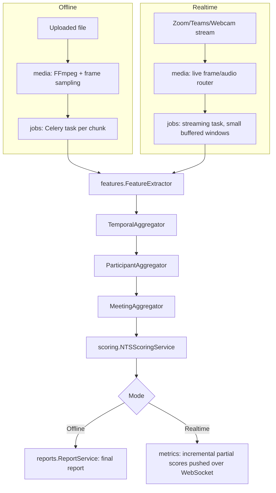

# 07. Backend Specification — NTS Analysis Application

Stack: Python + FastAPI + PostgreSQL + SQLAlchemy + Pydantic + Redis (cache/broker) + Celery (background jobs)

This document defines module boundaries, interfaces, and cross-cutting concerns. It intentionally specifies **interfaces before implementations**: every external dependency (the `Human` CV library, STT/diarization engines, object storage, the eventual LLM used for narrative generation) sits behind an adapter so the rest of the backend never imports a third-party SDK directly. See `docs/10_DATASETS_AND_FEATURES.md` for the feature/label semantics these services operate on.

---

## 1. Module Map & Responsibilities

```
backend/
  auth/            users/          organizations/   projects/
  meetings/        media/          jobs/            participants/
  features/        metrics/        scoring/         reports/
  datasets/        models/         experiments/     storage/
  notifications/   audit/
  core/            (config, DI container, logging, error types, shared base classes)
  adapters/        (HumanAdapter, STTAdapter, DiarizationAdapter, ObjectStorageAdapter, LLMAdapter)
```

| Module | Responsibility | Explicitly NOT responsible for |
|---|---|---|
| `auth` | Login/register, session/token issuance, password hashing, SSO if configured, RBAC checks | Business data access rules beyond identity (those live per-module) |
| `users` | User profile CRUD, org membership, roles | Auth mechanics |
| `organizations` | Org record, plan/limits, org-level settings (retention policy, feature flags) | Billing (out of scope unless separately specified) |
| `projects` | Optional grouping of meetings under a project/team | Meeting processing |
| `meetings` | Meeting entity lifecycle (create, list, get, delete), status, ownership/access | Media storage, CV/audio processing, scoring |
| `media` | Upload handling, validation, metadata extraction, FFmpeg processing, live-session media routing | Feature extraction (delegates to `features` via adapters) |
| `jobs` | Background job orchestration, status tracking, retries, idempotency keys | The actual CV/audio/scoring logic (calls into other modules' services) |
| `participants` | Participant entity (per meeting), identity linking across sessions where possible | Feature computation |
| `features` | Feature extraction orchestration (`FeatureExtractor`), temporal/participant/meeting aggregation | Model training, scoring |
| `metrics` | Read/query layer over stored feature records for the frontend (temporal queries, comparisons) | Feature computation itself |
| `scoring` | NTS scoring (`NTSScoringService`), model version resolution (`ModelRegistry`), prediction execution (`PredictionService`) | Report formatting/narrative |
| `reports` | Assembling a report payload from scores/features, narrative generation | Scoring logic |
| `datasets` | Dataset registry/metadata for training data (AMI, MPIIGroupInteraction, ELEA, NoXi, First Impressions V2), access-restriction bookkeeping | Model training itself |
| `models` | Model artifact registry (versions, training data provenance, metrics) — the persistence side of `ModelRegistry` | Serving predictions (that's `scoring`) |
| `experiments` | Training/evaluation run tracking (hyperparameters, dataset splits used, resulting metrics) | Production scoring |
| `storage` | Thin wrapper module around `ObjectStorageAdapter` for file lifecycle (raw media, thumbnails, exported reports) | Database persistence |
| `notifications` | Email/in-app notifications (job complete, job failed, report ready) | Job execution |
| `audit` | Immutable audit log of sensitive actions (data export, deletion, access to another org's data attempts) | Application logging (see Section 10; audit is a security record, not a debug log) |

---

## 2. Interfaces Before Implementations

Every module that talks to an external system exposes a `Protocol`/abstract base class defined in `adapters/`, and the concrete implementation is swapped via dependency injection (Section 6). No module outside `adapters/` imports `@vladmandic/human`-equivalents, a specific STT vendor SDK, a specific cloud storage SDK, or a specific LLM SDK directly.

```python
# adapters/human_adapter.py
from typing import Protocol, Any

class HumanAdapter(Protocol):
    """
    Adapter boundary around the `Human` CV library (vladmandic/human).
    Exact method names/signatures on the underlying library must be verified
    against the installed package version's TypeDoc/wiki before implementation
    (see docs/10_DATASETS_AND_FEATURES.md, Section 7.2). This Protocol defines
    the contract the REST of the backend depends on — it may wrap one or more
    underlying calls to achieve each method.
    """

    def detect_frame(self, frame: "VideoFrame", config: "HumanConfig") -> "FrameDetectionResult":
        """Run full detection (face/body/hand/gesture/emotion) on a single frame."""
        ...

    def process_video(self, source: "MediaSource", config: "HumanConfig") -> "VideoDetectionStream":
        """Run detection across a video source, yielding per-frame results."""
        ...

    def extract_pose(self, frame: "VideoFrame") -> "PoseResult":
        ...

    def extract_face(self, frame: "VideoFrame") -> "FaceResult":
        ...

    def extract_gaze(self, frame: "VideoFrame") -> "GazeResult":
        ...

    def extract_emotion(self, frame: "VideoFrame") -> "EmotionResult":
        ...

    def extract_hands(self, frame: "VideoFrame") -> "HandResult":
        ...
```

```python
# adapters/audio_adapters.py
from typing import Protocol

class STTAdapter(Protocol):
    def transcribe(self, audio: "AudioChunk", language_hint: str | None = None) -> "Transcript":
        ...

class DiarizationAdapter(Protocol):
    def diarize(self, audio: "AudioChunk") -> "SpeakerSegments":
        ...
```

```python
# adapters/storage_adapter.py
from typing import Protocol, BinaryIO

class ObjectStorageAdapter(Protocol):
    def put(self, key: str, data: BinaryIO, content_type: str) -> "StoredObjectRef":
        ...
    def get(self, key: str) -> BinaryIO:
        ...
    def delete(self, key: str) -> None:
        ...
    def signed_url(self, key: str, expires_in_seconds: int) -> str:
        ...
```

```python
# adapters/llm_adapter.py
from typing import Protocol

class LLMAdapter(Protocol):
    def generate_narrative(self, prompt_context: "ReportNarrativeContext") -> str:
        ...
```

Concrete implementations (`HumanJsBridgeAdapter`, `WhisperSTTAdapter`, `PyannoteDiarizationAdapter`, `S3StorageAdapter`, `AnthropicLLMAdapter`, etc.) live in `adapters/impl/` and are the only place a third-party client library is imported.

---

## 3. Media Processing (`media` module)

Pipeline for an uploaded file:

```
upload → validation → metadata extraction → FFmpeg processing → audio extraction
       → frame sampling → thumbnail generation → handoff to `jobs` for feature extraction
```

- **Upload**: chunked/resumable upload endpoint; writes to a temporary staging location via `ObjectStorageAdapter` before validation completes.
- **Validation**: container/codec allow-list check, duration/size limits (from org settings), corruption check (can FFmpeg probe it).
- **Metadata extraction**: `ffprobe`-derived duration, resolution, frame rate, audio sample rate/channel count, stored on the `Media` entity.
- **FFmpeg processing**: normalize container/codec if needed (e.g., transcode to a canonical format for downstream processing) — implemented as an isolated, retryable job step, not inline in the request/response cycle.
- **Audio extraction**: demux the audio track to a format the `STTAdapter`/`DiarizationAdapter` expect.
- **Frame sampling**: extract frames at a configured rate (independent of source frame rate) for CV processing, keeping the mapping from sampled-frame-index back to source timestamp explicit.
- **Thumbnail generation**: a small set of representative thumbnails for the `meetings`/`dashboard` UI.

Each step is its own idempotent job step (Section 8), so a failure at "frame sampling" does not require re-running "upload" or "validation."

---

## 4. CV Processing — `HumanAdapter` Usage

`features.FeatureExtractor` depends only on the `HumanAdapter` Protocol (Section 2), never on the underlying library. This is the boundary that makes it possible to:
- swap or upgrade the `Human` library version without touching `features`, `scoring`, or `reports`,
- run the identical extraction logic in both offline (`process_video`) and live (`detect_frame`, called per incoming frame) modes,
- unit-test `FeatureExtractor` against a fake `HumanAdapter` without loading any ML models.

```python
# features/extractor.py
class FeatureExtractor:
    def __init__(self, human: HumanAdapter, stt: STTAdapter, diarizer: DiarizationAdapter):
        self._human = human
        self._stt = stt
        self._diarizer = diarizer

    def extract_frame_features(self, frame: VideoFrame) -> FrameFeatures:
        pose = self._human.extract_pose(frame)
        face = self._human.extract_face(frame)
        gaze = self._human.extract_gaze(frame)
        emotion = self._human.extract_emotion(frame)
        hands = self._human.extract_hands(frame)
        return FrameFeatures.from_raw(pose, face, gaze, emotion, hands, provenance=self._provenance(frame))

    def extract_audio_features(self, audio_chunk: AudioChunk) -> AudioFeatures:
        segments = self._diarizer.diarize(audio_chunk)
        transcript = self._stt.transcribe(audio_chunk)
        return AudioFeatures.from_raw(segments, transcript)

    def _provenance(self, frame: VideoFrame) -> FeatureProvenance:
        ...  # populates source_dataset/source_media/participant_id/timestamp/feature_version/
            # extraction_model/confidence/quality_flag, per docs/10_DATASETS_AND_FEATURES.md Section 20
```

`TemporalAggregator`, `ParticipantAggregator`, and `MeetingAggregator` (Section 9 of the datasets doc) are separate, composable services that consume `FrameFeatures`/`AudioFeatures` streams and produce `ParticipantFeatures`/`MeetingFeatures` — they never call `HumanAdapter` directly.

```python
class TemporalAggregator:
    def aggregate(self, features: Iterable[FrameFeatures], windows: list[Window]) -> list[WindowedFeatures]:
        ...

class ParticipantAggregator:
    def aggregate(self, windowed: list[WindowedFeatures], participant_id: str) -> ParticipantFeatures:
        ...

class MeetingAggregator:
    def aggregate(self, participant_features: list[ParticipantFeatures]) -> MeetingFeatures:
        ...
```

---

## 5. Scoring

```python
class ModelRegistry:
    """Resolves which model version/artifact serves a given NTS dimension,
    and records which dataset(s)/labels/proxies each model version was trained on
    (docs/10_DATASETS_AND_FEATURES.md Section 25 requires this to be explicit)."""

    def get_active_model(self, dimension: str) -> ModelHandle:
        ...

    def get_model_metadata(self, model_handle: ModelHandle) -> ModelMetadata:
        # includes: training_datasets, label_type ("direct" | "proxy" | "engineered"),
        # version, evaluation_metrics, calibration_info
        ...


class PredictionService:
    def predict(self, model_handle: ModelHandle, feature_vector: ParticipantFeatureVector) -> Prediction:
        ...


class NTSScoringService:
    def __init__(self, registry: ModelRegistry, predictor: PredictionService):
        self._registry = registry
        self._predictor = predictor

    def score_participant(self, features: ParticipantFeatures) -> NTSParticipantScore:
        vector = self._to_feature_vector(features)
        dimensions = {}
        for dim in NTS_DIMENSIONS:
            handle = self._registry.get_active_model(dim)
            prediction = self._predictor.predict(handle, vector)
            metadata = self._registry.get_model_metadata(handle)
            dimensions[dim] = NTSDimensionScore(
                value=prediction.value,
                confidence=prediction.confidence,
                label_type=metadata.label_type,   # surfaced to the frontend, Section 3 of docs/06_FRONTEND.md
                model_version=metadata.version,
            )
        return NTSParticipantScore(dimensions=dimensions)
```

Each NTS dimension is scored by its own small model/service behind `ModelRegistry`, not one monolithic model — this is what lets leadership (ELEA-supervised), engagement (NoXi/MPIIGroupInteraction-supervised), and proxy/engineered dimensions (Section 25 of the datasets doc) evolve independently and be versioned independently.

---

## 6. Reports

```python
class ReportService:
    def build_report(self, meeting_id: str) -> Report:
        meeting_features = self._meeting_aggregator.get(meeting_id)
        participant_scores = [self._scoring.score_participant(p) for p in meeting_features.participants]
        narrative = self._narrative.generate(meeting_features, participant_scores)
        return Report(meeting_id=meeting_id, participant_scores=participant_scores, narrative=narrative)


class NarrativeService:
    def __init__(self, llm: LLMAdapter):
        self._llm = llm

    def generate(self, meeting_features: MeetingFeatures, scores: list[NTSParticipantScore]) -> str:
        context = ReportNarrativeContext.from_scores(meeting_features, scores)
        return self._llm.generate_narrative(context)
```

`NarrativeService` is a thin templating/prompting layer over `LLMAdapter`; it never invents scores itself — it only phrases already-computed `NTSParticipantScore` values in the "Observed/Derived/Model estimate/Confidence" language required by `docs/06_FRONTEND.md` Section 3, and must not upgrade a proxy/engineered score's phrasing to sound more certain than its `label_type` warrants.

---

## 7. Storage

```python
class StorageService:
    """Thin lifecycle wrapper used by `media` and `reports`; the only caller of ObjectStorageAdapter."""

    def __init__(self, adapter: ObjectStorageAdapter):
        self._adapter = adapter

    def store_raw_media(self, meeting_id: str, file: BinaryIO, content_type: str) -> StoredObjectRef:
        ...

    def store_export(self, report_id: str, file: BinaryIO, content_type: str) -> StoredObjectRef:
        ...

    def get_signed_url(self, ref: StoredObjectRef, expires_in_seconds: int = 3600) -> str:
        ...

    def delete_raw_media(self, ref: StoredObjectRef) -> None:
        """Used by the privacy/retention flow in docs/06_FRONTEND.md Section 11."""
        ...
```

---

## 8. Offline vs. Real-Time — One Pipeline, Two Entry Points

The backend must not duplicate the feature/scoring pipeline for offline video analysis vs. real-time analysis. Both modes share `FeatureExtractor`, the three aggregators, `NTSScoringService`, and `ReportService`; they differ only in how frames/audio chunks arrive and how aggressively partial results are flushed.



- **Offline**: a Celery chain processes the full media file, running `FeatureExtractor` over every sampled frame/audio chunk, then a single final aggregation + scoring + report-build pass.
- **Real-time**: `media` routes incoming frames/audio chunks (from the `WebcamMediaSource`/`ZoomMediaSource`/`TeamsMediaSource` abstractions defined in `docs/10_DATASETS_AND_FEATURES.md` Section 22) directly into the same `FeatureExtractor`, but the aggregators run in a rolling/incremental mode (maintaining running windows instead of processing a full timeline at once), and `NTSScoringService` is invoked on each flush interval, with results pushed to the frontend over the `/live` WebSocket contract (`docs/06_FRONTEND.md` Section 13) instead of being written into a final `Report`.

This is enforced structurally: `FeatureExtractor`, the aggregators, and `NTSScoringService` accept no parameter that means "offline" or "live" — mode-specific behavior (chunking, flush cadence, output sink) lives entirely in the `jobs` module's two entry points (`process_offline_meeting_task`, `stream_live_session_task`), not inside the shared services.

---

## 9. Dependency Injection & Configuration

- A lightweight DI container (constructor injection, wired at app-startup in `core/container.py`) binds each `Protocol` (Section 2) to its configured concrete implementation. Swapping `HumanAdapter`'s implementation, or pointing `STTAdapter` at a different vendor, is a container-wiring change, not a code change in `features`/`scoring`/`reports`.
- **Configuration**: a single `Settings` object (Pydantic `BaseSettings`), loaded from environment variables with per-environment overrides (`local`, `staging`, `production`), covering: database URL, Redis URL, object storage credentials/bucket, model artifact locations, feature flags (e.g., which STT vendor is active), org-level defaults (retention days), and rate limits.
- FastAPI's own dependency-injection (`Depends`) is used at the route layer to pull services out of the DI container per-request, keeping route handlers thin (parse request → call one service method → serialize response).

---

## 10. Background Jobs, Retries, Idempotency, Logging, Error Handling

**Background jobs (Celery):**
- Each pipeline stage (validate → extract metadata → transcode → sample frames → extract features → aggregate → score → build report) is its own task, chained via Celery `chain`/`chord` so partial failure is localized and retryable at the stage level, not the whole pipeline.
- Live-mode processing uses a lighter-weight streaming worker pattern (still Celery-managed, but short-lived per-chunk tasks) rather than one long-running task per session.

**Retries:**
- Every task defines a bounded retry policy (max attempts, exponential backoff) appropriate to its failure modes (e.g., transient storage/network errors retry; a corrupt-file validation failure does not retry).
- Retries are visible in `jobs` status records so `docs/06_FRONTEND.md`'s processing page can show "retrying (attempt 2/3)" rather than silently stalling.

**Idempotency:**
- Every task is keyed by a deterministic idempotency key (e.g., `meeting_id + stage_name + input_hash`), so re-running a stage (due to retry or manual re-trigger) does not double-write features or double-charge downstream aggregation.
- Upload endpoints accept a client-provided idempotency key to make retried upload requests safe.

**Logging:**
- Structured JSON logging (one logger config for the whole service), every log line carries `request_id`/`task_id`, `org_id`, `meeting_id` where applicable, so a single meeting's processing can be traced across services.
- `audit` module logs are separate from application logs: audit entries are immutable, written to an append-only store, and cover data export, data deletion, cross-org access attempts, and permission changes — not general debug information.

**Error handling:**
- A single error envelope shape returned by the API (`{ error: { code, message, request_id, details? } }`), so the frontend's error taxonomy (`docs/06_FRONTEND.md` Section 10) can branch on `code` rather than parsing message strings.
- Domain errors (e.g., `MediaValidationError`, `ModelNotAvailableError`) are distinct exception classes mapped to specific HTTP status codes and `code` values at the API boundary, never leaked as raw stack traces.

---

## 11. Tests

- **Unit tests**: every service (`FeatureExtractor`, the three aggregators, `NTSScoringService`, `ReportService`, `NarrativeService`, `StorageService`) tested against fake/mock adapters (fake `HumanAdapter`, fake `STTAdapter`, in-memory `ObjectStorageAdapter`) — no network, no real ML models, no real cloud storage in unit tests.
- **Contract tests**: for each adapter Protocol, a shared test suite runs against every concrete implementation (`HumanJsBridgeAdapter`, mocks, etc.) to guarantee they satisfy the same contract.
- **Integration tests**: a small number of end-to-end tests exercise the real pipeline (small sample video → real FFmpeg → real `Human`-backed adapter, if available in CI → real feature/aggregation/scoring path) against a disposable test database and test bucket.
- **Golden-data tests**: fixed sample AMI/NoXi clips (respecting each dataset's license — see `datasets` module below) with known extracted-feature expectations, to catch silent regressions in the extraction pipeline.
- **API tests**: FastAPI's test client exercises every route's happy path, validation-error path, and auth-failure path.
- **Frontend-contract tests**: schema tests asserting the API's Pydantic response models match the TypeScript types consumed by `docs/06_FRONTEND.md`'s API client, preventing field-name drift.

---

## 12. `datasets` Module

Tracks, per dataset (AMI, MPIIGroupInteraction, ELEA, NoXi, First Impressions V2): license/access-restriction metadata, which splits (train/val/test, per `docs/10_DATASETS_AND_FEATURES.md` Section 18) exist, and which labels are actually present (mirroring the "do not invent labels" comparison table). This registry is what `models`/`experiments` reference when recording what a given model version was trained/validated on, so `ModelRegistry.get_model_metadata()` can truthfully report `label_type` and `training_datasets` for every NTS dimension.

---

## 13. Explicit Model-Versioning Rule

Every prediction returned by `PredictionService` carries the exact `model_version` string that produced it (Section 5). `ModelRegistry` never silently swaps a production model version without incrementing this string, and `models`/`experiments` retain the mapping from a version string to its training-data provenance and evaluation metrics permanently, even after a newer version becomes active — this is what makes the `label_type`/confidence framing in `docs/06_FRONTEND.md` verifiable rather than asserted.
