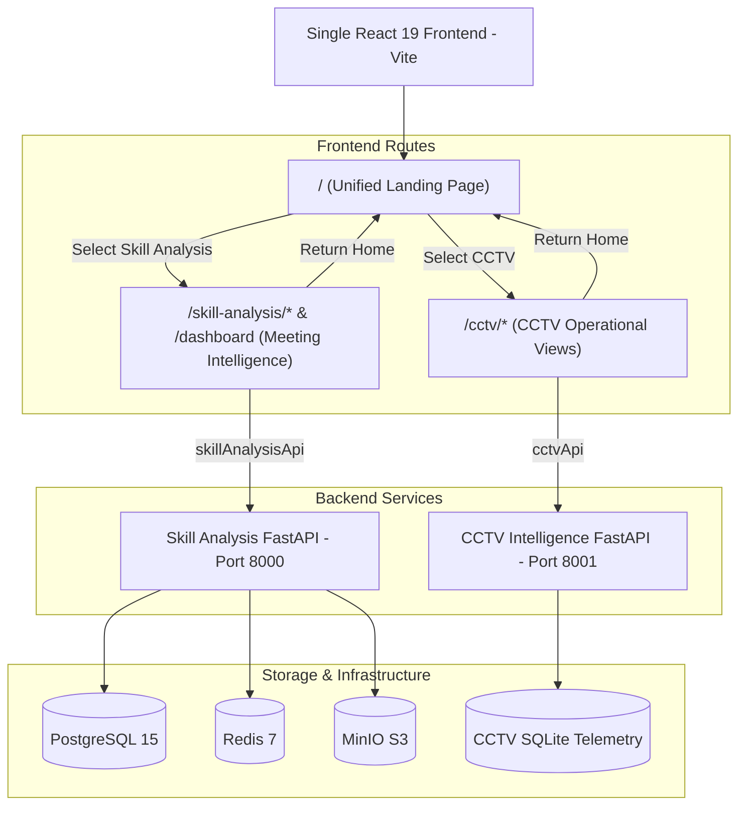

# Unified Application Architecture

**Document Version:** 1.0.0  
**Target Environment:** `c:\PJT`  
**Consolidated Frontend Path:** `c:\PJT\frontend`  

---

## 1. Architectural Principles

1. **One Unified Web Application:** A single React 19 + TypeScript + Vite frontend powers both analytical suites.
2. **Visual Design Authority:** The Skill Analysis project is the design system reference (light background `bg-gray-50`, `bg-white` cards with `border-gray-200`, deep blue `bg-blue-600` primary buttons, clean typography).
3. **Dedicated Entry Landing Page:** The root route (`/`) serves a landing page presenting two branches:
   - **CCTV Analytics** (`/cctv`)
   - **Skill Analysis** (`/skill-analysis` or `/dashboard`)
4. **Domain & Data Isolation:**
   - Skill Analysis: Relational meetings in PostgreSQL, media in MinIO, ARQ background tasks in Redis.
   - CCTV Analytics: Spatial tracking, zones, and scorecards in SQLite/Telemetry DB, video exports in local filesystem.
   - Zero blending of unrelated ML models or domain data models.
5. **Separate API Clients:**
   - `skillAnalysisApi.ts` (wrapped fetch with JWT auto-refresh on port 8000)
   - `cctvApi.ts` (Axios client with base URL targeting CCTV API on port 8001)

---

## 2. System Topology



---

## 3. Frontend Route Hierarchy

```
/
├── /                                  # Landing Page (Product Selection)
│
├── /cctv                              # CCTV Analytics Module (CctvLayout)
│   ├── /cctv                          # 01. Live Annotated CCTV (View01LiveCctv)
│   ├── /cctv/tracks                   # 02. Ephemeral Track Details (View02TrackDetails)
│   ├── /cctv/workflow                 # 03. Workflow Efficiency Scorecard A (View03WorkflowEfficiency)
│   ├── /cctv/activity                 # 04. Activity Distribution Scorecard B (View04ActivityDistribution)
│   ├── /cctv/occupancy                # 05. Occupancy & Presence Scorecard C (View05OccupancyPresence)
│   ├── /cctv/output                   # 06. Output Effectiveness Scorecard D (View06OutputEffectiveness)
│   ├── /cctv/team                     # 07. Team & Workspace Dynamics (View07TeamWorkspace)
│   ├── /cctv/historical               # 08. Historical Trend Comparison (View08HistoricalComparison)
│   ├── /cctv/export                   # 09. Video Export Controls (View09VideoExport)
│   ├── /cctv/diagnostics              # 10. Data Quality & Model Diagnostics (View10DataQuality)
│   └── /cctv/zones                    # Interactive Zone Editor (ZoneEditor)
│
└── Skill Analysis Module
    ├── /login                         # Login
    ├── /register                      # Registration
    └── (ProtectedLayout)
        ├── /dashboard                 # Meeting & Project Portfolio
        ├── /skill-analysis            # Redirects to /dashboard
        ├── /projects/:projectId       # Project Detail & Video Upload
        ├── /projects/:projectId/meetings/new # Meeting Initialization
        └── /meetings/:meetingId/analysis     # Multimodal Meeting Analysis Dashboard
```

---

## 4. Frontend Code Organization

```
c:/PJT/frontend/src/
├── app/
│   └── (App routing & providers)
├── components/
│   ├── common/                        # Shared UI components (CovenantBadge, MetricCard, ErrorBoundary)
│   ├── layout/                        # Shared layouts (Skill Analysis ProtectedLayout, CCTV Layout)
│   └── charts/                        # Shared charts (FeatureChart, ProsodyChart, Recharts, ECharts)
├── features/
│   ├── cctv/                          # CCTV module views, context, components, types
│   │   ├── context/AppContext.tsx
│   │   ├── pages/View01LiveCctv.tsx ... View10DataQuality.tsx, ZoneEditor.tsx
│   │   ├── components/
│   │   └── types/index.ts
│   └── skill-analysis/                # Skill analysis views, state, components
│       ├── routes/MeetingAnalysis.tsx, Dashboard.tsx, ProjectDetail.tsx ...
│       ├── components/
│       └── state/authStore.ts
├── routes/
│   └── LandingPage.tsx                # Flagship unified landing page
├── services/
│   ├── cctvApi.ts                     # CCTV API client targeting port 8001
│   └── skillAnalysisApi.ts            # Skill Analysis API client targeting port 8000
├── App.tsx                            # Root router
└── main.tsx                           # Root index
```

---

## 5. Development Proxy & Network Configuration

In `c:/PJT/frontend/vite.config.ts`:
- `/api/v1/auth`, `/api/v1/meetings`, `/api/v1/jobs`, `/api/v1/media`, `/api/v1/projects`, `/api/v1/users`, `/api/v1/scores`, `/api/v1/reports`, `/api/v1/visual-reports` $\to$ `http://127.0.0.1:8000` (Skill Analysis FastAPI)
- `/cctv-api/` (or `/api/v1/sessions`, `/api/v1/stream`, `/api/v1/telemetry`, `/api/v1/zones`, `/api/v1/analytics`, `/api/v1/export`, `/api/v1/upload`, `/health`, `/exports`) $\to$ `http://127.0.0.1:8001` (CCTV FastAPI)
